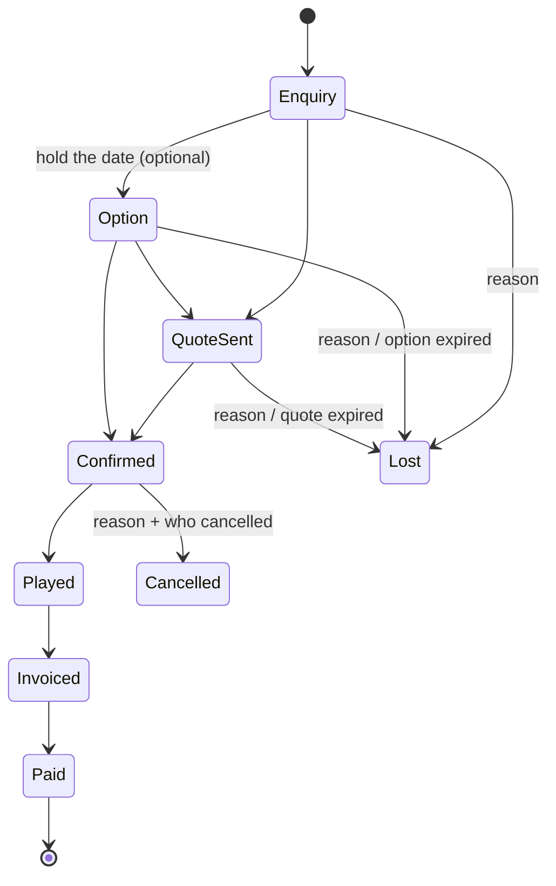
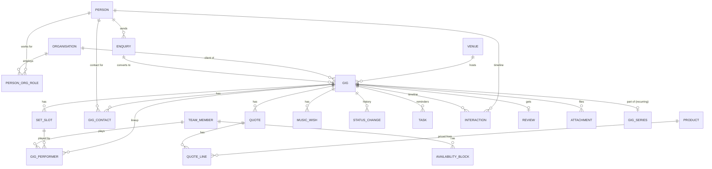

# Funqtion Bookings & CRM — Functional Plan

> App 1 of the Funqtion business suite. **FEEL THE MUSIQ.**
> Status: functional plan, no code yet. Owner: Gijs & Coen (Team Funqtion, Aarle-Rixtel).

This document describes *what* the app does and *how it fits* into the future Funqtion suite (invoicing, accounting, contracts, gear, gig-day planner, client portal, navigation). Section 9 lists the decisions we still need from you before building.

---

## Contents

1. [Core user flows](#1-core-user-flows)
2. [Data model](#2-data-model)
3. [Screens (mobile & desktop)](#3-screens)
4. [MVP vs. later](#4-mvp-vs-later)
5. [Tech stack, auth & backups](#5-tech-stack-auth--backups)
6. [Branding guidance](#6-branding-guidance)
7. [Integrations](#7-integrations)
8. [Privacy (GDPR/AVG) basics](#8-privacy-gdpravg-basics)
9. [Open questions](#9-open-questions)

---

## 1. Core user flows

### 1.0 The pipeline

Two "dead" end states, deliberately different:

| State | Meaning | Required info |
|---|---|---|
| **Lost** | Never became a booking (before *Confirmed*). | Reason: too expensive · went with another DJ · date not available (we declined) · no response · event didn't go ahead · not a fit · other (text). |
| **Cancelled** | Was a confirmed booking, then fell through. | Who cancelled (client / us), reason, cancellation fee due? (yes/no + amount — this feeds invoicing later). |

**Option** ("optie") is an optional stage: a provisional hold on a date with an expiry date. Common in the Dutch events world and important for conflict warnings. It can be skipped. (See open question Q3.)

Stage rules (the app enforces these gently — warning, not hard block, unless noted):

- **→ Quote sent** needs: date (or date range), event type, a quoted amount, and a "valid until" date.
- **→ Confirmed** needs: exact date + start/end times, venue, lineup (Gijs / Coen / both), agreed fee. Runs the conflict check; a *hard* conflict (same person, overlapping times, already confirmed) must be explicitly overridden with a note.
- **→ Played** only possible on/after the gig date.
- **→ Invoiced / Paid**: manual toggles in v1. Once the invoicing app exists, these become *read-only* and are driven by the invoice status (one source of truth).
- Every stage change is written to the gig's status history (who, when, from → to, reason).

### 1.1 Flow A — New enquiry comes in

1. **Capture** (≤ 30 seconds on a phone):
   - Tap the big **+** → "New enquiry".
   - Choose channel: phone · WhatsApp · email · Instagram DM · website form · in person · referral.
   - **Paste box**: paste the raw DM/email/WhatsApp text. It is stored verbatim as the original message (so nothing gets lost), and you fill only the essentials: name, contact detail, date (or "flexible / summer 2027"), event type, location (town is enough).
   - Website-form enquiries (v1.1) arrive already filled in, with status *New*.
2. **Instant availability check**: as soon as a date is entered, the app shows a banner: ✅ *free* · ⚠️ *option/enquiry exists on this date* · ⛔ *already booked (Gijs/Coen/both)* · 🟡 *someone has blocked this day (holiday, etc.)*. This lets you reply to a client within minutes.
3. **Match the client**: the app searches existing contacts/organisations by phone, email, Instagram handle and name and suggests "Is this the same person as *Jan de Vries (Kermis Comité Beek en Donk, 2 gigs)*?" → link, or create new.
4. **Assign an owner**: who handles this lead (Gijs or Coen). Default = whoever entered it.
5. **Automatic task**: "Reply to enquiry" due within 24h (if you didn't reply already — one tap "Replied ✓").
6. **Reply** using a template ("Thanks for your enquiry — the date is free!") sent via WhatsApp or email straight from the app (opens WhatsApp/mail with pre-filled text; the message is logged on the timeline).

> An **Enquiry** is the raw inbound request. It converts into one or more **Gigs** (e.g. "Can you do our Friday *and* Saturday at the kermis?" → two gigs, one client). Spam / not-a-fit enquiries can be closed without ever creating a gig.

### 1.2 Flow B — Qualify & quote

1. Open the gig (created from the enquiry) and fill in details: set times, venue, expected crowd, music wishes, lineup, what's included (sound, lights, extra hour…).
2. Enter the quote: package/lines, amount ex. VAT, VAT, total, valid until. In v1 you can attach your current quote PDF; in v1.1 the app generates a branded Funqtion quote PDF.
3. Mark **Quote sent** (date + channel recorded).
4. Automatic follow-ups:
   - Day 5 without response → task "Follow up on quote" + pre-written friendly nudge.
   - Day 12 → second nudge.
   - Quote expires → task "Mark as lost (no response) or extend?".
5. Client says yes → **Confirmed** (conflict check runs). Optionally: deposit requested / contract sent (later handled by the contracts and invoicing apps).

### 1.3 Flow C — From confirmed to the gig

Automatic, configurable reminder schedule per confirmed gig:

| When | Task / reminder |
|---|---|
| 6 weeks before | Send music-wishes request (later: client portal link). |
| 2 weeks before | Final check: times, address, load-in, contact person on the day, parking, power. |
| 1 week before | Gear check (later: gear app packing list). |
| Day before, 18:00 | Push/email to the playing member(s): tomorrow's summary. |
| Gig day | "Tonight" card on the home screen — works offline. Departure time (later: from navigation app). |

### 1.4 Flow D — After the gig

1. Next morning: prompt "Did *Bruiloft Lisa & Tom* go as planned?" → **Played** in one tap, plus optional quick notes (crowd, what worked, extra hours played → affects invoice!).
2. Same day/next day: task "Create invoice" (v1: manual / external; later: invoicing app button that pre-fills from the quote + extra hours).
3. Day 2–3: **review request** — template with links (Google review, Instagram tag @funqtionofficial). Review received → log it (rating, quote text, "may we publish?" yes/no).
4. **Invoiced** → **Paid** (manual in v1, automatic later).
5. **Recurring events** (kermis, carnival, company party, annual festival): ~9 months before the anniversary, task "Rebook *Kermis Aarle-Rixtel* for next year?". Repeat business is cheap business.

### 1.5 Supporting flows

- **Block availability**: Gijs or Coen marks a holiday/personal day → used by conflict warnings.
- **Log an interaction**: call, WhatsApp, meeting, note → appears on the client and gig timeline.
- **"What changed?"**: per gig/contact the History tab shows who changed what (e.g. *Coen changed start time 21:00 → 22:00, Tue 14:03*).
- **Find a client fast**: global search (name, place, phone, venue, Insta handle, gig reference).

---

## 2. Data model

### 2.1 Design principles (so the other apps can plug in)

1. **One Postgres database, one schema per app.** A shared `core` schema holds things every app needs (people, organisations, venues, team members, files, audit log). `bookings` holds gigs, enquiries, quotes, tasks. Future apps get `invoicing`, `contracts`, `gear`, `gigday`, `portal`, `accounting`. Apps may reference `core` and `bookings` tables; `core`/`bookings` never depend on later apps.
2. **The Gig is the hub.** Invoices, contracts, gear assignments, run-sheets, mileage trips and portal access all hang off `gig_id`.
3. **UUID primary keys** everywhere (safe for offline creation on a phone), plus a human reference for gigs: `FQ-2027-014`.
4. **Timestamps, not "date + time"**: `starts_at` / `ends_at` as `timestamptz`, displayed in Europe/Amsterdam. A set from 23:00 to 02:00 just works; a gig "on Saturday" that ends Sunday 02:00 does not break the calendar.
5. **Money in cents** (`integer`) + `vat_rate`, currency EUR. Quote lines use the same shape as future invoice lines.
6. **Soft delete** (`deleted_at`) + `created_at/by`, `updated_at/by` on every table; a generic **audit log** captures every insert/update/delete.
7. **Single source of truth per fact.** Example: "paid" belongs to invoicing once it exists; bookings only *displays* it.
8. **Domain events** table (`core.event`: `gig.confirmed`, `gig.played`, `gig.cancelled`…) so later apps can react without tight coupling (e.g. contracts app creates a draft contract on `gig.confirmed`).

### 2.2 Entity overview

### 2.3 `core` schema (shared by all Funqtion apps)

| Entity | Key fields | Notes |
|---|---|---|
| **team_member** | id, auth_user_id, display_name (Gijs/Coen), short code (G/C), colour, phone, email, active | Linked to login. Used for lineup, task owner, audit "who". |
| **person** | id, first_name, last_name, email, phone, whatsapp_phone, instagram_handle, preferred_language (nl/en), preferred_channel, how_found_us (source + detail, e.g. "referral: Kermis Beek en Donk"), notes, marketing_opt_in (+ date), retention_review_at, anonymised_at | A human. Bride, booker, festival chairman, venue manager. |
| **organisation** | id, name, type (company · venue · foundation/stichting · association/vereniging · municipality · agency · private), kvk_number, vat_number, billing_address, invoice_email, website, instagram, notes | Optional — private clients (e.g. a wedding couple) need no organisation. |
| **person_org_role** | person_id, organisation_id, role (organiser, booker, owner, finance, technician), is_primary, valid_from/to | People change committees and jobs; history is kept. |
| **venue** | id, name, street, postcode, city, country, lat, lng, organisation_id (owner, optional), load_in_notes, parking_notes, power_notes (e.g. "2× 230V on stage left"), house_sound (bool + notes), curfew, sound_limit_db, on_site_contact_person_id | Shared with navigation app (coordinates) and gig-day planner. Reused across gigs. |
| **address** | (embedded in venue/organisation as columns in v1) | Keep it simple. |
| **attachment** | id, entity_type, entity_id, file_path, file_name, mime, kind (quote_pdf, contract, rider, floor_plan, photo, other), uploaded_by | Polymorphic file link. Files in object storage. |
| **tag** / **entity_tag** | name, colour / entity_type, entity_id, tag_id | e.g. "VIP", "pays late", "repeat client". |
| **audit_log** | id, table_name, row_id, action (insert/update/delete), changed_fields (jsonb old→new), actor_team_member_id, actor_kind (user/system/form/portal), at | Filled by database triggers — no app can forget to log. |
| **event** (outbox) | id, type, entity_id, payload jsonb, created_at, processed_by[] | For loose coupling between apps. |

### 2.4 `bookings` schema

| Entity | Key fields | Notes |
|---|---|---|
| **enquiry** | id, received_at, channel, raw_message (verbatim text), person_id, organisation_id, requested_date / requested_date_text ("summer 2027"), event_type, location_text, guest_count_text, status (new · replied · converted · declined · spam), owner_id, first_response_at | Response-time stats come from `received_at` vs `first_response_at`. |
| **gig** | id, reference (FQ-YYYY-NNN), title ("Wedding Lisa & Tom"), enquiry_id, client_person_id, client_organisation_id, venue_id, event_type (wedding · village festival/kermis · carnival · club · private party · company · festival · other), indoor/outdoor, starts_at, ends_at, setup_from (load-in), teardown_until, expected_crowd, age_profile, dress_code, stage (status), status_changed_at, lost_reason, lost_reason_note, cancelled_by (client/us), cancellation_fee_cents, option_expires_at, owner_id (lead owner), lead_source (copied from person/enquiry), agreed_fee_cents, travel_fee_cents, deposit_cents, deposit_paid_at, series_id, notes_internal, notes_for_client | **The hub.** `starts_at/ends_at` = full booking window; actual playing time is in set slots. |
| **gig_performer** | gig_id, team_member_id, role (main, b2b, support), fee_share (later, for accounting) | Lineup: Gijs, Coen or both. Conflict detection uses this. |
| **set_slot** | id, gig_id, starts_at, ends_at, label ("ceremony", "dinner", "party", "afterparty"), room/stage, performer(s) via gig_performer or slot_performer, notes | Multiple sets per gig (e.g. wedding: drinks 16:00–17:30, party 21:00–01:00). |
| **gig_contact** | gig_id, person_id, role (booker, contact on the day, venue manager, technician, wedding planner) | "Who do we call at 22:00 when the power trips?" |
| **music_wish** | id, gig_id, kind (genre · must-play · do-not-play · first dance · special moment), text, spotify_url, requested_by_person_id, moment (optional, e.g. "after the cake") | Later the client fills these in via the portal. |
| **quote** | id, gig_id, version, status (draft · sent · accepted · declined · expired · superseded), sent_at, sent_via, valid_until, accepted_at, total_ex_vat_cents, vat_cents, total_cents, terms_text, pdf_attachment_id | Versioned: price changes create v2. |
| **quote_line** | id, quote_id, product_id, description, quantity, unit (hour, piece, km, flat), unit_price_cents, vat_rate, line_total_cents, sort | Same shape as future invoice lines → invoicing copies them 1:1. |
| **product** (catalogue) | id, name ("DJ set per hour", "Light package", "Extra hour", "Travel per km", "Wedding package"), default_price_cents, unit, vat_rate, active | Shared with invoicing — could live in `core` or a future `catalog` schema. |
| **status_change** | id, gig_id, from_stage, to_stage, reason, note, at, by | Pipeline history and conversion statistics. |
| **availability_block** | id, team_member_id, starts_at, ends_at, kind (holiday, personal, other job, hold), note | Personal unavailability for conflict warnings. |
| **task** | id, title, kind (reply_enquiry, follow_up_quote, music_wishes, final_check, mark_played, invoice, review_request, rebook, custom), due_at, assigned_to, gig_id, person_id, enquiry_id, status (open · done · snoozed · cancelled), snoozed_until, completed_at/by, rule_key (which automation created it — prevents duplicates) | Auto-generated by reminder rules; also manual. Auto-cancelled when no longer relevant (e.g. quote accepted → follow-up cancelled). |
| **reminder_rule** | key, trigger (stage/offset), offset, template_id, enabled, assignee (owner / performers / both) | Settings-driven, so you can tune "5 days" without code changes. |
| **interaction** | id, at, channel (call, whatsapp, email, instagram, meeting, note, website), direction (in/out), summary, body, person_id, gig_id, enquiry_id, by | The timeline. Templates sent from the app are logged automatically. |
| **message_template** | id, name, language, channel, subject, body with merge fields ({{first_name}}, {{gig_date}}, {{venue}}, {{quote_valid_until}}) | NL + EN versions. |
| **review** | id, gig_id, requested_at, platform (google, instagram, facebook, website, other), received_at, rating, text, may_publish (bool), publish_consent_at | Feeds your website testimonials (only with consent). |
| **gig_series** | id, name ("Kermis Aarle-Rixtel"), recurrence (yearly, typical month), client_organisation_id | Drives "rebook next year?" reminders and year-on-year history. |

### 2.5 How the future apps plug in

| Future app | Its own tables (examples) | Plugs into |
|---|---|---|
| **Invoicing** | invoice, invoice_line, payment | `gig_id`, `client_organisation_id/person_id`; copies `quote_line`s. Writes invoice status → bookings shows Invoiced/Paid. Cancellation fee from `gig.cancellation_fee_cents`. |
| **Accounting** | ledger entries, expenses, **mileage log (rittenregistratie)** | invoice + gig + navigation app trips per gig; `gig_performer.fee_share` for splitting income between Gijs/Coen. |
| **Contracts** | contract, contract_version, signature | `gig_id` + accepted `quote` version; reacts to `gig.confirmed`. Bookings can then require "contract signed" for *Confirmed* (setting). |
| **Gear** | gear_item, gear_kit, gear_assignment, maintenance | `gig_id`; packing list templates per `event_type`; `venue.power_notes/house_sound` decide what to bring. |
| **Gig-day planner** | run_sheet, run_sheet_item, checklist | `gig`, `set_slot`, `gig_contact`, `venue`, `music_wish`; departure time from navigation app. |
| **Client portal** | portal_access (token, person_id, gig_id, expires), portal_submission | Client sees own gig, quote, invoice; fills in `music_wish`, contact-on-the-day, timings. Everything written by the portal gets `actor_kind = portal` in the audit log. |
| **Navigation app** | trip (from, to, km, gig_id) | Reads `venue.lat/lng` and today's gigs; writes trips back for mileage and travel time. |

---

## 3. Screens

Navigation: **mobile** = bottom tab bar (Home · Pipeline · Calendar · Contacts · More) + a floating **+** (new enquiry / gig / note / block). **Desktop** = left sidebar with the same sections + global search (⌘K / Ctrl+K) at the top.

### 3.1 Home / "Today"

- **Mobile**: (1) *Tonight / next gig* card: name, time, venue, tap-to-navigate, tap-to-call contact on the day, lineup chip (G / C / G+C); (2) *My tasks today* (swipe right = done, swipe left = snooze); (3) *New enquiries* count with oldest waiting time ("2 unanswered — oldest 19h"); (4) next 7 days strip.
- **Desktop**: same content as a dashboard: tasks column, upcoming gigs list (next 30 days), pipeline summary (counts + € per stage), quotes awaiting response, small stats (this year: gigs, revenue booked, conversion rate).

### 3.2 Enquiry inbox & quick capture

- List of enquiries by status (New · Replied · Converted · Declined), with channel icon and age.
- **Quick capture sheet** (mobile-first): channel chips, paste box (raw text), name, phone/email/Insta, date (calendar picker + "flexible" option), event type chips, town. Live **availability banner** and **"existing client?" suggestion**. Buttons: *Save* · *Save & reply (template)* · *Create gig*.
- Desktop: two-pane layout — list left, enquiry + raw message right, with "convert to gig" form beside it.

### 3.3 Pipeline

- **Desktop**: kanban board — columns Enquiry · Option · Quote sent · Confirmed · Played · Invoiced · Paid; cards show date, title, town, fee, lineup chip, owner avatar, warning icons (conflict, overdue follow-up, option expiring). Drag a card to change stage (asks for reason when moving to Lost/Cancelled). Toggle to table view with filters (year, event type, owner, performer, source) and CSV export. Lost/Cancelled visible via a filter.
- **Mobile**: no kanban (too cramped) — stage selector as horizontal scrolling chips with counts, then a list of cards. Change stage from the gig detail with a big stage button.

### 3.4 Gig detail (the most important screen)

Header: title, reference, date, stage pill + "next step" button (e.g. *Mark quote sent*), lineup chips, warning banner (conflicts).

Sections (tabs on desktop, collapsible sections on mobile):

1. **Overview** — date, set times (set slots), event type, expected crowd, indoor/outdoor, owner, source, internal notes.
2. **Venue & logistics** — venue card (address, map preview, navigate button), load-in, parking, power, house sound, curfew/dB limit, contact on the day (tap to call/WhatsApp).
3. **Client** — client person/organisation cards, other gig contacts, previous gigs with this client.
4. **Music** — genres, must-play, do-not-play, special moments, Spotify links.
5. **Money** — quote versions (lines, totals, valid until, PDF), agreed fee, deposit, travel fee, cancellation fee; later: invoice status from invoicing app.
6. **Timeline** — interactions, messages sent, tasks done; add note/log call.
7. **Tasks** — open and completed tasks for this gig.
8. **History** — audit log ("Coen changed start time 21:00 → 22:00").
9. **Files** — quotes, contracts, riders, floor plans.

### 3.5 Calendar

- Views: month (default desktop), week, agenda/list (default mobile).
- Colour = stage (confirmed solid, option/enquiry dashed/outlined, cancelled hidden by default); chip = who plays (G / C / G+C, each member with their colour).
- Availability blocks shown as hatched bars per person.
- ⚠️ conflict badge on days with overlapping bookings; tapping opens a conflict panel listing the clashing items and why ("Coen: 21:00–01:00 Wedding Lisa & Tom overlaps 23:00–03:00 Club X; travel 45 min").
- Filters: Gijs / Coen / both; stages; event type.
- Tap an empty day → "new gig / block this day".

### 3.6 Contacts & organisations

- Searchable list with segment filters (private, company, festival committee, venue, has upcoming gig, repeat client, source).
- **Contact detail**: contact info with tap-to-call/WhatsApp/email/Instagram, organisations & roles, how they found us, gig history (stage, date, fee), total revenue, timeline, notes, tags, privacy panel (marketing opt-in, export, anonymise).
- **Organisation detail**: people, venues, gigs, billing info (KvK/BTW — ready for invoicing).
- **Venues** list as a sub-tab: address, map, logistics notes, gigs played there.

### 3.7 Tasks

- My tasks / Coen's tasks / all, grouped: overdue · today · this week · later. Snooze (1 day, 3 days, next week), reassign, done. Each task links to its gig/contact and offers its template ("Send follow-up").

### 3.8 Settings (desktop-first, works on mobile)

Team & accounts (2FA), reminder rules (timings on/off), message templates (NL/EN), products & prices, event types, lost/cancel reasons, lead sources, tags, calendar feed links, data export & backups, privacy (retention periods), branding (light/dark/auto).

### 3.9 Gig-day mode (offline)

A stripped-down, high-contrast, big-text view of today's gig(s): times, address + navigate, contact on the day (call), set slots, must-play / do-not-play, load-in & power notes, internal notes. Available without signal. Quick "add note" queued offline.

---

## 4. MVP vs. later

### MVP — v1.0 "Replace the spreadsheet + WhatsApp chaos" (~4–6 weeks of part-time building)

- Two accounts with 2FA; shared data; full audit log + per-gig History tab.
- Manual enquiry capture with raw-message paste box; enquiry → gig conversion.
- Contacts, organisations, venues; duplicate suggestions; how-found-us source.
- Gigs with all details: set slots, lineup, event type, crowd, music wishes, contacts, notes, files.
- Pipeline with all stages + Lost/Cancelled reasons + status history; kanban (desktop), list (mobile).
- Simple quote record (lines, totals, valid until, attach PDF).
- Calendar (month/week/agenda) with conflict warnings and availability blocks.
- Instant availability banner when entering a date.
- Tasks + automatic reminder rules (unanswered enquiry, quote follow-ups, quote/option expiry, pre-gig checks, mark played, invoice, review request) with an in-app task list and **daily email digest**.
- Message templates (NL/EN) → open WhatsApp/email pre-filled; logged on timeline.
- Read-only **ICS calendar feed** per member (subscribe in Google/Apple Calendar).
- Installable PWA; **offline read** of upcoming gigs (next 60 days) + gig-day mode; offline quick-capture of enquiries/notes (synced when back online).
- CSV import of existing clients and gigs (from your current spreadsheet/agenda).
- Nightly backups + full data export.
- Privacy basics: retention dates, export a contact's data, anonymise contact.

### v1.1 — quick wins after MVP

- **Website enquiry form** → creates enquiry, auto-reply email, push notification.
- **Web push notifications** (new enquiry, tomorrow's gig, overdue follow-up).
- **Branded quote PDF generator** from quote lines (with "accept quote" link later).
- Recurring events (gig series) + "rebook for next year?" reminders.
- Dashboard stats: conversion per source / event type, average fee, response time, season heat-map.
- Lead source tracking reports ("Instagram brought us 9 gigs, €7.400").

### v2 and beyond (mostly when the other apps arrive)

- Client portal: music wishes form, day-schedule, contact-on-the-day, view quote/invoice.
- **AI-assisted paste**: paste an Instagram DM/email and get name, date, location, event type pre-filled for review (Claude API; only what you paste, nothing automatic).
- Two-way Google Calendar sync (import personal "busy" blocks as availability).
- Invoicing/contracts/gear/gig-day apps taking over Invoiced/Paid, contract-signed gating, packing lists, run-sheets.
- Travel time from the navigation app in conflict checks and departure reminders.
- Review collection page; testimonials feed to website.
- Pricing calculator (hours × rate + travel km from navigation app + packages).
- Full offline editing of gigs with field-level conflict resolution.
- WhatsApp Business API / email inbox integration (only if volumes justify it).

---

## 5. Tech stack, auth & backups

### 5.1 Recommendation

| Layer | Choice | Why |
|---|---|---|
| Database + auth + storage + API | **Supabase** (Postgres), project in **EU region (Frankfurt)** | Real Postgres = the right foundation for one shared database across all future apps (schemas, foreign keys, triggers for the audit log, reporting/accounting queries). Auth, file storage, row-level security, scheduled jobs (pg_cron) and edge functions included. Free tier is plenty for two users. |
| Front end | **React + TypeScript + Vite**, installable **PWA**, Tailwind CSS with Funqtion design tokens | One codebase for phone and desktop; installs to the home screen on iOS/Android; no app-store fees. The design tokens package is reused by every Funqtion app (consistent look). |
| Offline | **IndexedDB (Dexie)** local cache + **outbox queue** for writes; service worker caches the app shell | Upcoming gigs + gig-day mode readable offline; quick-captures and notes queued and synced when online. With two users, last-write-wins per field + the audit log is enough. (Upgrade path: PowerSync on top of Supabase if full offline editing is ever needed.) |
| Hosting (front end) | **Cloudflare Pages** or Netlify (free) | Free, fast, HTTPS, deploy from GitHub on every push. |
| Email (digests, auto-replies) | **Brevo** (EU-based, free tier ~300 mails/day) or Resend | EU provider simplifies GDPR; tiny volumes. |
| Scheduled reminders | Supabase **pg_cron** → edge function every 15 min / daily 07:30 | Creates tasks from reminder rules, sends digest/push. |
| Bot protection (web form) | Cloudflare **Turnstile** + honeypot + rate limit | Free, cookie-less. |

**Cost**: €0/month to start (+ your domain). Plan to move to Supabase Pro (~$25/month) when invoicing/accounting go live, for daily managed backups, point-in-time recovery and no project pausing.

**Alternative** if you prefer one fixed, fully-owned server: **PocketBase** (single binary with SQLite, auth, realtime, admin UI and built-in S3 backups) on a **Hetzner** VPS in Germany/Finland (~€4–5/month). Simpler and very cheap, but you maintain the server yourself and SQLite is less ideal once many apps and accounting reports share it. My advice: Supabase.

**Caveats to know**:
- Supabase free projects pause after ~7 days without activity — the daily reminder job keeps it awake, but this is one reason to upgrade later.
- iOS PWAs: push works (iOS 16.4+, installed to home screen); background sync does not — the app syncs when opened. Fine for this use.

### 5.2 Authentication & access

- Exactly two accounts (Gijs, Coen); **public sign-up disabled**.
- Login: email + password **with TOTP 2FA** (authenticator app), or passkeys where supported. Long-lived sessions on your own phones so you're not logging in at a gig; biometric/PIN unlock via the phone's own lock screen.
- **Row-level security** in Postgres: only users with a `team_member` row can read/write. Later roles: `client` (portal — only own gigs via token), `accountant` (read-only finance), maybe `crew` (gig-day view only).
- Audit log via database triggers, capturing `auth.uid()` → team member, so "who changed what" is guaranteed for every app.
- Secrets (API keys) only in Supabase/edge-function config, never in the front end.

### 5.3 Backups (3-2-1 rule, on a budget)

1. **Nightly automated dump**: GitHub Action (free) runs `pg_dump` at 03:00, encrypts it (age/GPG), uploads to an EU object store (Backblaze B2 EU / Hetzner Storage Box / Google Drive). Keep 30 daily + 12 monthly.
2. **File storage** (PDFs, riders): weekly sync of the storage bucket to the same backup location.
3. **Export button** in the app: full JSON/CSV export of everything (also your GDPR "data portability" tool).
4. **Restore test** once a quarter (restore the dump into a scratch project and check counts). A backup you never restored is a hope, not a backup.
5. Later (Pro plan): managed daily backups + point-in-time recovery on top.

---

## 6. Branding guidance

Goal: it should feel unmistakably **Funqtion** — night, energy, "FEEL THE MUSIQ" — while staying fast and readable at 01:00 in a dark booth *and* at 14:00 in the sun at a village festival.

**Apply brand in the "moments", keep the workflow calm.**

| Where | How much brand |
|---|---|
| Login, splash, empty states, "gig confirmed" / "paid" celebration, PDFs (quotes), emails | **Full brand**: logo, display type, tagline "FEEL THE MUSIQ", subtle equalizer/waveform motif. |
| Navigation, headers, primary buttons | **Accent colour + logo mark**. |
| Forms, lists, tables, calendar | **Neutral**: high contrast, plain sans-serif, generous spacing. |

Practical rules:

1. **Design tokens, shared by all Funqtion apps** (colours, type, radius, spacing, shadows) in one small package, so invoicing/gear/etc. look like one family. I need your logo files and brand colours (Q14).
2. **Dark mode first, light mode equally solid.** Dark (near-black, not pure #000, with your accent) for nights at gigs; a high-contrast light theme for daytime and sunlight; "auto" follows the phone.
3. **One accent colour for actions only** (primary buttons, active tab). Don't use it for statuses, or everything starts shouting.
4. **Status colours are separate and always paired with a label/icon** (never colour alone): e.g. Enquiry = grey, Option = amber outline, Quote sent = blue, Confirmed = green, Played = purple, Invoiced = teal, Paid = solid green ✓, Lost/Cancelled = muted red strikethrough. Gijs and Coen each get their own (accessible) colour + initial chip.
5. **Typography**: a bold/condensed display face for headings and brand moments only; a highly legible sans (e.g. Inter) for all data, minimum 16px body on mobile, tabular numbers for money/times.
6. **Contrast** at least WCAG AA (4.5:1 for text), especially on dark backgrounds with neon-like accents — neon on black often fails for small text; use it for large elements only.
7. **Touch targets ≥ 44px**, one-handed reach for the main actions (bottom bar, FAB), because you'll often use it standing, holding a phone, maybe with headphones in your other hand.
8. **Tone of voice**: friendly, short, a bit of swagger in empty states and celebrations ("No gigs this weekend. Time to dig for records?" / "Booked! Let's feel the musiq."), but **neutral and precise** in warnings and errors ("Coen is already booked 21:00–01:00 at Wedding Lisa & Tom"). Keep the "Q" playfulness for the brand moments — don't respell UI labels.
9. **Motion**: a short equalizer-style loading animation and a small celebration on *Confirmed* / *Paid*; nothing that slows down workflows; respect "reduce motion".
10. **Client-facing output** (quote PDFs, emails, portal, ICS titles) is where the brand matters most commercially — invest polish there.

---

## 7. Integrations

| Integration | Recommendation | Phase |
|---|---|---|
| **Calendar** | Start with a **read-only ICS feed** per member (secret URL) subscribed in Google/Apple Calendar: confirmed gigs + options ("OPTIE –" prefix), minimal personal data in the event (title, venue, link to app — no client phone numbers). Later: two-way Google Calendar API to import your personal busy blocks as availability. Not recommended: writing client data into personal calendars. | v1 / v2 |
| **WhatsApp** | **Click-to-chat** links (`wa.me/<number>?text=...`) with pre-filled templates: free, no API, works with your normal WhatsApp/WhatsApp Business. App logs "message sent". WhatsApp Business Platform API (paid per conversation, Meta approval, template approvals) only if volume ever justifies it. | v1 |
| **Email** | v1: `mailto:` with templates + logging. Transactional mails (auto-reply to web form, daily digest) via Brevo/Resend from your own domain (set up SPF/DKIM/DMARC). Later: BCC/forwarding address that logs emails onto the timeline. | v1 / v1.1 |
| **Website form** | Small form on your site (date, event type, location, guests, name, contact, message, privacy notice) → edge function → enquiry + auto-reply + push. Turnstile against spam. | v1.1 |
| **Instagram** | Official DM API requires an Instagram professional account linked to a Facebook Page, a Meta app and app review — heavy for two users. Recommended: **paste-in** (with optional AI extraction later) + store `instagram_handle` on contacts so you can open the profile/DM from the app. Optional later: save posts/stories of gigs linked to the gig. | v1 (paste) / v2 |
| **Your navigation app** | (1) "Navigate" button deep-links to it with venue coordinates; (2) the nav app reads today's gigs from the shared database; (3) the nav app writes trips (km, duration, gig_id) back → mileage log for accounting + realistic travel time for conflict checks and "leave by 19:10" reminders. Tell me how it's built (Q16). | v1 (deep link) / v2 |
| **Google reviews** | Store your review link; review-request template includes it; log received reviews manually. | v1 |
| **Spotify** | Clients paste playlist links in music wishes; later possibly preview track names via Spotify API. | v2 |
| **Accounting/bank** (later apps) | e.g. bank CSV/PSD2 import to match payments → Paid. | Later |
| **AI (Claude API)** | Extract structured fields from pasted enquiries; draft replies in your tone. You always review before saving/sending. | v2 |

---

## 8. Privacy (GDPR/AVG) basics

*Practical summary, not legal advice. The Autoriteit Persoonsgegevens (AP) is the Dutch regulator.*

**What you store**: names, phone numbers, emails, Instagram handles, addresses of venues (and sometimes private homes for house parties), event details, notes, messages. No special-category data should be stored (health, religion, etc.) — keep notes factual and professional ("Father of the bride gives speech at 22:00", not personal health remarks).

**Lawful bases**

| Purpose | Basis |
|---|---|
| Handling an enquiry, quoting, performing a booking | Pre-contractual steps / contract (art. 6(1)(b)) |
| Quote follow-ups, review request after a gig, "rebook next year?" to business clients | Legitimate interest (6(1)(f)) — keep it limited, always offer an easy opt-out |
| Newsletter / promotional mailings | Consent (6(1)(a)) — separate opt-in, store date + source |
| Keeping invoice/administration records 7 years | Legal obligation (fiscale bewaarplicht, 6(1)(c)) |
| Publishing reviews/testimonials/photos with names | Consent — `may_publish` flag + date |

**To-do list**

1. **Privacy statement (privacyverklaring)** on your website (NL + EN): who you are (incl. KvK), what you collect, why, how long, which processors, rights, contact, right to complain at the AP. Link it from the web form, email footers and quote PDFs.
2. **Processor agreements (verwerkersovereenkomsten / DPAs)** with Supabase, hosting, email provider, backup storage. Most offer a standard DPA you accept online. Choose EU regions. Note: Supabase is a US company — data stays in Frankfurt, transfers are covered by their DPA/SCCs and the EU-US Data Privacy Framework; mention this in your privacy statement.
3. **Simple processing register** (one page: purposes, categories, retention, processors, security). Easy to keep and shows you take it seriously.
4. **Retention periods**, enforced by a monthly job that creates "review / anonymise" tasks:
   - Lost enquiries / never-booked contacts: anonymise after **12 months**.
   - Clients: keep relationship data **2–3 years after the last gig** (repeat bookings), then anonymise unless they opted in.
   - Invoice-related data (name, address, amounts): **7 years** (tax law) — anonymisation keeps these fields.
   - Raw pasted messages: delete after the enquiry is converted/closed + 12 months.
   - Audit log and backups: rotate (backups 12 months max) so deleted data really disappears over time.
5. **Data subject rights in the app**: export one contact's data (JSON/PDF), correct, anonymise/delete (scrubbing linked notes, raw messages and audit-log values). Respond within one month.
6. **Security**: 2FA, row-level security, encrypted backups, HTTPS, phone screen locks, log-out wipes the offline cache, offline cache limited to the next 60 days, no client data in the ICS feed beyond the minimum.
7. **Data breach procedure**: lost phone, leaked password → revoke sessions, rotate keys, assess; notify the AP within **72 hours** if there's a risk to people, and keep an internal breach log either way.
8. **Web form**: only ask what you need; show the privacy notice; no pre-ticked marketing box.
9. **Instagram/WhatsApp pastes** are personal data too — same retention rules apply.
10. **Client portal (later)**: tokenised links expire; clients only ever see their own data.

---

## 9. Open questions

Please answer these before building (short answers are fine):

**Business & process**
1. **Legal entity**: are you a VOF (partnership) or two eenmanszaken? Who is the contracting party on quotes/invoices? Affects client-facing documents and income splitting.
2. **VAT**: do you charge 21% BTW, or does the KOR (small business scheme) apply? Different rates per product?
3. **Options**: do you give clients provisional holds ("optie") on dates? If yes, default expiry (e.g. 7 or 14 days)?
4. **Quotes**: do you have a standard price list/packages (per hour, wedding package, lights, travel per km)? Can you share a current quote example?
5. **Deposits / contracts**: do you ask a deposit (aanbetaling) or signed agreement before a gig counts as *Confirmed*?
6. **Lineup**: when "both" play, is it always back-to-back, or sometimes two separate gigs on the same night (one each)? Do you ever hire other DJs/MCs/lights crew we should track?
7. **Conflict rules**: what buffer around a gig should count as "busy" (setup, travel)? Is the same person playing two gigs in one night ever OK (e.g. 18:00 reception + 23:00 club)?
8. **Lead ownership**: does one of you handle all enquiries, or whoever picks up? Should tasks go to the lead owner or to both?
9. **Reminder timings**: are 24h reply / day 5 & 12 quote follow-ups / 6-week music wishes / 2-day review request sensible for you?
10. **Volume**: roughly how many enquiries and gigs per year? Peak season months?

**Data & migration**
11. **Current tools**: where is your data now (Excel/Google Sheets, Google Calendar, WhatsApp, a booking platform)? Can you export it?
12. **History**: how far back do you want to import past gigs?

**Language & devices**
13. **Language**: app UI in Dutch or English? Client templates in both?
14. **Branding assets**: logo files (SVG), brand colours, fonts, any existing style guide or Canva brand kit?
15. **Devices**: iPhone or Android for each of you? Desktop: Mac/Windows/browser?

**Technical & integrations**
16. **Navigation app**: how is it built (platform, framework, database, does it support deep links/URL schemes)? Should it move onto the shared database?
17. **Website**: what is your site built on (WordPress, Wix, custom…)? Determines how we embed the enquiry form.
18. **Calendars**: Google or Apple Calendar? Do you want personal busy times imported later?
19. **Email**: do you have email on your own domain (e.g. boekingen@…)? Which provider?
20. **Hosting preference**: OK with Supabase (managed, EU) + free hosting, or do you prefer the self-hosted PocketBase/Hetzner route? Who maintains it — do you code yourself, or should everything be as low-maintenance as possible?
21. **Budget**: is ~€0 now and ~€25–30/month later (when accounting/invoicing go live) acceptable?

**Privacy**
22. Do you already have a privacy statement on your website and a marketing/newsletter list?
23. Do you store home addresses of private clients (house parties)? Any other sensitive cases (minors at school parties, etc.)?
