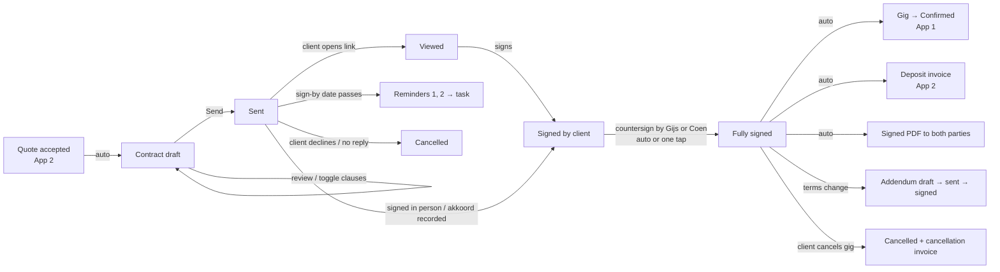
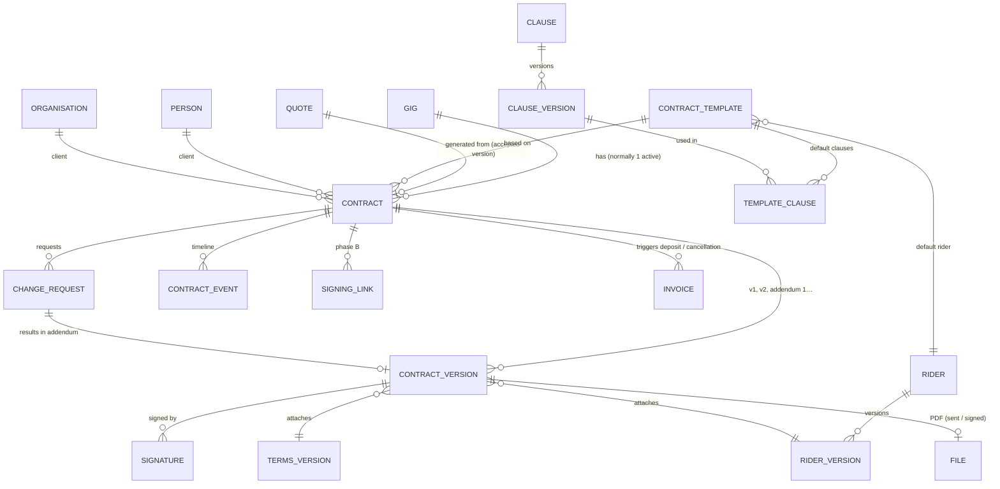

# Funqtion Contracts — Functional Plan

> App 4 of the Funqtion suite. **FEEL THE MUSIQ.**
> Status: functional plan, no code yet. Builds on App 1 (Bookings & CRM), App 2 (Quotes & Invoices) and App 3 (Money & Accounting), all live in this repo in local mode.
> **Decisions made (v0.4.0 build)**: these replace the matching recommendations below.
> - **Local mode first (phase A):** no server. The client signs on our phone/tablet (`/contracts/:id/sign`), replies "akkoord" (recorded with a screenshot as evidence), or returns a signed PDF. The online signing relay (phase B) is not built yet.
> - **Quote + contract per event type** (template setting `flow`): *together* (wedding, private party: quote and contract go out at once, one "akkoord" covers both and confirms the gig), *after quote* (company, village festival: quote acceptance holds the date, the signature confirms), *none* (club night: quote acceptance is enough). Editable in Contracts → Library.
> - **Cancellation:** a softer consumer scale (>6 months 10%, 3–6 months 25%, 1–3 months 50%, 2–4 weeks 75%, <14 days 100%); the existing scale stays for business clients. Terms bumped to version 2026-12 (art. 3.2 and 8.2).
> - **Countersigning is automatic** by whoever records the signature (their signature is drawn once in Contracts → Settings).
> - **Photo/video:** allowed by default, the client can opt out when signing.
> - Not built yet: the signing relay, automatic e-mail, "viewed" tracking, a merged "current text" view, RFC 3161 timestamps and PAdES seals, supplementary deposit invoices after a price increase.
>
> The legal points are a practical summary for a small Dutch DJ duo, **not legal advice**. Items marked ⚖️ should be checked by a lawyer (or compared with a branch model) before you rely on them. The clause texts in §4 are drafts in the same status as [`docs/legal/ALGEMENE-VOORWAARDEN.md`](../legal/ALGEMENE-VOORWAARDEN.md).

## Contents

0. [Read this first: three decisions that shape this app](#0-read-this-first-three-decisions-that-shape-this-app)
1. [Core user flows](#1-core-user-flows)
2. [Data model](#2-data-model)
3. [Dutch legal points](#3-dutch-legal-points)
4. [Standard clauses (NL + EN)](#4-standard-clauses-nl--en)
5. [Screens](#5-screens)
6. [MVP vs. later](#6-mvp-vs-later)
7. [E-signature options](#7-e-signature-options)
8. [Tech stack, PDF and tamper-evident storage](#8-tech-stack-pdf-and-tamper-evident-storage)
9. [Branding](#9-branding)
10. [Privacy and record keeping](#10-privacy-and-record-keeping)
11. [Open questions](#11-open-questions)

---

## 0. Read this first: three decisions that shape this app

**0.1 "Client signs on their phone" needs something online.** Apps 1–3 run entirely on your devices with no server (see `docs/HANDOFF.md`). A client can only open a signing link at 23:00 while your phone is off if a small public service holds that link. So App 4 is the natural moment to add the first online piece. This plan works in two phases:

| Phase | How the client signs | What's online |
|---|---|---|
| **A. Local (MVP, no server)** | (1) **On your device**, face to face (tablet/phone handed over at the intake meeting), or (2) by **replying "akkoord"** to the contract PDF via e-mail/WhatsApp, recorded in the app with evidence (the same way App 2 records quote acceptance today), or (3) returning a **signed PDF** (printed or signed in their own PDF app). | Nothing. |
| **B. Signing relay (v4.1)** | A personal link `…/c/<token>` opens a mobile signing page. The client reads it, ticks the consents, types their name and draws a signature. An e-mail code proves they own the address. Both parties then get the signed PDF automatically. | One small "relay" (§8.2) that only holds **pending** contracts and deletes them once your app has pulled the signature in. The same relay can later serve App 2's online quote acceptance and "viewed" tracking. |

**0.2 One "moment of truth": when is the gig legally booked?** Your current terms (art. 3.2) say the agreement exists as soon as the client accepts the **quote** (or pays the deposit). If the contract signature is *also* the moment of truth, you get a grey zone: is the gig booked when they say "yes" to the quote but never sign?

My recommendation:

- **Quote acceptance = date held and agreement in principle.** The gig shows *Akkoord – contract uit* (still at stage `quote_sent`) and keeps a hold on the date for a set number of days (default 7, the "sign-by" date).
- **Contract signature = booked.** The gig becomes *Confirmed* and the deposit invoice is created.
- **Small gigs without a contract** (e.g. a regular club night) keep working as now: accepting the quote confirms the gig. This is a per-template setting, `contractRequired`.
- Change terms art. 3.2 to: *"De overeenkomst komt tot stand door ondertekening van de gig-overeenkomst. Wordt er geen gig-overeenkomst gestuurd, dan komt de overeenkomst tot stand door schriftelijke acceptatie van de offerte of betaling van de aanbetaling."* (Q1)

**0.3 The contract is a short document *on top of* your general terms, not a replacement.** Contract = the specifics of this gig (who, when, where, what, price) + the clauses you switched on for this gig + the rider. The **algemene voorwaarden** stay the general rulebook and are attached as an annex. This keeps the contract readable (2–4 pages) and the terms in one place. An order-of-precedence clause decides conflicts (§4, clause K1).

---

## 1. Core user flows

### 1.0 Lifecycle overview

Statuses: `draft`, `sent`, `viewed` (phase B only), `signed` (both parties), `cancelled`. Two helper states are shown as badges, not separate statuses: *awaiting countersignature* (client signed, we haven't yet) and *expired* (sign-by date passed while still `sent`/`viewed`).

### 1.1 Flow A: accepted quote → contract → signed → deposit invoice

1. **Trigger.** In App 2 you record *Akkoord ontvangen* (phase A) or the client accepts online (phase B). If the gig's template has `contractRequired = true`:
   - the gig stays at `quote_sent` with the badge *Akkoord – contract uit*
   - the date hold runs until `signBy` (default 7 days, never later than 2 days before the gig)
   - a **contract draft** is generated immediately. You get a notification: *"Contract klaar voor controle – Bruiloft Lisa & Tom"*.
2. **Generation (automatic).** The app picks the template by `gig.eventType` and fills in:
   - **Parties:** the client snapshot from the accepted quote (name, address, e-mail, phone, KvK if business) and Team Funqtion's details from Settings (trade name, legal names, address, KvK if registered). The IBAN is not needed in the contract.
   - **Event:** title, date, venue name and address, set slots (start–end, who plays), build-up time, indoor/outdoor, expected crowd.
   - **Price:** the accepted lines (incl. the extras the client chose), total, VAT note per business mode, **deposit amount and due date**, balance and when it is invoiced, travel costs, the overtime rate per half hour.
   - **Included services:** generated from the quote lines (e.g. "DJ-set 4 uur", "Geluidsset tot 150 personen", "Lichtset", "Rookmachine").
   - **Clauses:** the template's default set, filtered by client kind (consumer/business) and context (outdoor → cover/weather clause on; `setupRequired` → build-up clause on; venue `soundLimitDb` → filled into the noise clause).
   - **Rider:** the current technical + hospitality rider for that event type, with venue-specific notes (power, load-in, parking from the venue record).
   - **General terms:** the version that was attached to the accepted quote (normally the current one).
   - **Cancellation table:** from `Settings.cancellationScale`, rendered as a table with **real dates** ("t/m 14 maart 2027: 25%") instead of "90 days before".
3. **Review (you, 1–2 minutes).** The editor shows the contract as the client will see it, plus a side panel:
   - optional clauses as switches
   - free-text "special agreements" (*bijzondere afspraken*)
   - warnings, e.g.: *"Buitenevenement maar geen overkappingsclausule"*, *"Consument: aansprakelijkheidsclausule B2B-variant staat aan"*, *"Geluidslimiet locatie onbekend"*, *"Set eindigt na 01:00 – vergunning?"*
4. **Send.** *Verstuur* freezes a **version** (`v1`): text + clause snapshot + variables + terms + rider → canonical JSON → SHA-256. The PDF is rendered from that version. Sending:
   - phase A: share sheet / e-mail / WhatsApp with the PDF and a fixed message template (*"Hoi Lisa, hierbij de overeenkomst voor 14 juni. Lees hem rustig door; als alles klopt, stuur dan 'akkoord' terug of teken hieronder…"*)
   - phase B: e-mail (and optionally WhatsApp) with the personal link, plus the PDF as attachment
5. **Client signs.**
   - Phase A, in person: the client reads on your device, ticks the consents, types their name and draws a signature. Your device records the time, device and document hash.
   - Phase A, remote: the client replies "akkoord". You press *Akkoord vastleggen*, choose the channel, paste or screenshot the message (stored as evidence), and the app stores the hash of the version they received.
   - Phase B: see §5.8 for the signing page. The relay records the e-mail code check, time, IP, browser, document hash, consents and signature.
6. **Countersign.** Setting `autoCountersign` (default **on**): the app adds Funqtion's signature (the signature image of the member who sent it, stored on the device) at the moment it records the client signature. With it off, you get a task *"Contract tekenen – Lisa & Tom"* and sign with one tap.
7. **Fully signed (automatic):**
   - contract → `signed`, the signed PDF is generated with a signature certificate page (§8.4) and archived with its hash
   - **App 1:** the gig → `confirmed`, the conflict check runs (a hard conflict blocks confirmation and alerts you), `contractSignedAt` is set, the date hold is cleared
   - **App 2:** a **deposit invoice** draft is created (amount and due date from the contract). Setting `autoSendDeposit`: *off* = task "Aanbetalingsfactuur versturen" (default in phase A), *on* = finalise + send (phase B, once the server assigns numbers)
   - **Both parties** get the signed PDF: phase A via share sheet/e-mail draft with one tap, phase B automatically by e-mail
   - **Timeline:** event `signed` on the contract and the gig, logged in the audit log
8. **Reminders (unsigned).** These run on the existing reminder engine as tasks/messages:
   - `contract_r1`: 3 days after sending, friendly (*"Heb je de overeenkomst al kunnen bekijken?"*)
   - `contract_r2`: 1 day before `signBy`, clear (*"De datum houden we vast tot morgen"*)
   - `contract_expired` on `signBy`: a task for you, not an automatic message. Extend the date, call the client, or cancel the contract and release the date.
   - Phase A: reminders appear as tasks with a ready-made WhatsApp/e-mail text. Phase B: they are sent automatically, and stop as soon as the contract is viewed+signed or paused per contract.

### 1.2 Flow B: change request → addendum

Changes **before** signing: just edit the draft, or, if it was already sent, *Wijzig* creates `v2`. The old link shows "Er is een nieuwe versie" and the old version becomes `superseded`. No addendum needed.

Changes **after** signing:

1. **Request.** You or the client want a change: a longer set, extra light, a different start time, a different venue, a new date.
2. **Change request (log).** *Wijziging* on the contract opens a form: what changes (fields picked from the gig: date, times, venue, lines/price, clauses, rider), who asked, and the reason. The app **diffs** old vs. new and shows exactly what changes and what it costs (e.g. "+1 uur DJ-set: +€150; nieuw totaal €1.350; aanbetaling blijft €600").
3. **Minor vs. material.**
   - *Minor* (no price, date or liability change, e.g. a 15-minute shift in set time agreed by WhatsApp): log it as a **note on the contract** with the evidence (screenshot). No signature needed, but it's shown in the version history.
   - *Material* (price, date, venue, duration, clauses): an **addendum** is created.
4. **Addendum.** A short document: *"Addendum 1 bij overeenkomst FQ-2027-014 v1"*, listing only the changed articles in "oud → nieuw" form, plus "Alle overige bepalingen blijven ongewijzigd". It gets its own hash and **references the hash of the signed parent version** (that's the version chain, §8.4). It is sent and signed exactly like the contract (same statuses and reminders).
5. **After signing the addendum:**
   - the gig fields are updated (times, venue, `agreedFee`)
   - App 2: a quote revision is recorded for the history. If the price went **up**, the extra is included in the final invoice (or, if the deposit percentage must still apply, a supplementary deposit invoice: setting). If it went **down** and the deposit already exceeds 50% of the new total, it simply stays as deposit and is deducted from the final invoice.
   - the **consolidated view** ("geldende tekst") shows contract + addenda merged. The signed PDFs stay untouched.
6. **Date change = postponement.** This uses the terms' art. 8.4 (new date within 12 months, not a cancellation). The addendum template "Verplaatsing" fills in the old and new date and the deposit transfer.
7. **Cancellation.** *Annuleren* on a signed contract asks: by whom (client / us / force majeure), the date of receipt, and the evidence. The app calculates the fee from the frozen cancellation table of the *signed* version, shows it, and on confirmation:
   - contract → `cancelled`
   - App 1 gig → `cancelled` with `cancelledBy` and `cancellationFee`
   - App 2: the cancellation invoice / credit note flow (already built) gets the amount
   - optional: a short **cancellation confirmation** PDF to the client

### 1.3 Supporting flows

- **Client's own contract** (club, agency, festival organisation): *Hun contract* uploads their PDF, tracks status (`received`, `signed by us`, `fully signed`), attaches our rider as an annex, and gives the same gig/invoice triggers on "fully signed". A checklist flags the clauses to check in their paper: cancellation, liability, payment term, and whether **their** terms exclude ours (§3.2).
- **Template & clause maintenance:** edit a clause → a new clause version. Existing contracts keep the version they were sent with.
- **Yearly terms update:** publish a new version of the general terms (e.g. `2027-01`). New quotes/contracts use it, and signed contracts keep theirs. The app shows which gigs still run on an old version.
- **Rider update:** same versioning. The rider is attached as a snapshot.
- **Gig-day (later app 5):** the gig-day screen shows the signed contract summary (times, overtime rate, noise limit, contact) offline, and can record **overtime played** with the client's tap-to-confirm, which feeds the final invoice.

---

## 2. Data model

### 2.1 Principles

- Same conventions as apps 1–3: UUIDs, `createdAt/By`, `updatedAt/By`, soft delete, every write via `save()` / `patch()` (audit log), money in **cents**, dates `yyyy-mm-dd`, times `HH:mm`.
- New tables go in a new Dexie block **`version(4)`** and are added to `DATA_TABLES` (backup/merge).
- **Sent and signed versions are immutable.** A `contractVersion` row is never updated after `frozenAt`, except for adding signatures. Corrections are new versions (before signing) or addenda (after).
- **Snapshots, not references, in frozen versions:** parties, gig details, lines, clause texts, rider and terms text are copied into the version. Ids are kept next to them only for navigation.
- **Templates/clauses/riders/terms are versioned libraries:** edits create a new version, old ones stay readable forever.
- **Hashes everywhere:** `contentHash` = SHA-256 of the canonical JSON of the version; `pdfHash` = SHA-256 of the rendered PDF bytes; `prevHash` links an addendum to its parent.

### 2.2 Entity diagram

### 2.3 Tables

**Libraries (templates, clauses, riders, terms)**

| Table | Key fields | Notes |
|---|---|---|
| `contractTemplates` | name NL/EN, eventTypes[] (`wedding`, `private_party`, `company`, `village_festival`, `club`, … from App 1), clientKind (`consumer` / `business` / `any`), contractRequired, signByDays, intro NL/EN, outro NL/EN, defaultRiderId, autoCountersign, active, sort | One per event type to start (5), plus "Algemeen". |
| `templateClauses` | templateId, clauseId, sort, mode (`required` / `default_on` / `default_off`), conditions (json: e.g. `{setting: 'outdoor'}`, `{clientKind: 'consumer'}`, `{setupRequired: true}`) | Conditions switch clauses on automatically. You can still override per contract, except `required`. |
| `clauses` | key (e.g. `cancel_scale`, `force_majeure`, `noise`), category (`core`, `money`, `cancellation`, `liability`, `venue`, `rights`, `rider`, `other`), currentVersionId, locked (true for clauses the law/terms need, e.g. K1 terms-incorporation), active | The stable identity of a clause. |
| `clauseVersions` | clauseId, version, title NL/EN, body NL/EN (Markdown with `{{placeholders}}`), variants (json: separate body for `consumer` / `business` where needed), internalNote ("waarom / juridische noot"), reviewedBy/At (e.g. "jurist 2027-02"), validFrom | Immutable once used in a sent contract. |
| `riders` | name ("Standaard", "Bruiloft", "Dorpsfeest tent", "Club – alleen DJ"), currentVersionId | |
| `riderVersions` | riderId, version, technical (json list: item, qty, spec, mandatory), hospitality (json list), stagePlotFileId?, notes NL/EN | Rendered as an annex. Items can contain placeholders (`{{performers.count}}` drinks vouchers). |
| `termsVersions` | version (`2026-11`), textNl, textEn, pdfFileId, sha256, validFrom | **Shared with App 2.** Today the terms live in `Settings.termsNl/En` + `terms.ts`. App 4 moves them to this versioned table (migration: current text → `2026-11`). |

**Contracts**

| Table | Key fields | Notes |
|---|---|---|
| `contracts` | number (`C2027-014`, same number as the gig reference for easy recognition), gigId, quoteId (the accepted version), acceptanceRef, templateId, clientPersonId, clientOrgId, clientKind (`consumer` / `business`; derived: org of type company/venue/agency/municipality → business; foundation/association → business with consumer-friendly variants; no org → consumer; always overridable), language, status (`draft`, `sent`, `viewed`, `signed`, `cancelled`), currentVersionId, signedVersionId, signBy, sentAt, firstViewedAt, viewCount, signedAt, cancelledAt, cancelledBy (`client` / `us` / `force_majeure`), cancellationReason, cancellationFee, kind (`ours` / `theirs`), remindersPaused, depositInvoiceId, cancellationInvoiceId | One active contract per gig. A cancelled one plus a new one is possible (e.g. after rebooking). |
| `contractVersions` | contractId, seq (1, 2, 3…), kind (`contract` / `addendum` / `cancellation_confirmation`), label ("v2", "Addendum 1"), parentVersionId, **snapshot** (json: parties, gig, lines, totals, deposit, setSlots, venue, clauses [key, version, title, rendered body], specialTerms, rider snapshot, cancellation table with real dates, termsVersion + its sha256), renderedNl/renderedEn (final text), contentHash, prevHash, frozenAt, frozenBy, sentPdfFileId, signedPdfFileId, signedPdfHash, status (`draft` / `sent` / `superseded` / `signed` / `void`) | **The legal object.** |
| `signatures` | contractVersionId, party (`client` / `funqtion`), signerName, signerRole ("bruid", "voorzitter Oranjecomité"), signerEmail, signerPhone?, memberId (for Funqtion), method (`drawn_on_our_device`, `remote_link`, `reply_akkoord`, `uploaded_pdf`, `external_service`), level (`SES` / `AES` / `QES`), emailVerifiedAt, otpChannel, signatureImageFileId?, typedName, consents (json: `{termsVersion, termsSha256, readContract: true, photoOptOut: false}`), contentHash signed, ip?, userAgent?, geo? (no), signedAt (server/device time), evidenceFileIds[] (screenshots of the WhatsApp "akkoord"), externalEnvelopeId? | One row per party per version. |
| `changeRequests` | contractId, requestedBy (`client` / memberId), requestedAt, channel, description, diff (json), classification (`minor` / `material`), resultingVersionId?, status (`open`, `addendum_sent`, `done`, `rejected`) | |
| `contractEvents` | contractId, versionId?, type (`generated`, `edited`, `sent`, `viewed`, `reminder_sent`, `otp_sent`, `signed_client`, `signed_funqtion`, `fully_signed`, `pdf_sent`, `declined`, `expired`, `addendum_created`, `cancelled`, `note`), at, actor (member / client / system), meta | Shown as the timeline. Also printed (short form) on the signature certificate. |
| `signingLinks` (phase B) | contractVersionId, tokenHash (the token itself is only in the link), expiresAt, revokedAt, relayId, lastSyncAt | The token is ≥ 128 bits random. Only its hash is stored locally. |
| `files` | kind (`contract_pdf`, `signed_pdf`, `evidence`, `signature_image`, `their_contract`, `stage_plot`), mime, size, sha256, blob, createdAt | Same idea as the planned App 2 `files` table and App 3's `receipts` blobs. Included in backups v2 (ZIP). |

**Settings additions**: `contractSignByDays` (7), `contractReminder1Days` (3), `contractReminder2DaysBeforeSignBy` (1), `autoCountersign` (true), `autoSendDeposit` (false in phase A), `signatureImage` per member (drawn once, stored on the device), `defaultContractLanguage` (follows the client language), `holdDateWhileUnsigned` (true).

### 2.4 How it links to apps 1–3

| App | Reads | Writes |
|---|---|---|
| **1 Bookings** | gig (event, date, set slots, performers, venue, setupRequired, setting, contacts), person/organisation, venue (load-in, parking, power, curfew, soundLimitDb) | New gig fields: `contractId`, `contractStatus` (badge on the pipeline card), `contractSignedAt`, `signBy`. Stage: `quote_sent` (+ badge *Akkoord – contract uit*) → `confirmed` on full signature. Cancellation → `cancelled` + `cancelledBy` + `cancellationFee`. New task kinds: `contract_review`, `contract_reminder`, `contract_countersign`, `contract_expired`. New template kinds: `contract_send`, `contract_reminder_1`, `contract_reminder_2`, `contract_signed`, `addendum_send`. Addendum → updates times/venue/`agreedFee`. |
| **2 Quotes & Invoices** | the accepted quote version + acceptance (lines, chosen extras, totals, depositPct, client snapshot, vatMode), Settings (cancellation scale, payment term, deposit %), terms version | Quote acceptance no longer confirms the gig directly when `contractRequired`. Full signature → **deposit invoice** draft (`kind: 'deposit'`, `quoteId`, new field `contractId`). Addendum with a price change → quote revision (`superseded` chain) + optional supplementary deposit. Cancellation → cancellation invoice/credit note with the fee from the signed version. Terms move to the shared `termsVersions` table. |
| **3 Money & Accounting** | nothing needed | Nothing directly: income still flows through App 2 invoices. Two small additions: the **accountant pack** gets a `contracts/` folder (signed PDFs of the year) because contracts support the invoices (bewaarplicht), and the cancellation fee shows up in profit per gig (already via App 2). |
| **Later: 5 Gig-day, 7 Portal** | Gig-day: signed summary + overtime rate offline. Portal: the client sees their contract, addenda and invoices in one place (replaces the separate signing link). | Gig-day: records overtime played with the client's confirmation → line on the final invoice. |

### 2.5 Placeholders available in clauses and templates

`{{client.name}}`, `{{client.address}}`, `{{client.kind}}`, `{{funqtion.legalNames}}`, `{{funqtion.kvk}}`, `{{gig.title}}`, `{{gig.date}}` (long format, in the contract language), `{{gig.reference}}`, `{{venue.name}}`, `{{venue.address}}`, `{{sets}}` (table), `{{setup.time}}`, `{{performers}}`, `{{services}}` (list from the quote lines), `{{price.total}}`, `{{price.vatNote}}`, `{{deposit.amount}}`, `{{deposit.pct}}`, `{{deposit.dueDate}}`, `{{balance.amount}}`, `{{paymentTermDays}}`, `{{overtime.rate}}` (per half hour), `{{cancellation.table}}` (with real dates), `{{noise.limit}}`, `{{curfew}}`, `{{rider.power}}`, `{{rider.space}}`, `{{performers.count}}`, `{{vehicles}}`, `{{breakdown.minutes}}`, `{{musicWishes.deadline}}`, `{{terms.version}}`, `{{terms.url}}`, `{{signBy}}`.

A placeholder without a value blocks sending, with a clear message (*"Geluidslimiet ontbreekt – vul in of zet clausule G2 uit"*).

---

## 3. Dutch legal points

### 3.1 Is a digital signature valid? (eIDAS levels) ⚖️

**First, the good news: a DJ booking has no form requirement.** Under Dutch law a service agreement (an *overeenkomst van opdracht*, art. 7:400 BW) is *vormvrij*: it exists as soon as there is offer and acceptance, even by phone or WhatsApp. A signature is about **proof**, not validity. The question is therefore: if a client later says "I never agreed to that cancellation fee", can you prove it?

| eIDAS level (EU Regulation 910/2014, updated by 2024/1183) | What it is | Legal weight in NL | Fit for Funqtion |
|---|---|---|---|
| **Simple (SES / gewone e-handtekening)** | Typed name, tick box, drawn signature, "akkoord" by e-mail/WhatsApp | Has legal effect if the method is **sufficiently reliable** given the purpose (art. 3:15a BW). If disputed, **you** must show it's reliable. | **Yes, if you add good evidence:** the e-mail code check, timestamp, IP/device, document hash, both parties receiving the same PDF, and an audit trail. That covers what a court looks at for a contract of €300–€3,000. |
| **Advanced (AES / geavanceerd)** | Uniquely linked to and identifies the signer, under their sole control, detects later changes (usually a certificate per signer + ID or SMS verification) | Same as SES, but the reliability is much easier to show. | Nice to have for larger company/festival gigs. Get it via a service (Yousign/DocuSign add-on), not by building it yourself. |
| **Qualified (QES / gekwalificeerd)** | AES + a qualified certificate on a qualified device (e.g. itsme, a qualified provider with ID check) | **By law equal to a handwritten signature** (eIDAS art. 25(2)); the other party must prove it's false. | Overkill for gigs. Later, the **EU Digital Identity Wallet** (eIDAS 2.0; member states have to offer one, NL's rollout is still in progress) should make free QES for citizens possible, which is worth revisiting in 2027–2028. |

**Conclusion:** build **SES with strong evidence** ("SES+"). The evidence package per signature:
- the document hash of the exact version shown
- e-mail ownership (a one-time code or the unique link sent to that address)
- the timestamp (server time in phase B)
- IP and browser (phase B)
- the typed name and drawn signature
- explicit consent ticks (incl. the terms version)
- immediate delivery of the identical signed PDF to both parties
- a signature certificate page

For in-person signing on your device, add: the location (venue/intake address typed by you, not GPS) and the member present.

**The "akkoord via WhatsApp" route** (phase A) is legally fine as acceptance. Its weak spot is that it's harder to prove *which version* someone agreed to. So always send the PDF *in the same chat* and ask for a reply to that message. The app stores a screenshot and the hash of the PDF you sent.

### 3.2 Making the algemene voorwaarden actually apply ⚖️

The rules are in art. 6:231–6:247 BW. Two steps, both needed:

1. **Declare them applicable** (*toepasselijk verklaren*), **before or at** the moment the agreement is concluded. A reference afterwards (e.g. only on the invoice) is too late.
   - The quote already says so. The contract says it again in clause K1, right above the signature.
2. **Give the client a reasonable chance to read them** (*informatieplicht / terhandstelling*, art. 6:233 sub b and 6:234). This also has to happen **before or at** conclusion.
   - **Electronic route (art. 6:234 lid 2–3):** make them available electronically *before* conclusion, in a way the client can **store and retrieve** (a PDF, not just a web page that can change). If you don't, the client can annul (*vernietigen*) the clauses that hurt them, such as the cancellation fee or liability limit. That's the risk you're avoiding.
   - **Depositing at the KvK or court** is only a valid alternative for business clients and when handing them over isn't reasonably possible, and you aren't registered yet anyway. So: **always hand them over.**

**How the app guarantees it:**

- The terms PDF (fixed version, e.g. `2026-11`, with its SHA-256) is **attached to the quote** (App 2, already done) **and** to the contract e-mail, **and included as an annex in the contract PDF itself**.
- The signing page shows them in full (expandable) with a download button, and the client ticks: *"Ik heb de algemene voorwaarden van Team Funqtion (versie 2026-11) ontvangen, kunnen opslaan en ga ermee akkoord."* The tick is required to sign. The version and hash are stored in `signatures.consents`.
- The contract is fully readable and printable **before** the signing step (no "sign first, read later").
- **Order of precedence** (clause K1): special agreements in the contract > contract clauses > rider > general terms. Conflicts are resolved in favour of the more specific document.
- **Business clients with their own terms** (*battle of forms*, art. 6:225 lid 3): the first reference wins unless the other party **explicitly rejects** it. Your quote is usually first, so clause K1 also says: *"De toepasselijkheid van inkoop- of andere voorwaarden van de opdrachtgever wordt uitdrukkelijk van de hand gewezen."* If the client sends their terms first (agencies, municipalities often do), look at them. The "their contract" flow (§1.3) shows a warning.
- **Your contract clauses are also "algemene voorwaarden" legally.** Anything drafted in advance for repeated use counts, except the **core terms** (*kernbedingen*: what you do and the price). So the cancellation table and liability limit in the contract face the same tests as in your terms. Writing them into the contract does **not** shield them, but the review rules below do help.
- **Plain language** (art. 6:238 lid 2): for consumers, an unclear clause is read in the client's favour. That's why §4 uses short, plain clauses.

### 3.3 Consumer vs. business client ⚖️

| | **Consumer** (natural person, not acting for a business): weddings, private parties | **Business** (company, venue, club, agency, municipality); **associations/foundations** (village festival committees, carnival clubs) are legal persons, so *business*, but treat them gently |
|---|---|---|
| Unfair-terms lists | **Black list** (art. 6:236: always void) and **grey list** (art. 6:237: presumed unreasonable) apply in full. | Not directly, but small businesses and associations can invoke them indirectly (*reflexwerking*), and the general reasonableness test (6:233 sub a) applies. |
| Right of withdrawal (14 days) | **Does not apply** to leisure services on a specific date (art. 6:230p sub e BW). This is already in the terms (3.4); repeat it in the contract (clause K3) because consumers often don't know. | n/a |
| Pre-contract information (distance/off-premises sales) | Required (art. 6:230m): identity, address, phone/e-mail, main characteristics, total price, payment, complaints procedure. The contract + terms cover it, and the app checks that address and e-mail are filled in. | Lighter. |
| Prices | **Final prices incl. any VAT.** | Excl. VAT allowed (when you're VAT-registered). |
| Deposit | **50% is a safe maximum.** Higher upfront payment can be seen as unreasonable. | Free to agree (e.g. 50% or 100% for small gigs). |
| Late payment | Statutory interest (6:119) and collection costs only after a **14-day reminder letter** (art. 6:96 lid 6, already built into App 2 reminders). | Commercial interest (6:119a), collection costs from the due date; payment term max 60 days. |
| Cancellation | The client can **always** end the agreement (art. 7:408 BW, mandatory for consumers). A cancellation fee is allowed only if it reasonably reflects your loss. A judge can reduce an excessive fee. See §3.4. | More freedom; your scale holds up easily. |
| Liability | Limiting it is on the grey list. A limit is fine if reasonable, **never** for intent/gross negligence and better not for personal injury. See §3.5. | A limit to the fee is normal and accepted. |
| Court | The consumer's own district court (*kantonrechter*) usually applies whatever the terms say. | Oost-Brabant clause works. |

The app sets `clientKind` automatically, uses the **consumer variant** of a clause where one exists, and warns when a business-only clause is switched on for a consumer.

### 3.4 Reasonable cancellation terms ⚖️

What a judge will look at: does the fee reflect a **realistic loss**? Far ahead, you can usually still rebook the date (especially outside the wedding season); close to the date you can't. Fees that rise as the date approaches, plus offsetting the deposit and a moving-date option, are standard in the Dutch events trade and usually hold up.

**Current scale (Settings, terms art. 8):** ≥ 90 days 25% · 30–90 days 50% · 7–30 days 75% · < 7 days 100%.

**Suggested refinement** (keep one scale for both apps; App 4 reads it from Settings):

| Cancelled | Consumer | Business |
|---|---|---|
| more than 6 months before | 10% (min. €50 admin/hold fee) | 25% |
| 3–6 months before | 25% | 25% |
| 1–3 months before | 50% | 50% |
| 2–4 weeks before | 75% | 75% |
| less than 14 days before | 100% | 100% |

Why: 25% a year ahead for a consumer is the part most likely to be cut down. 10% is easy to defend and keeps the deposit mostly refundable, which also makes booking early more attractive. The 100% band starts at 14 days because you can practically never rebook a date that close.

Also:
- **Deposit:** offset against the fee. Anything above it is refunded (already in art. 8.3). So a 50% deposit is **not** "non-refundable" for consumers; don't write that anywhere.
- **Postponement instead of cancellation** (art. 8.4): free within 12 months if you're available. This defuses most disputes.
- **Force majeure on the client's side** (e.g. the municipality refuses a permit or bans events): max 50%, or a new date (art. 10.2). Consider a separate, lower band for **extreme weather cancellation of outdoor events on the day**: e.g. 50% if you hadn't left yet, 100% if you're already on site and set up.
- **Cancellation by you without force majeure:** a full refund + best effort for a replacement (art. 9). Consider adding "plus reasonable proven extra costs, up to the fee". That's fairer and makes your own terms more credible.
- **VAT on cancellation fees** ⚖️: only relevant once you're VAT-registered (open item in `HANDOFF.md`).

### 3.5 Liability limits ⚖️

- **Limit to the fee** of the gig concerned ("het factuurbedrag"), or, if higher, to what your liability insurance pays out. This is common and generally accepted for businesses, and for consumers if the limit isn't unreasonably low compared to the risk.
- **Never** limit liability for **intent or gross negligence** (*opzet of bewuste roekeloosheid*) of yourselves. The current terms already say so.
- **Don't exclude personal injury** to consumers (e.g. a guest trips over a cable, a speaker falls). Instead: take out a **business liability insurance** (*AVB*, roughly €10–€25/month for a DJ duo; check that it covers performing at events). Many venues and municipalities ask for proof anyway. This is the single most important practical protection here. (Q9)
- **Indirect damage** (lost profit, damage to reputation, a "ruined party"): excluding it is normal for businesses. For consumers, write it as "not liable for consequential damage, except intent/gross negligence", and accept that a judge may weigh it.
- **Power/venue failures:** not liable for damage caused by the venue's power or facilities failing (already art. 11.2). Combined with the power clause (G3), this is well founded.
- **Damage to our gear:** the client is liable for damage by guests/third parties (art. 11.3). Make it reasonable for consumers: "caused by guests through their fault or carelessness (e.g. drinks on the gear, climbing on speakers), excluding normal wear". Also get your own **gear insurance** (*apparatuurverzekering*, all-risk incl. transport and theft from the car). Guests rarely pay.
- **Noise and hearing:** you follow the venue/permit limit and may lower the volume or stop (art. 7.3). Mention that you follow the **Dutch noise covenant for music events** (*Convenant preventie gehoorschade muzieksector*, average max. 103 dB(A) over 15 minutes) unless the permit is stricter. This shows care, which matters if someone claims hearing damage.

### 3.6 Other points that belong in a DJ contract

- **Music licences (Buma/Stemra, Sena):** for public events, the **organiser/venue** pays for the music rights. A clause makes that the client's responsibility (clause G5). Private weddings at home are usually not "public", while weddings at a venue are covered by the venue's licence.
- **Permits:** event and sound permits are the organiser's job (terms art. 6.3). The contract names the end time and noise limit, so overtime that would break the permit isn't possible "by accident".
- **Photo/video and portrait rights:** your promo use needs a legal basis. A recognisable guest is protected by **portrait rights** (art. 21 Auteurswet) and the GDPR. So: the client may opt out at signing (tick box), you only post recognisable guests with consent, never children recognisably without parent consent, and you remove footage on request. Also: the client's videographer may film you, but commercial use of your sets/brand by the client (e.g. a company ad) needs your consent.
- **Partnership:** as long as you're not a registered VOF, the contract parties are **Gijs and Coen together, trading as Team Funqtion** ("G. … en C. …, h.o.d.n. Team Funqtion"). Either of you may sign for both, which is clause K2. Once you register, the VOF becomes the party; the template picks this up from Settings.
- **Minors:** a client under 18 can't validly sign alone. The signing page asks for a date of birth only if you tick "client may be under 18" (e.g. sweet-16 parties), and then requires a parent to sign.

---

## 4. Standard clauses (NL + EN)

Plain language, short sentences, and **cross-references to the general terms instead of repeating them**. Each clause has a key (used in the data model) and is marked:
- **[R]** required (always on)
- **[D]** default on
- **[O]** optional (default off)
- **[C/B]** separate consumer/business variant

Text in `{{…}}` is filled in by the app.

### K. Core

**K1 [R] Documents and order / Documenten en rangorde**
> **NL** Deze overeenkomst bestaat uit: (1) dit document met de bijzondere afspraken, (2) de rider (bijlage 1) en (3) de algemene voorwaarden van Team Funqtion, versie {{terms.version}} (bijlage 2). De opdrachtgever heeft de algemene voorwaarden vóór ondertekening ontvangen en kunnen opslaan. Bij tegenstrijdigheid gaat het eerder genoemde document voor. Inkoop- of andere voorwaarden van de opdrachtgever gelden niet.
>
> **EN** This agreement consists of: (1) this document with the special terms, (2) the rider (annex 1) and (3) Team Funqtion's general terms and conditions, version {{terms.version}} (annex 2). The client received the general terms before signing and was able to save them. In case of conflict, the document listed first prevails. The client's purchasing or other terms do not apply.

**K2 [R] Parties / Partijen**
> **NL** Team Funqtion bestaat uit {{funqtion.legalNames}}, handelend onder de naam Team Funqtion. Ieder van hen mag deze overeenkomst namens beiden ondertekenen.
>
> **EN** Team Funqtion consists of {{funqtion.legalNames}}, trading as Team Funqtion. Either of them may sign this agreement on behalf of both.

**K3 [R, C only] No cooling-off period / Geen bedenktijd**
> **NL** Deze overeenkomst gaat over een optreden op een vaste datum. Er geldt daarom geen wettelijke bedenktijd van 14 dagen. Annuleren kan wel, volgens artikel A1.
>
> **EN** This agreement is for a performance on a fixed date, so the statutory 14-day cooling-off period does not apply. You can still cancel, as set out in article A1.

**K4 [R] What we do / Wat we doen**
> **NL** Team Funqtion verzorgt op {{gig.date}} bij {{venue.name}}, {{venue.address}} het volgende: {{services}}. Speeltijden: {{sets}}. Opbouw vanaf {{setup.time}}. De muzikale invulling op het moment zelf bepaalt de DJ, met zoveel mogelijk aandacht voor jullie wensen.
>
> **EN** On {{gig.date}} at {{venue.name}}, {{venue.address}}, Team Funqtion provides: {{services}}. Set times: {{sets}}. Set-up from {{setup.time}}. The DJ decides the music on the night, taking your wishes into account as much as possible.

### P. Price and payment

**P1 [R] Price / Prijs**
> **NL** De totale prijs is {{price.total}}. {{price.vatNote}} Reiskosten en de hierboven genoemde extra's zijn inbegrepen, tenzij anders vermeld.
>
> **EN** The total price is {{price.total}}. {{price.vatNote}} Travel costs and the extras listed above are included unless stated otherwise.

**P2 [R] Deposit and balance / Aanbetaling en restant**
> **NL** Na ondertekening ontvang je een factuur voor de aanbetaling van {{deposit.amount}} ({{deposit.pct}}%), te betalen vóór {{deposit.dueDate}}. De datum staat pas definitief vast als de aanbetaling binnen is. Het restant van {{balance.amount}} factureren we na het optreden, te betalen binnen {{paymentTermDays}} dagen.
>
> **EN** After signing you'll receive an invoice for the deposit of {{deposit.amount}} ({{deposit.pct}}%), payable before {{deposit.dueDate}}. The date is only final once the deposit has been received. We invoice the balance of {{balance.amount}} after the performance, payable within {{paymentTermDays}} days.

**P3 [D] Overtime / Verlenging**
> **NL** Wil je dat we langer spelen, dan kan dat alleen als wij beschikbaar zijn en de vergunning en de locatie het toelaten. Verlenging kost {{overtime.rate}} per begonnen half uur en wordt op de eindfactuur gezet. Een verzoek van de opdrachtgever of de contactpersoon van de dag op de avond zelf geldt als akkoord.
>
> **EN** If you'd like us to play longer, that's only possible if we're available and the permit and venue allow it. Overtime costs {{overtime.rate}} per started half hour and is added to the final invoice. A request on the night from the client or the day contact counts as agreement.

### A. Cancellation and force majeure

**A1 [R, C/B] Cancellation by you / Annulering door jou**
> **NL** Annuleren doe je schriftelijk (e-mail of WhatsApp is genoeg). Je betaalt dan een vergoeding over de totale prijs: {{cancellation.table}}. Wat je al hebt betaald, trekken we hiervan af; betaalde je meer, dan krijg je het verschil terug. Verplaatsen naar een andere datum binnen 12 maanden is geen annulering, als wij op die datum kunnen.
>
> **EN** Cancel in writing (e-mail or WhatsApp is fine). You then pay a fee on the total price: {{cancellation.table}}. Anything you've already paid is deducted from it; if you paid more, you get the difference back. Moving to another date within 12 months is not a cancellation, as long as we are available on that date.

**A2 [R] Cancellation by us / Annulering door ons**
> **NL** Kunnen wij niet spelen, bijvoorbeeld door ziekte, dan zoeken we eerst een goede vervanger in overleg met jou. Lukt dat niet, dan krijg je alles terug wat je hebt betaald.
>
> **EN** If we can't play, for example due to illness, we'll first look for a good replacement in consultation with you. If that doesn't work out, you get back everything you've paid.

**A3 [R] Force majeure / Overmacht**
> **NL** Overmacht is iets waar geen van beide partijen iets aan kan doen, zoals extreem weer met een officiële waarschuwing (code oranje/rood), een verbod of maatregel van de overheid, of een ernstig ongeval. Gaat het optreden daardoor niet door, dan zoeken we samen eerst een nieuwe datum. Lukt dat niet binnen 12 maanden, dan betaal je maximaal 50% van de prijs, verrekend met de aanbetaling.
>
> **EN** Force majeure is something neither party can do anything about, such as extreme weather with an official warning (code orange/red), a ban or measure by the authorities, or a serious accident. If the performance can't go ahead because of it, we first look for a new date together. If that isn't possible within 12 months, you pay at most 50% of the price, offset against the deposit.

**A4 [O] Outdoor weather on the day / Weer bij buitenoptreden**
> **NL** Bij regen of wind spelen we zolang het veilig is voor mensen en apparatuur. Daarover beslissen wij samen met de contactpersoon van de dag. Stoppen we om veiligheidsredenen, dan blijft de volledige prijs verschuldigd als we al waren opgebouwd.
>
> **EN** In rain or wind we play as long as it's safe for people and equipment. We decide this together with the day contact. If we stop for safety reasons, the full price remains due if we had already set up.

### L. Liability

**L1 [R, C/B] Our liability / Onze aansprakelijkheid**
> **NL (C)** Zijn wij aansprakelijk voor schade, dan is dat beperkt tot de prijs van dit optreden, of tot het bedrag dat onze verzekering uitkeert als dat hoger is. Deze beperking geldt niet bij opzet of grove nalatigheid van ons, en niet bij letselschade.
> **NL (B)** Onze aansprakelijkheid is beperkt tot de prijs van dit optreden, of tot het bedrag dat onze verzekering uitkeert als dat hoger is. We zijn niet aansprakelijk voor indirecte schade, zoals gederfde omzet. Dit geldt niet bij opzet of bewuste roekeloosheid.
>
> **EN (C)** If we are liable for damage, our liability is limited to the price of this performance, or to the amount our insurance pays out if that is higher. This limit does not apply in case of intent or gross negligence on our part, or to personal injury.
> **EN (B)** Our liability is limited to the price of this performance, or to the amount our insurance pays out if that is higher. We are not liable for indirect damage such as lost revenue. This does not apply in case of intent or wilful recklessness.

**L2 [D] Damage to our equipment / Schade aan onze apparatuur**
> **NL** Jij bent aansprakelijk voor schade aan onze apparatuur die gasten of andere derden tijdens het feest door schuld of onvoorzichtigheid veroorzaken, zoals drank over de apparatuur of klimmen op speakers. Normale slijtage valt hier niet onder. We melden schade zo snel mogelijk, uiterlijk binnen 7 dagen, met foto's.
>
> **EN** You are liable for damage to our equipment that guests or other third parties cause through their fault or carelessness during the event, such as drinks spilled on the gear or climbing on speakers. Normal wear and tear is not included. We report damage as soon as possible, at the latest within 7 days, with photos.

### G. Venue, power, safety

**G1 [D] Space and access / Speelplek en bereikbaarheid**
> **NL** Je zorgt voor een vlakke, droge en veilige speelplek van minimaal {{rider.space}}, en voor een plek om dichtbij te laden en lossen en te parkeren. Details staan in de rider. Geef uiterlijk 14 dagen vooraf het tijdschema en de contactpersoon van de dag door.
>
> **EN** You provide a level, dry and safe playing area of at least {{rider.space}}, and a place close by to load, unload and park. Details are in the rider. Please send the schedule and the day contact at least 14 days in advance.

**G2 [D] Noise limits and end time / Geluid en eindtijd**
> **NL** Op de locatie geldt een maximaal geluidsniveau van {{noise.limit}} en een eindtijd van {{curfew}}. Wij houden ons daaraan en aan het landelijke convenant tegen gehoorschade. We mogen het volume verlagen of stoppen als de locatie, de vergunning of de veiligheid dat vraagt; dat geldt niet als tekortkoming van ons.
>
> **EN** The venue has a maximum sound level of {{noise.limit}} and an end time of {{curfew}}. We stick to these and to the Dutch covenant on preventing hearing damage. We may lower the volume or stop if the venue, the permit or safety requires it; this does not count as a failure on our part.

**G3 [D] Safe power / Veilige stroom**
> **NL** Je zorgt voor {{rider.power}} binnen 10 meter van de speelplek, op een eigen groep en goed geaard. Bij een aggregaat: voldoende vermogen, geaard en met brandstof voor de hele avond. Is de stroom niet veilig, dan sluiten we niet aan. Valt de stroom uit door de locatie, dan zijn wij daar niet verantwoordelijk voor en blijft de prijs verschuldigd.
>
> **EN** You provide {{rider.power}} within 10 metres of the playing area, on a dedicated circuit and properly earthed. With a generator: enough capacity, earthed and with fuel for the whole night. If the power isn't safe, we won't connect. If the venue's power fails, we're not responsible and the price remains due.

**G4 [D, outdoor] Cover / Overkapping**
> **NL** Bij een buitenoptreden zorg jij voor een stevige, verankerde overkapping die de DJ en apparatuur beschermt tegen regen, wind en felle zon, met een droge ondergrond.
>
> **EN** For an outdoor performance, you provide a sturdy, anchored cover that protects the DJ and equipment from rain, wind and strong sun, with a dry floor.

**G5 [D, B and public events] Permits and music rights / Vergunningen en muziekrechten**
> **NL** Jij regelt de benodigde vergunningen (zoals evenementen- en geluidsontheffing) en de muziekrechten bij Buma/Stemra en Sena, voor zover nodig. Kosten of boetes door het ontbreken daarvan zijn voor jouw rekening.
>
> **EN** You arrange the necessary permits (such as event and noise permits) and the music rights with Buma/Stemra and Sena, insofar as required. Costs or fines resulting from their absence are for your account.

**G6 [O] Build-up and breakdown / Op- en afbouw**
> **NL** Wij hebben vanaf {{setup.time}} ongestoord toegang tot de speelplek voor opbouw en soundcheck, en na afloop {{breakdown.minutes}} minuten voor afbouw. Kunnen we later beginnen door de locatie, dan schuiven de speeltijden niet automatisch op.
>
> **EN** We have undisturbed access to the playing area from {{setup.time}} for set-up and soundcheck, and {{breakdown.minutes}} minutes after the end for breakdown. If the venue delays our start, the set times don't automatically move.

**G7 [O] Safety on site / Veiligheid**
> **NL** We mogen het optreden onderbreken of stoppen bij agressie, gevaar voor mensen of apparatuur, of als de speelplek niet veilig is. Komt dat door de gasten of de locatie, dan blijft de prijs verschuldigd.
>
> **EN** We may interrupt or stop the performance in case of aggression, danger to people or equipment, or an unsafe playing area. If this is caused by the guests or the venue, the price remains due.

### R. Rights and promo

**R1 [D] Photos and video for our promo / Foto en video voor promotie**
> **NL** We maken tijdens het optreden soms foto's en video's voor onze promotie, bijvoorbeeld op Instagram (@funqtionofficial). Herkenbare gasten gebruiken we alleen met toestemming, kinderen nooit herkenbaar zonder toestemming van een ouder. Liever niet? Vink dat hieronder aan; dan filmen we alleen onszelf. Haal je later toestemming in, dan verwijderen we het beeld.
> ☐ *Geen foto's en video's met gasten of de locatie in beeld.*
>
> **EN** We sometimes take photos and videos during the performance for our promotion, for example on Instagram (@funqtionofficial). We only use recognisable guests with their consent, and never children recognisably without a parent's consent. Rather not? Tick below; we'll then only film ourselves. If you withdraw consent later, we'll remove the footage.
> ☐ *No photos or videos showing guests or the venue.*

**R2 [O] Your recordings of us / Jouw opnames van ons**
> **NL** Jij en je gasten mogen ons filmen en fotograferen voor privégebruik. Voor zakelijk of commercieel gebruik van opnames van ons optreden of onze naam (bijvoorbeeld in een bedrijfsvideo of advertentie) vraag je eerst onze toestemming.
>
> **EN** You and your guests may film and photograph us for private use. For business or commercial use of recordings of our performance or our name (e.g. in a company video or ad), please ask our permission first.

**R3 [O, B] Billing and promotion / Vermelding in promotie**
> **NL** De opdrachtgever vermeldt Team Funqtion in promotie van het evenement als "Team Funqtion" met ons logo, en tagt @funqtionofficial op social media. We mogen het evenement noemen in onze eigen promotie.
>
> **EN** The client lists Team Funqtion in event promotion as "Team Funqtion" with our logo, and tags @funqtionofficial on social media. We may mention the event in our own promotion.

### H. Hospitality and other

**H1 [D] Hospitality / Catering**
> **NL** Bij optredens langer dan vier uur zorg je voor drinken en, waar redelijk, een maaltijd voor {{performers.count}} DJ('s). Zie de rider.
>
> **EN** For performances longer than four hours, you provide drinks and, where reasonable, a meal for {{performers.count}} DJ(s). See the rider.

**H2 [O] Exclusivity / Exclusiviteit**
> **NL** Er treden op het evenement geen andere DJ's op tijdens onze speeltijden, tenzij hierover vooraf afspraken zijn gemaakt.
>
> **EN** No other DJs perform at the event during our set times unless agreed in advance.

**H3 [O] Music wishes deadline / Muziekwensen**
> **NL** Muziekwensen en een "niet draaien"-lijst ontvangen we graag uiterlijk {{musicWishes.deadline}}. Speciale momenten (openingsdans, binnenkomst) spreken we vooraf door.
>
> **EN** We'd like to receive music wishes and a "do not play" list by {{musicWishes.deadline}}. We'll discuss special moments (first dance, entrance) in advance.

**H4 [O] Free text / Bijzondere afspraken** — whatever you agree specifically, typed per contract. It is shown first under "Bijzondere afspraken" because it overrides the rest (K1).

### Template defaults per event type

| Clause | Wedding | Private party | Company event | Village festival | Club night |
|---|---|---|---|---|---|
| Client kind default | C | C | B | B (association) | B |
| K3 no cooling-off | ● | ● | – | – | – |
| P3 overtime | ● | ● | ● | ● | ○ |
| A4 outdoor weather | auto (outdoor) | auto | auto | ● | – |
| L1 variant | C | C | B | B | B |
| L2 gear damage | ● | ● | ● | ● | ○ (house gear) |
| G1–G3 venue/power | ● | ● | ● | ● | ○ (house sound) |
| G4 cover | auto | auto | auto | ● | – |
| G5 permits & rights | ○ (venue: ●) | ○ | ● | ● | ● |
| G6 build-up | ● | ○ | ● | ● | – |
| G7 safety | ○ | ● | ○ | ● | ● |
| R1 photo/video | ● | ● | ● | ● | ● |
| R2 their recordings | ● | ○ | ● | ○ | ○ |
| R3 billing | – | – | ○ | ● | ● |
| H2 exclusivity | ○ | ○ | ○ | ○ | – |
| H3 music wishes | ● | ● | ○ | – | – |
| `contractRequired` | yes | yes | yes | yes | **optional** (quote acceptance is enough) |

● default on · ○ default off · auto = switched on by a gig field · – not offered

### Rider (annex 1) – default content

**Technical**
- Space: min. 3 × 2 m level, dry floor; outdoor: anchored cover with closed back and sides on the weather side.
- Power: 2 × 230 V, 16 A, earthed, separate circuits, within 10 m (with our own light show: 3 ×). No shared circuit with catering equipment (coffee machines, fryers).
- Tables: 1 sturdy table 180 × 80 cm (if we don't bring our booth), at least 90 cm high.
- Load-in: a vehicle can reach within 25 m, no stairs or a lift; access from {{setup.time}}.
- House sound (if provided): 2 × CDJ-3000 (or equivalent) + DJM mixer, booth monitor; tell us beforehand.

**Hospitality**
- Drinks during the set for {{performers.count}} people (water + soft drinks; alcohol only after the set).
- A hot meal for gigs over 4 hours, or with set-up before 18:00.
- Free parking for {{vehicles}} vehicle(s) close to the load-in.
- A lockable spot for cases and bags.

---

## 5. Screens

The same AppShell as apps 1–3: a bottom tab bar on mobile and a sidebar on desktop, NL/EN, dark default.

### 5.1 Overview (`/contracts`)
- **Mobile:** an "Actie nodig" list on top: drafts to review, signed by client but not by us, expiring sign-by dates, open change requests. Then sections *Verstuurd* (with days until `signBy`), *Getekend* (upcoming gigs), *Geannuleerd*. Each card: client, gig date, venue, status chip, version label (e.g. "v1 + addendum 1").
- **Desktop:** a table with filters (status, event type, year, client kind) and columns: number, client, gig date, status, sent, viewed, signed, sign-by, addenda, deposit invoice status. A side panel opens the contract preview.

### 5.2 Contract editor (`/contracts/:id/edit`)
- **Desktop (split view):** left is the live A4 preview, exactly as the client will see it; right is a panel with tabs:
  - **Gegevens:** read-only gig and price data, with links "wijzig in Boekingen / Offerte"
  - **Clausules:** switches grouped by category; consumer/business variant shown; a lock icon on required clauses
  - **Bijzondere afspraken:** free text
  - **Rider:** choose a rider, toggle items, venue notes
  - **Controle:** warnings and missing placeholders
  - Buttons: *Voorbeeld PDF*, *Verstuur*, *Teken hier ter plekke*.
- **Mobile:** stacked: a summary card, then collapsible sections (clauses as switches), a sticky bottom button *Verstuur*. The preview opens full screen.

### 5.3 Send dialog
Channel (e-mail / WhatsApp / share sheet / phase B link), the message from a template (editable), sign-by date, language, attachments (contract PDF, terms PDF), and a check "Klantgegevens compleet (naam, adres, e-mail)".

### 5.4 Contract detail (`/contracts/:id`)
- Header: status chip, gig link, client, amounts, deposit invoice link + status.
- **Timeline** (contract events): generated, sent, viewed, reminders, signed, PDFs sent, addenda.
- **Versions** list: v1, v2 (superseded), addendum 1, each with its hash (short), PDF, signatures, and a "vergelijk" (diff) button.
- Actions, depending on status:
  - *Akkoord vastleggen* (phase A remote: channel + evidence upload)
  - *Teken ter plekke*
  - *Herinnering sturen*
  - *Wijziging / addendum*
  - *Annuleren*
  - *Kopie sturen*
  - *Downloaden*
- **Consolidated view** ("Geldende afspraken"): contract + addenda merged, with the changed articles marked.

### 5.5 In-person signing mode (`/contracts/:id/sign-here`, mobile/tablet)
A full-screen, client-facing view with no app navigation; the brand look of §5.8. Exit needs your PIN, so a client can't wander into your app. It's the same steps as the public page.

### 5.6 Change request / addendum wizard
1. What changes? Pick from the gig fields.
2. New values, with a live price difference.
3. Minor or material? (the app suggests one, you decide)
4. Preview the addendum
5. Send

### 5.7 Library (desktop-first): templates, clauses, riders, terms
- **Templates:** list per event type → editor (clause list with drag-to-reorder, mode per clause, conditions, intro/outro, `contractRequired`, sign-by days).
- **Clauses:** list with category, version, "gebruikt in N contracten", and the reviewed date. The editor shows NL and EN side by side, consumer/business variants, the placeholders legend, and an internal legal note. Saving creates a new version.
- **Riders:** item lists (technical / hospitality), a stage plot upload, versions.
- **Algemene voorwaarden:** versions, publish a new version, and "welke boekingen gebruiken nog versie X".

### 5.8 Client signing page (phase B: `/c/<token>`, mobile-first, public)
Built for one thumb on a phone, at 4G, by someone who has never seen your app.

1. **Hero:** Funqtion logo, "Jullie gig-overeenkomst", event name, date, venue. Language toggle NL/EN.
2. **Summary card:** "Wat spreken we af": date, set times, location, what's included, total price, deposit + due date, cancellation in one sentence + "bekijk tabel". This is the bit people actually read.
3. **Full agreement:** in readable sections (accordion, all expandable; "alles openklappen"), annexes rider + algemene voorwaarden, a **download PDF** button for both. The signature button only becomes active after the client **scrolls to the end or opens "alles"** (this proves the chance to read, without being annoying).
4. **Questions?** A button *"Ik wil iets aanpassen"* opens a short message to you (creates a change request, the contract stays open), plus WhatsApp/phone links.
5. **Consents (ticks):**
   - ☐ *Ik heb de overeenkomst gelezen en ga akkoord.*
   - ☐ *Ik heb de algemene voorwaarden (versie 2026-11) ontvangen, kunnen opslaan en ga ermee akkoord.*
   - ☐ *Geen foto's/video's met gasten (optioneel, R1).*
6. **Identify:** full name (pre-filled, editable), role (optional, for businesses: "namens Stichting Oranjecomité, als voorzitter"), and a 6-digit code sent to their e-mail (shown as "code gestuurd naar l***@gmail.com").
7. **Sign:** a draw pad (with "wis") **or** "gebruik getypte naam als handtekening". Button: **"Onderteken"** (orange, corner brackets).
8. **Done:** a confetti-free but warm screen, *"Getekend! We hebben er zin in. Je ontvangt de getekende versie per e-mail."*, a download button, and the next step: *"Je krijgt binnenkort de aanbetalingsfactuur."*
9. **States:** expired link ("neem contact op"), superseded version ("er is een nieuwere versie → open"), already signed (show the signed PDF), cancelled.
10. **Accessibility:** WCAG AA contrast, 16px+ text, works without the drawing pad (typed name), screen-reader labels, no cookie banner needed (no tracking cookies; one functional session value only).

### 5.9 Settings → Contracts
Sign-by days, reminder days, auto-countersign, auto deposit invoice, your signature (draw once per member, stored on the device), default language, phase B relay URL + key (entered on the device, never in code), a "test signing" link.

### 5.10 Inside the other apps
- **Bookings, gig detail:** a "Contract" card (status, sign-by, buttons *Open*, *Verstuur*, *Herinner*), a pipeline badge *Akkoord – contract uit* / *Getekend ✓*.
- **Quotes, after acceptance:** a "Contract genereren" banner (automatic when `contractRequired`).
- **Today screen (App 1):** tasks for contract review, countersign, expired.

---

## 6. MVP vs. later

### MVP: v4.0 "Every confirmed gig has a clear, signed agreement" (local, no server)
- Libraries: 5 templates (wedding, private party, company, village festival, club night), all clauses from §4 in NL/EN with consumer/business variants, 1 default rider + 1 club rider.
- **Terms versioning** (`termsVersions`) shared with App 2 + migration of the current text to `2026-11`.
- Auto-generation from an accepted quote + gig, with placeholders, conditions and warnings.
- An editor with clause toggles and special terms; an A4 PDF (pdfmake, like App 2) with rider and terms annexes.
- Versions + hashes; **sending via share sheet / e-mail / WhatsApp**.
- Signing: **in person on the device** (draw + typed name + consents) and **"akkoord" recording** with evidence upload (screenshot) and **uploaded signed PDF**.
- Auto-countersign; a signed PDF with a **signature certificate page**; a one-tap "send copy" to the client.
- Triggers: gig → `confirmed` (with the conflict check), the deposit invoice draft + task, date hold + sign-by, reminders as tasks with message templates.
- Addenda (material change) and notes (minor), version history and diff, a consolidated view.
- Cancellation with the fee from the signed version → App 1 + App 2 cancellation flow.
- "Their contract" upload + status.
- Backups v2 include contract files. The accountant pack gets a `contracts/` folder.
- Unit tests: rendering placeholders, condition engine, cancellation dates, hash/canonical JSON, diff, gig/invoice triggers.

### v4.1: online signing (first server piece)
- **Signing relay** (§8.2): public page `/c/<token>`, e-mail code, viewed tracking, automatic e-mails (sent, reminders, signed PDF to both).
- Automatic reminders (phase B), deposit invoice auto-send (requires server numbering, or keep the task).
- The same relay serves **App 2 online quote acceptance** (a big win for both apps).

### Later
- **Accept & sign in one step** (quote page + contract on one page) for event types where that's simpler.
- AES via a provider for larger business gigs (adapter, §7).
- An RFC 3161 timestamp on signed PDFs + a PAdES seal (§8.4).
- Client portal (app 7): all documents in one place; the signing page becomes part of it.
- Gig-day overtime confirmation by the client on your phone → final invoice.
- Clause analytics: which clauses get questions or change requests most.
- EU Digital Identity Wallet signing when the Dutch wallet is available.
- A translation check: flag clauses where the NL and EN versions changed at different dates.

---

## 7. E-signature options

Prices are indicative (third-party listings, Nov 2026, excl. VAT). Check the vendor sites before you decide.

| Option | Cost for ~30–60 contracts/year | Level | Pros | Cons |
|---|---|---|---|---|
| **A. Own simple signing (recommended)**: in the app (phase A), + relay (phase B) | €0 (phase A); €0–€5/month for the relay (§8.2) | SES with strong evidence | Fully integrated: data from apps 1–2, triggers, versions, your branding everywhere, works offline in phase A, no per-envelope cost, data stays with you | You build and maintain it; SES only (fine for your contracts, §3.1); the evidence quality depends on doing it right (hashes, e-mail code, certificate page) |
| **Yousign** (French, EU-hosted, eIDAS-focused) | Free: 2 requests/month; **One: ~€9/month** (1 user, 10 requests/month); Plus ~€23/user/month; **API separately from ~€104/month** | SES; AES as an add-on (annual plans) | EU company and data, a good mobile signing experience, a solid audit trail, AES available | Integration needs the expensive API; otherwise it's copy-paste (export PDF → upload → send). Their branding is on the signing flow. Two members on the One plan = 2 subscriptions. |
| **DocuSign** | Personal ~$10–15/month (1 user, **5 envelopes/month**); Standard ~$25–45/user/month (≈ 100 envelopes/user/year on annual plans) | SES; AES/QES in higher tiers or add-ons | The best known, so clients trust it; a very robust audit trail | US company; expensive for 2 users; envelope caps; heavy for a wedding couple; the API is on separate developer plans |
| **SignRequest** (Dutch origin) | Now part of **Box** (Box Sign, inside Box plans) | SES | Was a good, cheap Dutch option | No longer a meaningful standalone choice. You'd need a Box subscription. |
| **DocuSeal** (open source) | Self-host: free (core); Pro ~$20/month (reminders, branding, API/webhooks; ~$0.20 per API completion). Cloud free tier ~10/month | SES with an audit log and a signed PDF | Can run on the same box as a future PocketBase server; open source; templates/fields UI | Another service to run and update; AGPL licence for the open-source core (fine as a separate service, check before embedding code); the most useful parts (API, reminders) are paid |
| **Others worth knowing:** Signhost/Evidos, ValidSign (Dutch), Zoho Sign, Dropbox Sign | Mostly €10–€30/month or pay per signature | SES/AES | Dutch providers support iDIN/bank-ID verification (AES-like) | Same integration issue as Yousign |

**Recommendation:** build **option A**. Your contracts are small, consumer-friendly, have no form requirement, and the value of this app is the **automation** around signing (generation, triggers, versions, addenda), which external tools don't do for you anyway. Keep a small `SignatureProvider` adapter (`local`, `relay`, later `yousign`) so you can switch one template (e.g. big company events) to **Yousign AES** later without changing the rest.

---

## 8. Tech stack, PDF and tamper-evident storage

### 8.1 Fits apps 1–3 unchanged

- The same React/TypeScript/Vite hub, Dexie (`version(4)` adds `contractTemplates`, `templateClauses`, `clauses`, `clauseVersions`, `riders`, `riderVersions`, `termsVersions`, `contracts`, `contractVersions`, `signatures`, `changeRequests`, `contractEvents`, `signingLinks`, `files`), the audit log via `save()`/`patch()`, NL/EN i18n, the reminder engine and the Tauri exe.
- Code in `src/apps/contracts/`:
  - `domain/render.ts`: placeholder + condition engine (pure, tested)
  - `domain/canonical.ts`: stable JSON + SHA-256 via WebCrypto
  - `domain/diff.ts`
  - `domain/triggers.ts`: gig/invoice side effects (tested against App 1/2 functions)
  - `pdf.ts`: pdfmake, lazy-loaded
- **Signature pad:** a small canvas component (or `signature_pad`, MIT), exporting SVG + PNG. Pointer events work on iPhone, Android and Windows touch.
- **Markdown in clauses:** a tiny subset (bold, lists, tables) rendered to both HTML and pdfmake. No full Markdown library needed.

### 8.2 Phase B: the signing relay (the first server piece)

| | **Recommended: Cloudflare Workers + D1 + R2 (EU jurisdiction)** | Alternative: PocketBase on a Hetzner VPS (Germany) or at home + Cloudflare Tunnel |
|---|---|---|
| Cost | Free tier is far above your volume (domain you already have) | ~€4–5/month (VPS) or €0 at home |
| Maintenance | None (serverless) | You update and back up a server |
| Data | **Only pending signing sessions**: the frozen contract version (JSON + PDF), the token hash, events, the signature. The app pulls them in and the relay **deletes them after 30 days** (or right after the sync + PDF delivery). | Can become the full shared database for all apps (the older plans' Q12) |
| GDPR | Cloudflare is a US company: sign their DPA, use EU jurisdiction storage, data-minimise (above). Acceptable for this limited, short-lived data. | Fully EU, fully yours |
| Fits "localhost first" | Yes: the books and the master data stay on your devices | Yes, if at home |

**How it works:**
1. *Verstuur* (phase B) uploads the frozen version + PDF to the relay with your device key.
2. The relay creates the token link and e-mails the client (via **Brevo**, EU, free tier, from `contracten@<your domain>` with SPF/DKIM/DMARC).
3. The client page logs views, sends the e-mail code, takes the signature, stamps **server time**, generates the signed PDF (or receives it from the app on the next sync, see below) and e-mails both parties.
4. Your app syncs (on open + every few minutes while open): it pulls events/signatures, verifies the content hash matches the local frozen version, stores everything, then runs the gig/invoice triggers locally.

Two options for who renders the **signed PDF**:
- (a) the relay renders it with pdf-lib on top of the sent PDF (signature image + certificate page). This is fastest for the client and needs no device online. **Recommended.**
- (b) your device renders it on the next sync and pushes it back. This keeps the relay dumb, but the client waits for the copy.

The relay never holds the IBAN, invoices, accounting data or backups.

### 8.3 PDF generation

- **pdfmake** (already used and tested in App 2) with the embedded Funqtion fonts, lazy-loaded, offline.
- Structure:
  1. cover block (logo, "OVEREENKOMST", number, version, parties, event card)
  2. summary box
  3. numbered articles (clauses in the template order), *Bijzondere afspraken* first
  4. a signature block with names, roles, place/date, signature images
  5. **Bijlage 1 Rider**
  6. **Bijlage 2 Algemene voorwaarden** (full text, version + hash in the header)
  7. *(signed only)* **Ondertekeningscertificaat**
- Every page footer: contract number · version · page x/y · short content hash (`sha256:3f9a…c21e`) · "FEEL THE MUSIQ".
- **PDF/A-2b** is nice for long-term archiving. pdfmake doesn't produce real PDF/A, so treat it as a later improvement (e.g. a conversion step on the server).

### 8.4 Tamper-evident storage (without expensive certificates)

1. **Canonical content hash:** each frozen version is serialised to canonical JSON (sorted keys, normalised text) → `contentHash` (SHA-256). It's printed on every page, shown on the signing page, and stored in the signature. Anyone can recompute it from the stored JSON.
2. **PDF hash:** the SHA-256 of the exact PDF bytes sent and signed (`pdfHash`, `signedPdfHash`), stored in `files.sha256`.
3. **Version chain:** each addendum stores `prevHash` = the hash of the signed parent version, so changing an old version breaks the chain visibly. (A simple hash chain, not a blockchain.)
4. **Signature certificate page** (*Ondertekeningscertificaat*): document number/version, content hash, and per signer: name, role, e-mail (masked), method, level (SES), e-mail verified at, signed at (server/device time, Europe/Amsterdam), IP/device (phase B), terms version + hash, consents. Plus a short timeline.
5. **Both parties receive the identical signed PDF immediately.** That's the strongest practical tamper evidence: the client holds a copy you can't change.
6. **Immutability in the app:** frozen versions/signatures can't be edited through the UI or `patch()` (guarded in `repo.ts` like finalised invoices), and every attempt is in the audit log. Deleting a signed contract isn't possible (only `cancelled`).
7. **Backups:** the encrypted ZIP backups (v2, AES-GCM) include the contract files. The yearly archive includes signed contracts (§10).
8. **Later, stronger:**
   - an **RFC 3161 timestamp** of `signedPdfHash` from a public timestamping authority (free ones exist, e.g. FreeTSA; for evidence a qualified TSA is better), stored next to the PDF
   - a **PAdES seal** with pdf-lib + `@signpdf`, using an organisation certificate (self-signed is free but shows "unknown signer"; an AATL certificate costs a few hundred euros per year)
   - the relay could also log hashes in an append-only list

---

## 9. Branding

Goal: **a contract that reads like a calm, fair agreement**, recognisably Funqtion but never "small print in a flyer". The signing page carries the brand; the PDF carries the trust.

| Medium | Approach |
|---|---|
| **Contract PDF** | Same family as the App 2 quote/invoice PDFs: **white paper**, near-black text, **one orange (`#f68712`) accent**: a rule under the title and the article numbers. Logo top-left; **Archivo Black** only for the title "OVEREENKOMST" / "GIG AGREEMENT" and the event name; **JetBrains Mono** for amounts, dates, times and the hash; body text in a highly legible text face at 10–10.5 pt (JetBrains Mono for long legal text is tiring to read, so consider a neutral sans such as Inter, open licence, for clause bodies) with 1.4 line spacing. Numbered articles with a bold short title ("A1 Annuleren door jou"). |
| **Summary box** | Page 1, a corner-bracket box (the signature detail from the website): date, times, venue, price, deposit, cancellation in one line. This is the brand moment *and* the part that prevents misunderstandings. |
| **Annexes** | Rider in a two-column checklist style (icons: ⚡ power, ☂ cover, 🅿 parking, 🍽 food) — simple line icons, no emoji in the PDF. Terms in a smaller (9 pt) two-column layout, clearly titled with version and date. |
| **Signing page** | Full brand like the App 2 client quote page: near-black background, film grain hero, orange buttons with corner brackets, Archivo Black headings. But: **the agreement text itself on a light card** (dark text on off-white) for readability. Big tap targets, WCAG AA. |
| **E-mails** | The App 2 style: a black header strip with the logo, a white body in a system font, one orange button ("Bekijk en onderteken"), and a plain-text version. |
| **Tone** | Warm in intro/outro and e-mails ("We hebben er zin in!", "FEEL THE MUSIQ" in the footer only). **Neutral, plain and complete** in clauses: no jokes, no "Q"-spellings, no Capitals For Emphasis, "je/jij" for consumers and "de opdrachtgever" for businesses (the template picks the form). Never hide unfavourable terms in grey or small type; it looks bad and weakens them legally (§3.2). |
| **Don'ts** | No dark-background PDFs (printing, scanning, legibility); no orange body text; no images behind text; no logo watermark over clauses. |

---

## 10. Privacy and record keeping

### 10.1 GDPR/AVG

- **Legal basis:** performance of a contract (art. 6(1)(b) GDPR) for client name/contact/address/signature; legal obligation (6(1)(c)) for keeping it with the books. Photo/video promo: legitimate interest with an easy opt-out (R1), and **consent** for recognisable guests and minors.
- **Data minimisation:**
  - no date of birth (except the under-18 flow)
  - no ID copies, ever
  - no BSN
  - IP and browser only in phase B as signing evidence
  - no GPS
- **Signature images** are personal data: stored only in the contract files, not reused elsewhere, not in analytics.
- **Processors** (phase B): Cloudflare (relay), Brevo (e-mail). Sign their DPAs (*verwerkersovereenkomsten*), choose EU storage, list them in your **privacy statement** (on the website, as the terms art. 14 already refers to). App 1's register of processing activities gets a "contracts" line.
- **Rights:** access/export: the contract PDFs are part of the client export in App 1. Erasure: **not** for contracts and invoices within the retention period (legal obligation). After that, they're deleted or anonymised (below). Objection to photos: honour right away and remove posts.
- **Security:** the PIN lock, device encryption, encrypted backups (already there), relay tokens ≥ 128 bits, expiring after `signBy` + 14 days, revocable; the e-mail code; HTTPS; no client data in URLs except the token; and `noindex` on signing pages.
- **Breach:** a lost phone with contracts is a potential data breach. Remote wipe / device encryption + the PIN reduce the risk. If in doubt, report it to the AP within 72 hours.

### 10.2 Retention ⚖️

| Record | Keep | Why |
|---|---|---|
| Signed contracts, addenda, signature evidence, the terms version used | **7 years** after the end of the year of the last related invoice | Fiscal *bewaarplicht* (art. 52 AWR): contracts support your invoices/income. Also covers the general limitation period for claims (5 years, art. 3:307/3:310 BW). |
| Contracts of **cancelled** gigs with a cancellation fee | 7 years | They support the cancellation invoice. |
| Unsigned/expired contracts (no gig, no invoice) | **1 year**, then delete | No legal need. A year helps if a dispute about "we did agree" comes up. |
| Phase B relay copies | Deleted **30 days** after signing/expiry (once synced) | Minimisation: the master copy is on your devices and in the backups. |
| Evidence screenshots ("akkoord" on WhatsApp) | Same as the contract | They are the signature. |
| Photo/video opt-out | Same as the contract | Proof you respected it. |

The app adds a yearly **retention job** in Settings → *Bewaartermijnen*: it lists what can be deleted and deletes it after your confirmation (no automatic deletion of legal records). Signed contracts go into the **yearly archive ZIP** (App 3) so the 7-year copy doesn't depend on one device.

---

## 11. Open questions

1. **Moment of truth:** do you agree that **signing the contract** (not accepting the quote) confirms the gig, with quote acceptance holding the date for 7 days? And for which event types may a quote acceptance be enough (club nights? repeat clients?) (§0.2)
2. **Phase B timing:** is online signing on the client's phone a must for the first version, or is the local version (sign on our device / "akkoord" + PDF) OK to start? Is a free **Cloudflare relay** acceptable to you, or do you want the PocketBase home/VPS server first (§8.2)?
3. **Countersigning:** auto-countersign by whoever sends it, or does one of you always check and sign? Do you want each other's signature allowed on contracts for gigs you're not playing?
4. **Cancellation scale:** keep the current one (25/50/75/100 at 90/30/7 days), or switch to the softer consumer scale in §3.4? A separate business scale?
5. **Deposit:** always 50%? 100% upfront for small gigs (< €500) or business clients? Supplementary deposit when an addendum raises the price?
6. **Overtime rate and minimum:** the rate per half hour (now from the quote), and do you want an "after 01:00 surcharge"?
7. **Rider:** what do you actually need: power (how many groups), table, space, the house-sound list for clubs, food/drinks, parking for how many cars? Do you have a stage plot? Any differences per event type?
8. **Photo/video:** is opt-out (default yes, client can untick) OK, or do you prefer opt-in? Do you also want permission to use the client's name/event in promo (R3)?
9. **Insurance:** do you have (or plan) business liability (AVB) and gear insurance? This decides the wording "or the amount our insurance pays" in L1.
10. **Legal party:** until you register, are the parties "Gijs [surname] and Coen [surname], trading as Team Funqtion"? Full names + address (whose address?) on the contract?
11. **Terms review:** will you have the general terms + clause set checked by a lawyer (e.g. via a legal-aid insurance or the *Juridisch Loket* for a quick check) before going live, or start with the draft and review later? The app marks clauses with a "reviewed" date either way.
12. **Club/festival "their paper":** how often do clubs/agencies send you their own contract? Should the app track it (MVP) or is that rare?
13. **Language:** do any clients need English contracts? (Both are planned; EN could be only for the clauses, with terms in EN as already drafted.)
14. **Signature:** do you each want to draw your signature once in the app (stored on your device), or use a typed "Gijs [surname], Team Funqtion"?
15. **E-mail sender:** which address on your domain for contract e-mails (e.g. `contracten@` or `boekingen@`), and who receives the copies: both of you, or the member who owns the gig?
16. **Minors:** do you play sweet-16s or school parties where the booker may be under 18 (§3.6)?
