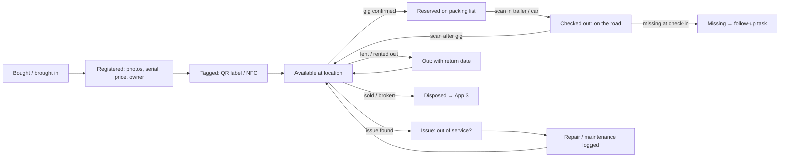
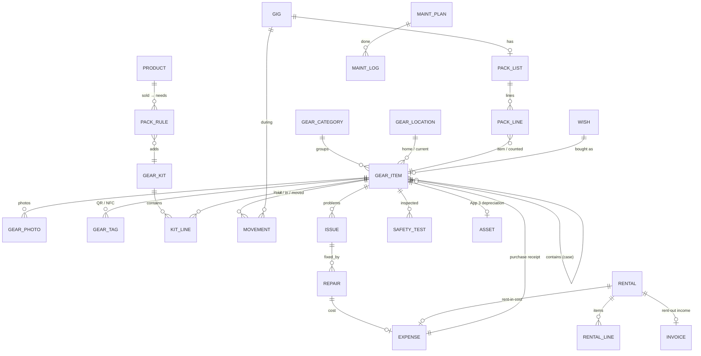

# Funqtion Gear & Inventory — Functional Plan

> App 5 of the Funqtion suite. **FEEL THE MUSIQ.**
> Status: functional plan, no code yet. Builds on App 1 (Bookings & CRM), App 2 (Quotes & Invoices), App 3 (Money & Accounting) and App 4 (Contracts), all live in this repo in local mode.
> **Decisions made (answers from Gijs)**: these replace the matching recommendations below.
> - **Sync:** start with **one gig phone** per gig (§0.2, option A in §7.3). The home server stays a later step.
> - **Phones:** both **iPhone** (15 Pro and 16 Pro). So: **QR only** in the web app (Safari has no Web NFC), scanning always inside the installed app, and no reliable web torch control: labels must be high-contrast and placed consistently, with a small clip-on light in the trailer. NFC only if the native iPhone app (Tauri iOS) is built later (§5).
> - **Gear list:** a temporary placeholder list is in [`gear-list.csv`](gear-list.csv) (format in [`GEAR-LIST.md`](GEAR-LIST.md)). Claude replaces it when the real list is compiled; the app imports it on first start.
> - **Storage and transport:** gear lives at **both homes** (Gijs and Coen) and goes to gigs in **a trailer behind a personal car** (no van). Locations: *Thuis Gijs*, *Thuis Coen*, *Aanhanger*, *Auto* (small and valuable things such as the laptop, controller, laser and headphones travel in the car, not in the trailer). Packing lists are sorted by home, with a "pick-up at Coen's/Gijs's" step, and show a **load order** for the trailer (§1.3).
> - **Gig phone:** chosen **per gig**, and it doesn't have to be the gig's owner in Bookings. The packing list shows whose phone it is; it can be handed over (e.g. Gijs loads, Coen unloads) with an export/import of that one list.
> - **Ownership:** **mixed**: some gear is Gijs's, some is Coen's, some is shared. Every item has an owner (`gijs` / `coen` / `shared`); the insurance overview and App 3 show totals per owner.
> - **Standard set-up** (one kit, "Standaard set"): all-in-one DJ controller, one light bar with lights and the laser, 2 top speakers, 1 subwoofer, a DJ booth, and a light & sound rack. A "DJ only" kit (controller + headphones + USBs) is for venues with their own sound and light.
> - **Laser:** Gijs's **Laserworld DS-1000 Mark III, class 4**. Class 4 gets its own safety checklist in the app (§6.3). Normally above heads; at private parties sometimes audience scanning *with permission*: the app records who gave permission and warns that permission doesn't make class 4 scanning eye-safe (only a measured, scan-safe set-up does). No venue has asked for laser documents so far.
> - **Trailer:** a light trailer without its own registration, **750 kg maximum mass** (incl. the trailer itself; enter its empty weight in settings for the real payload). **No lock on the trailer itself**; a **hitch lock** goes on whenever it's left unattended, and it's only left overnight **empty**. Both are tick boxes when unloading.
> - **DJ-only set-ups vary per venue:** sometimes only the controller, sometimes only USB sticks, sometimes controller + a bit of light. Three kits (`dj_controller`, `dj_usb`, `dj_light`), picked per gig with one tap.
> - **Light & sound rack:** contents unknown ("everything and nothing"); Gijs writes them down in [`RACK-CONTENTS.md`](RACK-CONTENTS.md) and a later Claude session turns that into rows.
>
> **v0.7.0 (label designs):** labels are printed with a **design** (Gear → Labels → Ontwerpen), with a live preview: six built-ins (*QR groot*, *QR klein*, *Barcode* in plain and **Funqtion style**: black label, orange rounded QR, Funqtion logo in the middle, Funqtion corners, FEEL THE MUSIQ) plus your own copies. Options: label background and code colour (black / white / orange), white panel behind the code, module shape (square / rounded / dots), logo, frame, text lines (code, name, "Eigendom van", tagline, own line), barcode copies and bar height. QR codes are drawn from the module grid (error correction H with a logo, the logo kept clear of the alignment square). Barcodes always print dark bars on a light background (readers can't read inverted barcodes). Inverted QR codes are read by the app (`tryInvert`), with a warning that not every handheld scanner does. Every design is verified by reading the printed PDF back.
>
> **v0.6.0 (Gijs's change requests):**
> - **Gear tree:** a case holds items, and cases can sit in cases (e.g. *Flightcase XDJ-AZ* → *XDJ-AZ* + *Stroomkabel*). The item page shows *Zit in* and *Inhoud*; the item list has a tree view. A case on a packing list brings its contents with it.
> - **Two scan modes per phase** (switch on the packing list, remembered): **Koffer = alles erin** (default for loading: scan the case and everything in it is ticked) and **Elk item los** (default for unloading: every piece is scanned, so you know everything is back in its place). Single items can always be scanned on their own, e.g. the controller without its case. Every line has **Niet mee** to leave it at home this time; scanning it anyway takes it after all.
> - **Labels per item:** *QR groot* (cases, big gear), *QR klein* (small gear) or *Barcode* (Code 128 strip that wraps lengthwise around a cable, code printed twice). Set per item or for a selection; one PDF with each type on its own pages.
> - **Barcode scanning** next to QR (camera: built-in detector on Android, zxing-wasm on iPhone, bundled for offline use), and a **Handscanner** mode for a USB/Bluetooth barcode/QR scanner (it types the code + Enter).
> - **Split counted items** (e.g. *XLR × 4* → four items with their own codes/labels) so every cable can be scanned.
>
> **Built (v0.5.0):** register (unique / counted / containers, photos, owner, locations, values, App 3 expense/asset links), QR scanning in the app (camera + typed code, torch where possible, wake lock, sounds), A4 QR label sheets, kits + product→kit links, packing lists per gig (set-up choice, quote products, outdoor, always-bring), load/unload by scan with missing-item choices and tasks, trailer/car split and load total, laser checklist, gear conflicts, issues and repairs (cost → App 3 expense), maintenance plans by days/hours/gigs, safety tests (off by default), rentals (rent-in cost → App 3), insurance overview + PDF/ZIP export, wishlist, CSV import/export of `gear-list.csv`. Not built yet: NFC, sync between phones, OCR of serial plates, a merged view in App 1 of gear conflicts (they show in the Gear app and on the packing list).
> - **Labels:** **A4 weatherproof polyester sheets**, PDF from the app.
> - **Safety tests (NEN 3140):** **not now**. The feature is built but off by default (Settings → Gear → Keuringen), so no warnings appear until it's switched on.
> - **Rentals:** **rarely**. Simple rent-in/lend-out tracking with return reminders; no rent-out invoices or rental contract in the MVP.
> - **Insurance:** **no business insurance yet** (neither equipment nor liability). See §6.1: the register and the insurance export still matter (proof for a future policy and for a police report), and the app shows an "onverzekerd" banner with the total value at risk.
>
> Safety and insurance points are a practical summary for a small Dutch DJ duo, **not advice from an inspector or insurer**. Items marked ⚖️ should be checked with your insurer or an inspection company. Prices are indicative (Nov 2026).

## Contents

0. [Read this first: three decisions that shape this app](#0-read-this-first-three-decisions-that-shape-this-app)
1. [Core user flows](#1-core-user-flows)
2. [Data model](#2-data-model)
3. [Screens](#3-screens)
4. [MVP vs. later](#4-mvp-vs-later)
5. [QR vs. NFC](#5-qr-vs-nfc)
6. [Insurance and electrical safety](#6-insurance-and-electrical-safety)
7. [Tech stack and offline use](#7-tech-stack-and-offline-use)
8. [Branding: Funqtion, but readable under pressure](#8-branding-funqtion-but-readable-under-pressure)
9. [Open questions](#9-open-questions)

---

## 0. Read this first: three decisions that shape this app

**0.1 Not everything gets its own tag: three kinds of gear.** Tagging every XLR cable one by one is the fastest way to stop using the app. So the app knows three kinds:

| Kind | Examples | How it's tracked |
|---|---|---|
| **Unique item** (serialised) | CDJs, controller, mixer, speakers, subs, moving heads, laser, laptop, flight cases, generator | Own record, own QR/NFC tag, serial number, photos, value. Scanned one by one. |
| **Counted item** (bulk) | XLR 10 m, power cables, IEC cables, cable ties, gaffa tape, spare fuses, DMX cables | One record with a **quantity** ("XLR 10 m × 12"). Packed and checked back by count ("8 out, 8 back"). Optional: a tag on the bag or bin. |
| **Container** (case, bag, bin) | "Kabeltas A", CDJ flight case, "Lichtkist", "Altijd-mee-tas" | Its own tag. Holds unique and counted items. **Scanning the case = everything in it**, with a short "contents still complete?" check after each gig. |

That makes packing for a typical wedding about 10–15 scans instead of 80.

**0.2 Two phones at one gig need sync, and the app doesn't have that yet.** Apps 1–4 store everything on each device; Gijs and Coen share data with backup export/import (`docs/HANDOFF.md`). For gear that's a real limit: if Gijs loads the trailer at home and Coen checks in at the venue at 02:00, both phones need the same packing list.

- **MVP:** one **"gig phone"** per gig does the whole check-out and check-in (a clear owner shown on the packing list). Everything else (register, repairs, insurance) works per device, with the existing backup merge.
- **Recommended next step:** the small home server that's been "maybe later" since App 3 (PocketBase on a Raspberry Pi/NAS + Tailscale, §7.3). Gear is the app where it pays off most. Decide in Q3.

**0.3 Our gear vs. App 3's "assets".** App 3 already has an `assets` table for gear ≥ €450 (depreciation). The gear register is the **full** list, including cheap stuff and personal gear. A gear item **links to** an asset (and the purchase expense) instead of copying it, so the price, the receipt and the depreciation are entered once.

---

## 1. Core user flows

### 1.0 Lifecycle overview

### 1.1 New gear → registered and tagged (≈ 1 minute)

1. **Start from the receipt (best) or the gear.**
   - *From App 3:* you photographed the receipt in Money (or imported the bank line). The expense shows a button **"Ook in gear-register"** → the gear form opens with supplier, date and price filled in, and the receipt already linked. If the price is ≥ €450 excl. VAT, App 3 makes it an asset (depreciation) and the gear item links to it.
   - *From the Gear app:* **+ Gear** → take 1–3 photos (front, back, **serial number plate**). The app suggests the category from the last ones you used.
2. **Fill in** (most fields optional, three required: name, category, owner):
   - category, brand, model, serial number (typed, or later: read from the photo with the OCR from App 3)
   - owner: **Gijs / Coen / shared (business)**
   - purchase date, price, supplier, receipt (linked to App 3), warranty until
   - home location (e.g. "Opslag Gijs – rek 2")
   - electrical: class I / II / none (for the safety checks, §6.2), power draw (W)
   - for counted items: quantity
   - for containers: what's inside (pick items, or "add later by scanning")
3. **Tag it.** The app gives a short code (`FQ-0042`) and shows **"Label printen"** (QR) or **"NFC koppelen"** (tap a blank tag to write the code to it). Labels can also be printed in batches later.
4. **Done.** The item is *available* at its home location. The insurance overview updates (§1.8).

**Bringing in gear you already own** (start-up, App 3 Q7): a quick-add mode for the first evening: photo → name → owner → next, with prices and dates filled in later from a list. The app shows a "completeness" score (photo, serial, value, receipt) so you can fill gaps over time.

### 1.2 Gig confirmed → packing list

1. **Trigger:** the gig moves to *Confirmed* in App 1 (or the contract is signed in App 4). The app makes a **draft packing list** and a task *"Paklijst checken – Bruiloft Lisa & Tom"* (due: the gear-check reminder App 1 already has, default 7 days before).
2. **What goes on the list (rules, all editable):**
   - **What was sold** (App 2): each catalogue product can name the kits it needs. *Geluidsset* → kit "Sound klein" (2 tops, 1 sub, stands, cables); *Lichtset* → "Licht basis"; *Lasers & effecten* → "Laser + hazer"; optional extras only if the client chose them.
   - **The gig itself** (App 1):
     - `setupRequired = false` or `venue.houseSound = true` → no PA, only the "DJ only" kit (laptop, USBs, headphones, a booth monitor if wanted)
     - setting outdoor → rain covers, gaffa, extra ground spikes, cable mats
     - number of performers → headphones per person
     - expected crowd > 150 → the larger PA kit (rule threshold editable)
     - long distance → spare laptop/USB set (optional rule)
   - **The contract and rider** (App 4): the signed version tells what we promised (e.g. "booth: wij nemen mee" in special terms) and what the venue provides (power, table). If the client provides a table, the folding table drops off the list.
   - **"Altijd mee"** list: USB sticks, headphones, spare power strip, multimeter, gaffa, torch, first-aid kit, spare fuses, extension cable, cable ties.
3. **You review** on desktop or phone: add or remove, swap an item ("CDJ set 2 instead of set 1"), set quantities. Every line shows *why* it's there ("uit offerte: Lichtset", "regel: buiten", "altijd mee").
4. **Reservation:** items on a confirmed list are **reserved** for the gig's time window (load-out from home → back home, from App 1's set-up/start/end times + travel time). The conflict check (§1.5) runs immediately.
5. **Day before:** a notification *"Morgen: Bruiloft Lisa & Tom – 14 colli te laden"* with any blockers (an item out of service, a safety check overdue, an item still lent out).

### 1.3 Check-out (loading the trailer and car)

1. Open the gig → **Inladen** (or scan any tag: if it's on today's list, the app opens that list).
2. **Scan mode**, with the camera on continuously:
   - each scan beeps, vibrates (Android) and flashes the line green; the counter goes "9/14"
   - scanning a **case** ticks off the case and everything in it
   - **counted items:** tap the line, then type or +/− the number ("XLR 10 m: 8")
   - an item **not on the list** → amber "Niet op de lijst – toch meenemen?" (adds it, so it's checked back in later)
   - an item **out of service** or **safety check overdue** → red block "Defect: niet meenemen" (you can override with a reason)
   - an item **reserved for another gig today** → red "Gereserveerd voor Kermis vrijdag 20:00"
3. **Done loading:** the app shows what's still unticked ("Nog 2: Lichtkist, statief L"), and you finish with **"Alles ingeladen"** (or "Vertrekken zonder" with a note). Everything checked out moves to location **"Onderweg – Bruiloft Lisa & Tom"**.
4. **Trailer and car:** each line says where it goes: *aanhanger* or *auto* (laptop, controller, laser, headphones, USBs: never in an unattended trailer). The trailer part is sorted in a **load order** you set once per kit (heavy items such as the sub and the rack low and over the axle, the booth last so it comes out first). With a weight per item, the app shows the total load against the trailer's maximum ⚖️ (check your trailer's permitted load and your driving licence: with licence B, car + trailer may usually weigh at most 3,500 kg maximum mass together; heavier combinations need BE or the B+ code 96).
5. Works **offline** (it's all on the phone); the gig phone (§0.2) holds the list.

### 1.4 Check-in (after the gig)

1. **Uitladen** on the gig (often at 02:00, so dimmed screen, big buttons). The list shows everything that went out.
2. Scan everything back (same scan mode). Cases: scan the case, then confirm "inhoud compleet?" (one tap, or tick what's missing).
3. **Missing items** stay red: *"Ontbreekt: Shure SM58 (FQ-0031)"*. For each one choose:
   - **Nog in aanhanger/auto / later** → stays "onderweg", reminder next morning
   - **Achtergelaten op locatie** → location "Kasteel Croy", task "Ophalen bij …" with the venue contact from App 1
   - **Kwijt / gestolen** → status *missing*, a checklist for insurance (police report within the insurer's term, §6.1) and a link to the client's liability clause if guests caused it (App 4, clause L2)
   - **Kapot** → opens the issue flow (§1.6) right away
4. **Usage counters** go up automatically for items that went to the gig: hours of use (from the set times) for lasers, hazers, moving heads, so maintenance by hours works without typing (§1.7).
5. Check-in done → the gig shows "Gear terug ✓" and App 1's "mark played" task is a natural next step.

### 1.5 Gear conflicts

- Each confirmed packing list **reserves** its items for a time window: `[leave home – return home]`, computed from set-up time (or start) minus travel time and load-in buffer, to end time plus breakdown and travel back (defaults: 45 min load-in, 45 min breakdown, travel from App 1's venue distance).
- **Conflict = the same unique item, or more of a counted item than you own, in two overlapping windows.** For counted items the app sums: "XLR 10 m: 8 + 6 needed, 12 owned → 2 short".
- This fits App 1's double-booking rule (same person, same day only without build-up and ≥ 2 h between gigs): two gigs on one day are possible, and gear is often the real bottleneck. The conflict shows:
  - in the Gear app (packing list and a "Conflicten" badge)
  - **on the gig in App 1**, next to the existing calendar conflicts, as a soft warning ("Gear: CDJ set 1 ook nodig voor Kermis vrijdag")
  - already **when quoting** in App 2 for a date that has another gig (soft: "Lasers zijn die avond al gereserveerd")
- Solutions the app offers: swap to an equivalent item (same model/category, available), split counted items, or **rent in** (§1.9) with one tap.

### 1.6 Issue found → repair logged

1. **Report from anywhere:** scan the item → **"Probleem melden"**, or from check-in (*Kapot*), or from the item page. Fields: what's wrong (text + photo/video), severity (*kan nog mee* / *niet meer gebruiken*), found by, at which gig.
2. **"Niet meer gebruiken"** sets the item **out of service**: it can't be packed without an override, and every packing list that has it gets a warning (with a suggested replacement).
3. **Repair:** choose *zelf* (DIY, e.g. resolder a cable), *reparateur* (shop, location becomes "Bij reparateur X", expected back date) or *garantie* (warranty end date from the item, link to the receipt).
4. **Close:** what was done, cost (→ an App 3 expense linked to the item and the gig if a guest caused it), parts, who, date. If the repair needs an electrical safety test (after opening a class I device, §6.2), the app asks for one before the item is back in service.
5. **Damage by guests:** the issue can be marked "schade door gasten bij gig X" → a draft message to the client and a note on the gig for the final invoice (App 2), referring to the contract clause (App 4 L2).
6. **Write-off:** "niet te repareren" → disposed in App 3 (book value written off) and removed from insurance totals.

### 1.7 Maintenance and recurring checks

Plans per item **or per category** (so "every XLR cable" doesn't need 30 plans):

| Plan | Trigger | Example |
|---|---|---|
| By date | every N days/months | cable test every 6 months; firmware check every 3 months; flight case hinges yearly |
| By use | every N hours (counted from gigs) | laser: clean optics every 50 h; hazer: clean every 20 h; lamp-based fixtures: lamp life |
| By gigs | every N gigs | check speaker grilles and rigging points every 10 gigs |
| Safety test | interval from §6.2 | portable equipment test every 12 months, extension cables every 6 months ⚖️ |

Due items appear on the Gear home screen and as tasks in App 1's task list (one task per batch, e.g. "6 items: kabeltest"). **Firmware:** the item has a "current firmware" field; the check is a reminder with the manufacturer's link, and you log the new version. (Automatic version checks aren't possible without per-brand integrations.)

### 1.8 Insurance overview

Always up to date, no extra work: total **purchase value**, **current value** (book value from App 3, or your own estimate), and **replacement value** (new price today, a field per item, used for "am I underinsured?"), per owner and per category. It also lists what's missing per item (photo, serial number, receipt, value). The **export** contains a PDF list + CSV + a ZIP with photos and receipts. Send it to the insurer once a year and keep a copy outside the house. Details in §6.1.

### 1.9 Rent in, lend out, rent out

- **Rent in** (from a rental company or another DJ), for a gig:
  - supplier, what (free text or a temporary item with a tag), pickup and return dates, price, deposit
  - it goes on the packing list, is scanned like our own gear, and has a **return reminder**
  - the cost becomes an App 3 expense (category *Gear huren*) linked to the gig, so profit per gig is right
- **Lend out** (to a friend, free):
  - who (a contact from App 1), what, from/to dates, condition photos at hand-over
  - reminders before and on the return date; the item's location is "Uitgeleend aan Bas"
- **Rent out** (for money):
  - same as lending out, plus a price and a deposit
  - creates an App 2 invoice ("verhuur") and a short rental agreement: App 4 template "Verhuur", with liability, return condition and deposit
  - conflicts with gig reservations are checked like gigs

### 1.10 Wishlist

Items you want: name, category, link(s), price (now and target), priority (must / nice / dream), for whom (Gijs/Coen/business), why ("2e set CDJ's voor dubbele boekingen", "huren kost ons €120 per keer"). Useful extras:

- **Rental cost so far**: the sum of rent-in costs for the same category this year ("we huurden 6× een hazer: €270"), which is a strong argument to buy.
- **Status:** idea → saving → ordered → bought. *Bought* converts the line into a gear item (and an App 3 expense).

---

## 2. Data model

### 2.1 Principles

- Same conventions as apps 1–4: UUIDs, `createdAt/By`, `updatedAt/By`, soft delete, every write via `save()` / `patch()` (audit log), money in **cents**, dates `yyyy-mm-dd`.
- New tables in a new Dexie block **`version(5)`**, added to `DATA_TABLES` (backup/merge). Photos are Blobs like App 3's receipts, so they travel in the backup ZIP.
- **Movements are an append-only log** (check-out, check-in, location changes). The current location/status of an item is *derived* from its last movement and stored as a convenience field, the same "computed, never stored twice" idea as App 3's reports.
- **Packing rules and conflicts are pure functions** (`domain/packing.ts`, `domain/conflicts.ts`), unit-tested like App 1's conflict check.

### 2.2 Entity diagram

### 2.3 Tables

**Register**

| Table | Key fields | Notes |
|---|---|---|
| `gearCategories` | key, name NL/EN, icon, parentId, defaultKind (`unique` / `counted` / `container`), electrical default (`class1` / `class2` / `none`), default maintenance plan ids, sort | Seeded: Decks & controllers, Mixers, Laptops & media, Headphones & mics, Speakers (tops), Subs, Monitors, Lighting, Lasers, Effects (haze/smoke/sparkular), DMX & control, Power (cables, distribution, generator), Audio cables, Stands & truss, Cases & bags, Furniture (booth, table), Tools & spares, Small stuff. |
| `gearItems` | code (`FQ-0042`, unique), kind (`unique` / `counted` / `container`), name, categoryId, brand, model, serial, quantity (counted), parentId (the container it lives in), owner (`gijs` / `coen` / `shared`), homeLocationId, **currentLocationId**, **status** (`available`, `reserved`, `out`, `out_of_service`, `in_repair`, `lent`, `missing`, `disposed`), purchaseDate, purchasePrice (cents, incl. VAT as paid), supplier, expenseId (App 3), assetId (App 3), warrantyUntil, replacementValue, insured (bool), electrical (`class1` / `class2` / `none`), powerW, usageHours, usageGigs, firmware, notes, completeness (computed: photo/serial/value/receipt) | `currentLocationId` and `status` are derived from movements/issues/rentals but stored for fast lists. |
| `gearPhotos` | itemId, kind (`main`, `serial`, `receipt`, `damage`, `condition`), blob, sha256, takenAt | Compressed to max ~1600 px like App 3's receipts. |
| `gearTags` | itemId, type (`qr`, `nfc`), value (the code or a URL), printedAt / writtenAt, active | More than one tag per item (QR + NFC, or a replacement label). A lost label is deactivated, not deleted. |
| `gearLocations` | name, type (`storage`, `home`, `vehicle`, `venue`, `repair`, `third_party`), venueId (App 1), personId (App 1, for "lent to"), address, notes | Seed: "Thuis Gijs", "Thuis Coen", "Aanhanger", "Auto". Venues and contacts are reused from App 1, not copied. |

**Kits and packing**

| Table | Key fields | Notes |
|---|---|---|
| `gearKits` | name ("Sound klein", "DJ only", "Licht basis", "Altijd mee"), lines: [{itemId? / categoryId?, quantity, optional}], notes | A kit line can name a specific item ("CDJ set 1") or a category + quantity ("2 × top speaker"), so swaps are easy. |
| `packRules` | name, when (json: `{productId}`, `{eventType}`, `{houseSound: false}`, `{setupRequired: true}`, `{outdoor: true}`, `{crowdOver: 150}`, `{performersAtLeast: 2}`), add: [{kitId / itemId, quantity}], remove: [...], active, sort | The rule engine is a pure function: (gig, venue, accepted quote, signed contract, rules) → lines with reasons. |
| `packLists` | gigId, status (`draft`, `confirmed`, `loading`, `out`, `returning`, `done`), gigPhoneMemberId, window {from, to} (ISO), lines: [{id, itemId?, categoryId?, quantity, source (`quote` / `rule` / `always` / `manual` / `rental`), reason, checkedOutQty, checkedInQty, note}], loadedAt, returnedAt | One per gig. Lines are stored because you adjust them; the generator only fills a draft. |
| `gearMovements` | itemId, quantity (counted), type (`check_out`, `check_in`, `move`, `lend_out`, `return`, `to_repair`, `from_repair`, `missing`, `found`, `dispose`), gigId?, rentalId?, fromLocationId, toLocationId, at, by (member), method (`scan_qr`, `scan_nfc`, `manual`), note | Append-only. Answers "where was it last seen, and by whom?" |

**Care**

| Table | Key fields | Notes |
|---|---|---|
| `gearIssues` | itemId, gigId?, title, description, photos, severity (`minor` / `out_of_service`), foundBy, foundAt, causedByGuests (bool), status (`open`, `in_repair`, `resolved`, `written_off`), resolvedAt | |
| `gearRepairs` | issueId, itemId, by (`self` / shop name / `warranty`), sentAt, expectedBack, returnedAt, work done, parts, cost, expenseId (App 3), needsSafetyTest | |
| `maintenancePlans` | target (itemId or categoryId), title ("Kabeltest", "Optiek reinigen", "Firmware check"), trigger (`days`, `hours`, `gigs`), interval, instructions, active | |
| `maintenanceLogs` | planId, itemId, doneAt, by, result (`ok` / `issue`), usageAtDone, note, cost?, firmwareVersion? | Next due = last log + interval (computed). |
| `safetyTests` | itemId, date, inspector (name / company), method (`NEN 3140 / NEN-EN 50699`), class, results (visual ok, PE resistance Ω, insulation MΩ, leakage mA, functional ok), passed, labelNo, nextDue, reportFileId | §6.2. A failed test sets the item out of service. |

**Rentals and wishes**

| Table | Key fields | Notes |
|---|---|---|
| `rentals` | direction (`in` / `out`), counterparty (personId / organisationId / free text), gigId?, lines: [{itemId? / description, quantity}], from, until, returnedAt, price, deposit, depositReturnedAt, expenseId (rent-in), invoiceId (rent-out), contractId (App 4, rent-out), conditionPhotos, status (`planned`, `active`, `returned`, `overdue`) | Rent-in gear can become a temporary gear item (with a tag), archived after return. |
| `wishlist` | name, categoryId, links[], priceNow, priceTarget, priority (`must` / `nice` / `dream`), for (`gijs` / `coen` / `shared`), reason, status (`idea`, `saving`, `ordered`, `bought`, `dropped`), boughtItemId | |

### 2.4 How it links to apps 1–4

| App | Gear reads | Gear writes / changes there |
|---|---|---|
| **1 Bookings** | gigs (date, times, set-up, `setupRequired`, setting, crowd, performers, owner), venues (`houseSound`, power/load-in notes, distance), contacts, availability | Gear conflicts as soft warnings on the gig; "Gear terug ✓" badge; the existing **gear-check task** opens the packing list; tasks for due maintenance/safety tests/rental returns via the shared reminder engine; venue becomes a location when gear is left behind. |
| **2 Quotes & Invoices** | accepted quote lines → `productId` → pack rules; catalogue products | New product field `kitIds` (what a product needs). Rent-out → invoice. Damage by guests → a note for the final invoice. Optional: a soft warning when quoting extras whose gear is already reserved that evening. |
| **3 Money & Accounting** | expenses + receipts (purchase), assets (book value, depreciation), category *Gear huren* | New fields: `Expense.gearItemIds`, `Asset.gearItemId`. Purchase → "ook in gear-register". Repair costs and rent-in costs → expenses linked to the item and the gig (profit per gig). Write-off/sale → asset disposal. Insurance export uses book values. **Personal gear used for the business** stays outside the books unless it's contributed (App 3 Q7). |
| **4 Contracts** | signed version: services, special terms, rider (what the venue provides) | Rent-out uses a new template "Verhuur" (liability, deposit, return condition). Missing/damaged gear by guests refers to clause L2. Later: our *technical rider* gets its power figures from the gear on the packing list (sum of `powerW`). |

---

## 3. Screens

Same AppShell as apps 1–4: bottom tabs on mobile, sidebar on desktop, NL/EN, dark default. **Scan** is the big orange button in the middle of the mobile tab bar.

**Design rules for a dark venue or trailer:**
- huge targets (≥ 56 px) and one-handed reach
- 18 px+ text on scan/pack screens
- sound + vibration on every scan
- the screen stays awake while scanning (Wake Lock)
- a torch toggle where the phone allows it (§5.3)
- an optional **"nachtmodus"**: dimmed, low-brightness red/amber UI that keeps your night vision and doesn't light up the booth

### 3.1 Gear home (`/gear`)
- **Mobile:** the next gig card ("Za 14 jun · Bruiloft Lisa & Tom · 14 colli · inladen 17:30"), with a big button *Inladen* / *Uitladen*. Below: alerts (conflicts, out of service, safety tests overdue, maintenance due, items still lent out or missing), each one tap to fix.
- **Desktop:** the same plus a week strip with packing lists per gig, and counters: items, total value, open issues, due checks.

### 3.2 Scan (`/gear/scan`): the fastest screen in the suite
- A full-screen camera with a framing box, torch toggle, and a "type code" field (for a damaged label: `0042` is enough).
- **Context-aware:**
  - during loading/unloading, a scan ticks the item off that list
  - outside a list, a scan opens the item card with quick actions: *verplaatsen*, *probleem melden*, *onderhoud gedaan*, *uitlenen*
- Continuous mode: scan, scan, scan. A bottom sheet shows the last 3 scans with undo.
- NFC (where supported, §5): "Houd telefoon bij tag" with the same result.

### 3.3 Packing list / loading (`/gear/gigs/:gigId`)
- **Header:** gig, date, times, venue, the gig phone (avatar), and the progress "9/14" in big type.
- **Lines grouped by case/container**, then loose items, then counted items. Each line shows: a big tick area, name + code, a reason chip ("offerte", "buiten", "altijd mee"), and a status icon (✓ / ! / ✕).
- **Order:** where things are (storage first, then home Coen), so you walk once.
- **Bottom bar:** *Scannen* (primary), *Klaar*. Unticked items stay on top when you press *Klaar*.
- **Desktop:** an editable table (add from kits/items/categories, swap, quantities), the conflict panel, a print button (an A4 checklist as a paper backup in the car).

### 3.4 Check-in (`/gear/gigs/:gigId/return`)
- Like loading, reversed. **Missing items in red at the top**, with the four choices from §1.4 as big buttons. The case-contents check is one tap.
- At the end: a summary ("13 terug, 1 achtergelaten bij Kasteel Croy – taak gemaakt"), the usage counters added, and links to issues reported.

### 3.5 Items (`/gear/items`) and item card (`/gear/items/:id`)
- **List (mobile):** search (name, brand, model, serial, code), filter chips (category, owner, status, location), big rows with a photo thumbnail, name, code, owner chip, status.
- **List (desktop):** a table with sortable columns (value, purchase date, next safety test), bulk actions (move, print labels, set category), CSV export.
- **Card:**
  - photo carousel, name, code + QR, status, location
  - owner, value (purchase / book / replacement), serial (copy button), warranty
  - tabs: *Historie* (movements and gigs), *Onderhoud* (plans, logs, next due), *Keuring* (safety tests), *Problemen*, *Documenten* (receipt from App 3, manual, keuringsrapport)
  - actions: *Label*, *Probleem melden*, *Verplaatsen*, *Uitlenen*, *Afvoeren*

### 3.6 Add / edit item
- **Photo-first** on mobile, then the fields in 3 short steps (wat / van wie / waarde). "Nog een zoals deze" duplicates for a second identical speaker (new code and serial).
- Desktop: one form, plus a "bulk import" (CSV) for the first inventory.

### 3.7 Kits & rules (`/gear/kits`), desktop-first
- **Kits:** list → editor (lines with item or category + quantity, drag to reorder).
- **Pack rules:** a readable list ("Als offerte *Lichtset* bevat → kit *Licht basis*"; "Als buiten → *Regenhoezen*") with a **test panel**: pick an upcoming gig → see the generated list and why.
- **Product links:** the App 2 catalogue with a "needs kit" column.

### 3.8 Maintenance & safety (`/gear/care`)
- **Due list** (overdue red, due in 30 days amber), grouped: safety tests, maintenance, firmware, open repairs.
- **Batch mode:** "Kabeltest" → scan cable after cable → ✓ ok / ✕ issue, and one log per item. The same for a safety-test day with an inspector: scan → enter values or just pass/fail + label number → next.
- Repair board: open → in repair → back (simple columns).

### 3.9 Rentals (`/gear/rentals`)
- Tabs *In* / *Uit*: active with return dates (overdue in red), planned, history. A new rental starts from a gig (rent in) or a contact (lend/rent out). Hand-over and return screens with condition photos and a scan list.

### 3.10 Insurance (`/gear/insurance`)
- Totals (purchase / book / replacement), per owner and category, a completeness bar ("38 van 52 items compleet"), a list of gaps, the **export** button, and the policy details (insurer, policy number, insured sum, deductible, conditions such as "niet 's nachts in de auto") with a warning when the replacement value exceeds the insured sum.

### 3.11 Wishlist (`/gear/wishlist`)
- Cards by priority, total per priority, the rent-in cost so far per category, a "gekocht" button.

### 3.12 Labels (`/gear/labels`)
- Pick items (or "all without a label") → layout: A4 sheet for weatherproof labels (2–3 sizes), or a CSV/PNG export for a label printer → print preview. Small cable labels (QR + code only) and bigger case labels (logo + code + name + owner + "Eigendom van Team Funqtion · 06-…").

---

## 4. MVP vs. later

### MVP: v5.0 "We know what we own, and nothing stays behind" (local, one gig phone)
- Register: categories (seeded), unique/counted/container items, photos, owner, locations, values, receipt and asset links to App 3, "also in gear register" from an App 3 expense, quick-add mode, CSV import.
- **QR labels** (codes + A4 label sheets as PDF) and **in-app QR scanning** (camera, continuous, typed fallback, torch where possible, wake lock, beep).
- Kits, "always bring" list, pack rules from the **accepted quote** + gig + venue (house sound, set-up, outdoor, performers, crowd).
- Packing list per gig: generated draft, review, reservation window, **conflict check** (unique + counted), soft warning on the gig in App 1.
- Check-out / check-in by scan, cases with contents check, missing-item choices with tasks, usage hours from gigs.
- Issues and repairs (out of service blocks packing), repair costs → App 3 expense.
- Maintenance plans by date/hours/gigs (per item or category), due list, batch cable test.
- **Safety tests** (records, due dates, out of service on fail, batch mode for a test day).
- Insurance overview + export (PDF + CSV + ZIP with photos/receipts).
- Rentals in/out with return reminders; rent-in → App 3 expense.
- Wishlist.
- Backups v2 include gear photos. Unit tests: pack rules, conflicts (incl. counted quantities and App 1's same-day rule), due dates, insurance totals.

### v5.1
- **Sync between the two phones** via the home server (if Q3 says yes): two people loading/unloading the same gig, live.
- NFC tags on Android (Web NFC) as an alternative to QR.
- Rent-out invoices (App 2) and the "Verhuur" contract template (App 4).
- Contract/rider awareness in pack rules (signed version special terms, venue-provided items).
- Power budget per gig (sum of `powerW` on the list vs. the venue's power from the rider).

### Later
- Native NFC on iPhone through the Tauri iOS app (§5.2).
- OCR of serial plates (re-using App 3's Tesseract setup).
- Gig-day app (app 6) integration: load-in time and trailer load order, set-up checklist.
- Firmware links per model, manual PDFs per model.
- Bulk RFID (UHF) for whole-trailer scanning (probably never worth it at your size, §5.1).
- Depreciation forecasts and "replace soon" hints (age + repairs + usage hours).

---

## 5. QR vs. NFC

### 5.1 Comparison

| | **QR label** | **NFC tag** | UHF RFID (for completeness) |
|---|---|---|---|
| Cost per tag | €0.05–0.30 on weatherproof A4 sheets; €0.10–0.50 with a laminated label printer (Brother P-touch TZe tape); €0.50–1.50 for engraved/anodised aluminium asset tags | €0.20–0.60 for NTAG213/215 stickers; €0.80–2 for **on-metal** (anti-metal) tags, needed on steel cases and amp housings; €1–2 for cable-tie or key-fob tags | €0.10–1 per tag, but a reader costs €300+ |
| Equipment | any printer (or a label printer, ~€80–150) | blank tags; writing works with the same phone (Android) or a free app | handheld reader |
| Durability on gear | Good if it's **laminated polyester/vinyl** (not paper), placed in a recess away from hands and gaffa. Scuffs over years; replace easily. Aluminium tags last forever. | Very good: no wear-off print, works through dirt, paint and stickers on top. Must not sit directly on metal unless it's an on-metal tag. | Good |
| On cables | **Wrap-around flag labels** near the connector (self-laminating cable labels) or a tag on a velcro tie; tiny QR codes (≥ 12 mm) still scan | NFC cable ties / small epoxy tags on a velcro strap: robust, a bit bulky | flags/ties |
| Scanning in the dark | needs light: the phone torch, or a high-contrast label; ~0.5–1 s per scan | **no light needed**, just a tap (1–4 cm); ~0.5 s | no line of sight, whole bin at once |
| Scanning speed | can scan from 20–50 cm; continuous mode is fast for a row of cases | must touch each item: slower for a pile, fine for single items | fastest |
| Works on iPhone web app | **yes**, in-app camera scanning | **no** (Safari has no Web NFC) | no |
| Works on Android web app | yes | yes (Chrome, Web NFC) | no |
| Native app needed? | no | on iPhone: yes (Core NFC via the Tauri iOS shell) | dedicated hardware/app |

### 5.2 How scanning works in a web app vs. a native app

- **QR in the web app (PWA/exe):** the app opens the camera (`getUserMedia`) and decodes frames:
  - with the built-in `BarcodeDetector` where the browser has it (Chrome on Android, desktop Chrome)
  - with a small WebAssembly/JS decoder elsewhere, notably **iPhone Safari**, which doesn't have it
  
  Both are fast enough for continuous scanning. Works offline.
- **Important iPhone gotcha:** if you scan a label with the **normal iPhone camera app**, the link opens in Safari, **not** in the installed home-screen app, and Safari has **separate storage** (it wouldn't see your data). So the label holds a code (or a URL that the app also understands), and scanning always happens **inside the app**. The same goes for Android to a lesser degree.
- **Torch:** controlling the flashlight from the web works on Android Chrome (`torch` constraint). On iPhone, web torch control is limited or missing, so plan for high-contrast labels, a small clip-on light, or the native app.
- **NFC in the web app:** only **Chrome on Android** supports Web NFC (read and write). Not iPhone, not desktop.
- **Native app (Tauri iOS/Android shell, already planned for iPhone):** NFC via Core NFC (iPhone, read and write NDEF) and Android NFC, plus a native camera scanner with reliable torch control. That's the path if you want NFC on iPhones.

### 5.3 Recommendation

**QR now, NFC later, a human-readable code always.** (Decided: both phones are iPhones, so QR only until a native iPhone app exists.)
- Every item gets a short code (`FQ-0042`) **printed under the QR**, so a damaged label is still typed in a second.
- Labels:
  - **cases and big gear:** weatherproof polyester labels (or aluminium tags for the expensive stuff), placed in the same spot on every case (top right of the lid), so scanning becomes muscle memory
  - **cables:** self-laminating wrap-around labels near the connector
  - **small stuff:** don't tag it; it lives in a tagged bag
- **NFC** in v5.1 for Android users, or with the native iPhone app later. The data model already allows two tags per item, so adding NFC later costs nothing.
- **Colour bands** (coloured heat-shrink/tape) per owner or per kit still help in the dark, before any scan. Suggested: orange = shared, plus one colour each for Gijs and Coen.

---

## 6. Insurance and electrical safety

### 6.1 What insurers usually want documented ⚖️

Typical requirements for an equipment/music-gear policy (*apparatuurverzekering* / *muziekinstrumentenverzekering*), which the app's register and export cover:

| What | Why | In the app |
|---|---|---|
| **List per item:** brand, model, **serial number**, purchase date, purchase price, (replacement) value | to prove what you had and its value; serials help police recover stolen gear | item fields + export |
| **Proof of purchase** (receipt/invoice) or other proof of ownership | without it, claims are often reduced or refused | receipt via App 3 |
| **Photos** of each item, including the serial plate | condition and ownership | photos (main + serial) |
| **Insured sum = real value** | if you insure too little (*onderverzekering*), a claim can be paid in proportion | warning when replacement value > insured sum |
| **Business use declared** | home contents insurance usually excludes gear used for paid gigs | policy field + note |
| **Theft from a vehicle:** conditions such as "locked, out of sight, no cover between 22:00 and 07:00 / overnight", visible break-in marks | the most common exclusion for DJs | policy conditions shown on the loading screen ("niet 's nachts in de aanhanger of auto laten") |
| **Police report** (*aangifte*) for theft, often within 24–72 h, and prompt notice to the insurer | claim condition | "kwijt/gestolen" checklist (§1.4) |
| **Coverage area and transport** (NL/Europe, during transport and at venues) | gigs abroad, rental gear | policy field |
| **Rented-in gear** | often only covered if named or within a limit; the rental company may require its own insurance | rental record + reminder to check |
| **New-value period** (*nieuwwaarde* for the first 1–3 years, then current value) | determines payout | purchase date + policy rule → shows the expected payout basis |
| **Deductible** (*eigen risico*) per claim | | policy field |

Also: keep the **yearly export outside the house** (cloud or with family). A fire takes the laptop with the register on it.

**You have no business insurance yet.** That means two open risks:
- **Your gear:** theft of the trailer (or from the car) or damage at a gig is fully your own loss. A private home contents policy usually **excludes gear used for paid gigs**, so don't count on it. The app shows the total value at risk on the Gear home screen and in the insurance overview, so you can weigh it against a premium.
- **Liability:** if a speaker falls on a guest or your gear causes a fire, you are personally liable, and as a VOF or two private persons that's your own money. App 4's contract limits liability "to the price of the gig or what our insurance pays", but a limit doesn't help with personal injury, which can't be excluded towards consumers. Many venues and festivals also ask for proof of an AVB.

My advice: get quotes for a **business liability policy (AVB)** first (usually the cheaper and more important one), then **equipment cover** once the register shows the real value. The insurance export is exactly what an insurer asks for when quoting. The app keeps the policy fields empty until then.

**Liability is separate:** a business liability policy (*AVB*) covers damage *you* cause to others (a speaker falls on a guest). That's the one App 4's contract assumes (Q9 there). Gear insurance covers *your* gear.

### 6.2 Electrical safety: NEN 3140 and portable equipment ⚖️

- **NEN 3140** is the Dutch standard for the safe operation of low-voltage installations, including **portable electrical equipment** (*arbeidsmiddelen*): your amps, active speakers, lights, hazers, power strips, extension cables and distribution boxes. It sets the framework: an inspection regime, who may inspect, and records.
- The **test methods** for equipment are now in **NEN-EN 50699** (periodic testing) and **NEN-EN 50678** (testing after repair), which NEN 3140 refers to.
- **Is it mandatory for you?** The Dutch working-conditions rules (*Arbobesluit*) require **employers** to keep work equipment safe, and NEN 3140 is the accepted way to show it. As a duo without employees it isn't strictly mandatory, but:
  - **venues, festivals and municipalities** increasingly ask for proof (inspection stickers + report), especially for outdoor/village events
  - **insurers** may refuse or reduce a claim after a fire or electric shock if the gear was visibly unsafe or never inspected
  - after an incident, a test report is your best evidence that you took care
  
  So: treat it as required.
- **Interval:** NEN 3140 doesn't fix one number; you set it **based on risk** (how often it's used, moved, used outdoors). Common practice:
  - **12 months** for normal gear
  - **6 months** for gear that's moved and plugged in a lot or used outdoors: extension cables, cable reels, power strips, distribution boxes
  - **3 months** for very heavy use
  - always after a repair or a drop/water incident
  
  The app's defaults: 12 months for gear, 6 for power distribution and extension cables (editable per category).
- **What a test covers** (and what the app records):
  - visual inspection (plugs, cables, strain relief, housing)
  - protective earth conductor resistance for class I devices (with an earth wire)
  - insulation resistance
  - leakage/touch current
  - a functional test
  - result **pass/fail**, a **label** with the date/next date, and a **report**
  
  Class II (double insulated, ⧈ symbol) items don't have an earth test, but still get the visual and insulation/leakage checks.
- **Who may test:** someone **competent** (*vakbekwaam*, or *voldoende onderricht* under supervision) with a **calibrated tester**. Options:
  1. **an inspection company:** typically €2–6 per item plus a call-out fee, often on location in one go, with labels and a report. Easiest for 50–100 items/year.
  2. **do it yourselves:** buy a PAT tester (€500–2,000) and get trained (a 1–2 day NEN 3140 / "keuren van arbeidsmiddelen" course). Only worth it with lots of gear or if one of you is already in the trade.
- **Between tests:** a quick **visual check** of cables and plugs at check-in (the app asks "kabels heel?" for power items), and pressing the **RCD test button** (*aardlekschakelaar*) on your distribution boxes monthly.

### 6.3 Lasers, haze and other effects ⚖️

- **Lasers:** record the **laser class** (EN 60825-1; show lasers are often class 3B or 4), output power, key switch, emergency stop, and the last check.
  - The Netherlands has no simple national "laser show licence", but venues/municipalities can ask for a **laser safety plan**.
  - Scanning into the audience is only acceptable below the safe exposure limit (MPE), which has to be measured.
  - The app keeps the documents (manual, CE declaration, safety plan template) on the item and reminds you to set the scan area/zones per venue.
- **Your laser: Laserworld DS-1000 Mark III, class 4.** Class 4 is the highest class: the direct *and* the reflected beam can damage eyes and skin, and it can set fire to flammable material at close range. What the app adds for this item:
  - a **pre-show checklist** on the gig's packing list (tick in the app, stored per gig as evidence):
    - beams **well above head height**; a common guideline is at least 3 m above the floor the audience stands on, and never into balconies or a raised stage area with people ⚖️
    - no audience scanning unless the MPE has been measured for that set-up (normally: don't)
    - key switch and **emergency stop / interlock** connected and within reach of the DJ
    - no mirrors, glass or shiny surfaces in the beam path; the venue's no-go zones noted
    - the laser fixed firmly to the light bar (safety cable), so it can't tilt into the crowd
  - a **document folder**: manual, CE/conformity declaration, your own short laser safety plan (a one-page template the app fills with venue, mounting height and zones), to hand to a venue or municipality that asks
  - **use hours** counted from gigs (maintenance: clean the exit window/optics)
  - transport: in the car, not the trailer (value and fragility), and a flag on the insurance overview because it's one of the most valuable single items
  - the venue question "lasers toegestaan?" added to the final-check task in App 1 for gigs where the laser is on the packing list
- **Haze/smoke machines:** fluid type (stored, for the venue's safety data sheet request) and a reminder to **tell the venue** (fire detectors). Add a pack rule "hazer → vloeistof + aanvraag aan locatie" so it's on the gig's checklist.
- **Generators and power distribution:** an earthing spike and test record. A pack rule for outdoor gigs without venue power.

---

## 7. Tech stack and offline use

### 7.1 Fits apps 1–4 unchanged

| Layer | Choice | Why |
|---|---|---|
| App | Same React/TypeScript/Vite hub, Dexie `version(5)`, `save()`/`patch()` audit log, NL/EN i18n, AppShell, reminder engine, Tauri exe | One codebase, no new hosting. |
| Photos | Blobs in IndexedDB, compressed in a canvas (re-use `compressImage` from App 3), in the backup ZIP (v2) | Already proven for receipts. |
| QR generation | `qrcode` (MIT, tiny) → SVG in the app and in pdfmake label sheets | Works offline, crisp printing. |
| QR scanning | `BarcodeDetector` where available, else a WebAssembly decoder (e.g. `zxing-wasm`) in a worker; `getUserMedia` with the rear camera; **Wake Lock** API; torch constraint where supported | Works in the PWA on iPhone and Android and in the exe (webcam). |
| NFC (v5.1) | Web NFC (`NDEFReader`) on Android Chrome; later the Tauri mobile NFC plugin for iPhone | No server needed. |
| Labels | pdfmake (already used) for A4 label sheets; CSV for label printers' own software | |
| Logic | Pure functions in `src/apps/gear/domain/`: pack rules, conflicts, due dates, insurance totals, all unit-tested | Same as App 1's conflicts and App 3's ledger. |

### 7.2 Offline at gigs

Everything runs **on the phone**: the packing list, the scanner, the decoder and the photos. That's a strength of the current local-first setup: a basement venue with no signal is no problem. Before the gig the app warns if the gig phone doesn't have the latest list (e.g. "lijst gewijzigd op de laptop, nog niet op deze telefoon": with backup merge in the MVP, or automatic with sync).

### 7.3 The sync question (recommended for this app)

| Option | Cost | Fit |
|---|---|---|
| **A. Stay local, one gig phone** (MVP) | €0 | Works today. The limit: one person scans per gig; the register is shared by backup export/import. |
| **B. Home server: PocketBase on a Raspberry Pi 5 or NAS + Tailscale** (recommended) | ~€0–100 one-off | Already proposed in App 3's plan. All apps share one live database; both phones scan the same gig; photos upload once; nightly encrypted backups. Phones keep working offline and sync when back in range. Sync logic: each record already has `updatedAt` + audit log; movements are append-only, so two phones scanning at once can't conflict. |
| C. Cloud (Supabase/PocketBase on a cheap EU VPS) | €5–25/month | Same as B but always reachable; client data leaves home. Only if B is too much hassle. |

Gear is the first app where two people really need the same data at the same moment, so it's the right trigger to build B.

---

## 8. Branding: Funqtion, but readable under pressure

The Gear app is a **work tool at 02:00 next to a dark trailer**. Branding stays in the frame; the lists stay plain.

- **Dark by default**, with a **night mode** for scanning: dimmed, low-brightness, no white flashes, amber/red accents only. Light mode for the desk (inventory, insurance).
- **Orange = action only:** the Scan button, *Inladen*/*Uitladen*, *Klaar*. Never for status, so the one thing to press is always obvious.
- **Status = icon + word + colour**, never colour alone (and readable for colour-blind users):
  - ✓ *ingeladen / terug* (green)
  - ! *ontbreekt / conflict* (red)
  - ⏸ *defect* (red outline)
  - ⏳ *keuring verlopen* (amber)
  - ↗ *uitgeleend* (blue)
- **Typography:** JetBrains Mono (tabular) for codes, counts and quantities: `FQ-0042`, `9/14`, `XLR 10 m × 8`. Archivo Black only for the gig title and the big counter. 18 px+ on scan/pack screens, 16 px elsewhere.
- **Lists:**
  - one line per item with the name first and the code second
  - grouped by case
  - no secondary info unless it matters ("op locatie Coen")
  - long names truncated in the middle, never wrapped across three lines
- **Feedback you don't have to look at:** a short "tick" sound on a good scan, a lower "bonk" on an error, vibration on Android. The sounds work with headphones around your neck.
- **Labels:**
  - black on white for scan reliability; the QR with the small Funqtion "F" in the middle (QR error correction allows it)
  - the code in mono under it, optionally an owner initial
  - on cases: "Eigendom van Team Funqtion · FEEL THE MUSIQ · 06-…" (a found case gets returned)
  - the orange colour band goes on the cable or case, not in the QR
- **Personality** only in empty states and moments: *"Alles terug. Strak."*, *"Geen keuringen open. FEEL THE MUSIQ."*, and the per-gig "14/14 ✓" moment. Errors stay neutral and precise: *"Ontbreekt: Shure SM58 (FQ-0031) – laatst gescand 21:04 bij inladen."*

---

## 9. Open questions

Answered: phones (iPhone 15 Pro + 16 Pro), sync (one gig phone), where gear lives (both homes; trailer + personal car), gig phone (per gig, any of you), ownership (mixed), standard set-up, laser (Laserworld DS-1000 Mk III, class 4), labels (A4 sheets), safety tests (not now), rentals (rarely), insurance (none yet). Still open:

1. **The real gear list:** replace the placeholder in [`gear-list.csv`](gear-list.csv). Any form is fine; Claude converts it.
2. **The trailer:** its permitted maximum load (kg), and does it have a lock (hitch lock / wheel clamp)? Is it ever left loaded overnight (e.g. after a late gig)? That's the biggest theft risk without insurance.
3. **Ownership per item:** who owns what? Easiest is to add it per line when you send the real list.
4. **The light & sound rack:** what's in it (amplifier, power distribution, wireless mic, DMX interface)? It becomes a container with its contents listed.
5. **DJ only kit:** for venues with their own PA, do you bring only the controller, or also the booth and the light bar?
6. **Aluminium tags** for the most expensive gear (in addition to the A4 labels), or labels only?
7. **Laser use:** do you scan into the audience, or only above heads? Do venues ask you for laser documents? Any haze/smoke machine as well?
8. **Existing gear in the books:** has the gear been contributed to the business in App 3 yet (App 3 Q7)? The gear register can be the starting point for that contribution list.
9. **Maintenance:** which recurring checks do you already do (cable tests, laser cleaning, firmware updates), and how often?
