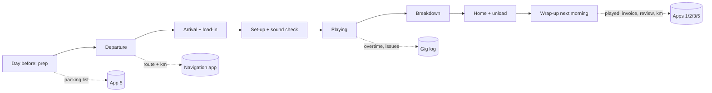
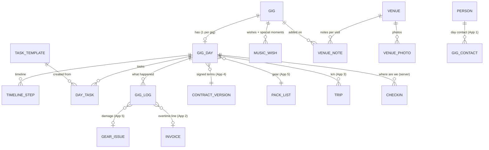

# Funqtion Gig Day — Functional Plan

> App 6 of the Funqtion suite. **FEEL THE MUSIQ.**
> Status: functional plan, no code yet. Builds on apps 1–5 (Bookings, Quotes & Invoices, Money, Contracts, Gear), all live in this repo in local mode, and on Gijs's own navigation app.
> **Decisions made (answers from Gijs):**
> - **Navigation app = [FQ-maps](https://github.com/Gbom2009/FQ-maps)** (Funqtion Maps, Tauri 2 + React, Windows exe now, iPhone/iPad sideloaded later). §6.1 is written for it: Gig Day sends the route as an FQ-maps route code; FQ-maps drives (trailer-aware) and sends drive time, arrival and km back.
> - **No sync server for now.** MVP is local: the plan goes to the other phone by QR/file, logs are merged afterwards, location via Find My (§0.2, §7.2 option A).
> - **Timeline durations: start with the defaults in §1.8 and customise later.** All of them are settings (per set-up: standard / DJ only), editable per gig.
> - **Thank-you + review request: the next morning**, as part of the wrap-up (10:00 card), together with the final invoice draft.
>
> Phone-platform behaviour (iPhone notifications, background location) is described as of late 2026; items marked ⚠️ depend on what Apple allows a web app to do and should be re-checked when building.

## Contents

0. [Read this first: three decisions that shape this app](#0-read-this-first-three-decisions-that-shape-this-app)
1. [Core user flows](#1-core-user-flows)
2. [Data model](#2-data-model)
3. [Screens](#3-screens)
4. [MVP vs. later](#4-mvp-vs-later)
5. [Notifications and reminders](#5-notifications-and-reminders)
6. [Navigation app and phone features](#6-navigation-app-and-phone-features)
7. [Tech stack and offline sync](#7-tech-stack-and-offline-sync)
8. [Branding: Funqtion, but calm on a stressful day](#8-branding-funqtion-but-calm-on-a-stressful-day)
9. [Open questions](#9-open-questions)

---

## 0. Read this first: three decisions that shape this app

**0.1 Most of the data already exists. Gig Day is mainly a view plus a log.** Everything the day needs is already stored in apps 1–5:

| Need | Already in |
|---|---|
| client, day contact, set slots, set-up time, music wishes, venue | App 1: `gig.contacts` (role `day_contact`), `gig.setSlots`, `gig.setupTime`, `gig.musicWishes`, `venue.loadInNotes/parkingNotes/powerNotes/curfew/soundLimitDb/houseSound`, `venue.distanceKm` per member |
| overtime rate, special terms, rider, noise and curfew as agreed | App 4: the signed contract version (frozen snapshot) |
| what to bring, load and unload, laser checklist, trailer and car split | App 5: the gig's packing list |
| final invoice, extra lines | App 2 |
| kilometres | App 3: `trips` (already has a `nav` source) |

So Gig Day adds four things:
- **a timeline** for the day (planned vs. actual times)
- **a shared task list** for Gijs and Coen
- **richer venue profiles** (photos, Wi-Fi, stage, power points, visit history)
- **a log** of what happened, which drives the wrap-up in the other apps

**0.2 "See each other's progress and location" needs the sync server.** All apps run on each phone separately today (`docs/HANDOFF.md`).

- **Without a server (MVP):** each of you sees your own phone. The tasks are split, but you see the other's ticks only after a backup merge. For location, the easiest and most reliable route is what your iPhones already do: **share your location with each other in Find My** (or a WhatsApp live location), started with one tap from the app.
- **With the home server** (PocketBase on a Raspberry Pi/NAS + Tailscale, proposed since App 3; also on the wish list for Gear), you get live task ticks, timeline changes, "Coen is at the venue" check-ins and the log on both phones. Gig Day is the app where two people truly work on the same thing at the same time, so this is **the moment to build that server** (Q2).

**0.3 Reminders on iPhone: use the calendar until there's a server.** An installed web app on iPhone can't schedule its own notifications offline. Web Push needs a server, and background timers don't run ⚠️. The robust, free, offline answer is to **put the gig-day timeline into your iPhone calendar** with alarms. The suite already has a calendar export (App 1, `ics.ts`). Calendar alarms work offline, on the lock screen and on your watch. With the server later: Web Push for the few things that need to reach the other person (§5). With a native iPhone app (Tauri iOS, planned) later: local notifications.

---

## 1. Core user flows

### 1.0 The day at a glance

### 1.1 Day before (prep, ~10 minutes)

1. **Trigger:** App 1 already has a *final check* task (14 days before) and a *gear check* (7 days). Gig Day adds a **"Morgen: Bruiloft Lisa & Tom"** card from 18:00 the day before. In the MVP that card is the calendar event made at the timeline step (§5). It opens the **Prep screen**.
2. **The timeline is generated** (§1.8) and you check it: leave time, load-in, sets, curfew. Drag a step or type a time; everything after it moves along.
3. **Readiness check**, each line one tap to fix:
   - ✓ contract signed (App 4), deposit paid (App 2)
   - ✓ day contact known (name + phone); missing → "Vraag contactpersoon" message to the client
   - ✓ venue address, loading entrance and parking known; missing → fill in now or "ter plekke vastleggen"
   - ✓ music wishes received; special moments with times
   - ✓ packing list confirmed (App 5), gig phone chosen, laser checklist ready if the laser goes
   - ✓ who drives, who picks up what from whose home (the gear lives at both homes)
   - ⚠ weather for outdoor gigs (later, §4), curfew and noise limit
4. **Split the tasks** (§1.9): load-in tasks, set-up, MC duties ("speeches aankondigen"), wrap-up. Default from a template per event type, adjust per gig.
5. **"Plan klaar"**:
   - the timeline goes to both calendars (ICS, or synced via the server later)
   - the packing list status in App 5 becomes *confirmed*
   - the day contact gets an optional WhatsApp: *"Morgen zijn we er om 17:30, laden via de achteringang. Wie is ons aanspreekpunt?"*

### 1.2 Departure

1. **"Vertrekken over 30 min"** (a calendar alarm; with the server, also on the other phone). The Today screen switches to *Vertrek*:
   - big **leave time** with a countdown
   - **pick-up step:** "Ophalen bij Coen: subwoofer, rack" (from App 5 home locations)
   - **Inladen** opens App 5's load flow (scan cases; the laser and controller go in the car)
   - trailer check: hitch lock and lights; the 750 kg load from App 5
2. **"Route"** opens your navigation app with the venue's **loading entrance** as destination (not the front door) and the notes (§6.1). The departure time is logged: *actual leave*.
3. **Location sharing**, opt-in per gig: one tap starts sharing in Find My / WhatsApp for the gig day (MVP), or in-app check-ins once the server exists (§6.3).
4. **Running late?** Big button **"We zijn later"**: choose +15 / +30 / +60 min → a prepared WhatsApp to the day contact, and the timeline shifts (only steps not yet done).

### 1.3 Arrival and load-in

1. Arrival is set automatically when the navigation app reports it (if it can call back, §6.1), or one tap **"Aangekomen"**. This logs the real arrival time and the kilometres for App 3 (§1.7).
2. The **Venue card** comes to the front:
   - loading entrance, parking (with photos from last time)
   - power points, stage size, Wi-Fi, access code, curfew and noise limit
   - the on-site contact: **call / WhatsApp** in one tap
3. **New info is captured right there:** "Foto toevoegen" (loading door, power point, stage), "Notitie" ("stroom op de groep van de bar, niet gebruiken"). It's stored on the venue for next time, with the date and gig.

### 1.4 Set-up and sound check

1. **Set-up checklist** (the template for the set-up: standard / DJ only) with the tasks split between Gijs and Coen; each ticks his own lines.
2. **Laser checklist** from App 5 (class 4: beams above heads, emergency stop, safety cable…) appears as a set-up task when the laser is on the packing list; crowd scanning only with recorded permission (as in App 5).
3. **Power:** the venue's power points + the packing list's power budget (App 5, later) → "2 groepen nodig".
4. **Sound check** step with the venue's noise limit and curfew in big type. *"Soundcheck klaar"* logs the time.
5. If set-up is running late against the doors time, the Today screen shows how many minutes are left in amber, then red.

### 1.5 Playing

The phone lies next to the decks in **Booth mode** (§3.6): a calm, dark screen with the clock, *now* and *next*, countdowns to the next special moment, set end and curfew, and four big buttons:

- **Moment** → the special moments list (first dance, speeches, cake, countdown) with times, songs and notes; tap "Gedaan"
- **Verlenging** → "+30 min gevraagd door [name]" → logs overtime with who asked and when (contract P3: a request on the night counts as agreement). Shows the curfew check ("kan tot 01:00 volgens vergunning").
- **Notitie/Probleem** → quick log: issue, damage (→ App 5 issue, "door gasten" → contract L2), complaint, compliment
- **Vibe** → 1–5 + optional word ("dansvloer vol om 23:15")

Set start/end are logged with one tap (or automatically at the planned time, confirmed later). Breaks and DJ switches (Gijs ↔ Coen) come from `setSlots`.

### 1.6 Breakdown and leaving

1. **"Laatste plaat"** logs the actual end. Overtime is calculated from planned vs. actual end and from the logged requests, never only from the clock.
2. **Breakdown checklist** + App 5 **unload flow** (scanning each item, or case-level, as set in App 5).
3. **Before leaving:** "Niets vergeten?" (App 5's missing items: left at venue / lost / broken), the venue walk-through ("stroomkabels, statieven, USB in de speler?"), hitch lock, the trailer is never left loaded overnight.
4. **"Vertrokken"** → departure time; route home opens in the navigation app.

### 1.7 Home and wrap-up (next morning, 5 minutes)

1. **"Thuis"** (one tap, or the navigation app's end of trip): App 5 check-in is finished at home (each item back in its place).
2. **Next morning, 10:00: a wrap-up card** with everything prepared, each item one tap:
   - **App 1:** gig → *played* (with the real times in the gig's timeline)
   - **App 3:** trip(s) with **km**: from the navigation app if it reports them, else the venue's known distance per driver, round trip, editable (`source: 'nav'` or `'venue'`); parking costs if logged
   - **App 2:** **final invoice** draft, with an **overtime line** when overtime was logged: half-hours × the contract's overtime rate (App 4 snapshot), and a note "verlenging op verzoek van … om 00:55"
   - **App 5:** open issues and damage; missing items follow-up
   - **Client:** a **thank-you + review request** (App 1 template `thank_you_review`, sent by WhatsApp/e-mail with the review link), timing per your preference (same night vs. next day, Q8)
   - **Venue profile:** confirm the notes and photos added on the day
   - **Gig log summary:** times, overtime, vibe, issues: saved with the gig (for next year's rebooking and for disputes)
3. **"Afronden"** marks the gig day closed; anything skipped stays as a task in App 1.

### 1.8 How the timeline is built (automatic, always editable)

Built backwards and forwards from what's known, with defaults per set-up (Q4):

| Step | Default rule | Source |
|---|---|---|
| Sets, breaks, DJ switches | `setSlots` (or start–end) | App 1 |
| Special moments | times from the music wishes, or "after set 1" | App 1/6 |
| Curfew, noise limit | venue / contract snapshot | App 1/4 |
| Doors / guests arrive | entered, or 30 min before the first set | gig day |
| Sound check done | 30 min before doors (standard set), 15 min (DJ only) | defaults |
| Set-up start | `gig.setupTime`, else sound check − 90 min (standard set) or − 30 min (DJ only) | App 1/5 |
| Arrival / load-in | set-up − 15 min | defaults |
| **Leave home** | arrival − travel − 15 min buffer − pick-up stop | below |
| Travel time | **FQ-maps' drive time** for this gig (Valhalla, truck routing with the trailer, its tow speed caps 90/80/50 km/h) + its traffic margin, when it has been sent back (§6.1); otherwise an estimate from `venue.distanceKm` per member ÷ 60 km/h (55 with the trailer), rounded up to 5 min | FQ-maps / App 1 |
| Breakdown | last set end + 60 min (standard) / 20 min (DJ only) | defaults |
| Leave venue / home | breakdown end; home = + travel | defaults |

Two leave times when you start from different homes (the gear lives at both), plus a **pick-up step** at the other's home when App 5 says something must be collected there. Every step has a **planned** and an **actual** time; the plan shifts when you change a step, but done steps never move.

### 1.9 Splitting tasks between Gijs and Coen

- Tasks come from **templates** per phase (prep / departure / set-up / playing / breakdown / wrap-up) and set-up (standard / DJ only), plus anything you add. Each task has an **owner** (Gijs / Coen / both) and optionally a time (a timeline step).
- Each phone shows **"Mijn taken"** first; the other's tasks are folded in with a progress bar ("Coen 4/6").
- MVP: progress of the other person isn't live (no server); the split is clear because it was agreed the day before and both phones have the plan (backup merge or "deel plan" QR, §7). With the server: live ticks.

---

## 2. Data model

### 2.1 Principles

- Same conventions as apps 1–5: UUIDs, `createdAt/By`, `updatedAt/By`, soft delete, `save()`/`patch()` audit log, money in cents, dates `yyyy-mm-dd`, times `HH:mm`. New tables in Dexie **`version(6)`**, added to `DATA_TABLES`; photos as Blobs in the backup ZIP (like App 5).
- **Reuse, don't copy:** contacts are App 1 persons (`gig.contacts`), music wishes extend App 1's `gig.musicWishes`, venue data extends App 1's `venues`, the packing list is App 5's. Gig Day stores only the plan, the tasks, the log and the extra venue knowledge.
- **The log is append-only** (like App 5 movements): two phones logging at once never conflict, which matters for sync (§7).
- **Pure logic** (timeline generation, overtime calculation, wrap-up proposals) in `src/apps/gigday/domain/`, unit-tested.

### 2.2 Entity diagram

### 2.3 Tables

| Table | Key fields | Notes |
|---|---|---|
| `gigDays` | gigId (unique), status (`draft`, `planned`, `live`, `wrapping_up`, `closed`), setup (`standard` / `dj_only`, from App 5's set-up), doorsAt, curfew (copied from venue/contract, editable), noiseLimitDb, drivers (memberId → car/trailer), startFrom (memberId → `home_gijs` / `home_coen`), travelMinutes (per member, estimate or nav), bufferMinutes, contractVersionId (App 4), packListId (App 5), plannedAt, liveAt, closedAt, shareLocation (bool, per member), wrapUp (json: which wrap-up actions were done, with links) | One per gig; created at the first open or by the day-before card. |
| `timelineSteps` | gigDayId, kind (`leave_home`, `pickup`, `arrive`, `load_in`, `setup`, `soundcheck`, `doors`, `set_start`, `set_end`, `break`, `moment`, `curfew`, `breakdown`, `leave_venue`, `home`, `custom`), label, plannedAt (ISO), actualAt, memberId (for per-person steps such as leave home), remind (minutes before, or none), locked (manually set → not moved by regeneration), sourceRef (setSlotId / musicWishId), sort | Regeneration keeps locked and done steps. |
| `dayTasks` | gigDayId, phase (`prep`, `departure`, `setup`, `playing`, `breakdown`, `wrapup`), title, owner (`gijs` / `coen` / `both`), stepId (optional time), done, doneAt, doneBy, templateItemId, note | Small, flat; ticking is a field update. |
| `taskTemplates` | name, eventTypes[], setup (`standard` / `dj_only` / `any`), items: [{phase, title, owner, offsetStep?, laserOnly?, outdoorOnly?}], active | Seeded: "Opbouw standaard set", "DJ only", "Bruiloft extra's" (speeches, first dance), "Buiten" (cover, weights, rain covers). |
| `gigLogs` | gigDayId, gigId, at, by (member), type (`leave`, `arrive`, `soundcheck_done`, `set_start`, `set_end`, `overtime_request`, `overtime_end`, `moment_done`, `issue`, `damage`, `complaint`, `compliment`, `vibe`, `note`, `photo`, `late`), payload (json: minutes, requestedBy, vibe 1–5, text, issueId, photoId), offline (bool, created without sync) | Append-only. Drives the wrap-up and the gig's history. |
| `venueNotes` | venueId, gigId?, kind (`load_in`, `parking`, `power`, `stage`, `wifi`, `access`, `noise`, `contact`, `general`), text, photoId?, validFrom, stale (bool, "klopt niet meer") | History per visit: newest first, stale ones folded. |
| `venuePhotos` | venueId, gigId?, kind (`entrance`, `parking`, `power`, `stage`, `booth`, `other`), caption, blob, takenAt, by | Blobs, in the backup ZIP. |
| **`venues` (App 1, extended)** | + loadingEntrance {lat, lng, note}, parking {lat, lng, note}, stageSize ("6 × 4 m"), powerPoints (text), wifiName, **wifiPassword** (device-only, never exported unencrypted, Q9), accessCode (same), houseRules, defaultDoors | Existing fields stay: loadInNotes, parkingNotes, powerNotes, houseSound, curfew, soundLimitDb, distanceKm per member. |
| **`gig.musicWishes` (App 1, extended)** | kind (`genre`, `must_play`, `do_not_play`, `special_moment`) + for moments: at (time or "after set 1"), title ("Openingsdans"), track (artist – title), cue ("na de speech van de vader"), mc (announce? who), done, doneAt | No new table; the special moments also become timeline steps. |
| `checkins` (server only) | gigDayId, memberId, at, kind (`left_home`, `arrived`, `pickup_done`, `left_venue`, `home`), lat?, lng?, accuracy? | Not continuous tracking: a few events per gig day. Deleted after 30 days. |
| **Settings** | gigDayDefaults: {soundcheckBeforeDoors, setupMinutes {standard, dj_only}, breakdownMinutes {…}, arriveBeforeSetup, leaveBuffer, avgSpeedKmh, avgSpeedTrailerKmh, reminders: {…}}, navApp: {kind, urlTemplate, …}, wrapUpAt ("10:00"), thankYouTiming (`same_night` / `next_morning`) | Per device. |

### 2.4 Links to apps 1–5 and the navigation app

| App | Gig Day reads | Gig Day writes / triggers |
|---|---|---|
| **1 Bookings** | gig (date, times, set slots, set-up, performers, owner), client + day contact (persons), venue, music wishes, tasks | stage → *played* at wrap-up (existing rule: only on/after the date); real times on the gig; venue profile updates; extended music wishes; tasks for skipped wrap-up items; the day-before message to the day contact |
| **2 Quotes & Invoices** | accepted quote, deposit status | final invoice draft (`createInvoiceFromQuote(final)`) + **overtime line** (half-hours × rate); a damage note for the invoice when guests caused damage |
| **3 Money** | mileage rate | `trips`: one per driver, km from the nav app (`source: 'nav'`) or the venue distance (`'venue'`), round trip; parking as an expense |
| **4 Contracts** | the signed version: sets, overtime rate, curfew/noise, special terms, rider (what the venue provides), photo opt-out (no promo shots with guests!) | nothing (the log is evidence if a dispute comes up) |
| **5 Gear** | packing list, set-up choice, gig phone, laser checklist, trailer/car split, home locations (pick-up step) | opens the load/unload flows; damage → `gearIssues` (with `causedByGuests`, gigId) |
| **Navigation app** | (if it can) travel time estimate, arrival event, km driven | gets the destination (loading entrance), notes and the gig reference via a link/URL scheme or the shared database (§6.1) |

---

## 3. Screens

Mobile first (iPhone, often one-handed, often in the dark, often with headphones on). Same AppShell as the other apps, but **Gig Day hides the tab bar while a gig day is live**: the Today screen *is* the app. Rules:
- every primary action is a **big bottom-row button** (≥ 64 px), reachable with the thumb
- there are never two equally important buttons next to each other
- text ≥ 18 px, times ≥ 32 px
- **night mode** (from App 5) on by default after 20:00
- the screen stays on (Wake Lock) in Booth mode

### 3.1 Gig list (`/gigday`)
- Today first (big card), tomorrow (prep card), then upcoming. Each card: title, time, venue, readiness dots (contract · deposit · contact · gear · wishes), and the next action ("Plan maken", "Vertrek 17:15", "Afronden").

### 3.2 Prep (`/gigday/:gigId/prep`), the day before
- Readiness checklist (§1.1) with fix-it buttons; the timeline editor (list of steps with times; tap → time wheel; "alles na deze stap mee verschuiven"); drivers and start homes; task split by phase with owner chips; **"Plan klaar"** (calendar export + share).

### 3.3 Today (`/gigday/:gigId`), the hub on the day
- **Header:** gig title, date, the phase chip (Vertrek / Opbouw / Spelen / Afbouw / Thuis).
- **Now / Next card** (huge): the current step and the next one with a countdown ("Soundcheck klaar over 0:22"). Behind schedule → amber, then red, with "+15 min schuiven".
- **One-tap row:** Route · Bel contact · WhatsApp · Venue · Inladen/Uitladen (App 5).
- **My tasks** for this phase (big ticks), the other's progress bar.
- **Bottom button:** the phase's main action ("Vertrokken", "Aangekomen", "Soundcheck klaar", "Booth mode", "Laatste plaat", "Thuis").

### 3.4 Timeline (`/gigday/:gigId/timeline`)
- Vertical timeline: planned time, actual time (green/amber/red difference), owner, reminder bell. Tap a step → set the actual time now, edit, or move.

### 3.5 Venue card (`/gigday/:gigId/venue`)
- Address + **loading entrance** (route button), parking, photos (swipe), power points, stage size, Wi-Fi (tap to copy the password), access code, curfew and noise limit in big type, house rules, notes from earlier visits (newest first, "klopt niet meer" to fold one). **+ Foto / + Notitie** always visible.

### 3.6 Booth mode (`/gigday/:gigId/booth`), next to the decks
- Black screen, dim. A big clock; **now playing: Gijs / Coen until 23:30**; countdowns: next moment, set end, **curfew**; the noise limit.
- Four quarter-screen buttons: **Moment** · **Verlenging** · **Notitie** · **Vibe**. A long press is needed to leave (no accidental taps). Wake Lock on.
- Optional "red mode" (red-on-black, keeps night vision, invisible to the crowd).

### 3.7 Music & moments (`/gigday/:gigId/music`)
- Special moments in time order (time / cue / track / who announces), with a big **"Gedaan"**; must-plays (tick when played), do-not-plays (always visible as a red list), genres. Search box for "mag dit?" ("is X on the do-not-play list?").

### 3.8 Contacts sheet
- Client, day contact, venue manager, technician, planner (App 1 roles): name, role, **Bellen** / **WhatsApp** / **SMS** buttons, last message. "Wie is er vandaag?" shows the day contact first.

### 3.9 Log (`/gigday/:gigId/log`)
- Quick-add chips (Probleem, Schade, Klacht, Compliment, Notitie, Foto, Vibe) and the running list. Damage → asks which item (App 5 scan or pick) → creates the App 5 issue.

### 3.10 Wrap-up (`/gigday/:gigId/wrapup`), the next morning
- A checklist of prepared actions, each with its preview and a one-tap "Doen": gig played · trip(s) km · final invoice (+ overtime line) · thank-you + review · venue notes · gear issues · log summary. **"Afronden"**.

### 3.11 Desktop
- The same screens in two columns (prep and wrap-up are nicer on a laptop); task templates and defaults in Settings.

---

## 4. MVP vs. later

### MVP: v6.0 "Everything for tonight on one screen, offline" (local mode, no server)
- Gig days with the **generated timeline** (planned/actual, editable, shift-along), defaults per set-up.
- **Today** screen with Now/Next, the one-tap row, the phase button; **Booth mode**; night mode, Wake Lock.
- Contacts sheet with call / WhatsApp / SMS; "We zijn later" message + timeline shift.
- **Venue card** with the extended venue fields, notes per visit, **photos**.
- **Music & moments:** extended music wishes, special moments as timeline steps, must-play ticks, do-not-play list.
- **Tasks** from templates with owners (per phone; the split is agreed and shared via the plan).
- **Log**: set start/end, overtime requests, issues, damage (→ App 5), vibe, notes, photos.
- **Wrap-up**: played (App 1), trip km (App 3, from the venue distance), final invoice + overtime line (App 2), thank-you + review message, gear issues (App 5).
- **Navigation (FQ-maps)**: "Route" shows the FQ-maps route code as QR/file (works today), or opens `fqmaps://route?d=…` once FQ-maps registers the link; drive time, arrival and km come back via the return link (§6.1). Apple/Google Maps as fallback.
- **Reminders via calendar export** (ICS with alarms) per person (§5).
- **Share the plan** to the other phone: a QR code / file with this one gig day (no full backup needed).
- Unit tests: timeline generation, shifting, overtime calculation, wrap-up proposals.

### v6.1 (with the home server)
- **Live sync** of timeline, tasks and log between both phones; "Coen 4/6" live.
- **Check-ins** ("Coen is vertrokken / aangekomen") and opt-in location at those moments.
- **Web Push** for the few cross-person alerts (§5).
- FQ-maps reads and writes the shared database directly (gigs, venues, trips) instead of links.

### Later
- Weather for outdoor gigs (KNMI warnings, rain radar), linked to contract A3/A4 (weather and force majeure).
- A decibel indicator (the phone's microphone gives a rough value, not a calibrated measurement).
- Client portal (app 7): the client fills in music wishes and moments; the day contact sees "we're on our way".
- Native iPhone app (Tauri iOS): local notifications, Live Activity / lock-screen countdown ⚠️, background location for check-ins.
- A setlist log (what was played when), integration with DJ software exports (rekordbox history).
- Post-gig photo selection for promo (respecting the contract's photo opt-out).

---

## 5. Notifications and reminders

**Principle: few, timed, personal, and silent while playing.**

| When | What | To whom | How (MVP → server) |
|---|---|---|---|
| Day before, 18:00 | "Morgen: Bruiloft Lisa & Tom, vertrek 16:45. Plan checken?" | owner + performers | calendar event (all-day reminder) → push |
| Leave home − 30 min | "Vertrek over 30 min: ophalen bij Coen eerst" | each driver (own leave time) | calendar alarm → push |
| Leave home | "Nu vertrekken: route openen" | each driver | calendar alarm (with the route link in the notes) → push |
| Set-up start − 0 | nothing: you're there, the Today screen guides | — | — |
| Doors − 15 min, if set-up/sound check isn't done | "Soundcheck nog niet klaar, deuren over 15 min" | both | in-app banner only (you're at the venue) → push only to the other phone |
| Special moment − 5 min | "Openingsdans over 5 min: [track]" | the one playing | **in-app (Booth mode) only**, with a flash, never a sound |
| Curfew − 15 min | "Eindtijd over 15 min (vergunning)" | the one playing | in-app (Booth mode) |
| Leave venue | nothing | — | — |
| Next morning, wrap-up time (10:00) | "Bruiloft afronden: 6 acties klaar" | gig owner | calendar alarm → push |
| Something left at the venue / damage | the existing App 1/5 tasks | owner | tasks (no extra push) |

Not annoying, because:
- **Silence while playing.** No sounds from the app during a gig; Booth mode shows visual countdowns only. Tip: an iPhone **Focus "Gig"** that allows calls only from the day contact and each other.
- **Personal.** Each person gets their own leave time; the other isn't pinged for steps that aren't theirs.
- **Maximum 3 alarms on the phone per gig** (day before, leave −30, leave), plus the wrap-up next morning. Everything else is in the app.
- **No reminder for something already done** (with the server; in the MVP the calendar alarm can't know, so the alarms are deliberately few).
- **Settings:** per reminder on/off and the minutes, "stille uren".

---

## 6. Navigation app and phone features

### 6.1 FQ-maps (your navigation app)

**What FQ-maps already has** (read from its repo, Nov 2026):
- **Routes**: Valhalla with trailer-aware truck routing and tow speed caps.
- **Gigs and venues of its own**: leave-by from load-in time + set-up buffer + traffic margin, reminders while the app is open, venue cards with a load-in-door pin, a trailer-parking pin, contact, notes and photos.
- **Share ETA.**
- **A trip log** (km, start/end, car, trailer, gigId, arrived).
- **Route hand-over without a server**: a compact route code `FQR1.<deflate+base64url>` (stops + route options + car + trailer) as a QR code or `.fqroute`/`.gpx` file. Its decoder already accepts the link form `fqmaps://route?d=FQR1.…`.

**Division of work:** Gig Day owns the **gig plan** (timeline, tasks, log, venue knowledge); FQ-maps owns **driving** (route, live drive time, guidance, trip km). Gigs and venues are entered **once**, in the suite, and handed to FQ-maps, so the two apps never disagree.

**Suite → FQ-maps ("Route" button):**
1. **Works today, without any change to FQ-maps:** Gig Day builds an FQ-maps route code (same format, same pure functions as `features/handoff/routeCode.ts`), with these stops:
   - start (home)
   - pick-up at the other member's home, if needed
   - the venue's **loading entrance**
   
   plus the trailer profile and route options. It's shown as a **QR code** (scan with FQ-maps on the iPad/iPhone) or saved as a `.fqroute` file.
2. **One tap (small FQ-maps change):** register the `fqmaps://` URL scheme in FQ-maps (Tauri deep-link plugin; on iPhone a URL scheme in the app's Info.plist). Then "Route" in Gig Day simply opens `fqmaps://route?d=FQR1.…` and FQ-maps opens with the route planned.
3. **Gig hand-over (FQ-maps change, recommended):** add an optional `gig` block to the payload (version 2):
   - title, date, load-in time, set-up buffer, suite gig id
   - venue name, address, load-in door, trailer parking, day contact, notes
   
   FQ-maps creates or updates its gig and venue from it, so its leave-by, reminders and Share ETA work with the suite's data.

**FQ-maps → suite (results back):**
- FQ-maps opens a **return link** `<suite>/#/gigday/<gigId>/nav?driveMin=…&arrivedAt=…&km=…&trip=…` (the suite URL is a setting in FQ-maps: the GitHub Pages hub, or a `funqtion://` scheme once the suite exe registers one). It sends:
  - after "Bereken reistijd": the **drive time** for the timeline's leave time
  - on arrival: the **arrival time** for the log
  - after the trip: the **km** for App 3 (`trips`, `source: 'nav'`, linked to the gig)
- **Fallback without the link:** FQ-maps' Setlist exports trips (JSON/CSV) → import in App 3 (matching on gig id/date), or the km from the venue distance.
- **Venue pins back:** when you set or correct the load-in door or trailer parking on FQ-maps' map (it has pin-picking), a "send to suite" return link updates the venue profile, so the next gig routes there automatically.

**Changes needed in FQ-maps** (small; done in that repo, which this session can read but not push to):
1. register the `fqmaps://` deep link (Tauri deep-link plugin) and route it to the existing `decodeRoute`/`applyPayload`
2. payload v2 with the optional `gig` block, upserting FQ-maps' gig and venue (keyed on the suite gig/venue id)
3. a setting "Funqtion Hub-adres" and the return links (drive time, arrival, km, venue pins)
4. (later) the Tauri notification plugin (FQ-maps' Phase 6), which also gives background reminders

With the sync server later, both apps can read and write the shared database directly instead of links. The data shapes above are the same, so nothing is wasted.

### 6.2 Calls, WhatsApp, SMS, e-mail
- **Call:** `tel:` link. **WhatsApp:** `https://wa.me/<number>?text=…` (already used in App 1's message composer), with prepared texts: "We zijn er over 15 min", "We zijn later", "Aangekomen, waar mogen we laden?". **SMS:** `sms:`. **E-mail:** `mailto:`.
- All templates are editable (App 1 templates), in Dutch and English.

### 6.3 Location sharing
- **MVP (recommended): use what your iPhones already do best.** Share your location with each other permanently in **Find My** (it's private between the two of you, works in the background and costs no battery from our app). The Today screen has a button "Waar is Coen?" that opens Find My (iPhone app link, ⚠️ check on the device). WhatsApp live location for the day contact if useful.
- **With the server:** **check-ins** at the moments that matter (left home, picked up, arrived, left venue, home), each with an optional location point. That gives "Coen: aangekomen 17:42" without continuous tracking; it's opt-in per gig day and deleted after 30 days.
- **Continuous tracking** inside the app isn't feasible as a web app on iPhone (no background location) ⚠️ and isn't needed; it would come with the native app, if ever.

### 6.4 Other phone features
- **Camera** for venue photos and damage (as App 5).
- **Wake Lock** (screen on) in Booth mode and while loading.
- **Haptics:** Android only; iPhone web apps can't vibrate ⚠️, so the cues are visual.
- **Calendar:** ICS export/subscription (§5).
- **Share sheet:** share the plan, the venue card or the log summary.

---

## 7. Tech stack and offline sync

### 7.1 Fits apps 1–5 unchanged
- The same React/TypeScript/Vite hub, Dexie `version(6)`, the audit log, NL/EN i18n, AppShell, the reminder engine (App 1 tasks), pdfmake (log summary PDF), and the Tauri exe.
- Code in `src/apps/gigday/`:
  - `domain/timeline.ts`: generation, shifting, planned vs. actual
  - `domain/overtime.ts`: half-hours, rate, invoice line
  - `domain/wrapup.ts`: proposals for apps 1/2/3/5
  
  All three are pure and tested.
- **Offline:** everything for the day is on the phone. The app shell is cached by the PWA, the data is in IndexedDB, photos are Blobs. A venue basement without signal changes nothing.

### 7.2 Sync (the decision for this app)

| Option | Cost | What you get |
|---|---|---|
| **A. Local + share the plan** (MVP) | €0 | Both phones get the plan via a QR/file export of one gig day (and the existing backup merge). Each phone logs its own things; the logs merge afterwards (append-only, no conflicts). |
| **B. Home server: PocketBase** on a Raspberry Pi 5 / NAS + **Tailscale** (recommended for v6.1) | ~€0–100 one-off | Live sync for all apps, realtime for tasks and log, Web Push, check-ins, the nav app writing km. Phones keep working offline and sync when back in range. |
| C. The same on a small EU VPS | ~€5/month | Always reachable without a home connection; client data off-site. |

**How sync stays solid offline:**
- Every record has a UUID, `updatedAt` and `updatedBy` (true since App 1).
- **Logs and movements are append-only**, so they never conflict.
- **Tasks and timeline steps** use per-field last-write-wins, and a "done" never goes back to "not done" through sync.
- Each phone keeps an **outbox** of changes made offline and sends it when the server is reachable.
- **Photos** upload in the background once there's Wi-Fi.
- The data model is ready for this without reshaping.

---

## 8. Branding: Funqtion, but calm on a stressful day

- **Calm first.** Gig Day is used under time pressure, in the dark, with loud music. The Funqtion style is in the frame; the content is quiet and very legible.
- **Dark and night mode** by default (App 5's night mode); Booth mode is pure black with dim text, optionally red. No white screens after 20:00; photos are dimmed in night mode.
- **One colour for "do this now":** orange (`#f68712`) only for the single main button and the current step. Status uses words and icons, not just colour: ✓ op schema (green), ⏱ achter (amber), ! te laat (red).
- **Typography:** times and countdowns in JetBrains Mono (tabular, no jumping digits), very large (32–64 px in Booth mode); Archivo Black only for the gig title and the phase. Body ≥ 18 px.
- **Short, concrete wording:** "Vertrek 16:45: eerst sub ophalen bij Coen". No jokes during the gig; personality only in the moments around it: the plan done ("Plan staat. Morgen knallen."), arrival, and the wrap-up ("Alles afgerond. FEEL THE MUSIQ.").
- **No animations** during the set, except one subtle pulse for a moment that starts in under 5 minutes; respect "reduce motion".
- **Big, forgiving targets:** at least 64 px for main actions, long-press for destructive or leaving actions, undo for every tick (5 seconds).

---

## 9. Open questions

Answered: navigation app (FQ-maps), sync (no server for now), timeline durations (defaults, customise later), thank-you timing (next morning). Still open:

1. **FQ-maps changes:** may Gig Day rely on the small FQ-maps changes in §6.1 (deep link `fqmaps://`, payload v2 with the gig, return links)? They're done in the FQ-maps repo. Until then the QR/file route code works without changes.
2. **One source for gigs and venues:** OK that gigs and venues are entered in the suite (App 1) and FQ-maps receives them, instead of maintaining them in both apps?
3. **Location:** Find My sharing between you two as the MVP solution? (FQ-maps' "convoy mode" would need a relay server, so it waits for the server too.)
4. **Departure:** who usually drives and tows, do you often start from two different homes, and where do you meet?
5. **Reminders:** which calendar app do you use (Apple Calendar, Google)? Calendar alarms OK as the MVP reminder until FQ-maps/the suite run as native iPhone apps?
6. **Special moments:** which ones come up most, and do you announce on the mic yourselves (MC role)?
7. **Review link:** which one (Google, Facebook)?
8. **Venue data:** OK to store Wi-Fi passwords and access codes on the phones (encrypted in backups)? Venues you play often, to fill in first?
9. **Vibe and log:** a 1–5 scale, or words ("leeg / halfvol / vol / los")? Anything else to log every gig?
10. **Multi-gig days:** do you sometimes play two gigs on one day? Then the Today screen needs a "next gig" switch.
11. **Instagram handle:** the suite uses **@funqtionofficial**, FQ-maps' story export uses **@funqtion1**. Which one is right?
