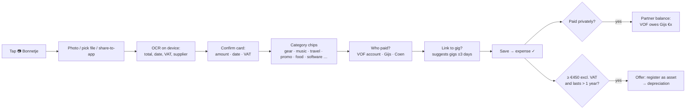
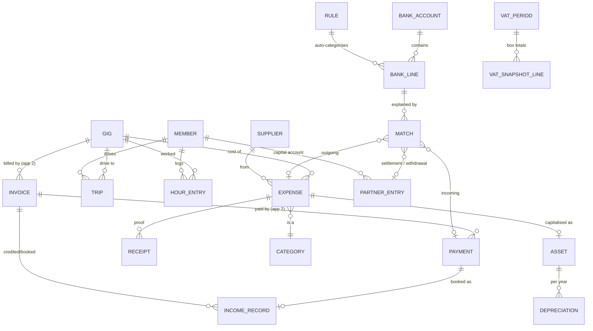

# Funqtion Money & Accounting — Functional Plan

> App 3 of the Funqtion suite. **FEEL THE MUSIQ** — but with the books in order.
> Status: functional plan, no code yet. Builds on App 1 (Bookings & CRM) and App 2 (Quotes & Invoices), both live in this repo.
> Tax points are a practical summary, **not tax advice**. Rates and thresholds change every year; items marked ⚖️ must be checked with an accountant or the Belastingdienst, and every rate in the app is a **dated setting**, never hard-coded.

> **Decisions made (v0.3 build)**: these replace the matching recommendations below.
> - **Registration:** expected within the next 3 years → the app runs in **"not registered"** mode now (results per person as *resultaat uit overige werkzaamheden*). KOR/VAT modes are built in for later; the VAT quarter screen appears once the mode is set to VAT-liable.
> - **Bank:** probably **Revolut** → Revolut (personal and Business) CSV import added next to ING, Rabobank, ABN AMRO, bunq and CAMT.053.
> - **Split:** **50/50 by default, adjustable**: fixed % or per gig by lineup, with dated rules (a new rule applies from its start date).
> - **Jobs next to Funqtion:** yes → hours are tracked lightly (automatic from gigs + quick manual logging); the urencriterium is shown for information only.
> - **Server:** not now → everything is local, with **encrypted backups that include receipt photos**. A home server can be added later.
> - **Existing gear:** not answered yet → you can add it any time under *Investeringen* (as a contribution).

## Contents

0. [Starting point and key recommendation](#0-starting-point-and-key-recommendation)
1. [Core user flows](#1-core-user-flows)
2. [Data model](#2-data-model)
3. [Dutch tax points for a DJ duo](#3-dutch-tax-points-for-a-dj-duo)
4. [Screens](#4-screens)
5. [MVP vs. later](#5-mvp-vs-later)
6. [Bank import and receipt OCR options](#6-bank-import-and-receipt-ocr-options)
7. [Tech stack, security and backups](#7-tech-stack-security-and-backups)
8. [Branding: Funqtion, but trustworthy numbers](#8-branding-funqtion-but-trustworthy-numbers)
9. [Record keeping and privacy](#9-record-keeping-and-privacy)
10. [Existing tools vs. custom: the hybrid advice](#10-existing-tools-vs-custom-the-hybrid-advice)
11. [Open questions](#11-open-questions)

---

## 0. Starting point and key recommendation

What is true today (from apps 1–2 and your answers):

- You're **not registered yet** (no KvK, no VAT). App 2 is in "not registered – no VAT" mode.
- Everything runs **local-first** (IndexedDB on each device, Windows exe, iPhone PWA). There's **no server**, and you prefer localhost.
- Bank details are entered by you on the device, never in code.
- App 2 already produces invoices, credit notes and **manually registered payments**, and App 1 holds gigs with dates, times, venues and lineups.

**The app has to work in three tax situations** and switch between them without re-entering data. This is the same "business profile mode" as App 2:

| Mode | VAT | Income tax | What App 3 does |
|---|---|---|---|
| **A. Not registered (hobby / resultaat uit overige werkzaamheden)** | none | profit is "ROW" in box 1, no entrepreneur deductions | Track income and costs per person, profit per gig, a year overview per person for the IB return |
| **B. VOF/eenmanszaak + KOR** | none charged, **no** input VAT reclaim, no quarterly returns (⚖️ except reverse-charge purchases) | "winst uit onderneming" if you qualify as entrepreneur | Same as A, plus KOR turnover meter, hours for the urencriterium, assets and depreciation, partner capital accounts |
| **C. VOF/eenmanszaak, VAT-liable** | 21%/9% on sales, input VAT reclaimed, **quarterly returns** | as B | Everything, plus VAT per transaction, quarterly VAT overview per box, period locking |

**Recommendation in one sentence:** build a **light custom Money app** for what's unique to you (profit per gig, the Gijs/Coen split, mileage from gigs, hours, set-aside dashboard, receipts on your phone). Do **not** build a full ledger with tax filing. When you register, and certainly once you're VAT-liable, either hand a clean **export pack** to an accountant each quarter/year, or **sync to Moneybird or e-Boekhouden** as the official books. See §10.

---

## 1. Core user flows

### 1.1 Receipt → categorised expense (on the phone, < 20 seconds)



1. **Capture.** The big ＋ button → *Bonnetje*. Use the camera, pick from photos/files, or share a PDF from your mail (e.g. a Beatport or Adobe invoice) to the app.
2. **Read.** On-device OCR suggests **total, date, VAT amount/rate and supplier**. Fields with low confidence are highlighted, and you can always correct them.
3. **Supplier memory.** If the supplier is known ("Thomann", "Beatport", "Shell"), the app pre-fills category, VAT rate, business % and "reverse charge yes/no" from the last time.
4. **Categorise.** One tap on a category chip (list in §2.3). Mixed-use items get a business % (e.g. phone 50%).
5. **Who paid.** Choose the **VOF/business account**, **Gijs privately** or **Coen privately**. Private payments create a partner claim automatically (1.5).
6. **Gig link.** The app suggests gigs within ±3 days of the receipt date (fuel on the way to *Kermis Beek en Donk*, food at the wedding). Linked costs count in **profit per gig**.
7. **Save.** It works offline. The photo is compressed (~300 KB) and stored with a hash, and the expense shows *✓ bon aanwezig*.
8. **Later matching.** When the bank statement is imported, the expense is matched to the bank line (1.3), so nothing is counted twice.

Special cases:

- **Forgot the receipt:** you can save an expense without one (status *bon ontbreekt*). It shows up in the "missing receipts" counter until you fix it.
- **Foreign online services** (Spotify, Beatport, Rekordbox, Dropbox) ⚖️: these are flagged *buitenlandse dienst*. In VAT mode the VAT may be **reverse-charged** to you (§3.3). Under KOR there's a gotcha, see §3.3.

### 1.2 Invoice paid → income (automatic)

1. In App 2 you register a payment (or later a bank match does it).
2. App 3 creates an **income record** for that payment: date, amount, the **excl./VAT split per rate** (copied from the invoice), client, gig, and invoice number.
3. Credit notes create negative income, and cancellation invoices count as income from cancellation fees.
4. **Two views of income**, both kept:
   - **Invoiced (accrual).** Income counts on the invoice date. This is the basis for VAT (*factuurstelsel*) and for the year profit (outstanding invoices at year end are still income).
   - **Received (cash).** Money in on the payment date. Used for the cash dashboard and for "what can we spend".
5. **Profit share.** Each income record is split between Gijs and Coen by the split rule (§2.6), for example by lineup: a gig played by both is 50/50, while a solo gig follows your rule.

### 1.3 Bank import → matching

1. **Import.** Download a CSV/CAMT.053 export from your bank (monthly), then choose *Importeer bankafschrift*. The app detects the bank format (ING, Rabobank, ABN AMRO, bunq, Knab, ASN/SNS/RegioBank) and shows a preview. Duplicates are skipped by hash (date + amount + counterparty + description).
2. **Matching inbox.** Unmatched lines appear as a **card stack**: swipe on mobile, keyboard on desktop. For each line the app suggests:
   - **Incoming money:** the open invoice with the same amount and/or the invoice number in the description → *registreer betaling* (also marks the App 2 invoice paid).
   - **Outgoing money:** an expense with the same amount ±3 days → *koppel*. Otherwise → *maak uitgave* (pre-filled from the bank line; add the receipt later).
   - **Transfer** between your own accounts, **private** (not business, ignore), or a **partner settlement** (Gijs pays Coen back) → partner balance.
3. **Rules.** "Always: *Spotify AB* → Music & subscriptions, 100% business". Rules are suggested after you match the same counterparty twice.
4. **Result.** Every business bank line is explained, every expense has a payment, every paid invoice has money in. Reconciliation status per month is shown on the dashboard ("Okt: 3 open").

### 1.4 Mileage per gig

1. Every gig from App 1 with a venue gets a **suggested trip**: *home → venue → home*, per driver (who drives is chosen once per gig, default the gig owner).
2. **Kilometres** come from, in order of preference:
   - **your navigation app** (later: it writes the real km per trip into the shared database)
   - a **saved distance** for that venue (asked once, reused for every later gig there)
   - manual entry
   - estimated with straight line × 1.3 (clearly marked *schatting*, never used in exports without confirmation)
3. **Other business trips** (buying gear, a meeting with a client, a rehearsal) can be added by hand.
4. The trip log produces a **rittenregistratie** (date, from, to, purpose, km, driver, car), so the km allowance (§3.6) can be substantiated.
5. **Per gig:** km × the mileage rate is shown as a travel cost in profit per gig. Optional extra costs per trip: parking and tolls.

### 1.5 Partner split: who paid, who is owed

- **Expenses paid privately** by Gijs or Coen → the business owes them → shown as a balance.
- **Income received privately** (e.g. a client paid a Tikkie to Coen) → Coen owes the business → balance.
- **Profit share** at month or year end → added to each partner's **capital account** (*kapitaalrekening*).
- **Withdrawals** (*privé-opnames*): money taken out of the business account by a partner.
- **"Verrekenen" (settle up):** one screen shows *"Coen → Gijs € 84,50 to settle"*, with a button to record the payment (or to match it with the bank line later).
- This mirrors how an accountant books a VOF, so the year-end handover is easy (§3.1).

### 1.6 Quarter end → VAT overview (mode C)

1. On the 1st of the new quarter you get a task: **"Btw-aangifte Q3 voorbereiden"** (the return is due by the end of the month after the quarter).
2. **Checklist:**
   - bank imported up to the quarter end
   - all lines matched
   - no missing receipts for expenses with VAT
   - no draft invoices dated in the quarter
3. **Overview per return box** (rubriek), so you can copy the numbers into *Mijn Belastingdienst Zakelijk* in 5 minutes:
   - 1a sales at 21% (base + VAT)
   - 1b sales at 9%
   - 1e sales at 0% / not taxed here
   - 4a and 4b services from outside/inside the EU (reverse charge)
   - 5b input VAT (voorbelasting)
   - **total to pay / to receive**
4. Drill-down: every number → the list of invoices/expenses behind it → the receipt.
5. **Mark as filed**, with the date and a screenshot or PDF of the confirmation. The period is then **locked**: later changes to that quarter are blocked or go into a **correction list** for the next return (or a *suppletie* if the difference is above €1,000 ⚖️).
6. **Mark as paid** (matched to the bank line to the Belastingdienst).
7. In **KOR mode** there's no quarterly flow. Instead a yearly KOR check shows turnover vs. the €20,000 threshold, plus any reverse-charge purchases ⚖️.

### 1.7 Year end → income-tax overview

1. In January you get the task **"Jaarafsluiting 2026"** with a checklist:
   - all quarters closed
   - outstanding invoices at 31 Dec listed (they are income for 2026)
   - unpaid expenses listed
   - assets checked (still present? sold?)
   - mileage complete
   - hours complete
   - private use corrections entered
2. **Year report per partner:**
   - **profit share**, built up from revenue, costs per category, depreciation and mileage
   - **hours** vs. the urencriterium
   - indicators for **zelfstandigenaftrek / startersaftrek / MKB-winstvrijstelling / KIA** (only shown as "likely applies", never decided by the app)
   - **capital account movement** (start, profit share, contributions, withdrawals, end)
   - **set-aside vs. estimated tax**
3. **Accountant pack:** one ZIP with the PDF report, CSVs (income, expenses, bank, mileage, assets, hours, partner accounts), all receipts and invoices, and a README. Later also as an **XAF** audit file (§5).
4. **Lock** the year after export.

### 1.8 Dashboard ("Hoe staan we ervoor?")

| Tile | Meaning |
|---|---|
| **In** | income received this month / quarter / year (with the invoiced amount below it) |
| **Uit** | business expenses paid in the same period |
| **Resultaat** | invoiced revenue − costs − depreciation − mileage (accrual), per partner on tap |
| **Btw opzij** | VAT on sales − input VAT for the open quarter (mode C); "geen btw (KOR)" otherwise |
| **Belasting opzij** | estimated income tax + Zvw contribution on profit so far, per partner, using a simple % you set (default suggestion based on profit level ⚖️) |
| **Openstaand** | outstanding and overdue invoices (from App 2) |
| **Verrekenen** | partner balance ("Coen → Gijs €84,50") |
| **To do** | unmatched bank lines, missing receipts, unconfirmed km estimates, hours not logged for recent gigs |
| **Meters** | KOR turnover (mode B), urencriterium per partner (B/C) |

---

## 2. Data model

### 2.1 Principles

- **Same database, same conventions as apps 1–2:** UUIDs, `createdAt/By`, `updatedAt/By`, soft delete, the audit log via `save()`, and a new Dexie version block (`version(3)`).
- **Source documents are the truth; reports are calculated.** Invoices (App 2), expenses, bank lines, trips, assets and partner entries are stored. P&L, VAT boxes and profit per gig are **computed** and only **snapshotted** when a period is closed or exported.
- **Money in cents, VAT per line with a VAT code**, and every amount split into excl./VAT/incl.
- **Dated rates:** mileage rate, KOR threshold, deduction amounts, depreciation minimum and representation % live in a `taxRates` table with `validFrom/validTo`. Nothing is hard-coded per year.
- **Closed periods are immutable.** Locked VAT quarters and closed years refuse edits. Corrections are new records in an open period.
- **Receipts are files**, stored as Blobs with a SHA-256 hash and referenced by id (never inline in JSON).

### 2.2 Entity diagram



### 2.3 Tables

**Setup**

| Table | Key fields | Notes |
|---|---|---|
| `categories` | key, name NL/EN, kind (`income`, `expense`, `asset`, `private`, `transfer`), defaultVatCode, deductiblePct (e.g. 80 for food/representation ⚖️), defaultBusinessPct, accountantCode (grootboek number for export), taxHint, icon, active | Seeded with the list below; editable. |
| `suppliers` | name, aliases[] (bank names like "PAYPAL *BEATPORT"), country, defaultCategory, defaultVatCode, isForeignService, reverseCharge, businessPct | Built from your own history. |
| `bankAccounts` | name, ibanMasked (`NL…1234`), bank, owner (`vof`, `gijs`, `coen`), kind (`business`, `private_used_for_business`), openingBalance + date | The full IBAN is only stored if you enter it. |
| `rules` | match (counterparty contains / description contains / amount), action (category, supplier, businessPct, `private`, `transfer`), priority | Bank auto-categorisation. |
| `taxRates` | key (`mileage_per_km`, `kor_threshold`, `self_employed_deduction`, `starters_deduction`, `mkb_profit_exemption_pct`, `asset_min_capitalise`, `kia_min`, `kia_max`, `representation_pct`, `urencriterium_hours`, `zvw_pct`), value, validFrom, validTo, source note | Filled with current values (to be confirmed) and updated yearly. |
| `splitRules` | validFrom, method (`fixed`: Gijs x% / Coen y%; `by_lineup`: both → 50/50, solo → performer z% + business (100−z)%), overheadSplit (fixed %), notes | Mirrors your VOF contract. |
| `vehicles` | owner (member), description, plate (optional), ownership (`private` / `business`), defaultHome (start address), fuel | Normally private cars → km allowance. |
| `places` | name ("Thuis Gijs"), address, lat/lng | Start points for trips. |

**Starter categories** (expense), with typical treatment ⚖️:

| Category | Examples | Default |
|---|---|---|
| Gear – small | cables, headphones under €450, stands, flight cases | expense, 21% |
| Gear – investment | controllers, speakers, lights, laptop ≥ €450 | → **asset** (depreciation) |
| Gear hire | sub-rental of speakers/lights for a gig | expense, linked to gig |
| Music & subscriptions | Beatport, Bandcamp, Rekordbox/Serato, DJ pools, Spotify (business share) | often foreign → reverse-charge flag |
| Software & online | Adobe, Canva, website hosting, domain, cloud storage | |
| Promo & marketing | Instagram ads, flyers, photographer, merch for promo, banners | |
| Travel – mileage | own car km allowance (from trips) | computed, no receipt |
| Travel – other | parking, tolls, public transport, taxi | |
| Food & drinks at gigs | meals on gig days, drinks with clients | **partly deductible** (representation rule) |
| Phone & internet | business share of subscription | business % |
| Clothing | normally **not** deductible, except branded/stage costume | default 0% deductible |
| Education | DJ course, workshop | |
| Insurance | equipment insurance, liability (AVB) | VAT-exempt (insurance tax) |
| Bank & payment costs | bank fees, Mollie/Tikkie fees | VAT-exempt |
| Workspace / studio | rent of a rehearsal space (home studio: strict rules) | |
| Accountant & admin | bookkeeper, KvK, this app's costs | |
| Other | | |

**Transactions & documents**

| Table | Key fields | Notes |
|---|---|---|
| `bankLines` | bankAccountId, date, amount (signed cents), counterpartyName, counterpartyIbanMasked, description, reference, importBatchId, hash (unique), status (`unmatched`, `matched`, `private`, `transfer`, `ignored`) | Never edited after import; only status and matches change. |
| `importBatches` | bankAccountId, fileName, format, period from/to, lineCount, duplicatesSkipped, importedAt/by | |
| `matches` | bankLineId, targetType (`payment`, `expense`, `partnerEntry`, `vatPayment`, `transfer`), targetId, amount | One bank line can split across several targets (e.g. one transfer paying two invoices). |
| `expenses` | date, supplierId, description, categoryId, amountIncl, vatCode, vatAmount, amountExcl, businessPct, deductiblePct (snapshot), **paidBy** (`vof`, `gijs`, `coen`), paymentMethod, gigId?, assetId?, receiptIds[], status (`ok`, `missing_receipt`, `to_review`), reverseCharge, foreignCountry, vatPeriodKey (derived: `2027-Q2`), locked | **The core cost record.** |
| `receipts` | fileBlob, mime, size, sha256, capturedAt, source (`camera`, `file`, `share`, `bank`), ocrText, ocrFields (json + confidence), expenseId | Images compressed; PDFs kept as is. |
| `incomeRecords` | sourceType (`payment`, `credit_note`, `invoice_accrual`, `other_income`), invoiceId, paymentId, gigId, date, amountExcl per VAT code, vatAmount, amountIncl, client, splitResult {gijs, coen, business} | Generated from App 2. "Other income" covers e.g. selling old gear or royalties. |
| `trips` | date, gigId?, driver (member), vehicleId, from (place/address), to, purpose, km, roundTrip, source (`nav_app`, `venue_saved`, `manual`, `estimate`), confirmed, parkingCents, tollCents | Rittenregistratie. |
| `venueDistances` | venueId, placeId, km, measuredAt, source | Reused for later gigs at the same venue. |
| `hourEntries` | memberId, date, hours, kind (`gig`, `travel`, `prep_music`, `promo`, `admin`, `training`, `other`), gigId?, auto (generated from a gig), note | Urencriterium evidence. |
| `assets` | name, categoryId, expenseId (purchase), purchaseDate, costExcl, residualValue, usefulLifeYears, startMonth, businessPct, owner (`vof` / member), kiaEligible, disposedAt, disposalAmount, serialNumber, photoReceiptId | Shared with the future Gear app (same item → gear inventory). |
| `depreciations` | assetId, year, amount, bookValueEnd, locked | Computed by schedule; locked at year close. |
| `partnerEntries` | memberId, date, kind (`contribution`, `withdrawal`, `paid_business_expense`, `received_business_income`, `settlement`, `profit_share`), amount, sourceType/sourceId, note | Capital/current account per partner. |
| `vatPeriods` | key (`2027-Q1`), from, to, status (`open`, `prepared`, `filed`, `paid`), boxes (json snapshot: 1a,1b,1c,1d,1e,2a,3a,3b,4a,4b,5a,5b,5c…), filedAt, filedBy, confirmationFileId, paidAt, corrections[] | Locked once filed. |
| `yearCloses` | year, status, snapshot (P&L, per-partner shares, assets, receivables/payables at 31-12, hours), exportFileIds[], closedAt | |
| `setAside` | memberId, year, method (`pct`), pct, notes | Simple estimate. Shown as "indication". |

### 2.4 How it links to apps 1 and 2

| From | To App 3 | Effect |
|---|---|---|
| **App 2 `payments`** | `incomeRecords` (cash) | automatically, when a payment is registered or matched from the bank |
| **App 2 `invoices`** (finalised) | `incomeRecords` (accrual) + VAT boxes 1a/1b/1e | invoice date drives the VAT period (factuurstelsel) |
| **App 2 credit notes** | negative income / VAT correction | same period as the credit note date |
| **App 3 bank match → App 2** | creates the App 2 `payment` | one source of truth for "paid": App 2's status updates automatically |
| **App 1 `gigs`** | profit per gig, trips, hour entries | gig date/times → auto hour entries (set + setup + travel); venue → trip |
| **App 1 `gig.performers`** | split rule `by_lineup` | income split per gig |
| **App 1 venues** | `venueDistances`, trips | |
| **Navigation app** (later) | `trips` with real km | via the shared database or a file import |
| **Gear app** (later) | `assets` ↔ gear items | same purchase record, no double entry |

### 2.5 Profit per gig (definition)

```
Revenue (excl. VAT): invoices for the gig (deposit + final/standard + cancellation − credit notes)
− Direct costs:      expenses linked to the gig (gear hire, parking, food*, sub-DJ, consumables)
− Travel:            km × mileage rate (+ parking/tolls)
= Gig margin (contribution)
− Overhead share:    optional (e.g. yearly fixed costs + depreciation ÷ gigs in the year)
= Gig result after overhead (indicative)
* only the deductible part counts in the "fiscal" view; the "cash" view shows the full amount
```

Shown on the gig page in App 1 (Money tab) and in a sortable table in App 3, by event type, month and lineup. For example: *"Weddings earn €61/hour after travel, village festivals €38/hour"*.

### 2.6 Partner split

- `by_lineup` (suggested default):
  - a gig played by both → revenue 50/50
  - a solo gig → the performer gets z% (e.g. 80%) and the rest goes to the shared pot
  - shared costs and overhead → 50/50
  - costs linked to a solo gig → follow that gig's split
- `fixed`: everything x/y.
- **The split is calculated, not booked per transaction.** Changing the rule mid-year applies from `validFrom` only.
- For a **VOF**, the year-end profit split must follow your **VOF contract** ⚖️. The app shows the result per rule so your accountant can use it.

---

## 3. Dutch tax points for a DJ duo

> Summary to help you decide and to design the app. Numbers marked ⚖️ change yearly and must be confirmed; the app stores them as dated settings.

### 3.1 Eenmanszaak vs. VOF for a duo

| | **VOF** (both partners, one business) | **Two eenmanszaken** (each their own business) |
|---|---|---|
| Set-up | KvK registration of one VOF + both as partners; a written **VOF contract** (profit split, contributions, what if one leaves) is strongly advised | Two KvK registrations |
| Invoices | one name, one invoice number series, one bank account | separate invoices per person, or one invoices the other (complex for duo gigs) |
| VAT | **the VOF is one btw-ondernemer**: one VAT number, one return. **The KOR threshold (€20,000) applies to the VOF's total turnover** | each person separately: each has their own €20,000 KOR threshold ⚖️, but only if they really operate independently (the Belastingdienst can treat a duo acting together as one VOF) |
| Income tax | each partner reports **their own profit share** as winst uit onderneming; each can individually get entrepreneur deductions if they each meet the conditions (hours!) | each reports their own profit |
| Liability | partners are **jointly and severally liable** with private assets for VOF debts | each only for their own business |
| Admin | one administration plus per-partner capital accounts | two full administrations |
| Fit for Team Funqtion | ✅ **Usually the natural choice** when you perform, market and invoice as one act | Only if you mostly gig separately under your own names |

**App impact:** the app is built for **VOF + two partners**, and also handles "two individuals, not yet registered" (mode A: each person's share in their private return) without restructuring.

### 3.2 Quarterly VAT returns (mode C)

- Return and payment due **by the last day of the month after the quarter** (Q1 → 30 April). Filed via *Mijn Belastingdienst Zakelijk*.
- **Factuurstelsel** (the default): VAT is due on the **invoice date**, not on payment. Input VAT is reclaimable on the **invoice date** of purchases, **with a valid invoice in the business's name**. Till receipts under €100 are fine for small amounts ⚖️.
- Late or wrong returns: correct differences in the next return, or file a *suppletie* for corrections over €1,000 ⚖️.
- No input VAT on non-deductible items (e.g. private share of mixed-use items, part of food/representation ⚖️).
- **Rates:** 21% standard. 9% possibly for the DJ performance as an "uitvoerend kunstenaar" ⚖️ (see the App 2 plan, §3.2).

### 3.3 The KOR (kleineondernemersregeling)

- **Threshold:** **€20,000 turnover per calendar year** (for a VOF: the VOF's total).
- **Effect:**
  - no VAT on invoices
  - no VAT returns
  - **no input VAT reclaim** (gear becomes 21% more expensive in effect)
- **How:** you **apply** at the Belastingdienst (at least 4 weeks before the quarter it starts). Since 2025 you can leave after a shorter period than the old 3 years ⚖️.
- **Exceeding the threshold:** VAT is due from the invoice that crosses it. The app warns at 80% and 100% (it already shows the KOR meter in App 2).
- **Gotcha** ⚖️: services bought from abroad where VAT is **reverse-charged** to you (e.g. some EU software or music platforms invoicing your VAT number) may still require you to report and pay that VAT even under the KOR. The app flags these purchases.
- **KOR vs. VAT registration:** with mostly private clients (weddings, parties) and moderate gear purchases, KOR usually wins. If you plan a big gear investment, compare the VAT you could reclaim. The app can show "VAT you would have reclaimed this year" as a decision aid.

### 3.4 Entrepreneur for income tax? (ondernemer vs. ROW)

The Belastingdienst looks at all facts together: independence, several clients, profit expectation, time spent, risk, how you present yourself (website, Instagram, KvK).

- **Ondernemer** → profit is *winst uit onderneming*. You get the **ondernemersaftrek** (see 3.5) and the **MKB-winstvrijstelling**, and must keep a full administration.
- **Not ondernemer** → *resultaat uit overige werkzaamheden* (ROW): costs are still deductible, but no zelfstandigenaftrek or MKB-winstvrijstelling.
- Many starting DJ duos fall in **ROW** in year 1–2. The app works for both; the year report shows either way.

### 3.5 Hours, urencriterium and deductions ⚖️

- **Urencriterium: at least 1,225 hours per calendar year** spent on the business, **per partner**. If you also have a job, there's an extra condition that more than half of your working time is spent in the business, **except for starters** (no entrepreneur in one or more of the previous 5 years) ⚖️.
- **What counts:**
  - gigs, including set-up and teardown
  - travel to gigs
  - preparing sets and digging music
  - practice
  - promo and social media
  - client contact
  - admin and gear maintenance
- **What to log:** a credible log, made at the time, not reconstructed in April.
- **Deductions that depend on hours** (2026 amounts to confirm):
  - **zelfstandigenaftrek:** being phased down year by year (≈ €1,200 in 2026)
  - **startersaftrek:** extra ≈ €2,100, max 3× in the first 5 years
  - **MKB-winstvrijstelling** (≈ 12.7% of profit after the ondernemersaftrek): doesn't require hours
  - all need **"ondernemer" status**
- **Realism check:** 1,225 hours ≈ 24 hours/week all year. With, say, 50 gigs × 10 h (incl. travel and set-up) = 500 h, the rest must come from preparation, promo and admin. Two DJs **each** need 1,225 h. That's achievable for a full-time duo, harder next to a job. The app shows a **progress meter per partner** ("612 / 1,225 h – on track ✔ / behind ✖"), so you know early whether to count on these deductions.
- **App support:**
  - **automatic hour entries per gig** (setup → end + travel time from the trip)
  - quick "+1h prep / promo / admin" logging with a weekly reminder
  - an export of the hour log

### 3.6 Mileage allowance ⚖️

- **Private car used for business:** deduct **€0.23 per business km** (rate for recent years; confirm the current year). It covers all car costs; fuel receipts for that car are **not** deducted separately (parking and tolls are).
- **Evidence:** a trip log (date, from–to addresses, purpose/gig, km). The App 1 gigs plus venues give the purpose and destination automatically.
- **Commuting** to a fixed workplace is a special case. Trips to gigs at changing venues are business trips.
- A **business-owned car** (on the VOF balance sheet) is a different regime (bijtelling for private use). Not planned for now.

### 3.7 Deductible costs: the DJ-specific notes ⚖️

| Cost | Treatment (typical) |
|---|---|
| Music purchases, DJ pools, software | deductible; often foreign suppliers → reverse-charge check |
| Gear | < €450 excl. VAT per item → direct cost. ≥ €450 and lasting more than a year → **asset**, depreciated |
| Food & drinks, client entertainment | **partly deductible**: either a fixed threshold or 80% deductible (one method per year) |
| Meals on gig days | depends; travel-related meals are usually treated as food/drink costs (above) |
| Clothing | normally **not** deductible (also wearable privately); costumes/branded stage wear can be |
| Phone, laptop, internet | business part only (business %) |
| Home studio | only with a separate workspace that meets strict criteria; often not deductible |
| Fines | never deductible |
| Hearing protection, safety | deductible |
| Insurance (gear, liability) | deductible (no VAT) |

### 3.8 Depreciation and KIA ⚖️

- **Capitalise** items ≥ **€450 excl. VAT** that last more than a year (speakers, controllers, lights, laptop, flight cases in sets).
- **Depreciation:** straight-line over the useful life (typically **5 years**, max 20% of cost per year), minus a residual value (e.g. 10%). The first year is pro-rata by month (the app does this).
- **Kleinschaligheidsinvesteringsaftrek (KIA):** an extra deduction when **total qualifying investments in a year** exceed ≈ €2,900 (and up to an upper limit). For a VOF it's determined at VOF level and split between partners. The app shows the year's qualifying total and an "≈ KIA indication".
- **Selling gear:** the sale price minus book value → a gain or loss. The app records the disposal.
- **Private gear brought into the business** (e.g. controllers you already owned): can be **contributed** (inbreng) at market value → asset + partner contribution. Useful at the start!

### 3.9 Setting money aside (indication only)

- **VAT** (mode C): exactly computable → shown as a hard number.
- **Income tax + Zvw:** depends on each partner's total income (job, other income) and deductions. The app uses a **simple % per partner** you choose (start with 30–40% of profit share ⚖️; your accountant can give a better figure). It also shows whether the **voorlopige aanslag** (provisional assessment) you pay monthly covers the estimate.

---

## 4. Screens

App 3 gets its own tile on the Funqtion Hub, with the same shell as apps 1–2.

- **Bottom tabs (mobile):** Overzicht · Uitgaven · Bank · Ritten · Meer
- **Sidebar (desktop):** adds Per gig, Btw, Jaar, Partners, Activa, Uren, Export, Instellingen
- **Big ＋ (mobile FAB):** Bonnetje · Uitgave zonder bon · Rit · Uren · Privé-opname

### 4.1 Overview (dashboard)

- **Mobile:**
  - period switch (month / quarter / year)
  - stacked tiles from §1.8, with *In / Uit / Resultaat* large on top
  - *Btw opzij* and *Belasting opzij* as two "envelopes"
  - the to-do list (unmatched bank lines, missing receipts, unconfirmed km, hours not logged)
  - the partner balance chip
- **Desktop:** the same, plus a 12-month bar chart (in vs. out, result line), the top 5 cost categories, the 5 most and least profitable gigs, and meters (KOR, hours per partner).

### 4.2 Receipt capture (mobile-first)

A full-screen camera with an edge-detection frame and a flash toggle. After the photo, a **confirm card**:

- image thumbnail (tap to zoom)
- amount, date, VAT (OCR-filled, low confidence in amber)
- supplier
- category chips
- business %
- **who paid** (3 chips)
- **gig suggestion** chips
- Save

The large one-handed **Save** sits at the bottom, and it works offline.

### 4.3 Expenses list

- Filters: period, category, who paid, gig, status (missing receipt / to review / matched).
- Rows: date · supplier · category icon · amount (right-aligned) · receipt icon · paid-by chip.
- **Desktop:** table with inline category change, bulk actions (set category, link gig), a preview pane with the receipt image.

### 4.4 Bank import & matching inbox

- **Import wizard:** file → detected bank/format → preview of the first lines → mapping check → import summary (new, duplicates skipped).
- **Inbox:**
  - **mobile:** one card per bank line (counterparty, amount, date, description), suggestions as buttons: *Factuur F2027-G-0012 €567 ✓*, *Uitgave Thomann €89 ✓*, *Nieuwe uitgave*, *Privé*, *Overboeking*, *Verrekening*. Swipe left = skip.
  - **desktop:** list on the left, suggestions on the right, keyboard shortcuts (1–5, P = private, N = new expense).
- **Rules editor:** "When … then …".

### 4.5 Trips (mileage)

- A list per month with total km and allowance.
- **"Ritten uit gigs"** shows suggested trips for gigs without one: confirm km per trip, choose the driver.
- Add trip: from (home / saved place), to (venue / address), purpose, km, return trip, parking.
- **Export:** rittenregistratie as PDF/CSV per year and per driver.

### 4.6 Profit per gig

- **Table:** date, gig, event type, lineup, revenue, direct costs, travel, margin, margin per hour, after overhead. Sortable, filterable by year and event type.
- **Detail:** a waterfall bar (revenue → costs → travel → margin) with links to the invoices and expenses.
- **Also shown on the App 1 gig page** (Money tab): a compact profit card.

### 4.7 VAT (mode C) / KOR check (mode B)

- **Mode C:**
  - list of quarters with status (open / prepared / filed / paid) and amount
  - **quarter detail:** checklist, the return boxes in the same order as the Belastingdienst form with a copy button per box, drill-down lists, file/paid buttons, confirmation upload
- **Mode B:** KOR meter, "VAT you would have reclaimed", reverse-charge purchases list.

### 4.8 Year end

Per year:

- the checklist
- the P&L (revenue by event type, costs by category, depreciation, mileage, result)
- per partner: profit share, hours, deduction indicators, capital account movement
- **accountant pack** button
- lock year

### 4.9 Partners

- Two cards (Gijs / Coen): current balance, capital account, YTD profit share, YTD withdrawals.
- **"Verrekenen"**: suggested settlement + a record button.
- **Entries list** with filters.
- **Split rule** editor (with validFrom).

### 4.10 Assets (activa)

- List: name, purchase date, cost, book value, depreciation this year, status.
- Detail: depreciation schedule table, receipt, serial number, photo, "sold / scrapped" action.
- "Register as asset" also appears on any expense ≥ €450.

### 4.11 Hours

- Per partner: week strip and year meter toward 1,225 h, split by kind.
- Auto-entries from gigs are listed (editable).
- Quick add: +30 min / +1 h / +2 h with kind chips.
- **Weekly reminder:** "Hoeveel uur prep/promo deze week?"

### 4.12 Export

- **Accountant pack (ZIP)**
- **CSV per table**
- Rittenregistratie, hour log
- **Later:** XAF audit file, Moneybird/e-Boekhouden sync (§10)

### 4.13 Settings

- Mode (A/B/C) shared with App 2
- Categories & accountant codes, suppliers, rules
- Bank accounts
- Vehicles & home addresses, mileage rate
- Split rule
- Set-aside %
- Tax rates per year
- Accountant contact
- Backup & encryption (§7)

---

## 5. MVP vs. later

### MVP (v3.0): "know where the money is, without a server"

- Income records generated from App 2 payments and invoices (cash + accrual view)
- **Receipt capture on the phone** with on-device OCR (amount/date/VAT suggestions) and manual confirm. Expense without receipt allowed.
- Categories (seeded DJ list), suppliers with memory, business %, partly deductible categories
- **Who paid** (VOF / Gijs / Coen) → partner balances + "verrekenen"
- **Bank CSV/CAMT.053 import** (ING, Rabobank, ABN AMRO, bunq, Knab, ASN/SNS/RegioBank presets) with dedupe, a matching inbox and simple rules. A matched incoming payment registers the App 2 payment.
- **Trips** suggested from gigs + venues, venue distance memory, manual km, rittenregistratie export
- **Profit per gig** + month/quarter/year P&L
- **Dashboard** with in/out/result, VAT and tax to set aside, outstanding invoices, partner balance, to-dos
- **Hours log** with auto gig hours and a progress meter (urencriterium)
- **Assets** with straight-line depreciation (≥ €450 prompt)
- Mode A/B/C support. **VAT quarter overview by box** (mode C) with period locking. KOR meter (mode B).
- Year-end report per partner (PDF) + **accountant pack ZIP** (CSV + receipts + reports)
- **Encrypted backup** including receipts (§7)

### v3.1

- PSD2 bank connection (needs a server, see §6/§7) **or** Moneybird/e-Boekhouden sync (§10)
- Navigation app integration (real km)
- Cloud OCR option (better accuracy) with your own API key
- Forward receipts by e-mail (needs a server mailbox)
- Recurring expenses (subscriptions) with "receipt expected" reminders
- Budget per category, alerts ("music spend +40% vs. last year")

### Later

- XAF audit file export (the Dutch accountant standard)
- Direct VAT return filing (only via certified software, so through Moneybird/e-Boekhouden, not custom)
- Gear app integration (asset ↔ gear item ↔ maintenance)
- Multi-year comparisons, seasonality forecast, cash-flow forecast from confirmed gigs + deposits
- Pension/AOV reserve tracker (FOR is gone; just savings goals)

---

## 6. Bank import and receipt OCR options

*Prices are indicative, from public information; verify before choosing.*

### 6.1 Bank import

| Option | Cost | Pros | Cons | Fit |
|---|---|---|---|---|
| **CSV / CAMT.053 / MT940 export** from your bank's internet banking | free | Works today, every Dutch bank supports it, no third party sees your data, works fully offline | Manual download (monthly ~1 min), format differs per bank (presets solve this) | ⭐ **MVP** |
| **bunq API** (if you bank with bunq) | free API key on your own account | Real-time, official API, no aggregator | Only bunq; needs a small server or the app holding a long-lived key (security!) | Good if you choose bunq for the business account |
| **PSD2 aggregator: GoCardless Bank Account Data** (ex-Nordigen) | was free for own use | Covers all NL banks, standard API | ⚖️ availability for new sign-ups has been limited, so check first; needs a server for the consent redirect; consent renewal every 90–180 days; US-owned company | Only with a server |
| **PSD2 aggregator: Enable Banking / Tink / Salt Edge / Yapily** | from free (restricted personal use) to commercial contracts | Licensed, broad coverage | Contracts/KYC aimed at companies; server needed; renewal of consents | Later, if ever |
| **Via an accounting package** (Moneybird, e-Boekhouden, Jortt) | included in the subscription | They handle licences, consents, matching | You use their matching, not ours (unless synced) | Part of the hybrid route (§10) |

**Recommendation:** CSV/CAMT.053 in the MVP. Open a **separate business account** (even before registering, a second private account used only for Funqtion helps enormously). If you go hybrid later, let Moneybird/e-Boekhouden do the PSD2 link.

### 6.2 Receipt OCR

| Option | Cost | Pros | Cons |
|---|---|---|---|
| **On-device OCR (Tesseract.js, Dutch + English)** + our own parser for totals ("TOTAAL", "Te betalen"), dates and VAT lines ("BTW 21%") | free | Works offline, private (photos never leave the device), fine for clear till receipts | ~10–15 MB one-time download of language data; weaker on crumpled/thermal receipts; parsing needs tuning |
| **iPhone Live Text** (copy text from the photo) | free | Very good recognition | Manual copy-paste, until a native iOS app can call Apple Vision directly (Tauri iOS plugin, later) |
| **LLM vision API** (e.g. Claude Haiku) returning JSON (supplier, date, total, VAT per rate, category guess) | roughly a cent or less per receipt ⚖️ | Excellent on messy receipts and invoices (PDF), understands Dutch, can guess category/supplier | Needs internet + an API key (stored only on your device); receipt images go to the provider (DPA; mostly business data) |
| **Google Cloud Vision / Azure Document Intelligence (receipts) / AWS Textract AnalyzeExpense** | free tiers, then ~€1–€10 per 1,000 receipts | Purpose-built receipt models | Cloud account + billing; usually needs a server to hide keys; US providers |
| **Mindee / Veryfi / Klippa** (receipt APIs) | free tier small, then per document / contract | Very accurate, Klippa is Dutch | Pricier, contracts, overkill for ~300 receipts/year |
| **Inside an accounting package** (Moneybird / e-Boekhouden / Jortt receipt apps) | included | Ready-made, linked to their books | Lives in their app, not yours |

**Recommendation:** **on-device OCR in the MVP** (free, private, offline) with a good confirm screen, since confirming takes seconds anyway. Add an **optional "AI read" button** (v3.1) using an LLM API key you enter yourself, for PDFs and difficult receipts. At ~300 receipts a year the cost is negligible.

---

## 7. Tech stack, security and backups

### 7.1 Fits apps 1–2 unchanged

- Same React/TypeScript hub, same IndexedDB (Dexie `version(3)` adds the App 3 tables), same audit log, same NL/EN i18n, same AppShell.
- **OCR:** Tesseract.js in a Web Worker, lazy-loaded (like pdfmake in App 2), with Dutch + English language data cached for offline use.
- **Camera:** `<input type="file" accept="image/*" capture="environment">` works on iPhone/Android without native code. Images are compressed in a canvas to max ~1600 px JPEG.
- **Bank parsers:** pure TypeScript per bank format, fully unit-tested with sample files.
- **Reports/exports:** pdfmake (already in App 2) for PDFs, CSV writers, ZIP via a small library (fflate).
- **Charts:** simple SVG bars (no heavy chart library).

### 7.2 The big risk: financial data only on devices

App 3 holds **7 years of legally required records**. Local-only storage is convenient, but a lost phone or a cleared browser must never mean lost books. So:

1. **One "home" device per business holds the books.** Recommended: the **Windows exe** on a laptop (data in the app data folder, not subject to browser eviction), or an **iPhone/iPad PWA installed to the home screen** (installed web apps aren't subject to Safari's 7-day storage purge, but still back up). Phones capture receipts and sync them to the home device via backup import.
2. **Encrypted backups:**
   - the backup format gets a v2: ZIP with JSON + receipt files, **encrypted with a passphrase** (AES-GCM, key derived with PBKDF2 or Argon2)
   - you choose where to keep it: USB stick, external disk, your own cloud drive (iCloud/OneDrive/Google Drive folder) or a NAS
   - the app nags you: weekly reminder, a warning on the dashboard if the last backup is older than 14 days
3. **Yearly archive:** at year close, an encrypted **archive ZIP** (all records + receipts + reports) to keep for 7 years. Store two copies in different places.
4. **Restore test:** a "test restore" button imports a backup into a temporary database and checks counts and hashes.
5. **Device security:** PIN lock (exists), device encryption (iPhone default, BitLocker/Device Encryption on Windows), auto-lock after inactivity in the Money app.

### 7.3 "Localhost" done right: an optional home server

Since you prefer localhost over the cloud, the natural next step is a **small server at home** instead of in the cloud:

- **PocketBase** on a Raspberry Pi 5, a NAS (Synology/QNAP can run containers) or an always-on PC: about €0–€100 one-off, no monthly fee
- reachable from your phones via **Tailscale** (free for personal use, encrypted, no open ports) or only on the home Wi-Fi
- it becomes the **shared database** for all Funqtion apps: real sharing between Gijs and Coen, receipts uploaded straight from the phone, nightly encrypted backups to an external disk + an off-site copy
- **later**, the same box can host the PSD2 redirect, the e-mail outbox and online quote acceptance, if you want that

This is optional for App 3's MVP, but strongly advised once real money flows. Decide in Q12.

### 7.4 What we won't do

- No storing of bank login credentials, ever. PSD2 uses bank-issued consents only.
- No API keys in the code or on GitHub. Keys are entered on the device, stored locally and excluded from exports unless you opt in.
- No hand-rolled crypto beyond the browser's WebCrypto.

---

## 8. Branding: Funqtion, but trustworthy numbers

The Money app is where the brand **steps back**. People should trust the numbers at a glance.

- **Same shell, calmer content.** The dark Funqtion theme is the default, but tables and reports also look good in the high-contrast light theme. Spreadsheets and accountant reports use the light/print style from the App 2 PDFs (white paper, near-black text, one orange rule).
- **Numbers first:**
  - JetBrains Mono already has tabular figures, so columns align perfectly
  - always **right-aligned**, always € with two decimals in tables (no rounding to "€1.2k" except in chart labels)
  - Dutch number format (€ 1.234,56) in NL, English format in EN
- **Sign conventions:** money out shows a **minus sign and a ↓ icon**, never colour alone (accessibility). Green/red only as a second signal. **Orange is never used for negative numbers**; orange stays the action colour.
- **Status badges** say where a number comes from: *factuur*, *bank*, *bon*, *handmatig*, *schatting*. Estimates are labelled *indicatie* and use a dashed underline.
- **Freshness:** "Bank t/m 31 okt · laatste back-up 2 dagen geleden" is always visible on the dashboard.
- **Charts:** simple bars and one line, one colour per series, labelled axes, no 3D or gradients.
- **Tone:** neutral and precise in VAT and tax screens ("Btw Q3: te betalen € 412,00"). Funqtion personality only in empty states and milestones: *"Alle bonnetjes binnen. Strak geregeld."*, *"Kwartaal afgesloten — FEEL THE MUSIQ."*
- **Brand moments:** the year-end report cover (logo, year, "Team Funqtion – jaaroverzicht 2026") and the accountant pack PDF follow the App 2 invoice style.

---

## 9. Record keeping and privacy

### 9.1 Bewaarplicht (7 years) ⚖️

- **What:**
  - the *basisgegevens*: sales and purchase invoices/receipts, bank statements, the ledger/overviews, VAT returns and their workings, the asset register, the trip log, the hour log, contracts (VOF contract), and the year reports
  - for a VOF, also partner capital accounts
- **How long:** **7 years** after the end of the year. Real-estate records are 10 years (not relevant).
- **Form:** digital is fine. **Paper receipts may be discarded after scanning**, provided the scan is complete, readable and kept unaltered for the full period ⚖️ (the Belastingdienst allows conversion to digital). The app stores the original image + hash, never an edited version.
- **Integrity:**
  - locked periods
  - audit log of every change (who, when, old → new)
  - hashes on receipts and exported archives
  - corrections as new records, never silent edits
- **Accessibility:** within "reasonable time" you must be able to show the records. The accountant pack/archive ZIP is self-contained (opens without the app: PDFs + CSVs).
- **After 7 years:** a yearly job lists records past `retainUntil` (31 Dec of year + 7). You confirm deletion, and the deletion is logged.

### 9.2 GDPR/AVG

- **Personal data here is limited:** client names on invoices (from App 2), counterparty names and **IBANs in bank lines**, and your own data. Bank lines from **private** transactions (if you import a mixed account) are **your private data**: mark them *privé* and the app can hide their description after matching. Better still, use a separate account (§6.1).
- **Lawful basis:** legal obligation (bookkeeping) and contract. No consent needed.
- **Minimisation:** counterparty IBANs are stored masked (`NL…1234`) unless needed for matching. Receipt photos sometimes show names or loyalty card numbers, and that's fine (business purpose).
- **Processors:** none in the MVP (all local). Cloud OCR or a sync to Moneybird/e-Boekhouden would add a processor and need a DPA. Moneybird/e-Boekhouden are Dutch, with EU hosting.
- **Rights requests** by clients don't override the 7-year retention for financial records. The app anonymises non-required data (notes, phone numbers) but keeps the invoice data.
- **Breach:** a lost phone or laptop with unencrypted books may need reporting to the AP. Device encryption + PIN + encrypted backups make it a non-event.

---

## 10. Existing tools vs. custom: the hybrid advice

*Prices are indicative per month (ex. VAT) and change; check the sites.*

| | **Moneybird** | **e-Boekhouden.nl** | **Jortt** | **Tellow / Rompslomp** | **Fully custom (App 3)** |
|---|---|---|---|---|---|
| Typical price | ~€15–40, plans by volume | ~€10–25 | free tier + paid ~€10–30 | free tier / ~€5–25 | €0 (+ your time) |
| Invoices & quotes | ✅ (we already have App 2) | ✅ | ✅ | ✅ | ✅ App 2 |
| Bank PSD2 link | ✅ | ✅ | ✅ | ✅ | ✖ (CSV) / server needed |
| Receipt app + OCR | ✅ | ✅ | ✅ | ✅ | ✅ on-device |
| VAT return filed **directly** | ✅ | ✅ | ✅ | ✅ | ✖ (prepared; you type 6–8 numbers in Mijn Belastingdienst) |
| Income tax help | partial (overviews, accountant access) | overviews | ✅ (IB-aangifte support/service) | ✅ (some plans) | year report + accountant pack |
| Accountant access | ✅ widely used by accountants | ✅ | ✅ | ✅ | via export |
| **Public API** | ✅ good REST API | ✅ API | ✅ API | limited | — |
| VOF partner accounts | basic | ✅ full bookkeeping | basic | basic | ✅ tailored |
| **Profit per gig, lineup split, mileage from gigs, hours from gigs** | ✖ (manual tags/projects) | ✖ | ✖ | ✖ | ✅ **this is the unique value** |
| Funqtion branding & one hub | ✖ | ✖ | ✖ | ✖ | ✅ |
| Offline | ✖ | ✖ | ✖ | ✖ | ✅ |

### Recommendation: hybrid, in two phases

**Phase 1: now, unregistered or KOR → custom App 3 only.**

No VAT returns, low volume, and you want local and offline. App 3's MVP covers everything you need, and an accountant (if any) gets the yearly pack. Cost €0.

**Phase 2: once VAT-registered (or once you hire an accountant who prefers a package) → custom front-end, package as the "books of record".**

- Keep **apps 1–3 as your daily cockpit**: gigs, quotes, receipts on the phone, profit per gig, partner split, hours, mileage.
- Choose **Moneybird** (best API and accountant ecosystem) or **e-Boekhouden** (most complete bookkeeping, cheaper) as the official administration. It handles the PSD2 bank link, the VAT return filing and the year-end ledger for the accountant.
- **Sync** (needs the home server from §7.3 or a small cloud function, for the API token and webhooks):
  - App 2 invoices → package invoices/sales
  - App 3 expenses + receipt images → package purchase documents
  - package bank matches/payments → back into App 2/3 statuses
- Avoid a **double administration**: in phase 2 the package is leading for bank and VAT, and App 3 reads from it for its dashboards.

**Why not fully custom forever?** Direct VAT filing needs certified software. A real double-entry ledger, PSD2 licensing and the accountant workflow are solved problems you'd pay for in time and risk. **Why not only a package?** None of them understands gigs, lineups, venues, mileage per gig or your 50/50 vs. solo split, and they'd split your workflow across apps you don't control. The hybrid keeps the fun, Funqtion-specific part custom and outsources the boring, regulated part.

---

## 11. Open questions

**Structure & tax status (these decide the mode)**

1. Do you plan to register as a **VOF** together, or each separately? Roughly **when** (this year / next year)? Do you have, or want, a **VOF contract** (profit split, contributions, exit)?
2. Will you apply for the **KOR**, or go VAT-registered? Any big gear purchases planned (this tips the decision)?
3. Do either of you have a **job** next to Funqtion? Roughly how many hours per week each go into Funqtion (to judge the urencriterium early)?
4. Do you have, or plan to use, an **accountant/bookkeeper**? If yes, which software do they prefer (Moneybird, e-Boekhouden, Exact, other)?

**Money flows**

5. **Bank:** is there (or will there be) a **separate account** for Funqtion? At which bank? Today, do you each pay costs from private accounts?
6. **Split:** how do you want to split revenue and costs: always 50/50, or by lineup (solo gigs)? How should shared gear bought by one of you be handled?
7. **Gear you already own:** do you want to **contribute** existing gear to the business (asset register with value at contribution)? Can you list items with rough purchase dates and prices?
8. **Cars:** whose cars are used for gigs (private cars of Gijs/Coen)? Home addresses as trip start points?

**Features & tech**

9. **Receipts:** OK with on-device OCR first, plus an optional "AI read" button later using your own API key? Do many receipts arrive as **PDFs by e-mail** (Thomann, Beatport, Adobe)?
10. **Which categories** matter most to you? Anything missing from the list in §2.3 (e.g. merch, sub-DJ fees, photography)?
11. **Hours:** do you want to log hours actively (weekly reminder), or only auto-hours from gigs for now?
12. **"Localhost":** would a small **home server** (Raspberry Pi/NAS/always-on PC + Tailscale) be acceptable as the shared database and backup hub? Who of you would host it?
13. **Start date:** from which date should the books start (1 Jan 2026, 1 Jan 2027, or the registration date)? Should we import past income/expenses?
14. **Navigation app:** still to answer from earlier. How is it built, and can it export trips (file/API)?
15. **Exports:** what does your accountant (or the Belastingdienst for ROW) want from you each year: PDF report, CSV/Excel, XAF?
