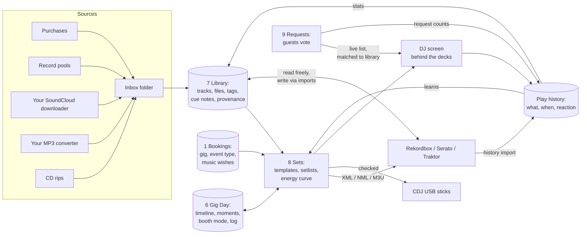
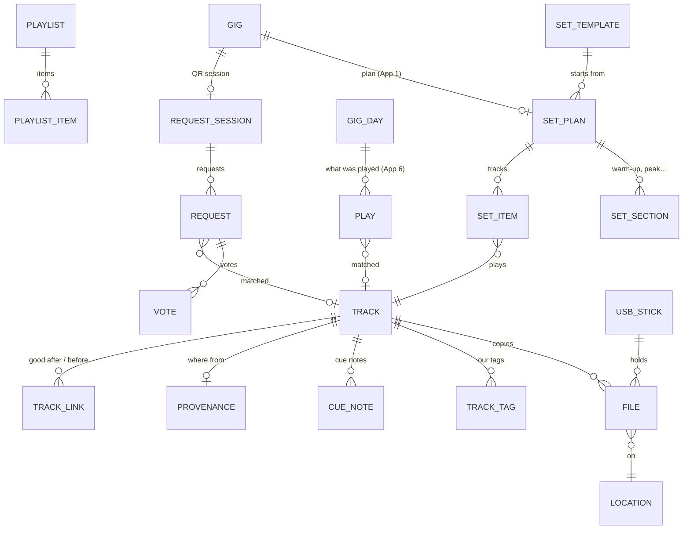
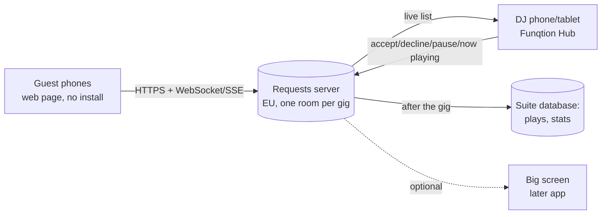

# Funqtion Music: Library, Sets & Requests (apps 7, 8, 9)

> Three connected music apps for Team Funqtion. **FEEL THE MUSIQ.**
> Status: functional plan, **no code yet**. Builds on apps 1–6 and Maps, all in this repo (`docs/HANDOFF.md`).
> Numbering: Library = 7, Sets = 8, Requests = 9. The client portal (in `src/hub/apps.ts` as "portal") moves to app 10, and Navigatie (Maps) keeps its tile.
> Facts about DJ software, APIs and licensing were checked in November 2026. Items marked ⚠️ depend on third parties or on legal advice, so re-check them when building.

## Contents

0. [Read this first: four decisions that shape these apps](#0-read-this-first-four-decisions-that-shape-these-apps)
1. [One system: the flow from library to play history](#1-one-system-the-flow-from-library-to-play-history)
2. [Data model](#2-data-model)
3. [Rekordbox, Serato and Traktor](#3-rekordbox-serato-and-traktor)
4. [BPM, key and metadata detection](#4-bpm-key-and-metadata-detection)
5. [Next-track suggestions](#5-next-track-suggestions)
6. [Real-time tech for Requests](#6-real-time-tech-for-requests)
7. [Screens](#7-screens)
8. [MVP vs. later, and build order](#8-mvp-vs-later-and-build-order)
9. [Tech stack](#9-tech-stack)
10. [Storage and backup](#10-storage-and-backup)
11. [Branding](#11-branding)
12. [Licensing and privacy (NL)](#12-licensing-and-privacy-nl)
13. [Open questions](#13-open-questions)

---

## 0. Read this first: four decisions that shape these apps

**0.1 A web app can't touch your music files, so Library needs a desktop part.**
- The suite runs in the browser and in the Tauri exe.
- Scanning drives, reading and writing tags, analysing audio and preparing USB sticks all need direct file access.
- So the Library has a **desktop companion**: the existing Tauri shell, with a Rust side for file work. It runs on each laptop.
- Phones and tablets only see the *metadata*: the track list, tags, cue notes, sets and play history. They never see the audio files.

**0.2 Your DJ software stays the boss of what it's good at.**
- Rekordbox, Serato and Traktor own their beatgrids, hot cues, waveforms and performance data. Their databases are fragile and partly undocumented.
- **Funqtion Library is the master for *our* knowledge:**
  - our tags (energy, mood, crowd type, "banger")
  - cue *notes*
  - where each file came from and whether it's licensed
  - sets and play history
- The DJ software stays the master for *its* data.
- We **read** from the DJ software freely. We **write** only through the official import routes (Rekordbox XML, Traktor playlist NML, Serato crates while Serato is closed), and always after a backup (§3).

**0.3 Two laptops plus guests on their phones means a server.**
- Today every app is local per device (`docs/HANDOFF.md`). For apps 7 and 8 that still works, with one complication: one overview "across both laptops" means the two laptops must share metadata.
  - Without a server: export/merge the same way as today's backups (already built).
  - With the planned home server (PocketBase + Tailscale, proposed since App 3): live.
- **Requests (app 9) can't work without a server reachable from the internet.** Guests are on their own phones, on venue Wi-Fi or 4G. So app 9 needs a small hosted backend in the EU (§6, §9). That's a new cost (about €5–10/month) and a new responsibility (GDPR, §12).
- The same backend can later give Gig Day its live sync. **Recommendation:** build it once, for both.

**0.4 "What's playing right now" depends on your hardware.**
- With **CDJs/XDJs on Pro DJ Link** (network), we can read it live and reliably.
- With an **all-in-one controller on a laptop**:
  - Serato: its history file
  - Traktor: its history or broadcast
  - Rekordbox: only indirectly (history in its encrypted database)
- Fallback that always works: a one-tap "nu" on the Sets screen next to the decks, or the next track ticked off the planned set (§3.4, Q1).

---

## 1. One system: the flow from library to play history

**The gig, step by step:**
1. **New music arrives** in an *Inbox* folder per person (also the output folder of your converter and downloader).
2. The Library desktop app:
   - picks it up
   - records the **source** (purchase, pool, download, conversion)
   - cleans up the name and tags
   - analyses BPM, key, length and quality
   - suggests energy and crowd tags
3. You confirm, and it goes into the collection, optionally into the DJ software as well (§3).
4. **A gig is confirmed** (App 1). Sets creates a **set plan** from the event type's template:
   - the night's flow (warm-up / peak / cool-down)
   - the **special moments**, must-plays and do-not-plays from the gig's music wishes (App 1/6)
   - the split between Gijs and Coen from the set slots
5. **Building the set:**
   - you pick tracks; suggestions show what fits next (key, BPM, energy, what worked at similar gigs)
   - the energy curve shows the shape of the night
   - export to your DJ software and/or a **checked USB stick**
6. **The gig (Gig Day's Booth mode + Sets live view + Requests):**
   - guests scan the QR code and request and vote
   - the DJ sees the requests next to the plan, marked *in library / not in library / fits now*
   - the DJ accepts, declines or puts a request on "play later"
   - what's played is logged: automatically where the hardware allows (0.4), otherwise by one tap
   - crowd reactions come from Booth mode (vibe, 🔥 per track) and from votes
7. **Next morning (Gig Day wrap-up)**:
   - the play history is completed (import from the DJ software's history and fill gaps)
   - request data is aggregated, with personal data removed after the retention period (§12)
   - stats update: most played, best reactions, "not played in a while"
   - Sets learns which transitions and tracks work at which event type

---

## 2. Data model

### 2.1 Principles
- **Same conventions as apps 1–6:** UUIDs, `createdAt/By`, `updatedAt/By`, soft delete, `save()` + audit log, dates `yyyy-mm-dd`, NL/EN.
- New Dexie versions:
  - v8 for Library + Sets
  - Requests lives mainly on the server, with a local mirror for the DJ
- **Track ≠ file.**
  - A *track* is the song version (artist + title + mix).
  - A *file* is one copy at one location (laptop Gijs, laptop Coen, an SSD, a USB stick).
  - One track can have several files: MP3 and WAV, copies, a stick.
- **File identity:** each file gets an **audio fingerprint** (Chromaprint) and an **audio-only hash** (a hash of the audio frames, not the tags).
  - So retagging a file doesn't make it "new".
  - Copies on the other laptop are recognised.
  - Duplicates are found even with different names.
- **Audio never goes into the database:** only metadata, paths and hashes. The database stays small enough for phones and backups.
- **The play history is append-only** (like Gig Day's log), so two devices can never conflict.

### 2.2 Entity diagram

### 2.3 Tables

**App 7 – Library**

| Table | Key fields | Notes |
|---|---|---|
| `tracks` | artist, title, mix (e.g. "Extended Mix", "VIP Edit"), featuring, label, year, genre, isrc?, mbRecordingId?, discogsReleaseId?, bpm, key (Camelot "8A"), keyConfidence, durationS, energy 1–10, mood[], crowd[] (`wedding` / `village_festival` / `club` / `after_party` / `private` / `company`), vocal (`vocal` / `instrumental` / `acapella`), flags (`classic`, `banger`, `singalong`, `clean` (radio edit), `explicit`), language, decade, rating 1–5, artworkId, notes, owner (`gijs` / `coen` / `shared`), status (`inbox` / `ok` / `needs_fix` / `retired`) | One record per song version. Our tags live here. |
| `files` | trackId, locationId, path (relative to the location root), format (mp3/aac/flac/wav/aiff), bitrate, sampleRate, sizeBytes, audioHash, fingerprint (Chromaprint), quality (`ok` / `low` / `transcode_suspect` / `broken`), lastSeenAt, missing | One per copy. "Missing" = not found at the last scan. |
| `locations` | name ("MacBook Gijs – Music", "SSD Funqtion", "USB Rood 64GB"), kind (`laptop` / `external` / `usb` / `nas`), device id, owner, root path, lastScanAt | USB sticks also get `fs` (FAT32/exFAT) and `pioneerExport` (bool). |
| `provenance` | trackId, source (`purchase` / `record_pool` / `downloader` / `converter` / `cd_rip` / `promo` / `own_production` / `unknown`), store/pool name, orderRef / account, purchasedAt, url (e.g. SoundCloud page), licenceNote, **playOut** (`ok` / `check` / `no`), owner (whose purchase or account) | Drives the "properly licensed?" filter (§12). Converted files point to their source track. |
| `cueNotes` | trackId, kind (`drop` / `mix_in` / `mix_out` / `break` / `vocal_in` / `warning` / `tip`), atS (seconds), text ("drop op 1:04, na 32 tellen"), source (`ours` / `rekordbox` / `serato` / `traktor`) | *Our notes*, separate from the DJ software's hot cues (we can read those, §3). |
| `trackLinks` | fromTrackId, toTrackId, kind (`good_after` / `avoid_after` / `mashup`), note, learned (bool, from play history) | "Goed na X" tips, by hand or learned. |
| `artworks` | blob, mime, hash | Shared by tracks. In the backup ZIP like photos. |
| `scanRuns` | locationId, startedAt, found, added, missing, errors | Health and debugging. |
| `djSoftwareLinks` | trackId, app (`rekordbox` / `serato` / `traktor`), externalId, path, hotCues (json, read-only copy), beatgridOk, lastSyncedAt | Mapping to each DJ software's own track. |

**App 8 – Sets**

| Table | Key fields | Notes |
|---|---|---|
| `setTemplates` | name, eventTypes[], sections: [{kind (`warmup` / `build` / `peak` / `cooldown` / `afterparty` / `moment`), minutes, energyFrom, energyTo, bpmRange, genres[], notes}], rules: {maxSameArtistPerHour, vocalRatio, decadeMix} | Seeded per event type: wedding, village festival, club, private party, company. |
| `setPlans` | gigId? (App 1), name, templateId, status (`draft` / `ready` / `played`), totalMinutes | A plan can also exist without a gig (practice, promo mix). |
| `setSections` | setPlanId, kind, label, startAt (time or offset), minutes, energyFrom/To, performer (`gijs` / `coen` / `b2b`), setSlotId (App 1) | Connects to App 1's set slots and Gig Day's timeline. |
| `setItems` | setPlanId, sectionId, trackId, sort, performer, role (`planned` / `backup` / `must_play` / `moment`), momentWishId (App 1 music wish), transitionNote, locked | The set order. |
| `playlists` | name, kind (`crate` / `smart`), rule (json for smart lists), items | General crates ("Bruiloft openers", "Brabantse meezingers"). |
| `plays` | gigId, gigDayId?, trackId?, rawArtist / rawTitle (when not matched), startedAt, endedAt?, deck?, performer, source (`prodjlink` / `serato_history` / `traktor_history` / `rekordbox_history` / `tap` / `plan`), reaction (`fire` / `good` / `meh` / `empty_floor`)?, requested (requestId?) | Append-only. What was **really** played. |
| `trackStats` (derived) | trackId, playsTotal, playsByEventType, lastPlayedAt, avgReaction, requests | Recalculated, never edited. |

**App 9 – Requests (server + local mirror for the DJ)**

| Table | Key fields | Notes |
|---|---|---|
| `requestSessions` | gigId, code (short, e.g. `FQ7K2`), status (`open` / `paused` / `closed`), opensAt / closesAt, rules: {pausedDuring: [timeline step kinds or moment ids], maxPerDevice, maxPerHour, allowShoutouts, explicitAllowed, genresBlocked[], artistsBlocked[], weddingMode: {coupleNames, wishes[]}}, nowPlaying? (artist/title, only if enabled) | One per gig, created from Gig Day. The QR code points at `…/r/FQ7K2`. |
| `requests` | sessionId, artist, title, catalogRef? (e.g. Deezer id / ISRC), normKey (normalised artist+title), trackId? (library match), match (`in_library` / `not_in_library` / `fits_now`), status (`new` / `accepted` / `later` / `declined` / `played` / `blocked`), votes, shoutout? (text, name), deviceId (pseudonymous), createdAt | Duplicate requests merge into one row by `normKey`. |
| `votes` | requestId, deviceId, at | One vote per device per request. |
| `blocks` | scope (`global` / `gig`), kind (`track` / `artist` / `word`), value | Our standing "nooit" list, plus per-gig blocks. |
| `deviceLimits` (server only, short-lived) | deviceId, ipBucket, counters | Spam protection; deleted when the session closes (§12). |

**Links to the business apps:**
- **App 1 gig:**
  - `eventType` picks the set template
  - `setSlots` become the set sections and the Gijs/Coen/B2B split
  - `musicWishes` (genre / must-play / do-not-play / special moment, as extended by Gig Day) become must-play items, blocks and moment items
  - `stage` 'played' closes the set plan
- **App 6 Gig Day:**
  - timeline steps (set_start/end, moments) give the live view its clock
  - Booth mode gets a **Sets** panel (now/next track, requests)
  - Gig Day's log (vibe, overtime) is linked to the plays by time
  - the wrap-up gets a "play history complete?" item
- **App 4 Contracts:** the clause that the client arranges Buma/Stemra and Sena already exists (contract library, "permits"). The client's photo opt-out also applies to the big screen (no guest names or photos without consent).
- **App 5 Gear:** USB sticks become gear items (code, owner), so a "USB Rood" stick is both a gear item (scan, pack) and a Library location.

---

## 3. Rekordbox, Serato and Traktor

### 3.1 What each one stores and how we can reach it

| | Library | Read | Write safely | Risk |
|---|---|---|---|---|
| **Rekordbox 6/7** | `master.db`: SQLite **encrypted with SQLCipher** ⚠️. Analysis files (ANLZ) per track. USB: `PIONEER/` folder with `export.pdb` + ANLZ, and on newer players the encrypted **OneLibrary** (`exportLibrary.db`). | **XML export** (File → Export Collection in xml format): official, complete for tracks, cues and playlists, but **excludes play history**. Directly: `master.db` read-only via the open-source **pyrekordbox** / **rbox** libraries (unofficial; the key is on the machine) ⚠️. | **XML import**: Rekordbox shows an imported XML in its "rekordbox xml" pane, and you drag playlists in. This is the official path and never touches `master.db`. | Writing to `master.db` directly can corrupt the library and breaks with updates → **we don't**. |
| **Serato DJ** | `_Serato_` folder: `database V2`, crates (`Subcrates/*.crate`), history sessions. Cues, beatgrid and overview are stored **inside the audio file's tags** (GEOB frames). | `database V2` and crate files (binary but known formats, open-source parsers exist). History: session files (Serato 3: binary; reported SQLite in newer versions ⚠️). | **New crate files** (adding our sets as crates) only while Serato is **closed**. Tags: write ours **without touching** Serato's GEOB frames. | A tag editor that drops unknown ID3 frames **wipes Serato's cues**. Our tag writer must keep every frame it doesn't own (a test for this is mandatory). |
| **Traktor Pro 3/4** | `collection.nml` (XML). History in `History/*.nml`. | Read `collection.nml` and history directly (XML). | **Playlist NML import** (Traktor's own import function). Never edit `collection.nml` while Traktor is running. | Users report collections corrupting on save (symlinked paths, power loss). Always a backup first, and never rewrite paths. |

### 3.2 Which one is the master
- **For performance data** (beatgrids, hot cues, waveforms, the USB export for CDJs): the DJ software you actually play from. Recommendation: **Rekordbox if you play on Pioneer/AlphaTheta CDJs, XDJs or an all-in-one controller** (most venues and your controller family). This depends on Q1.
- **For our metadata** (tags, energy, crowd, provenance, cue notes, sets, history): **Funqtion Library**.
- **One-way by default:**
  - DJ software → Library: read tracks, hot cues as a read-only copy, playlists and history; on every scan, with no risk.
  - Library → DJ software: only on demand, via the official import (XML / NML / crate), and always after an **automatic backup** of the DJ software's library folder (timestamped, kept 30 days).
- **Tags in the files** (artist, title, genre, comment):
  - The only channel all three DJ apps read.
  - The Library writes them only when you choose "write to files", and keeps all foreign frames intact.
  - We can put the energy level and crowd tags into the comment or grouping field (e.g. "E7 · wedding · banger"). That makes them visible and sortable in every DJ app without any integration.
- **Two DJs, two libraries:**
  - Each laptop keeps its own DJ software library; we don't try to merge two Rekordbox databases.
  - The Library knows both collections and shows what's only on one laptop ("staat alleen bij Coen").

### 3.3 USB sticks for CDJs
- **Preferred:** let the DJ software export to USB (Rekordbox's export writes `PIONEER/` with analysis and the encrypted OneLibrary). That's the only way to get correct beatgrids, cues and waveforms on the players.
- **What the Library adds** (the **check**):
  - before a gig, plug in the stick → compare it with the set plan
  - flags missing tracks, low-quality files, files not in the export database, and the file system (FAT32/exFAT), free space and stick health (read test)
  - "Stick Rood is klaar voor Bruiloft Lisa & Tom: 212 tracks, 3 ontbreken"
- **Plan B for any player:** a plain folder per set plus M3U playlists (no grids or cues, but always playable).
- **Backup sticks:** two sticks per gig (Gear packs them both), with the same contents checked.

### 3.4 Detecting what's playing live

| Setup | Method | Reliability |
|---|---|---|
| CDJ/XDJ players (or an XDJ all-in-one) on **Pro DJ Link** (Ethernet, switch) | Listen to the link as a passive observer (open-source **beat-link** / Now Playing-style). Gives the loaded track, play state, BPM and the on-air/fader state with a DJM mixer. | High, live. Needs a laptop or Raspberry Pi on the link network, wired. Wi-Fi often drops the broadcast packets ⚠️. |
| Rekordbox (laptop + controller) | No live API. History is in the encrypted `master.db` and auto-history isn't in the XML ⚠️. Option: read the history after the gig (pyrekordbox), live only by polling read-only ⚠️. | After the gig: good. Live: fragile, not for the MVP. |
| Serato (laptop + controller) | Watch the session history file (updated when a track is loaded on a deck). | Medium: "loaded" isn't "playing" (Serato can't tell either). |
| Traktor | History NML after the gig. Live: Traktor's broadcast metadata to a local stream server ⚠️. | After the gig: good. Live: possible, not for the MVP. |
| Any setup | **Tap fallback:** on the Sets live screen the next planned track is one tap ("▶ nu"), and an unplanned one is a quick search. Reactions (🔥 / 👍 / 😐 / floor empty) are a second tap. | Always works, offline. |

**MVP:**
- tap + import after the gig (Rekordbox via pyrekordbox read-only or XML, Serato history, Traktor history NML)
- live detection via Pro DJ Link if you have CDJs/XDJs on a network (Q1)

---

## 4. BPM, key and metadata detection

### 4.1 Audio analysis (on the laptop, offline)

| Need | Recommended | Notes |
|---|---|---|
| BPM, beat positions | **Essentia** (C++, with Python and a JavaScript build) | Research-grade, also does loudness and danceability. Licence AGPL: fine for our own internal use, not for selling the app ⚠️. |
| Key → Camelot | **Essentia** key extractor (EDM profile), or **libKeyFinder** (GPL; the engine behind KeyFinder and Mixxx) | Store key + confidence. Convert to Camelot (8A = A minor, …). Flag a low confidence instead of guessing. |
| Loudness, quality | **FFmpeg / ffprobe** + spectrum check | Bitrate, sample rate and duration from the header. **Fake 320s** (upscaled 128 kbps) are found by the frequency cut-off in the spectrum (e.g. nothing above 16 kHz). Also clipping, silence at the start/end and broken frames. |
| Fingerprint | **Chromaprint** (`fpcalc`) | For duplicates, AcoustID lookup and later live recognition. |
| Already analysed? | **Import first** from Rekordbox (XML/master.db), Serato (tags) or Traktor (NML) | Your DJ software has already analysed most tracks, so we reuse those values. We only analyse what's missing, and show differences ("Rekordbox: 8A, wij: 9A"). |

Analysis runs in the background in the desktop app, one file at a time (roughly 1–3 s per track). Expect a few hours for a first scan of 20,000 tracks, then only new files.

### 4.2 Metadata lookup (online, with care)

| Source | Use | Limits |
|---|---|---|
| **AcoustID** (fingerprint → MusicBrainz recording) | Identify badly named files | Free for non-commercial use ⚠️, needs an API key. |
| **MusicBrainz** | Artist, title, release, label, year, ISRC | Max ~1 request/s and a proper User-Agent (with our contact). Cache everything. |
| **Discogs** | Label, catalogue number, year, genre/style, **cover art**, remix credits (strong for dance and vinyl) | Token needed. Rate-limited ⚠️, cache. |
| **Cover Art Archive** | Artwork via MusicBrainz | Free. |
| Store/pool data | Beatport, Traxsource and pools often put good tags in the file itself | Read them first; they're usually better than lookups for genre and mix name. |
| ~~Spotify audio features~~ | ~~BPM / key / energy~~ | **Closed to new apps since November 2024**: not an option. |
| Alternatives for "energy" | Our own: Essentia's danceability/loudness/onset density → a **suggested** energy level, which you confirm | Our own 1–10 scale stays leading. Paid APIs (Cyanite) aren't needed. |

**Clean-up rules** (suggested, never automatic without confirming):
- **filename** → "Artist - Title (Mix).ext"
- remove "(Original Mix)" noise, "www.site.com" tags and "[FREE DOWNLOAD]"
- move featuring artists into the artist field
- trim whitespace, fix capitalisation, normalise "&" / "x" / "vs"

The current name is always kept in history (audit), so every change can be undone.

---

## 5. Next-track suggestions

### 5.1 Score per candidate (explainable)
For the current track A and a candidate B, the score is a weighted sum. Every part is shown as a chip ("8A→9A ✓", "+2 BPM", "energy ↑", "werkte op 3 bruiloften"), so you can see why a track is suggested.

| Factor | Rule | Weight (default, editable) |
|---|---|---|
| **Harmonic (Camelot)** | Same key (8A→8A) = 1.0. ±1 on the wheel (8A→7A/9A) = 0.9. Relative major/minor (8A→8B) = 0.85. +2 "energy boost" (8A→10A) = 0.6. +7 / diagonal (8A→9B) = 0.5. Anything else = 0.1. **Pitch-shift aware:** at +3% tempo the key moves about half a semitone, so the key is calculated at the BPM it'll be played at. | 30% |
| **BPM** | Inside ±3% = 1.0, ±6% = 0.6, half or double time (e.g. 64↔128) = 0.7, beyond = 0. The allowed range comes from the set section (warm-up 100–118, peak 124–130…). | 25% |
| **Energy** | Distance to the curve's target at this moment (section energyFrom→To). Small steps up in a build-up, never more than +2 at once except for a planned "drop". | 20% |
| **Crowd fit** | The track's crowd tags vs the gig's event type; decade, language and singalong for weddings and village festivals. | 10% |
| **Learned** | Play history: reactions of this track at this event type, the A→B transition ("good after" learned when B after A got 🔥 two or more times), request counts. | 10% |
| **Variety** | Penalty for the same artist in the last 60 min, the same genre four times in a row, or a track played at the last gig for the same client or venue. | −5…−30% |
| **Hard filters** | Do-not-play (gig + global blocks), `playOut = no`, a missing file on the laptop that's playing, explicit content at a wedding/kids' party (if set), already in this set. | excluded |

### 5.2 Planning a whole night
- **Energy curve:**
  - every set item has an energy value (1–10); the curve is plotted over time with the template's target curve behind it
  - deviations are shaded ("piek te vroeg", "dip van 20 min")
- **Sections** come from the template: e.g. a wedding is dinner (energy 2–3) → opening dance (moment) → warm-up (4–6) → peak (7–9) → late classics (8) → cool-down (5) → last song (moment).
- **Auto-fill (assist, never autopilot):**
  - "vul deze sectie" proposes a chain using a beam search over the score (the best 5 paths of N tracks), respecting must-plays at their times
  - you accept, swap or lock tracks
- **Time-aware:** the plan knows track lengths, so "set end 00:30" and the moments (from Gig Day) line up. Overrun shows in red.
- **B2B:** the sections alternate performer per N tracks or per 30 min; each DJ sees "jij / Coen next".
- **Must-plays** from the client are placed in the right section; do-not-plays are blocked everywhere.

### 5.3 Learning from play history
- **Per event type, per track:** plays, average reaction, requests, and how many times it was "rescued" (energy back up after a dip).
- **Per transition (A→B):** count, reaction → becomes `trackLinks.learned`.
- **"Niet gespeeld sinds":** tracks with a good history that haven't been played in a while → a "Herontdekken" list.
- **Venue memory:** what was played last time at this venue or for this client (App 1), so a returning client never gets the same set.
- Simple statistics first (counts, averages, Bayesian smoothing so one 🔥 doesn't dominate). Machine learning only if the data is ever big enough (it won't be for years).

---

## 6. Real-time tech for Requests

### 6.1 Architecture

- **One "room" per gig session.** Guests open `funqtion.nl/r/FQ7K2` (or the QR code at the booth).
- **Live updates:**
  - **Server-Sent Events** (SSE) for the list and **plain HTTPS POST** for requests and votes. SSE is simpler than WebSockets, reconnects by itself, works through most proxies, and the browser resumes with `Last-Event-ID`.
  - The DJ app uses a WebSocket (or SSE too) for instant updates.
- **Load:**
  - a busy wedding = 150–300 guests, a village festival maybe 1,000+ phones, of which perhaps 10–20% are active
  - that's a few hundred requests and votes per hour, peaking at a few per second
  - a single small server handles this easily
  - the main cost is keeping connections open: SSE connections are cheap
- **Bad Wi-Fi / 4G** (both sides):
  - The guest page is tiny: one HTML file under ~60 kB with inline CSS and no framework, loads on 3G, and shows something useful even if the live connection drops (the last list + "opnieuw verbinden…").
  - Requests are **queued on the phone** and sent when the connection is back (with an idempotency key, so no double requests).
  - Votes are **optimistic** (shown immediately, corrected by the server).
  - **Polling fallback** (every 10–15 s) when SSE is blocked.
  - The **DJ side** is the most important connection: the DJ device uses 4G (personal hotspot), not venue Wi-Fi. If the server is unreachable, the DJ still has the set plan offline and requests simply pause.
- **Search for guests:**
  - **Our library first:** a search index of artist/title only (no files, no paths) is pushed to the server per session. Results show "✓ hebben we" without revealing the whole collection as a list (search only, min. 3 letters).
  - **Public catalogue for everything else:** Deezer's free search API (artist, title, cover, ISRC) ⚠️ (check its terms and rate limits), or MusicBrainz as a fallback.
  - **Free text** always possible ("iets van Snollebollekes").
- **Matching** (server, then refined on the DJ side):
  - normalised artist+title, ISRC, and fuzzy matching (Levenshtein on "artist - title" without "feat.", "remix", accents)
  - **"Fits now"** = in library AND the score from §5.1 against the current track/section ≥ a threshold (e.g. BPM ±6%, energy ±2, key compatible)
  - **"Not in library"** is visible only to the DJ, never to guests (guests just see "aangevraagd ✓")

### 6.2 DJ controls and rules
- **Per request:** accept (→ "staat in de wachtrij"), play later, decline (with an optional friendly reason for the guest: "past vanavond niet"), block track/artist (for this gig or always), mark played (also automatic when the play is detected).
- **Session:** open/close, **pause** (whole session, or **automatically during timeline steps or moments** from Gig Day: the first dance, speeches, cake; "verzoekjes even op pauze tijdens de openingsdans"), max requests per phone (default 3 open at a time, 10 per hour), shout-outs on/off, explicit lyrics on/off, genres off.
- **Wedding mode:** the couple's names and colours on the page, the couple's must-plays/wishes shown as "het bruidspaar wil graag…" (from App 1 music wishes, only those you mark as public), a dedication option, and requests from the couple (a separate code) get priority.
- **Now playing** (optional): shown on the guest page and big screen only if enabled, with a delay of a few seconds and only after the track has really started. Great for track ID ("welk nummer is dit?" → "Now playing: …").

### 6.3 Spam and abuse
- **Device id:** a random token in the browser (no account). **Rate limits** per token **and** per network (IP bucket, kept only in memory and short-lived).
- Hard caps per session; cooldown after a declined request; duplicate requests merge into one row.
- **Text filter:** NL + EN word lists (insults, discrimination, sexual content) plus a length limit, links blocked, emoji spam limited.
- **Shout-outs are pre-moderated:** they appear only after the DJ approves them, and **never on the big screen without approval**.
- Optional **session PIN** on the QR card (for private parties), so only people in the room can request.
- **Kill switch:** one tap closes the session and hides everything.

---

## 7. Screens

### 7.1 App 7 Library (desktop first)
- **Collection table** (the main screen):
  - virtualised list (20k+ rows, fast), columns to choose: art, artist, title, mix, BPM, key (coloured Camelot chip), energy bar, crowd tags, rating, quality badge, source badge (🟢 licensed / 🟠 check / 🔴 no), locations ("G", "C", "SSD", "USB Rood"), last played
  - filters: crowd type, energy range, BPM range, key compatible with…, decade, vocal/instrumental, flags, "not played since", "only on Coen's laptop", "needs fix"
- **Track panel** (right): editable tags with suggestions (lookup results side by side), artwork, waveform (from the analysis), cue notes on the waveform, "good after" links, provenance, all files/copies, play history and stats.
- **Inbox:** new files per person with proposed clean-up and tags, and "accept all" for confident ones.
- **Problems:** duplicates (side by side: quality, tags, which to keep), missing or broken files (relink by fingerprint), low quality ("zoek betere versie"), unknown source, key/BPM conflicts between apps.
- **DJ software:** last read, differences, "export to Rekordbox XML / Traktor NML / Serato crates", backups made.
- **USB:** connected sticks, "check against set plan", health, free space.
- **Phone/tablet:** read-only search and track info (e.g. "hebben we dit?" during a client meeting), tags editable.

### 7.2 App 8 Sets (desktop to build, tablet/phone to play)
- **Planner (desktop):**
  - Left: library search with filters.
  - Middle: the set as a timeline with sections (warm-up, peak…), tracks as rows with BPM/key/energy, transition indicators (✓ key, ⚠ BPM jump), performer colours (Gijs orange, Coen blue, B2B striped) and **moments** pinned at their times.
  - Top: the **energy curve** with the template target behind it, plus the time ruler (from the gig's timeline).
  - Right: **suggestions for the next track** with reason chips; must-plays still to place; do-not-play list.
- **Templates:** per event type, sections, energy targets and rules.
- **Live view (tablet/phone, part of Gig Day's Booth mode):**
  - dark, big: **now** (title, BPM, key), **next 3 planned**, "past nu" suggestions (top 5 by score), the request queue (sorted by votes, match badge)
  - one-tap "▶ nu" / reaction buttons / "speel later"
  - moments countdown (from Gig Day)
- **History & stats:**
  - per gig: the played list with reactions, requests and deviations from the plan
  - overall: most played, best reactions per event type, "herontdekken", requests that came up most and whether we have them
  - "Eerder hier gespeeld" per venue or client

### 7.3 App 9 Requests
- **DJ side** (inside Gig Day/Sets live view, plus a separate screen):
  - queue cards with votes, match badge, the guest's message, accept/later/decline/block
  - session controls: open/pause/close, rules, wedding mode, QR card print
  - a stats strip ("43 aanvragen, 211 stemmen, 12 gedraaid")
- **Guest page** (phone, no install):
  - **Header:** Funqtion logo, "FEEL THE MUSIQ", the event name (wedding: "Lisa & Tom").
  - **Search box** (big) → results with cover art → "Vraag aan".
  - **Top requests** (live) with big **▲ vote** buttons and the count.
  - "Mijn aanvragen" (status: in de wachtrij / gedraaid 🎉 / past vanavond niet).
  - **Now playing** (if on), and a shout-out form (if on).
  - Footer: @funqtionofficial, "Boek ons", privacy link.
  - NL/EN automatically from the phone's language.
  - Paused state: "Even geen verzoekjes: de openingsdans is bezig 💛".
- **QR card / poster:** A6 table cards and an A3 poster for the booth (from the PDF tools in App 5's label engine), with the short code under the QR code for when scanning fails.

---

## 8. MVP vs. later, and build order

### 8.1 Recommended order
1. **Library MVP (app 7):**
   - the scanning, tagging and provenance foundation everything else needs
   - starts the desktop companion
   - no server needed (per-laptop database + the existing backup/merge between laptops)
2. **Sets MVP (app 8):**
   - set plans with templates, suggestions, energy curve, gig link, export, tap-to-log in Booth mode, and history import after the gig
   - still no server
3. **Server foundation:**
   - EU hosting, auth for the two of you, and sync of the suite tables
   - gives live sync to Gig Day and the two laptops' Library as a bonus
4. **Requests MVP (app 9):** guest page, live queue, DJ controls, rules, spam protection, GDPR retention.
5. **Later rounds:** live detection, wedding mode extras, big screen, learning, USB deep checks.

Why this order:
- Requests is the most visible app, but without a clean library its "in library / fits now" matching is worthless.
- Without play history its data teaches nothing.
- Building it first would also force the server decision before anything else is ready.

### 8.2 MVP features

| App | MVP (first release) | Later |
|---|---|---|
| **7 Library** | Desktop companion on both laptops; scan locations (laptop, external drives, USB); tracks/files/fingerprints; tag editor with clean-up suggestions and filename fixing; import BPM/key/cues from the DJ software, analyse the rest (BPM, key, length, quality, fake-320 check); our own tags (energy, mood, crowd, vocal, flags); cue notes; provenance with "OK to play out"; duplicates and missing files; inbox for the converter/downloader; read Rekordbox XML/master.db, Serato and Traktor; write tags safely; export XML/NML/crates with automatic backup; USB stick check against a set; overview of both laptops via export/merge. | MusicBrainz/AcoustID/Discogs lookups in bulk; artwork fixing in bulk; live sync between laptops (server); "betere versie zoeken" in pools/stores; waveform cue editor; smart playlists. |
| **8 Sets** | Templates per event type; set plans linked to gigs (sections from set slots, moments from Gig Day, must/do-not-play from App 1); suggestions with reason chips (§5.1); energy curve; Gijs/Coen/B2B; export to Rekordbox XML / Traktor NML / Serato crate / M3U; live view in Booth mode with tap-to-log and reactions; history import after the gig; basic stats (most played, not played since, best per event type). | Auto-fill with beam search; learned transitions; venue/client memory; Pro DJ Link live detection; practice mode (rehearse a set with timing); mix recording notes. |
| **9 Requests** | Hosted session per gig + QR card; guest page (search our library + public catalogue, request, vote, my requests); live DJ queue with match badges; accept/later/decline/block; pause and auto-pause during moments; limits per phone; text filter; pre-moderated shout-outs; NL/EN; privacy notice + automatic deletion; request counts into play history. | Now playing for guests; wedding mode with couple's wishes and priority code; big screen (Funqtion Live); session PIN; tips/donations ⚠️ (tax/VAT); post-gig "gedraaide nummers" page for guests (Instagram share). |

---

## 9. Tech stack

Fits apps 1–6 unchanged: **React + TypeScript + Vite**, Dexie for the local database, the same audit log, NL/EN i18n, brand tokens and the **Tauri** shell.

| Part | Choice | Why |
|---|---|---|
| **Desktop companion** (Library scanning, tags, analysis, DJ-software files, USB) | The existing **Tauri 2** app with Rust commands: – **lofty** (tags; keeps unknown frames, which matters for Serato's GEOB) – **symphonia** (decoding) – **rusqlite + SQLCipher** (read Rekordbox read-only) – quick-xml (Rekordbox XML / Traktor NML) – `fpcalc` (Chromaprint) and **Essentia/libKeyFinder** as bundled sidecar binaries – **ffprobe** | One exe for everything (Windows now, macOS if either laptop is a Mac, Q2). Web code stays shared. Heavy work runs off the UI thread. |
| **Python sidecar (optional)** | pyrekordbox for Rekordbox's encrypted DB and OneLibrary, if the Rust route lags behind Rekordbox updates | Pyrekordbox is maintained and tracks Rekordbox versions; run it as a small bundled helper. |
| **Shared data** | The suite's Dexie database (new tables in v8+); Library/Sets metadata is small (~20k tracks ≈ 20–40 MB including fingerprints) | Same backup/merge as today; phones can hold it. |
| **Server** (needed for Requests, useful for everything) | **PocketBase** (Go, SQLite, realtime via SSE, auth, admin UI) on a small **EU VPS** (e.g. Hetzner, ~€5/month) behind HTTPS; or self-hosted at home with Tailscale **only for sync**: guests can't reach a home server unless it's exposed publicly ⚠️. | PocketBase was already the proposal for sync (App 3/6). One binary, SSE built in, easy backups. |
| **Guest page** | A separate tiny static page (vanilla TS, < 60 kB) served by the same server, not the full hub | Fast on 3G, no login, nothing to install. |
| **Catalogue search for guests** | Deezer public search API ⚠️ (or MusicBrainz) via the server (caching, keys hidden) | Free; check terms of use. |
| **Analysis libraries' licences** | Essentia (AGPL), libKeyFinder (GPL), Chromaprint (LGPL/MIT) | Fine for internal use; selling the apps would need a licence review. |

---

## 10. Storage and backup

**The facts:** a DJ library is ~200 GB–2 TB per person (MP3/AAC much smaller than WAV/AIFF), on two laptops, plus external drives and sticks. The *database* is small; the *files* are big.

**Recommended set-up:**
1. **Each DJ owns their files** on their own laptop (or their own SSD), in one clear structure: `Music/Funqtion/<Genre or Source>/Artist - Title (Mix).ext`. The Library can propose and do the moves (with the DJ software's paths updated via its import, never by rewriting its database).
2. **Shared pool (optional):** an external SSD or the home NAS with "Funqtion Shared" for tracks both of you play, **only for tracks whose licence allows it** (§12: purchases are usually personal).
3. **3-2-1 backup per person:**
   - **3 copies:** laptop + local backup + offsite
   - **2 media:** laptop SSD + an external HDD/NAS (versioned: Time Machine, File History or Restic)
   - **1 offsite, encrypted:** an EU storage box or cloud (e.g. Hetzner Storage Box or Backblaze B2 EU, ~€4–10/month per TB), synced nightly with Restic/rclone (deduplicated, encrypted, versioned). Excluded: the DJ software's caches.
4. **The DJ software's own libraries** (`rekordbox` folder incl. `master.db`, `_Serato_`, Traktor folder): backed up **separately and more often**, especially before every Library export (automatic, §3.2). These are small and the most precious (years of cues).
5. **The suite database:** the existing backup ZIP (with a passphrase) also covers Library/Sets/history metadata. Artwork blobs go in the ZIP like gear photos; audio never does.
6. **The Library watches the backups:** "laatste offsite backup Gijs: 9 dagen geleden" on the dashboard.
7. **USB sticks are never a backup:** they're copies for a gig, rebuilt from the library.

---

## 11. Branding

**Two audiences, one brand:**

**For us (Library, Sets, live view): fast and readable.**
- The suite's dark theme, JetBrains Mono for numbers (tabular BPM/key/time), Archivo Black only for titles.
- Dense tables, but with large hit areas on tablets.
- **Colour has a job:**
  - orange (`#f68712`) = selected / now / main action
  - Gijs orange and Coen blue (the existing member colours)
  - **Camelot key colours** = the standard 12-colour key wheel used by DJ tools, *only in the key chip*, because it lets you spot compatible keys at a glance
  - status = words + icons (✓ ⚠ ✕), not colour alone
- Energy as a small bar (1–10), the set's energy curve as a line in off-white with the target band in grey.
- In the live view the night mode from Gig Day applies (black, dim, red option).

**For guests (Requests page, QR cards, big screen): fun and recognisable.**
- **Brand moment first:**
  - black background, the FQ logo, **FEEL THE MUSIQ**, orange accents, corner brackets (from funqtion-site)
  - the vote button is a big orange ▲ with a tiny pulse (respecting "reduce motion")
- **Friendly copy:** "Wat moet de dansvloer horen?" / "Gedraaid! 🎉" / "Past vanavond niet, maar we noteren 'm", in NL with an EN switch.
- **Wedding mode:** the couple's names in Archivo Black, an optional accent colour from the wedding theme, still with the Funqtion footer.
- **Social:** @funqtionofficial on the page, and "deel je moment" after a played request.
- **QR card:**
  - A6, black with orange QR (like the Gear "Funqtion style" labels, with the logo in the middle)
  - the short code in big type
  - "Scan · Vraag aan · Stem"
  - privacy line in small print

---

## 12. Licensing and privacy (NL)

> Not legal advice. The points marked ⚠️ should be confirmed with BumaStemra/Sena and, for the request page, checked against the GDPR guidance of the Autoriteit Persoonsgegevens.

### 12.1 Playing music in public
- **Two collecting societies:**
  - **Buma/Stemra** handles the authors' rights (composers, lyricists, publishers; Buma for performance, Stemra for reproduction)
  - **Sena** handles the neighbouring rights of performers and record producers
- **Who pays for public performance:** BumaStemra's own FAQ says "in principle, whoever organises the event is responsible for arranging the licences". Venues often have a combined Buma/Sena licence (for their business and events), and event organisers arrange an event licence.
- **Our contract already covers this:** App 4's terms say the client arranges the permits and, "insofar as required, the music rights with Buma/Stemra and Sena".
  - The **Gig Day readiness check** could add "muziekrechten geregeld? (opdrachtgever/locatie)" for private parties at non-venue locations (a tent in a garden), where nobody else has a licence.
  - **Q12 (open):** should that line be added?
- **Your copies on laptop/USB:**
  - private copying is allowed (a levy is paid on storage media)
  - copying to a laptop or stick *to play in public* is a reproduction
  - whether a DJ in NL needs a separate Stemra/Sena permission for those working copies **isn't clearly answered by public sources** ⚠️ (older sources mention a separate copying licence for DJs)
  - **Action:** ask BumaStemra and Sena directly (via mijnlicentie.nl / their contact), and record the answer in `docs/music/LICENSING.md`
- **Streaming services:** a consumer subscription (Spotify, Apple Music) doesn't cover public performance. DJ-specific streaming inside the DJ software (e.g. Beatport/Beatsource streaming, SoundCloud DJ, TIDAL in DJ apps) follows *those* services' terms ⚠️.

### 12.2 Properly sourced files (what provenance tracks)

| Source | Status in the Library | Why |
|---|---|---|
| Purchased downloads (Beatport, Traxsource, Bandcamp, iTunes, Juno…) | 🟢 ok | You bought a copy. Note that **purchases are personal**, so copying Gijs's purchase onto Coen's laptop is usually not covered by the store's terms ⚠️; the Library shows the owner. |
| Record pools (DJcity, BPM Supreme, ZipDJ, …) | 🟢 ok **while membership/terms allow** | Pools license music for DJ use under their own terms (often only while you're a member, no redistribution) ⚠️. We store the pool + account and the date downloaded. |
| CD rips of your own CDs | 🟢 ok | Original kept. |
| Promos sent to you (labels, artists) | 🟢 ok (promo) | Keep the email/link as evidence in the provenance note. |
| Own productions/edits | 🟢 own (edits of others' tracks: 🟠 check) | An edit of someone else's track is a derivative work. |
| **SoundCloud downloader** | 🟠 **check** by default; 🟢 only if the artist offers a free/official download (button or "free download" link, stored as evidence) | Ripping a stream is not a licensed copy. |
| **MP3 converter** output | inherits from its source track | A conversion of a purchased WAV is fine; a conversion of a ripped stream isn't. |
| Unknown | 🟠 check | Older files: tag them in a clean-up round. |

The **Sets planner and USB check** can filter on "only 🟢" for gigs where that matters (Q11).

### 12.3 GDPR/AVG for the request page
- **Data minimisation:**
  - no accounts, no email, no phone numbers
  - a random device token in the browser (for votes and limits)
  - an optional first name only for a shout-out
  - IP addresses only in memory for rate limiting, never stored
- **Lawful basis:** legitimate interest (running the request service you ask for); shout-outs with a name = the guest provides it voluntarily for display. **No tracking, analytics or advertising cookies.** A strictly necessary functional token needs no cookie banner ⚠️ (check the current guidance).
- **Privacy notice** (short, NL/EN) on the page:
  - who we are (Team Funqtion, KvK)
  - what we store and why
  - how long
  - contact for questions/removal
- **Retention:**
  - personal parts (shout-out texts, names, device tokens) are **deleted 30 days after the gig** (automatically)
  - aggregated statistics (track X requested 14 times at weddings) are kept without any personal data
- **Minors** (village festivals): no data asked; shout-outs pre-moderated; nothing published with a name without approval.
- **Big screen and photos:** never names or messages without DJ approval; the client's **photo opt-out** (App 4) applies to anything shown about guests.
- **Processors:** the hosting provider (EU) gets a data processing agreement (*verwerkersovereenkomst*); no data outside the EU (Deezer search runs *through our server*, so guests' phones don't talk to third parties).
- **Security:**
  - HTTPS only
  - DJ controls behind our login
  - session codes expire
  - the session closes automatically after the gig
  - the kill switch (§6.3)

---

## 13. Open questions

1. **Hardware and DJ software:** Which DJ software do you play from (Rekordbox, Serato, Traktor), and both the same? Which all-in-one controller (model)? Do you ever play on venue CDJs from USB? This decides the master (§3.2) and live detection (§3.4).
2. **Laptops:** Windows, macOS, or one of each? Where do your files live now (internal disk, external SSD), and roughly how big is each collection (number of tracks, GB)?
3. **Shared vs personal music:** Do you share files between your laptops today? Should the Library show one combined collection with owners (recommended), or two separate ones?
4. **Your tools:**
   - **MP3 converter** and **SoundCloud downloader**: where do they put files, and can they write the source (URL, original file) into a tag or a sidecar file?
   - Are they in a repo I can look at (then the Library can integrate them directly)?
5. **Record pools and stores:** which ones do you use (for the provenance list and tag reading)?
6. **Tags:** is a 1–10 energy scale OK, and which moods and crowd types do you want besides wedding / village festival / club / after-party (private party, company, kids)? Should our tags also be written into the files' comment field so they show up in the DJ software?
7. **Set templates:** can you describe the flow of a typical wedding and a typical village festival night (sections, times, energy), so the first templates are yours?
8. **Requests:**
   - Your own domain for the guest page (e.g. `funqtion.nl/r/...`)?
   - OK with a small hosted server (~€5–10/month)?
   - Should guests be able to request **anything** (public catalogue) or only from your library?
   - Shout-outs: yes/no, and only after approval?
9. **Now playing:** do you want "now playing" visible for guests (track ID), and only on request or by default?
10. **Wedding mode:** what should the couple see or do: their own wishes on the page, a priority code, their names and colours?
11. **Licensing policy:** should sets for paid gigs be limited to 🟢 tracks (purchased/pool/promo) by default, with a warning for 🟠?
12. **Licensing checks:** may I prepare the questions for BumaStemra/Sena about DJ working copies? And should Gig Day's readiness check get "muziekrechten geregeld" for gigs at non-venue locations?
13. **Big screen (Funqtion Live):** soon, or really later? (It affects whether shout-outs and now playing are built with a screen in mind.)

---

**Sources** (checked November 2026):
- [BumaStemra FAQ for music users](https://bumastemra.nl/en/everything-for-music-users/faq-music-users/)
- [Sena – mijn licentie](https://sena.nl/muziekgebruikers/mijn-licentie)
- [Muziekrechten en licenties voor DJs in Nederland (EuroMix Project)](https://euromixproject.nl/muziekrechten-djs-nederland)
- [De Dance-advocaat – Sena betalen?](https://www.danceadvocaat.nl/naburig-recht/sena-betalen-hoeveel-waarom/)
- [pyrekordbox](https://github.com/dylanljones/pyrekordbox)
- [rbox](https://pypi.org/project/rbox/)
- [Now Playing – Pro DJ Link](https://help.nowplayingapp.com/reference/integrations/prodjlink/)
- [Now Playing – Serato](https://help.nowplayingapp.com/reference/integrations/serato/)
- [traktor-nml-utils](https://github.blesdmm.dns-dynamic.net/jlantz/traktor-nml-utils)
- [NI community on collection corruption](https://community.native-instruments.com/discussion/comment/78393)
- [Spotify audio features deprecation (community)](https://community.spotify.com/t5/Spotify-for-Developers/Web-API-Get-Track-s-Audio-Features-403-error/td-p/6654507)
- [MusicBrainz rate limiting](https://musicbrainz.org/doc/MusicBrainz_API/Rate_Limiting)

---

## 14. Gijs's answers (November 2026) and what they change

| # | Answer | Decision in the plan |
|---|---|---|
| 1 | **Serato or djay Pro, or CDJs** | **Serato is the master for performance data** (cues and grids live in the file tags, crates in `_Serato_`). **djay Pro** (Mac) reads Serato crates when pointed at the `_Serato_` folder, so the crates the Library writes show up in both. djay's own library (`~/Music/djay/`) is read-only for us; no history export, so live logging there is tap-only. **CDJs (venue USB):** the Library writes a **Rekordbox XML** from our data and Serato's cues (as the free serato2rekordbox script does), you import it into **free Rekordbox** and let it build the stick; the Library then checks the stick. **Now playing:** Serato session history (automatic), djay = tap, CDJs = Pro DJ Link later. |
| 2 | **Music on USB drives or the Mac** | The desktop companion is a **macOS** build of the Tauri app (built on the Mac itself or a macOS CI runner ⚠️ minutes). USB drives are normal *locations*: scanned when plugged in, and "offline" otherwise (tracks stay visible, with "staat op USB Zwart"). |
| 3 | **Converter and downloader: will send later** | Planned as an **Inbox** source: watch their output folder and record the source in provenance. Integrated once the code is in. |
| 4 | **No purchases: downloads and streaming inside the DJ software** | Provenance stays (it's how we know what's where), with sources `stream` (Serato/djay streaming services), `download`, `converted`, `cd_rip`, `unknown`, as **information only** (no 🟢/🟠/🔴 gate, see 8). **Streaming tracks have no file**: the Library and Sets support **stream-only tracks** (service + id), shown with a ☁ badge, plannable in sets, and flagged "needs internet" and "not on USB". |
| 5 | **Tags: "do something"** | Energy **1–10**. Crowd: wedding, village festival, club, after-party, private party, company, kids. Mood: feelgood, euphoric, dark, emotional, party, chill. Flags: classic, banger, singalong, clean, explicit, Dutch. **Written into the files' Comment field** as a short prefix (`E7 · BRUILOFT · BANGER ·` + your existing comment), so they're visible and searchable in Serato and djay; Serato's own data in the file is preserved. |
| 6 | **Templates: OK** | Seeded with the default flows in §5.2 (wedding, village festival, club, private, company); editable. |
| 7 | **Own server, no paid hosting** | Requests and sync run on **your home server** (PocketBase). Guests reach it **without opening ports** via **Cloudflare Tunnel** (free; needs your domain's DNS on Cloudflare, e.g. `verzoek.<your domain>`) or **Tailscale Funnel** (free, `*.ts.net` address, no custom domain) ⚠️ check current free-tier limits. Server set-up comes when you're ready; Library and Sets work without it. Defaults chosen: guests can request **anything** (public catalogue search through our server, plus our library), **shout-outs on, only after DJ approval**, **now playing off by default** (switch per gig), **wedding mode** with the couple's names, their public wishes and a priority code. |
| 8 | **No questions to BumaStemra/Sena; no "licensed only" filter** | Not done. The contract keeps the client responsible for Buma/Stemra and Sena. |

**Note on 4, written down once:** playing downloaded copies that weren't licensed at public, paid gigs is copyright infringement in the Netherlands, even when the venue's Buma/Sena licence covers the performance; that licence doesn't cover the copy itself. Streaming through the DJ software's own services (Beatport/Beatsource, SoundCloud, TIDAL… in Serato or djay) is the licensed route that doesn't require buying. The apps record where files come from but don't download or rip music themselves.
