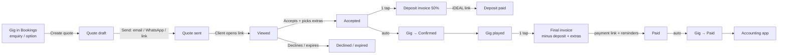
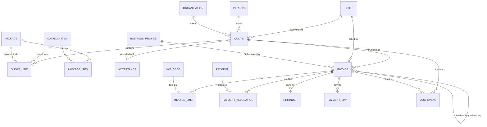

# Funqtion Quotes & Invoices — Functional Plan

> App 2 of the Funqtion suite. **FEEL THE MUSIQ.**
> Status: functional plan, no code yet. Builds on App 1 (Bookings & CRM, live in this repo).
> Tax and legal points below are a practical summary, **not tax advice**. Have an accountant or the Belastingdienst confirm the items marked ⚖️.

> **Decisions made (v0.1 build)**: these replace the matching recommendations below.
> - **Registration:** not registered yet → business profile mode **"not registered – no VAT"**. KOR and VAT modes are built in and can be switched on later in Settings.
> - **Bank details:** you enter the IBAN yourself in the app (Settings). It's stored only on the device and in your own backups, never in code or on GitHub.
> - **No server (local only):** clients receive the quote PDF (with your terms attached) via e-mail/WhatsApp/share sheet and accept by replying. You record the acceptance with **"Akkoord ontvangen"**, with name, channel and chosen extras as evidence. The gig is then confirmed automatically (unless there is a calendar conflict). Payments are by bank transfer and registered by hand. Online acceptance pages, payment links and "viewed" tracking wait for a server.
> - **Invoice numbers:** one gapless series per person (`F2026-G-0001` for Gijs, `F2026-C-0001` for Coen), so two devices can never produce the same number without a server.
> - **General terms:** drafted in [docs/legal/ALGEMENE-VOORWAARDEN.md](../legal/ALGEMENE-VOORWAARDEN.md) and editable in the app. **Have them checked.**
> - **Domain:** you have one; it becomes useful once e-mail sending moves to a server.

## Contents

0. [Read this first: your "unofficial" status](#0-read-this-first-your-unofficial-status)
1. [Core user flows](#1-core-user-flows)
2. [Data model](#2-data-model)
3. [Dutch invoicing requirements and KOR](#3-dutch-invoicing-requirements-and-kor)
4. [Screens](#4-screens)
5. [MVP vs. later](#5-mvp-vs-later)
6. [Payment providers in the Netherlands](#6-payment-providers-in-the-netherlands)
7. [Tech stack, PDF and email](#7-tech-stack-pdf-and-email)
8. [Branding for quotes, invoices and emails](#8-branding-for-quotes-invoices-and-emails)
9. [Privacy and record keeping](#9-privacy-and-record-keeping)
10. [Open questions](#10-open-questions)

---

## 0. Read this first: your "unofficial" status

For App 1 you told me you are not registered (no KvK, 0% VAT). That was fine for a CRM. **Invoicing is where it starts to matter**, for three reasons:

1. **VAT ⚖️.** For VAT purposes you are a *btw-ondernemer* as soon as you independently and regularly sell services for money, whether or not you are registered with the KvK. Then you must either charge VAT or be registered for the **kleineondernemersregeling (KOR)**. KOR is something you *apply for* at the Belastingdienst; it doesn't happen automatically. "0% because we're unofficial" is not a status the Belastingdienst recognises. For a duo, the turnover threshold (€20,000/year) applies to the partnership as a whole if you operate together, not per person.
2. **Payment providers.** Mollie, Tikkie Zakelijk, Stripe and bunq Business ask for a KvK number (or at least business identity checks) during onboarding. Without one, you're limited to plain bank transfer.
3. **Invoice content.** A proper Dutch invoice includes a KvK number and VAT ID (or a KOR exemption line). Without them you can still send a *payment request* ("betaalverzoek / declaratie") and declare the income privately as *resultaat uit overige werkzaamheden*. That's a valid route for a hobby-sized business, but it isn't a VAT invoice.

**The app supports all three situations** through a "business profile" setting, so you can start now and switch later without losing anything:

| Profile | Shows on documents | VAT on lines |
|---|---|---|
| **A. Not registered (private / ROW)** | Names, address, IBAN. Title "Betaalverzoek" or "Factuur" without VAT | none |
| **B. Registered + KOR** | + KvK number, + exemption line (see §3) | none, no VAT shown |
| **C. Registered, VAT-liable** | + KvK number, + btw-id, VAT per rate | 21% / 9% per line |

**My recommendation:** register as a **VOF** (or each an eenmanszaak) at the KvK and apply for **KOR** while your combined turnover stays under €20,000. That costs one KvK registration fee, unlocks iDEAL payment links, looks professional to companies and village festival committees, and keeps you VAT-free. Decide with an accountant. See open questions Q1–Q3.

---

## 1. Core user flows

### 1.0 Lifecycle overview

### 1.1 Gig → quote (30 seconds)

1. In Bookings, open the gig → **"Maak offerte"** (or from the Quotes app: *New quote → pick gig*).
2. The quote is pre-filled from the gig:
   - **Client:** person and/or organisation, with the billing address and invoice e-mail (the organisation's if there is one, otherwise the person's)
   - **Event:** gig date, set times, venue name + town, event type, expected crowd
   - **Language:** the client's preferred language (NL/EN)
   - **Lines:** a **suggested package** for the event type (e.g. *Bruiloft compleet*), plus **travel costs** worked out from the distance to the venue (manual km now, navigation app later)
   - **Intro text:** per event type
3. Adjust: add/remove items, change quantities, apply a discount, and mark items as **optional extras** the client can tick (e.g. lasers, early set-up, extra hour).
4. Preview the PDF → **Send** (e-mail with PDF + link, or WhatsApp with the link).
   - Gig stage moves to **Quote sent** automatically.
   - App 1's reminder engine already schedules follow-ups (day 5 and day 12).

### 1.2 Client accepts online

1. The client opens a personal link (`…/q/<random token>`), a branded, mobile-first page showing the quote, optional extras as checkboxes (totals update live), the terms and the validity date.
2. **Accept**: the client types their name, ticks "I agree to the quote and the terms", and optionally draws a signature → **"Akkoord / Accept"**.
3. The app records **acceptance evidence**:
   - name, e-mail, timestamp, IP address, browser
   - the chosen extras
   - a hash of the exact quote version they saw
4. What happens automatically:
   - the quote becomes **Accepted** and the gig becomes **Confirmed**
   - the conflict check runs (you get a notification if there is a clash)
   - accepted extras are copied onto the gig
   - the client gets a confirmation e-mail with a PDF of the accepted quote
5. Alternatives: the client clicks **"Vraag stellen / Change request"** (a message to you, quote stays open) or **"Afwijzen"** (optional reason → gig *Lost* with that reason).
6. Expiry: after *valid until*, the link shows "expired – contact us"; the follow-up/lost flow from App 1 takes over.
7. Offline/paper fallback: you can mark a quote accepted manually ("accepted by phone/WhatsApp") with a note.

### 1.3 Deposit invoice

1. On acceptance (automatically, or with one tap, see Q6), create a **deposit invoice** for e.g. **50%** of the accepted total. The percentage is a setting, overridable per quote.
2. The deposit invoice gets the next **sequential invoice number** at the moment it is finalised (drafts have no number).
3. Due date: e.g. 14 days, or "before [date]" if the gig is sooner.
4. Sent with the PDF and an **iDEAL payment link**; payment is matched automatically through the provider's webhook (or registered by hand for bank transfers).
5. Deposit paid → the gig shows "deposit received"; App 1's `depositPaidAt` is filled in.

### 1.4 Final invoice

1. After the gig is marked **Played** (App 1 already creates the task "Create invoice"), tap **"Eindfactuur"**.
2. Pre-filled:
   - all accepted quote lines and chosen extras
   - **post-gig changes**: extra hours played (asked when marking Played), extra km, damage or other surcharges
   - minus the **deposit already invoiced**, shown as a deduction line referring to the deposit invoice number
3. Send → payment link → reminders (see 1.6).
4. Paid → invoice **Paid** → gig **Paid** in Bookings → the record is passed to Accounting.

> Small gigs can skip the deposit: one **standard invoice** after the gig (or before it, e.g. company parties that pay upfront).

### 1.5 Payments

- **Automatic:** payment link paid → provider webhook → payment recorded → invoice status updated.
- **Manual:** "Register payment" (amount, date, method: bank, cash, Tikkie, other). Partial payments are supported, and status becomes *partially paid*.
- **Bank reconciliation (later):** import the bank CSV/CAMT file and match transfers by invoice number and amount.

### 1.6 Payment reminders (dunning)

Default schedule (all editable in settings, NL/EN wording, you can pause it per invoice):

| When | Level | Tone |
|---|---|---|
| Due date −3 days | Heads-up (optional, off by default) | "Even een seintje…" |
| Due date +3 days | **1 – Friendly** | "Misschien over het hoofd gezien? Hier is de betaallink." |
| Due date +14 days | **2 – Firm** | "We hebben je betaling nog niet ontvangen. Graag binnen 7 dagen." |
| Due date +28 days | **3 – Formal last notice** | For private clients: the legally required **"14-dagenbrief"** (see §3.5). For businesses: last notice, collection costs and statutory interest from now on. |
| After that | Escalation task | The app creates a task to call the client or hand over to collection. Nothing is sent automatically. |

Reminders are sent by e-mail (with the payment link and the invoice PDF again), logged on the invoice timeline and in App 1's client timeline, and stop as soon as a payment arrives.

### 1.7 Credit notes and cancellations

Sent invoices are **never edited or deleted** (legal requirement). Instead:

- **Credit note** (full or partial): a negative invoice with its own number from the same sequence, referring to the original invoice number and the reason. Use it for wrong amounts, a refund, or goodwill.
- **Cancellation by the client**, after a deposit invoice:
  1. Gig → *Cancelled* (App 1).
  2. The app proposes the **cancellation fee** from your terms (e.g. sliding scale: >3 months 25%, 1–3 months 50%, <1 month 100% of the fee).
  3. Result: the deposit is kept as (part of) the cancellation fee, and the app creates a cancellation-fee invoice (or a credit note for the difference if the deposit was larger than the fee, plus a refund task).
  4. VAT treatment of cancellation fees ⚖️ is configurable per line (see §3.4).
- **Cancellation by you** (illness, emergency): a full credit note for the deposit + a refund task. Optionally offer a replacement DJ.
- **Quote changes after acceptance:** create a new quote version → client re-accepts → invoices use the latest accepted version.

### 1.8 Handover to Accounting (later app)

Every finalised invoice, credit note and payment writes a **ledger-ready record**:

- revenue per VAT rate and VAT amount
- payment date and method, provider fee
- gig and client links
- the **partner split** (Gijs/Coen share: per gig from the lineup, or a fixed 50/50, see Q12)

Accounting only *reads* these records and never changes invoices.

---

## 2. Data model

### 2.1 Principles

- Same database and conventions as App 1: UUIDs, `createdAt/By`, `updatedAt/By`, soft delete, audit log through `save()`.
- New tables live in a new Dexie version block (and later in their own server-side schema `invoicing`).
- **Documents are immutable once sent/finalised.** A finalised quote/invoice stores **snapshots** of seller and client details, lines, VAT and terms. Changing a client's address later never changes an old invoice.
- **Money in cents**, VAT per line by **VAT code** (not a raw percentage), so rate changes over time are handled.
- **Invoice numbers are gapless and assigned only at finalisation**, from a central counter (see §7.3 on how that works with two devices).
- App 1's simple `quotes`/`products` tables are **migrated** into this richer model. App 1 keeps showing quote status on the gig, but editing moves to App 2.

### 2.2 Entity diagram

### 2.3 Tables

**Settings & catalogue**

| Table | Key fields | Notes |
|---|---|---|
| `businessProfiles` | id, validFrom, mode (`private` / `kor` / `vat`), tradeName ("Team Funqtion"), legal names (e.g. "G. … & C. … h.o.d.n. Team Funqtion"), address, kvk, vatId, iban, bic, accountHolder, email, phone, website, logo, termsVersionId, paymentTermDays, depositPct | Versioned: invoices point to the profile that was valid when they were finalised. |
| `vatCodes` | code (`NL21`, `NL9`, `NL0`, `KOR`, `NONE`), rate %, label NL/EN, validFrom/To, invoiceNote | KOR/NONE carry the exemption text. |
| `catalogItems` | sku, name NL/EN, description NL/EN, category (performance, sound, light, effects, travel, extra, fee), unit (hour, piece, km, flat, day), unitPrice, vatCode, defaultQty, minQty, isOptionalByDefault, active, sort | Replaces App 1 `products`. |
| `packages` | name NL/EN, description, eventTypes[], pricing (`sum` of items or `fixed` package price), fixedPrice, active | e.g. "Bruiloft compleet", "Dorpsfeest tent", "Club set". |
| `packageItems` | packageId, catalogItemId, qty, priceOverride, optional | |
| `termsVersions` | version, text NL/EN (Markdown), cancellationScale (json: days-before → %), validFrom | Your general terms (algemene voorwaarden). The accepted version is stored with each quote. |
| `numberSeries` | id (`invoice`, `quote`), prefix, year, next, padding | e.g. `F2027-0001`, `O2027-0001`. |

**Quotes**

| Table | Key fields | Notes |
|---|---|---|
| `quotes` | number, version, gigId, clientPersonId, clientOrgId, **clientSnapshot** (name, attention, address, email, vatId), **sellerSnapshot**, language, status (`draft`, `sent`, `viewed`, `accepted`, `declined`, `expired`, `superseded`, `withdrawn`), issueDate, validUntil, introText, outroText, termsVersionId, depositPct, discount (pct or amount, on total), totals (exVat, perVatCode, vat, incVat; with and without optional extras), publicToken (random, ≥ 128 bits), sentAt/sentVia, firstViewedAt, viewCount, acceptedAt, declinedAt/reason, pdfFileId + pdfHash | One row per version; older versions → `superseded`. |
| `quoteLines` | quoteId, sort, kind (`item`, `package`, `text`, `subtotal`), catalogItemId, packageId, description, qty, unit, unitPrice, discountPct/discountAmount, vatCode, **optional**, **selected** (default for optional), groupLabel | Package lines can be shown collapsed (one price) or expanded. |
| `acceptances` | quoteId, quoteHash, acceptedName, acceptedEmail, selectedOptionalLineIds[], signatureImage?, ip, userAgent, acceptedAt, channel (`online`, `manual`) + note | Proof of agreement. Retained with the quote. |

**Invoices**

| Table | Key fields | Notes |
|---|---|---|
| `invoices` | number (null while draft), kind (`standard`, `deposit`, `final`, `credit_note`, `cancellation`), gigId, quoteId, creditsInvoiceId (for credit notes), clientSnapshot, sellerSnapshot (incl. profile mode), language, status (`draft`, `sent`, `viewed`, `partially_paid`, `paid`, `overdue`, `credited`), issueDate, **supplyDate** (gig date), dueDate, paymentTermDays, reference/PO number, notes, totals per vatCode, amountPaid, amountOpen, finalisedAt (lock), sentAt, firstViewedAt, paidAt, dunningLevel, dunningPaused, pdfFileId + pdfHash, publicToken | `overdue` is computed from dueDate + amountOpen and stored for lists. |
| `invoiceLines` | invoiceId, sort, kind (`item`, `deposit_deduction`, `text`), sourceQuoteLineId, description, qty, unit, unitPrice, discount, vatCode, lineTotalEx, lineVat, refInvoiceId (for deduction lines) | A deposit deduction is a negative line referring to the deposit invoice. |
| `payments` | date, amount, method (`ideal`, `bank`, `cash`, `tikkie`, `card`, `other`), provider (`mollie`, …), providerPaymentId, status (`open`, `paid`, `failed`, `expired`, `refunded`), fee, payerName, payerIban (masked), note | One payment can cover several invoices (allocation). |
| `paymentAllocations` | paymentId, invoiceId, amount | |
| `paymentLinks` | invoiceId, provider, providerId, url, amount, expiresAt, status | New link per reminder when the old one expired. |
| `reminders` | invoiceId, level, scheduledFor, sentAt, channel, templateId, messageId | |
| `docEvents` | docType (`quote` / `invoice`), docId, type (`created`, `finalised`, `sent`, `viewed`, `accepted`, `declined`, `payment_received`, `reminder_sent`, `credited`, `email_bounced`), at, actor (member / client / system), meta | Shown as the document timeline. |
| `files` | kind (`pdf`), mime, size, sha256, blob / storage path, createdAt | PDFs exactly as sent (for the 7-year archive). |
| `outbox` | channel (`email`), to, subject, html, attachments[], status, providerMessageId, error | Queue for the server to send (works offline: queued on the phone). |

**Links to App 1**

| App 1 field | Filled/changed by App 2 |
|---|---|
| `gig.stage` → `quote_sent` | quote sent |
| `gig.stage` → `confirmed` | quote accepted online (the conflict check still runs) |
| `gig.agreedFee` | accepted quote total (incl. chosen extras) |
| `gig.deposit`, `gig.depositPaidAt` | deposit invoice amount / payment |
| `gig.stage` → `invoiced`, `invoicedAt` | final (or standard) invoice sent |
| `gig.stage` → `paid`, `paidAt` | all invoices for the gig fully paid |
| `gig.cancellationFee` | cancellation invoice |
| App 1 tasks | "create invoice" is closed automatically when the invoice exists. Payment tasks are replaced by dunning. |

---

## 3. Dutch invoicing requirements and KOR

### 3.1 Mandatory contents of a VAT invoice (Wet OB art. 35a, plus the Handelsregisterwet for the KvK number)

| Field | On Funqtion invoices |
|---|---|
| **Invoice date** | issueDate |
| **Unique sequential number**, one or more series, no gaps | `F2027-0001`, assigned at finalisation. A yearly prefix is allowed. |
| **Your name and address** | from businessProfile (trade name + legal names) |
| **Your VAT ID (btw-id)** | `NL…B01` (the btw-id, *not* the omzetbelastingnummer) |
| **Your KvK number** | required on invoices and business correspondence once you're registered |
| **Client name and address** | clientSnapshot (a private client needs no VAT number) |
| **Client VAT ID** | only for reverse-charge / EU B2B, which normally doesn't apply to you |
| **Date of supply** if different from the invoice date | the gig date ("Datum optreden") |
| **Description and quantity** of the services | lines |
| **Unit price excl. VAT**, discounts | lines + discount |
| **Amount excl. VAT per VAT rate** | totals block |
| **VAT rate per line and VAT amount per rate** | totals block |
| **Total incl. VAT** | totals block |
| Reference to the original invoice | **credit notes** (and deposit deductions) |
| Exemption text | for KOR or other exemptions (see 3.3) |

Recommended (not mandatory): payment term and due date, IBAN + account holder, payment link, your e-mail/phone, a reference to your terms, and the client's PO number for companies and municipalities.

Rules the app enforces:

- **No editing or deleting** after finalisation. Corrections go through credit notes.
- **Gapless numbering**: drafts have no number. A number is only taken when a document is finalised. Cancelling a finalised invoice is a credit note, never a deleted number.
- **Invoice in euros**, VAT totals rounded per rate.
- **Deposit invoices** ⚖️: VAT on an advance payment is due when you invoice or receive it, so a deposit invoice shows VAT on the deposit, and the final invoice deducts the deposit *including* its VAT.
- **Simplified invoice** (under €100 incl. VAT) is allowed but not needed; the app always produces a full invoice.

### 3.2 VAT rates for a DJ ⚖️

- **21%** is the standard rate: equipment hire (sound, light, lasers), travel costs invoiced as part of the service, and DJ services in general.
- **9%** applies to services of **performing artists** (*uitvoerend kunstenaars*). Whether a DJ qualifies depends on whether the performance is seen as a creative performance and not just playing music. The Belastingdienst and case law have gone both ways, so ask your accountant before using 9% for the DJ-set line.
- Lines that belong together (e.g. a "complete package" with performance + equipment) may need to be split or follow the main service. The app supports a VAT code per line so either approach works.

### 3.3 Kleineondernemersregeling (KOR)

- **What:** if your yearly turnover in NL is **≤ €20,000** (for the partnership as a whole), you can register for the KOR. You then **charge no VAT**, file no VAT returns, and **cannot reclaim VAT** on gear you buy.
- **How:** apply at the Belastingdienst (at least 4 weeks before the quarter you want it to start). Since 2025 the old 3-year lock-in is gone, so you can leave sooner. Check the current rules.
- **On invoices under KOR:**
  - no VAT amount and no VAT rate
  - your KvK number
  - an exemption line, e.g. *"Btw vrijgesteld – kleineondernemersregeling (KOR)"* (ask your accountant for the exact wording)
  - the btw-id may still appear, but that's not required
- **The app:** profile mode `kor` sets all lines to VAT code `KOR`, prints the exemption line, and shows a **turnover meter** on the dashboard ("€14,200 of €20,000 this year"). It warns at 80% and 100%: crossing the threshold means VAT applies from that moment, so you'd switch to profile mode `vat` mid-year.
- **Trade-off to consider:** when buying expensive gear, VAT registration lets you reclaim 21% on purchases. With KOR you can't. Mostly private clients (weddings) → KOR is attractive. Mostly companies that can reclaim VAT anyway → VAT registration costs them nothing.

### 3.4 Cancellation fees ⚖️

Whether VAT is due on a cancellation fee depends on your terms and recent case law (fees agreed in advance are increasingly treated as VAT-able consideration). The app lets you choose the VAT code for the "Annuleringskosten" item. Confirm the treatment with your accountant once and set it as the default.

### 3.5 Late payment rules (built into the reminders)

- **Private clients (B2C):** before charging collection costs you must send a **"14-dagenbrief"**: a written reminder giving **14 days from receipt** to pay, stating the exact collection costs that will be charged otherwise (Wet normering buitengerechtelijke incassokosten; minimum €40). Statutory interest (*wettelijke rente*) can be claimed after the due date. The level-3 reminder template is this letter.
- **Business clients (B2B):** statutory commercial interest (*wettelijke handelsrente*) applies automatically after the payment term (max 30 days unless agreed otherwise; 60 days max for large companies paying small ones). Fixed collection costs of €40 can be charged.
- The app only *mentions* costs and interest when you enable that per reminder level. Nothing is added to amounts automatically.

### 3.6 Retention (bewaarplicht)

Invoices, credit notes, quotes that led to invoices, payment records and the underlying PDFs must be kept **7 years** (art. 52 AWR), in a form that can be shown to the Belastingdienst within reasonable time. See §9.

---

## 4. Screens

Navigation: Quotes & Invoices is a new tile on the Funqtion Hub, with the same layout as Bookings (bottom tabs on mobile, sidebar on desktop). Tabs: **Overzicht · Offertes · Facturen · Betalingen · Catalogus** (+ Instellingen).

### 4.1 Overview (dashboard)

- **Open amount** (total + count), **overdue** (red, oldest first), **paid this month / year**, **expected deposits**
- **KOR turnover meter** (in KOR mode)
- **Quotes awaiting response**, with "viewed 2× · last yesterday"
- Activity feed: viewed, accepted, paid, bounced
- Mobile shows the same content as stacked cards.

### 4.2 Quote list

- Filters: status chips (draft/sent/viewed/accepted/declined/expired), year, client, search.
- Row: number + version, client, gig date, total, status pill, "viewed" eye icon.
- Desktop: table with bulk actions (send reminder, export CSV). Mobile: cards.

### 4.3 Quote editor

- **Desktop:** two panes.
  - Left: client & gig block (pre-filled, read-only with an "edit in Bookings" link), intro text, lines (drag to reorder, add from the catalogue, add a package, toggle "optional", per-line discount), total discount, deposit %, validity, terms version.
  - Right: **live PDF preview** in NL/EN.
  - Sticky bar: totals (with and without extras) · Save · Preview · **Send**.
- **Mobile:** a step-by-step sheet: *Klant & gig* (confirm) → *Pakket* (pick a package card) → *Extra's* (toggle cards with prices) → *Korting & aanbetaling* → *Controleer* (PDF preview) → *Versturen* (e-mail / WhatsApp / copy link).
- Send dialog: channel, recipient, subject/message template, PDF attached, link included.

### 4.4 Client quote page (public, mobile-first)

- Funqtion header (logo, "FEEL THE MUSIQ"), "Offerte voor Bruiloft Lisa & Tom – za 12 juni 2027 – De Hoeve, Aarle-Rixtel"
- Package summary, then **optional extras as toggle cards** (photo/icon, short description, price); the total updates live.
- Terms (collapsible), validity date, deposit explanation
- **Accept** block: name, "akkoord" checkbox, optional signature pad, big button. Secondary actions: "Vraag stellen", "Afwijzen".
- After acceptance: thank-you screen, downloadable PDF, "deposit invoice follows / pay deposit now" button.
- Works in NL/EN, without login. The link token is the access key. No tracking cookies.

### 4.5 Invoice list

- Status chips with amounts: *Open €2,450 · Te laat €600 · Betaald*
- Row: number, kind (deposit/final/credit), client, gig date, due date (red when overdue), amount, open amount, status.
- Desktop: table + CSV/UBL export. Mobile: cards; swipe right = "register payment".

### 4.6 Invoice detail

- Header: number, kind, status pill, total/open, due date.
- Actions: **Send / Resend**, **Copy payment link**, **Register payment**, **Credit note**, **Pause reminders**, **Download PDF**.
- Tabs/sections:
  - PDF preview
  - lines
  - payments (with allocations)
  - **timeline** (created, sent, viewed, reminder 1, payment received…)
  - related documents: quote, deposit invoice, credit notes, gig link

### 4.7 Create invoice from quote

A sheet with the choices **Deposit invoice (x%)** · **Final invoice** · **Single invoice**. The final invoice shows deduction lines for earlier deposits and a "post-gig extras" step (extra hours, km, other). Preview → **Finalise & send** (the number is assigned here, with a warning that the document can't be edited afterwards).

### 4.8 Credit note / cancellation dialog

Pick the invoice → full or partial (choose lines/amounts) → reason → optional cancellation fee from the terms scale (shows days before the gig and the resulting %) → preview → finalise. Creates refund tasks when money must go back.

### 4.9 Payments

A list of all payments (provider and manual) with match status. "Unmatched" bank imports (later) appear here with suggestions.

### 4.10 Catalogue & packages

- Items: table with name, unit, price, VAT code, category, active; inline editing on desktop, form on mobile.
- Packages: cards with their items, pricing mode and event types. "Preview as client" shows how it looks on the quote page.

### 4.11 Settings

- Business profile(s) with mode A/B/C, KvK, btw-id, IBAN, logo, legal names, valid-from
- Numbering (prefix, next number, read-only once used)
- VAT codes
- Payment term, deposit %, cancellation scale
- Terms versions (NL/EN)
- Reminder schedule & templates (NL/EN, friendly → firm → formal)
- E-mail sender (from name/address, reply-to)
- Payment provider connection
- PDF options (show package details, show unit prices)

---

## 5. MVP vs. later

### MVP (v2.0): "send a real quote and invoice, get paid"

- Catalogue items + packages (migrate App 1 products)
- Quote from gig with pre-fill, optional extras, line/total discounts, versions, validity
- Branded **PDF** quote and invoice (generated in the app, works offline)
- Sending by e-mail through the server (PDF attached + link); WhatsApp/share sheet with the PDF or link
- **Online acceptance page** (name + checkbox + optional signature, extras selection) → gig Confirmed
- Deposit, final, standard invoices; gapless numbering at finalisation; immutable after finalising
- Manual payment registration (bank/cash/Tikkie); statuses draft/sent/viewed/paid/overdue
- **Payment link** through one provider (Mollie recommended, see §6) with automatic "paid" via webhook. Requires KvK; without it, MVP uses bank transfer + IBAN + payment reference only.
- Automatic reminders, 3 levels, NL/EN, including the B2C 14-day letter
- Credit notes and cancellation with fee scale
- Business profile modes (private / KOR / VAT) + KOR turnover meter
- Document timeline, audit log, PDF archive with hash
- Accounting handover records (ledger-ready, partner split field)
- CSV export of invoices and payments (for an accountant)

### v2.1

- Bank statement import (CAMT.053/CSV) with automatic matching
- Quote templates per event type (intro/outro texts, default packages)
- Travel costs from the navigation app (km to venue)
- Client portal integration (App 7): all of a client's quotes and invoices in one place
- Recurring "rebook" quotes (copy last year's accepted quote for gig series)
- Reminder by WhatsApp (link via share sheet), call task at level 3

### Later

- UBL/Peppol e-invoices for business clients and municipalities (e-invoicing isn't mandatory in NL yet; useful for government clients)
- Multiple payment methods on the pay page (cards, Apple Pay, Bancontact for Belgian clients)
- Instalment plans for big events
- Contract generation from the accepted quote (App 3 Contracts)
- Quote analytics: acceptance rate per package, average time to accept, most picked extras
- Multi-currency (not needed now)

---

## 6. Payment providers in the Netherlands

*Indicative public prices at the time of writing, excluding VAT. Check current pricing before you choose.* All of them require business onboarding (identity check; usually a KvK number) except plain bank transfer.

| Option | Cost (approx.) | Pros | Cons | Fit |
|---|---|---|---|---|
| **Mollie** (Amsterdam) | iDEAL ~€0.30 per paid transaction, no monthly fee; cards ~1.8% + €0.25 | Dutch, excellent API + **payment links** + **webhooks**, fast payouts, handles the iDEAL → Wero transition, Bancontact/cards if needed | Needs KvK + business bank account; a webhook needs a server | ⭐ **Recommended** once registered |
| **Stripe** | iDEAL ~€0.30; cards ~1.5% + €0.25 (EEA) | Best developer tools, Payment Links, invoices, also allows sole proprietors | US company (EU entity in Ireland); support less local; payouts slightly slower | Good alternative |
| **Tikkie Zakelijk** (ABN AMRO) | ~€0.20–0.30 per paid Tikkie, depending on plan | Everybody in NL knows Tikkie; feels friendly; API available | Requires a business account/KvK; limited status tracking and branding; links expire | OK for small amounts |
| **Personal Tikkie / betaalverzoek** | free | Instant, familiar | Not meant for business use; no API, so manual matching; amount limits | Only as a stopgap |
| **bunq Business** | subscription ~€10–20/month; bunq.me links | Payment links + API + bank account in one | Monthly fee; whole banking switch | If you want a new business account anyway |
| **Bank transfer** (IBAN + reference) | free | No onboarding, works today, no KvK needed | Manual matching (or bank import in v2.1); slower payment; no "click to pay" | **Start here** if you stay unregistered |

**Recommendation:**

1. **Now / unregistered:** bank transfer with a clear payment reference (`F2027-0012`), plus manual "mark paid". The app is built provider-agnostic.
2. **After KvK registration:** **Mollie** payment links (iDEAL first). At ~€0.30 per payment, 50 gigs × 2 invoices costs about €30/year.
3. Pass card fees on? Not recommended; keep iDEAL the default and offer cards only if a client asks.

---

## 7. Tech stack, PDF and email

### 7.1 What changes compared to App 1

App 1 runs entirely on the device. App 2 needs things that **must be online even when your phone is off**:

- the client acceptance page
- payment webhooks
- e-mail sending
- "viewed" tracking

That makes App 2 the moment to add the **self-hosted server** that App 1 was prepared for.

### 7.2 Recommendation

| Layer | Choice | Why |
|---|---|---|
| App (both apps) | Existing React/TypeScript hub, local-first IndexedDB | Unchanged. Works offline in the browser, exe and iPhone. |
| **Server + shared database** | **PocketBase** (single binary: SQLite, REST/realtime API, auth, file storage, JS hooks, admin UI) on a **Hetzner** VPS in Germany/Finland (~€4–5/month) | Cheap and fixed-cost, EU-hosted (GDPR), simple backups, enough for many years of two users. Becomes the shared database every Funqtion app syncs to, and gives Gijs and Coen real shared data instead of export/import. |
| Sync | App ⇄ PocketBase: push local changes (records already carry `updatedAt`/`updatedBy`) and pull changes since the last sync; newest-wins per record; **invoice numbers and finalisation only on the server** | Two people editing offline stays safe; numbering stays gapless (see 7.3). |
| Public pages | Small static page served by the same server: `/q/<token>` (quote), `/i/<token>` (invoice + pay button) | No login for clients; tokens are random and revocable. |
| PDF | **Generated in the app** with `pdfmake` (or `@react-pdf/renderer`), embedding the Funqtion fonts (JetBrains Mono, Archivo Black: open font licence) and the logo SVG | Works offline and in the exe; identical output everywhere. The finalised PDF is uploaded to the server and stored with a SHA-256 hash (archive copy). |
| E-mail | **Brevo** (EU, free tier ~300 mails/day) or Postmark, called from a server hook; sent from your own domain (`boekingen@…`) with **SPF, DKIM and DMARC** set up | Reliable delivery, bounce tracking, attachments. Mails queue in `outbox` when offline. |
| WhatsApp | Device **share sheet** (Web Share API with the PDF file on iPhone/Android) or a `wa.me` link with the public link | Free, no WhatsApp Business API needed. |
| Payments | Mollie API: create a payment link when an invoice is finalised; webhook → PocketBase hook → payment record → status | Provider behind a small adapter, so you can switch to Stripe/Tikkie later. |
| Backups | Nightly PocketBase backup (built-in) to an EU object store (Hetzner Storage Box / Backblaze EU), 30 daily + 12 monthly + **yearly archives kept 7+ years**; quarterly restore test | Covers the legal retention requirement. |
| Hosting cost | ~€5/month server + ~€1–3/month storage + domain | |

**Cheaper alternative (€0):** Cloudflare Workers + D1 as a "relay" only for the public pages, webhooks and e-mail, with everything else staying local. It works, but leaves you with no shared database and puts client data with a US provider. I'd only choose it if €5/month is a blocker.

### 7.3 Invoice numbering with two devices

Gapless numbers can't be assigned safely offline on two phones at once. So:

- Drafts can be made anywhere, offline.
- **"Finalise"** asks the server for the next number (an atomic counter in one transaction).
- If you're offline, the invoice stays in **"Ready to finalise"** and is finalised and sent automatically when back online.
- Quotes may use a non-gapless series, so they can be numbered offline.

### 7.4 PDF contents and layout (A4)

1. **Header:** logo, "OFFERTE" / "FACTUUR" / "CREDITNOTA", number, date(s)
2. **Parties:**
   - from: trade name, legal names, address, KvK, btw-id, IBAN, e-mail, phone
   - to: client snapshot, PO/reference
3. **Event block:** event title, date, set times, venue + town (deliberately prominent: it's what the client recognises)
4. **Lines table:** description (with package sub-items in small type), qty, unit, price, VAT %, amount
5. **Totals:** subtotal, discount, excl. VAT per rate, VAT per rate, **total**, deposit already paid, **amount due**
6. **Payment block:** due date, IBAN, reference, payment-link QR code + short URL
7. **Footer:** exemption/VAT notes, terms reference, page x/y, tagline

---

## 8. Branding for quotes, invoices and emails

Goal: a **professional financial document first**, unmistakably Funqtion second. People print invoices, forward them to their finance department and archive them. The client acceptance page is where the brand can go all the way.

| Medium | Approach |
|---|---|
| **PDF quote/invoice** | **White paper**, near-black text (prints well, cheap on ink); **one orange accent** (`#f68712`) for the document title rule and the "Total / Te betalen" line; logo top-left; **Archivo Black** only for the title ("FACTUUR") and the total amount; **JetBrains Mono** for everything else, which gives perfectly aligned numbers. Hairline rules as on the website. Corner brackets around the totals block as the signature detail. Footer: small "FEEL THE MUSIQ" + @funqtionofficial. |
| **Quote PDF extras** | Allowed a bit more personality: a short intro in your own tone, one strip photo (e.g. crowd shot from `funqtion-site`, which needs consent from recognisable people), package names with a one-line description. Still white paper. |
| **Client quote page** | Full brand: near-black page, film-grain hero, orange accent buttons, corner-bracket "Accept" button, extras as tiles with icons/photos. Must stay WCAG AA and fast on 4G (no video). |
| **E-mails** | Simple, single-column HTML that works in Outlook and Gmail: a black header strip with the logo (an image with alt text "Team Funqtion"), a white body in a readable system font (custom fonts fail in most mail clients), one orange button ("Bekijk offerte" / "Betaal nu met iDEAL"), signature with names, phone, Instagram. Plain-text version included. Test dark mode: no text baked into images. |
| **Tone of voice** | Quotes: warm and enthusiastic ("We hebben er zin in!"). Invoices: clear and short. Reminders: friendly → businesslike → formal; never jokes in level 2/3. Legal texts stay plain Dutch/English. |
| **Consistency** | Reuse the `src/styles/tokens.css` colours and fonts. The PDF template takes the same tokens so the website, app, PDF and e-mails feel like one family. |

---

## 9. Privacy and record keeping

### 9.1 GDPR/AVG

| Topic | Approach |
|---|---|
| **Lawful basis** | Quotes/invoices: contract (6(1)(b)). Keeping invoices: legal obligation (6(1)(c)). Reminders: contract/legitimate interest. No consent needed, and no marketing in these e-mails. |
| **Minimal data** | Name, billing address, e-mail, phone, and a company's KvK/VAT if they provide it. Never BSN, date of birth or ID copies. |
| **Acceptance evidence** | IP address and browser are personal data. Keep them with the quote for the retention period, then delete. Mention this in the privacy statement. |
| **Public links** | Random tokens (≥ 128-bit), no client data in the URL, `noindex`, can be revoked/expired, HTTPS only. The invoice page shows only what's on the PDF. |
| **"Viewed" tracking** | Based on opening the link, **no tracking pixels** in e-mails. Pixels raise ePrivacy/cookie-consent issues. |
| **Processors** | Hetzner (hosting), Brevo/Postmark (e-mail), Mollie (payments; Mollie is also a controller for payment data), backup storage. Sign their DPAs (*verwerkersovereenkomst*), choose EU regions, and list them in your privacy statement. |
| **Rights requests** | Export: App 1's person export gains their quotes/invoices. **Erasure is limited** for invoices (legal retention). Instead the app anonymises everything that isn't required (notes, phone, acceptance IP after retention) and keeps the invoice snapshot. |
| **Security** | Server: HTTPS, admin UI behind 2FA/IP restriction, automatic updates, encrypted backups. Devices: PIN/screen lock, as in App 1. |

### 9.2 7-year retention (fiscale bewaarplicht)

- **What:** all invoices and credit notes (the exact PDFs + data), quotes that led to an invoice, acceptance records, payments, bank imports, the ledger records for the accounting app, and the business profile history. Deposits and cancellations are included.
- **How long:** **7 years** from the end of the year the document relates to. The app sets `retainUntil` = 31 Dec of (year + 7).
- **How:**
  - the database is the primary record
  - the **PDF exactly as sent** is stored with a hash, so you can prove it wasn't changed
  - **immutable** after finalisation
  - the audit log for every change
  - a yearly **archive export** (ZIP with PDFs + CSV/JSON) stored separately; you can also hand it to an accountant
- **After retention:** a yearly job lists documents past `retainUntil` → you confirm → they are deleted or anonymised, with the action logged. Quotes that never became an invoice are deleted after 2 years by default (they aren't financial records).
- **If you stop the server:** the archive export is self-contained, so the obligation can still be met from the files.

---

## 10. Open questions

**Legal & tax (answer these first: they change what goes on the documents)**

1. **Registration:** will you register with the KvK before App 2 goes live? As a VOF or as two eenmanszaken? Which names and address go on invoices?
2. **VAT:** KOR, VAT-registered, or (for now) unregistered "payment requests"? Do you have an accountant who can confirm the DJ-set VAT rate (9% vs 21%) and the cancellation-fee treatment?
3. **Turnover:** roughly how much per year (combined)? Close to €20,000?

**Money & terms**

4. **Bank account:** which IBAN receives payments: a joint/business account or one personal account? Who is the account holder?
5. **Payment term:** 14 days? Different for companies (e.g. 30 days)?
6. **Deposit:** always 50%? Only above a certain amount or for weddings? Due within how many days, and must it be paid before the gig counts as confirmed? Should the deposit invoice be **sent automatically** on acceptance, or after your review?
7. **Cancellation policy:** do you have terms (algemene voorwaarden)? What scale do you want (e.g. >90 days 25% · 30–90 days 50% · <30 days 100%)? If you have no terms yet, should I draft a starter version for you to check?
8. **Price list:** your current rates per item and package (DJ set per hour, sound, light, lasers, km rate, extra hour, early set-up). Do you show hourly prices or package prices to clients?

**Clients & sending**

9. **Online acceptance:** is name + checkbox enough, or do you want a drawn signature too?
10. **E-mail domain:** do you own a domain (for `boekingen@…`) and which mail provider do you use? Are you OK with Brevo or Postmark for sending?
11. **Payment provider:** OK with bank transfer now and Mollie after registration? Any preference for Tikkie?
12. **Partner split:** how should income be split between Gijs and Coen: 50/50 always, or by who played the gig (lineup)? Who pays shared costs?

**Technical**

13. **Server:** OK with ~€5/month for a Hetzner server running PocketBase as the shared Funqtion database (it also gives you real shared data in App 1)? Or do you prefer the €0 relay option?
14. **Existing documents:** have you sent invoices before? What numbering did you use (so the new series continues correctly)? Do you want to import old quotes/invoices?
15. **Business clients:** do municipalities or companies ask you for PO numbers, UBL e-invoices or specific invoice e-mail addresses?
16. **Look:** any example quote/invoice you like (yours or someone else's)? Should quotes show photos?
