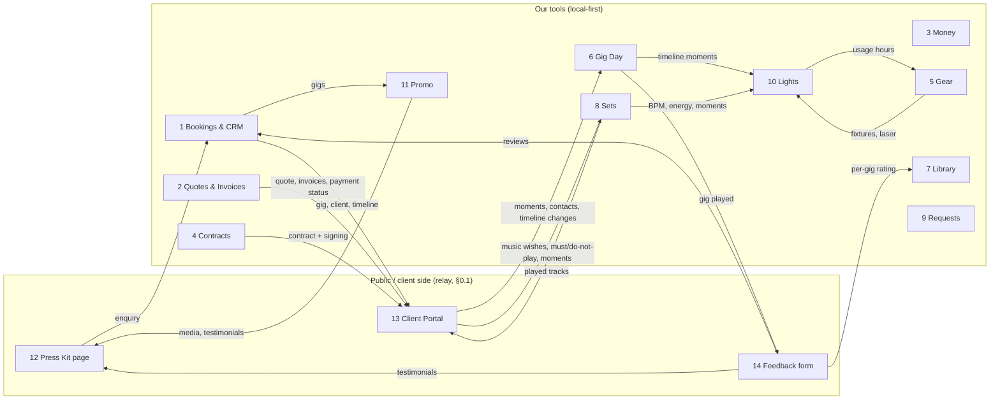

# Funqtion Lights, Promo, Press Kit, Client Portal & Feedback (apps 10–14)

> Five connected apps for Team Funqtion. **FEEL THE MUSIQ.**
> Status: functional plan, **no code yet**. Builds on apps 1–9 and Maps, all in this repo (`docs/HANDOFF.md`).
> Numbering: Lights = 10, Promo = 11, Press Kit = 12, Client Portal = 13, Feedback = 14. The hub tile `portal` in `src/hub/apps.ts` **is** app 13 (the music plan said "app 10"; that is replaced by this numbering).
> Facts about hardware, APIs, licences and rules were checked in November 2026. Items marked ⚠️ depend on third parties or on legal advice, so re-check them when building.

> **Gijs's answers (November 2026), already worked into this plan:**
> - **DMX calculator, Hyperframes prompt generator, Remotion videos:** they live in Claude chats, not in a repo. To use them, paste the code (or export it) into this repo, e.g. `tools/dmx-calculator/`, `tools/hyperframes/`, `tools/remotion/`. Until then the plan describes what they become, not how they work today.
> - **Lighting hardware:** a **Daslight DVC Gold** interface (with Daslight 4/5 software) and a **SoundSwitch Micro DMX** dongle. Both only work with their own software ⚠️, so Lights **controls Daslight and SoundSwitch** (MIDI) instead of sending DMX itself (§0.2, §3).
> - **Instagram:** probably a **Business** account, and **no post goes out without a manual confirmation**. Promo never publishes on its own (§0.4, §4.4).
> - **Domain:** the website **stays** on `gbom2009.github.io/funqtion-site/`, and the DNS does **not** move to Cloudflare (§5.2).
> - **Home server:** **none**, so Cloudflare Tunnel and Tailscale Funnel are out. The public parts (enquiry form, portal, feedback) need a different backbone: §0.1 (decision needed, Q17).
> - **Google Business Profile:** **none**, so the Google review prompt is off until one exists (§5.3, app 14).

## Contents

0. [Read this first: five decisions that shape these apps](#0-read-this-first-five-decisions-that-shape-these-apps)
1. [Connections between apps 10–14 and apps 1–9](#1-connections-between-apps-1014-and-apps-19)
2. [Data model](#2-data-model)
3. [Lights: DMX hardware, software, beat sync and laser safety](#3-lights-dmx-hardware-software-beat-sync-and-laser-safety)
4. [Promo: what the Instagram API can and can't do](#4-promo-what-the-instagram-api-can-and-cant-do)
5. [Press Kit: fitting into the website, and SEO](#5-press-kit-fitting-into-the-website-and-seo)
6. [Client Portal: secure access without hassle](#6-client-portal-secure-access-without-hassle)
7. [Screens](#7-screens)
8. [MVP vs. later, and build order](#8-mvp-vs-later-and-build-order)
9. [Tech stack and hosting](#9-tech-stack-and-hosting)
10. [Branding](#10-branding)
11. [Privacy (AVG/GDPR)](#11-privacy-avggdpr)
12. [Open questions](#12-open-questions)

---

## 0. Read this first: five decisions that shape these apps

**0.1 Three of these apps are public, and there is no home server: so they need a free "relay".**
- Press Kit enquiries, the Client Portal and the Feedback form are opened by people outside Funqtion, on their own phones.
- The first version of this plan used the **home server** from the music plan (Q7). There is no machine for it and the DNS stays where it is, so that route is out. Two options remain, both free:

| | **A. Free relay on Cloudflare Workers** (recommended) | **B. No server at all** |
|---|---|---|
| How | A small Worker with a D1 database on a free `*.workers.dev` address (e.g. `funqtion.<account>.workers.dev`). **No domain move needed**, no machine at home. | The hub exports an **encrypted** page per gig (key only in the link's `#` part, never sent anywhere) to static hosting; clients answer via a pre-filled WhatsApp/e-mail message that we paste back into the hub. |
| Can do | Everything in this plan: enquiries, portal (read + music wishes + accept quote + sign), feedback form, later Requests (app 9). | Read-only portal (quote, invoices, timeline, played list); feedback and wishes only by message. No live updates, no signing relay. |
| Costs/limits | €0 on the free plan: 100,000 requests per day, enough for us many times over ⚠️. D1 free limits are enforced since September 2026 (queries fail when the daily limit is hit, far above our use). | €0. |
| Privacy | Cloudflare is a processor (data processing terms), choose EU storage where offered ⚠️. | The encrypted file sits on a public host; if a link leaks, that gig's page can be read. Weak for invoices. |

- **Recommendation: A**, holding **only what a client or guest must see** (a published snapshot per gig), never the full database. The master stays local-first on our devices (Dexie), like today. Devices pull new answers from the relay when online.
- If the relay is unreachable: the Press Kit still works (static), enquiries fall back to `mailto:Booking@funqtion.nl`, and clients always have the PDFs we already sent.
- This also affects **Requests (app 9)**, which planned the home server: the same Worker can serve it (live updates via Durable Objects or polling ⚠️ check free-plan support when building).

**0.2 Daslight and SoundSwitch stay the light engines; Lights is the cockpit around them.**
- You already own a **Daslight DVC Gold** (1024 channels = 2 DMX universes, stand-alone mode with an SD card, dry-contact trigger inputs) and a **SoundSwitch Micro DMX** dongle (1 universe; works with Serato, Engine DJ and Virtual DJ, Ableton Link, MIDI). Both are **locked to their own software** ⚠️ (not usable as a generic USB-DMX box from our code or QLC+).
- A browser can't send DMX anyway (no UDP for Art-Net, no Web Serial on iPad). So **Lights does not output DMX itself** in the MVP. It does what those programs don't: rig/patch planning linked to Gear, presets per event type, moments from Gig Day and Sets, laser safety, logs, and **one big remote** for the tablet.
- **How it controls them:** the Tauri desktop app on the DJ laptop sends **MIDI** (virtual MIDI port: the IAC driver on a Mac, loopMIDI on Windows) that Daslight and SoundSwitch map to scenes, moments, blackout. The tablet talks to the laptop over the local network (WebSocket); if the tablet dies, Daslight/SoundSwitch keep running the show.
- **Our own DMX engine** (Rust, or QLC+ through its WebSocket API) stays a **later option**, only if you ever buy an open interface (Enttec-compatible USB-DMX or an Art-Net node, §3.1).

**0.3 Software can never be the laser's safety system.**
- Gijs's laser is a **Laserworld DS-1000 Mark III, class 4** (gear plan §6.3).
- The app helps: zones, "never below this height" limits, a checklist, a log, and a big **STOP** button that blacks out the laser channel.
- But a laptop, Wi-Fi or app can crash. **The real emergency stop is hardware**: the laser's key switch / interlock and a physical e-stop (remote interlock) within reach of the operator. The app says so on every laser screen. Audience scanning stays as in the gear plan: only at private parties, only with recorded permission, and permission does not make class 4 scanning eye-safe (§3.5).

**0.4 Instagram: Promo prepares everything, a person always presses "post".**
- Your rule: **nothing goes out without a manual confirmation.** So Promo **never** auto-publishes.
- At the planned time Promo shows a **"Klaar om te posten"** reminder; you check it and then either post it yourself (media saved to the phone, caption copied, Instagram opens) or, later, tap **"Plaats nu"** to have the app publish it through the API **at that moment**. Meta Business Suite's own scheduler is also fine, because you confirm the post there.
- The API is useful mainly for **reading stats**. Publishing through it is possible (up to **50 posts per 24 hours**, no scheduling endpoint, no licensed Instagram music or stickers), but it is an optional "post this now" button, never a timer. Details §4.

**0.5 One identity for everyone outside: the client, the gig and a token.**
- Clients don't make accounts. Each gig gets **one portal link** with a long random token, plus an optional 6-digit code by e-mail for sensitive parts (invoices, contract). Details §6.
- Feedback is a separate, even simpler link (no code), so guests can also fill it in when the client shares it.
- The same token system serves the contract signing relay that app 4 still lists as "not done".

---

## 1. Connections between apps 10–14 and apps 1–9

### 1.1 The big picture

### 1.2 Connection list

| From → To | What flows | When |
|---|---|---|
| **12 Press Kit → 1 Bookings** | Enquiry form → new `enquiries` row (source `website_epk`), same fields as the manual enquiry form (date, type, place, guests, budget, message, contact). | On submit; the relay (§0.1) holds it until a device pulls it. |
| **1 → 13 Portal** | Gig (date, venue, times, event type), client person/organisation, our contact numbers, the timeline (app 6). | On publish/refresh of the portal snapshot. |
| **2 → 13** | Quote PDF + status (accept button), invoices PDF + status (open / paid / overdue), payment link (if any, later). | On publish; payment status after each bank match (app 3). |
| **4 → 13** | Contract PDF, signing (the remote-link method already in the app 4 data model), signed copy. | On publish; signature flows back. |
| **13 → 8 Sets / 1** | Music wishes: must-plays, do-not-plays, special moments (first dance, entrance, cake, speeches, last song), with tracks searched via the same catalogue search as Requests (app 9). Stored as app 1 music wishes; Sets uses them as `must_play` / `moment` items. | Whenever the client saves; locked X days before (setting, default 7). |
| **13 → 6 Gig Day** | Moments with times, extra contacts (wedding planner, venue manager, "ceremoniemeester"), parking/arrival notes. | Same; changes after the lock become a "client asked for a change" task. |
| **8 / 7 → 13** | After the gig: the played list (from `plays`, app 8), optionally as a Spotify playlist link made by hand. | Wrap-up (app 6, next morning). |
| **6 → 14 Feedback** | Gig played → feedback request with the link, combined with the existing "Bedankt + review" template (`thank_you_review`) in the wrap-up. | Next morning (decided in app 6). Reminder after 5 days if no answer. |
| **14 → 1** | The answer lands in the existing `reviews` table (rating, text, mayPublish) and as an interaction on the client. Low scores make a task "bel even". | On submit. |
| **14 → 12 / website** | Approved testimonials (permission = yes, approved by us). | On publish of the Press Kit. |
| **14 → 7 / 8** | Rating per gig joins the play history: "tracks played at gigs rated 5/5", "dance floor rating" per set section. | Recalculated in `trackStats`. |
| **1 → 11 Promo** | Confirmed gigs → draft posts (announcement, "tonight!", thank-you), with venue, city, event type, whether public. Drafts only: you confirm every post. | When a gig becomes confirmed / day before / day after. |
| **11 → 12** | Media library is the single source for photos, logos, videos used on the Press Kit. | On publish. |
| **5 Gear → 10 Lights** | Fixtures and the two interfaces (Daslight DVC Gold, SoundSwitch Micro) are gear items. Lights adds DMX info to them. Rig per kit. | Set up once; per gig via the packing list. |
| **10 → 5** | Laser and fixture **hours of use** from the show log (laser on/off presses), more precise than set times. | After the gig. |
| **6 → 10** | Timeline moments (entrance, first dance, countdown, last song) appear as moment buttons in Lights at the right time. | During the gig. |
| **8 → 10** | Planned BPM and energy per section, moments in the set plan; beat sync when the live source fails. | During the gig. |
| **3 Money** | Promo costs (paid ads, boosts), Press Kit print, Lights hardware → expenses as usual. | As they happen. |

### 1.3 The client's journey in one line

Press Kit → enquiry (1) → quote in portal (2, 13) → contract signed in portal (4, 13) → music wishes + timeline in portal (13 → 6, 8) → gig day: lights follow the moments (10) → next morning: thank-you + feedback link (6, 14) → photos + played list in portal (13) → testimonial on the Press Kit (12) and a "bedankt Knip Gala!" post (11).

---

## 2. Data model

### 2.1 Principles (same as the rest of the suite)
- One Dexie database `funqtion`, new tables in a **new version block** (version 8 onwards, add-only), every row a `Base` (id, createdAt, updatedAt, deletedAt), all writes through `save()`/`patch()` so the audit log keeps working, all tables in `DATA_TABLES` so backup and merge include them.
- Money in cents, dates `yyyy-mm-dd`, times `HH:mm`.
- **Server rows are copies.** What lives on the relay (§0.1) for portal/feedback/enquiries is a published snapshot plus incoming answers. Devices pull incoming answers into local tables; the server deletes them after the retention period (§11).
- Blobs (photos, videos, fonts) follow the gear-photo pattern: a separate table, in the backup ZIP, with a sha256 so duplicates are stored once.

### 2.2 Shared parts

| Shared thing | Lives in | Used by |
|---|---|---|
| **Gigs** | `gigs` (app 1) | Everyone. Portal, feedback, posts, light shows and played lists all hang off `gigId`. |
| **Clients** | `persons` / `organisations` (app 1) | Portal access, feedback request, testimonial name ("Lisa & Tom, bruiloft"). |
| **Venues** | `venues` (app 1) + `venueNotes`/`venuePhotos` (6, Maps) | Venue light profiles (10), "tonight at …" posts (11), past gigs list (12). |
| **Media** | **new** `mediaAssets` (owned by app 11) | Promo posts, Press Kit photos/logos/videos, portal "foto's van jullie feest". One library, not three. |
| **Tracks** | `tracks` / `plays` (apps 7, 8) | Portal music wishes (match to library), played list, feedback linked to play history, BPM for lights. |
| **Reviews** | `reviews` (app 1, already exists) | Extended by app 14 instead of a new table. |
| **Access tokens** | **new** `shareLinks` (core) | Portal, feedback, contract signing, Requests links. One mechanism. |
| **Consents** | **new** `consents` (core) | Photo use, testimonial publication, audience-scanning permission, newsletter (later). One place to prove "who agreed to what, when". |

### 2.3 Tables

**Core (shared, new)**

| Table | Fields | Notes |
|---|---|---|
| `shareLinks` | kind (`portal` / `feedback` / `contract_sign` / `requests`), gigId, personId?, tokenHash (sha256 of the token; the token itself is only in the link), codeRequired (bool), expiresAt, revokedAt?, lastOpenedAt?, openCount | Token = 32 random bytes, base64url. We store only the hash. |
| `consents` | subjectKind (`person` / `guest` / `organisation`), subjectId?, subjectName, purpose (`photo_promo` / `testimonial_public` / `testimonial_name` / `audience_scan` / `marketing_email`), given (bool), scope (text, e.g. "Instagram + website"), source (`contract` / `portal` / `feedback_form` / `in_person` / `whatsapp`), evidence (file id or text), at, withdrawnAt? | Withdrawal is a new row state, never a delete, so we can prove what happened. |

**App 10 – Lights**

| Table | Fields | Notes |
|---|---|---|
| `fixtureProfiles` | manufacturer, model, mode name ("8ch"), channelCount, channels: [{offset, function (`dimmer` / `red` / `green` / `blue` / `white` / `amber` / `uv` / `pan` / `tilt` / `pan_fine` / `tilt_fine` / `speed` / `strobe` / `gobo` / `color_wheel` / `program` / `pattern` / `size` / `laser_x` / `laser_y` / `other`), default, ranges: [{from, to, label}]}], kind (`par` / `bar` / `moving_head` / `laser` / `hazer` / `strobe` / `other`), source (`own` / `qlc_import` / `ofl_import`) | Import from QLC+ `.qxf` or Open Fixture Library JSON so we don't type channel layouts by hand. |
| `fixtures` | gearItemId? (app 5), profileId, label ("Bar links"), universe, address (1–512), group (`front` / `back` / `bar` / `laser` / `fx`), position (x, y on the rig drawing), invert pan/tilt, maxDimmer | The DMX calculator logic (next free address, overlap check, dip-switch values) lives here. |
| `rigs` | name ("Standaard set", "Alleen laser"), gearKitId? (app 5), fixtureIds[], outputs: [{universe, controller (`daslight` / `soundswitch` / `own_usb_dmx` / `artnet`), device}] | Usually one rig per kit. Which fixtures hang on the Daslight line and which on the SoundSwitch line. |
| `controllerMaps` | controller (`daslight` / `soundswitch`), midiPort, items: [{ourId (scene / moment / blackout / laser_stop / master), message (note/CC + channel + value), label in that program}], showFile (name/path of the Daslight show or SoundSwitch project), verifiedAt | The bridge: what MIDI message triggers what in Daslight/SoundSwitch. A "test all" button checks each one. |
| `venueLightProfiles` | venueId, rigId, patchOverrides (json), houseFixtures (their own lights we may use), laserZones (see below), maxDimmer, hazeAllowed (bool, smoke detector!), notes | Remembered per venue; Gig Day shows it. |
| `scenes` | name, kind (`static` / `chase` / `effect`), controller + external id (the Daslight scene / SoundSwitch autoloop it triggers), colours (theme refs), values per group/fixture (json, only for our own engine later), steps, speed (`bpm_sync` / fixed ms), tags | In the MVP a scene is mostly a **named pointer** to a Daslight scene or SoundSwitch autoloop, with our tags (event type, section, colours). |
| `themes` | name ("Funqtion Oranje", "Bruiloft warm", "Carnaval rood-geel-groen"), colours[] (hex), intensity, allowStrobe | Funqtion colour themes; `#f68712` orange is the default. |
| `showPresets` | eventType (wedding / company / private / festival / carnaval / …), themeId, scenesBySection: {warmup, build, peak, cooldown, afterparty} → sceneIds, momentButtons: [{kind, sceneId}] | Ties sections from app 8 to scenes. |
| `momentCues` | kind (`drop` / `blackout` / `strobe` / `first_dance` / `entrance` / `countdown` / `cake` / `last_song` / `custom`), label, sceneId, durationMs or `hold`, returnTo (`previous` / sceneId), laserAllowed (bool), confirm (bool, e.g. for strobe) | The big buttons. |
| `lightShows` | gigId, rigId, venueLightProfileId?, presetId, status (`planned` / `running` / `done`), operator (memberId), startedAt, endedAt | One per gig. |
| `lightLogs` | showId, at, event (`scene` / `moment` / `blackout` / `estop` / `laser_on` / `laser_off` / `beat_source_change` / `error`), detail | Proof for laser use; source for hours of use. |
| `laserZones` (inside venue profile, and as default per rig) | name, kind (`projection_ok` / `no_go` / `audience`), polygon in laser X/Y space, minHeightM, allowedPatterns[], maxScanSpeed | See §3.5. |
| `laserChecks` | showId, checklist answers, operatorName, audienceScanPermission (consent id), measuredAt?, notes | Extends the app 5 laser checklist instead of duplicating it. |

**App 11 – Promo**

| Table | Fields | Notes |
|---|---|---|
| `mediaAssets` | kind (`photo` / `video` / `logo` / `font` / `template` / `audio` / `doc`), blobId or externalUrl, title, tags[], gigId?, venueId?, takenAt, photographer (credit), people (`none` / `crowd_unrecognisable` / `recognisable`), consentIds[], usage (`internal` / `promo_ok` / `press_ok`), width, height, durationS, sha256 | One library for 11, 12, 13. |
| `mediaBlobs` | blob, mime, sha256, sizeBytes, variant (`original` / `web_2048` / `thumb_400`) | Web variants are made on the device; originals can stay off the server. |
| `brandKit` (settings row) | colours, fonts (JetBrains Mono, Archivo Black), logo asset ids (light/dark, square, wordmark), tagline "FEEL THE MUSIQ", hashtags, default caption footer | Read by every generator. |
| `posts` | gigId?, kind (`announcement` / `tonight` / `thank_you` / `throwback` / `mix_release` / `other`), format (`feed` / `carousel` / `reel` / `story`), status (`idea` / `draft` / `ready` / `due` (reminder shown) / `published` / `failed`), plannedAt (reminder time), confirmedBy + confirmedAt (required before `published`), publishMode (`manual` / `api_now`), caption NL/EN, hashtags, mediaAssetIds[], igMediaId?, permalink?, error? | The content calendar. |
| `postTemplates` | kind, format, captionTemplate (with `{venue}`, `{city}`, `{date}`, `{eventName}`, `{client}`), visualTemplate (Hyperframes prompt id / Remotion composition id / Canva link), rules (e.g. "no venue name for private parties") | Auto-generation reads these. |
| `videoJobs` | postId?, engine (`remotion` / `hyperframes` / `external`), composition, props (json from gig data), status (`queued` / `rendering` / `done` / `failed`), outputAssetId?, renderedOn (device) | Renders happen on the Mac or home server, not in the browser. |
| `postStats` | postId, at, reach, views, likes, comments, saves, shares, follows?, profileVisits? | Pulled daily for 30 days, then weekly. Metric names vary per format ⚠️. |
| `accountStats` | date, followers, reach, profileViews | Daily snapshot. |

**App 12 – Press Kit**

| Table | Fields | Notes |
|---|---|---|
| `epkContent` (one row per language) | language (`nl` / `en`), bioShort (≤ 300 characters), bioLong, quote, sections order, visible sections, seo title/description | Draft vs. published copy: `publishedAt`, `publishedSnapshot`. |
| `epkItems` | section (`photo` / `logo` / `mix` / `video` / `reference` / `past_gig` / `rider`), refId (mediaAsset / review / gig), label, sort, visible | Picks from the shared tables; past gigs are generated from `gigs` (public ones only, §11). |
| `epkPublishes` | at, by, version, files changed, pdfAssetId | History; roll back = re-publish an older snapshot. |

**App 13 – Client Portal**

| Table | Fields | Notes |
|---|---|---|
| `portals` | gigId, shareLinkId, language, sections on/off (quote, contract, invoices, wishes, timeline, contacts, after), lockWishesAt, welcomeText, publishedAt, snapshotHash | One per gig. |
| `musicWishes` (app 1 already has music wishes on the gig; this formalises them) | gigId, kind (`must_play` / `do_not_play` / `moment` / `genre_like` / `genre_dislike` / `note`), moment (`entrance` / `first_dance` / `cake` / `speech` / `last_song` / `other`), atTime?, artist, title, catalogRef?, trackId? (library match), note, by (`client` / `funqtion`), status (`new` / `seen` / `planned` / `cannot`) | Sets (app 8) reads these; "cannot" (not available / not suitable) comes back to the client with a short reason. |
| `portalContacts` | gigId, name, role, phone, email, showToClient (bool) | Ceremoniemeester, venue manager, our phones on the day. |
| `portalEvents` | portalId, at, kind (`opened` / `code_sent` / `code_ok` / `wishes_saved` / `quote_accepted` / `contract_signed` / `downloaded`), detail | So we see "the client looked at the quote twice". |

**App 14 – Feedback**

| Table | Fields | Notes |
|---|---|---|
| `reviews` (exists, extended) | + overall (1–5), scores: {music, vibe, communication, value, would_recommend (0–10)}, highlight (chips: "dansvloer vol", "eerste dans", "licht/laser"…), text, displayName (as they want it shown), mayPublish, mayUseName, photoAssetId?, source (`feedback_form` / `google` / `instagram` / `manual`), language, approvedAt?, approvedBy?, publishedOn[] (`epk` / `website` / `instagram`), googlePromptShown/Clicked | No new table: keep one place for reviews. |
| `feedbackRequests` | gigId, shareLinkId, sentAt, channel (`whatsapp` / `email`), reminderAt?, answeredAt?, closedAt | One per gig (more if we ask several people, e.g. committee members). |

---

## 3. Lights: DMX hardware, software, beat sync and laser safety

### 3.1 Hardware options

**What you own (the MVP uses only this):**

| Interface | What it is | Strengths | Limits ⚠️ |
|---|---|---|---|
| **Daslight DVC Gold** | USB-C interface for Daslight 4/5: 1024 channels (2 universes), RJ45 + XLR, SD card for stand-alone shows, buttons, dry-contact inputs that trigger scenes. | Full scene/step editor, stand-alone mode (a backup if the laptop dies: scenes play from the box), MIDI-triggerable. | Only works with Daslight software. OSC support not confirmed; we use MIDI and keyboard shortcuts. |
| **SoundSwitch Micro DMX** | USB dongle, 1 universe, SoundSwitch software. | Reads the track in **Serato** (and Engine DJ / Virtual DJ): beat-synced autoloops, pre-scripted shows per track, Ableton Link, MIDI mapping. | Only works with SoundSwitch software (subscription after the trial ⚠️). **djay is not on the supported list** ⚠️ so with djay use Ableton Link only. |

**Suggested split** (check with your fixtures, Q2b): SoundSwitch drives the **light bar** (beat-synced with Serato during the party), Daslight drives the **laser and moments** (blackout, first dance, countdown, the laser zones and its STOP), with the DVC Gold's stand-alone mode as a backup. If you'd rather use one program for everything, Daslight alone (2 universes) can do it, without the Serato track sync.

**If you ever want our own engine (later):**

| Option | What it is | Price range ⚠️ | Fits us? |
|---|---|---|---|
| **USB-DMX, "open" FTDI type** (Enttec Open DMX USB, cheap clones) | USB to one DMX universe; the computer does the timing. | €20–€80 | Cheap, but timing can flicker on a busy laptop (the laptop is also running the DJ software). Only as a spare. |
| **USB-DMX, "pro" type with own processor** (Enttec DMX USB Pro / Pro Mk2, DMXking ultraDMX Micro, Eurolite USB-DMX512 PRO) | USB to 1–2 universes; the box does the timing. | €80–€250 | Only needed if we build our own engine. Supported by QLC+ and by Rust serial libraries. |
| **Art-Net / sACN node** (DMXking eDMX1/eDMX2, Enttec ODE Mk3, Showtec NET-2/3) | Ethernet/Wi-Fi to DMX. | €100–€300 | **Later**, when the laptop should not be cabled to the rig, or for 2+ universes. Use a **cable or a dedicated router**, not the venue Wi-Fi. |
| **Wireless DMX** (W-DMX, Showtec/Eurolite wireless transceivers, battery uplights) | Radio from the booth to the fixtures. | €60–€200 per pair | Handy for uplights around a dance floor; not for the laser (keep the laser cabled). |
| **Stand-alone controller with MIDI** (e.g. a small DMX desk) | Hardware fallback. | €100+ | Not needed: the DVC Gold's stand-alone mode and the light bar's own auto/sound mode are the backups. |

The light bar we use (model ⚠️ unknown, Q2) probably has its own sound-active and auto mode, and DMX modes of e.g. 3/8/14+ channels. We will add its profile once we know the model.

### 3.2 Software: build on QLC+, or own engine?

**QLC+** (free, open source, Windows/macOS/Linux) already does fixtures, scenes, chases, audio-triggered effects, Enttec USB, Art-Net, OS2L, a virtual console and a web interface.
- Started with `-w` (web interface), it offers a **WebSocket API** on `ws://<ip>:9999/qlcplusWS` with commands like `QLC+API|getFunctionsList`, `setFunctionStatus`, widget control. That is enough for our moment buttons and scene switching.
- It also has a fixture library we can import (`.qxf`), plus the community **Open Fixture Library** (export to QLC+ and other formats).

| | A. **QLC+ as the engine**, our app as the "Funqtion skin" | B. **Own engine in Tauri (Rust)** |
|---|---|---|
| Effort | Low: QLC+ does DMX output and timing; we send commands. | Medium-high: DMX output, fades, chases, beat clock, safety logic all ours. |
| Fit with our data | Scenes live in a QLC+ workspace file; we keep a mapping (our scene id ↔ QLC+ function id). Rig and fixture data duplicated. | Everything in our database: rigs from gear, presets per event type, moments from Gig Day, logs. |
| Laser safety logic | Limited: we can only send what the API offers. | Full: zone clamping, "laser off during moment X", STOP. |
| Risk | QLC+ must be running; API is documented but partly version-specific ⚠️ (v4 vs v5). | Bugs in our own timing; more testing. |
| Licence | QLC+ is Apache 2.0 — fine to use alongside. | Our code. |

**Decision after Gijs's answer: neither A nor B for now. Option C: control Daslight + SoundSwitch.** Your interfaces only run with their own software, so the MVP builds the cockpit around them:
- Daslight and SoundSwitch hold the actual scenes, chases and DMX output (and SoundSwitch does the Serato track sync).
- Funqtion Lights sends **MIDI** to them (`controllerMaps`), shows the moments at the right time, keeps the rig/patch, presets, laser checklist and log.
- Scenes are programmed in Daslight/SoundSwitch; in our app you give each one a name, tags and a big button.
- A or B only come back if you buy an open interface. QLC+ fixture import is still useful for the patch (channel layouts).

The **DMX calculator** you made in a chat (Q1: paste it into the repo) becomes the "Patch" screen: next free address, overlaps, DIP-switch view, and a printable patch sheet.

### 3.3 Beat sync: options, best first

| Source | How | Works with | Notes |
|---|---|---|---|
| **SoundSwitch + Serato** | SoundSwitch reads the playing track from Serato and runs beat-synced autoloops or a pre-scripted show. | Serato (and Engine DJ / Virtual DJ). | **Primary when playing Serato**: the beat sync happens inside SoundSwitch; Lights only picks the mood (autoloop group) per section. |
| **Ableton Link** | Local network protocol: tempo, beat and phase shared between apps. SoundSwitch and Daslight-side timing can follow it; our Tauri app joins the session too (Rust bindings exist) to show BPM and time moment buttons. | **Serato DJ Pro** (Link support since 1.9.3; per Serato docs it shares tempo/beat/phase), **djay Pro** (Link in DJ tools), Traktor, Rekordbox (Link in performance mode ⚠️). | **Preferred.** No cables. The DJ software must have Link switched on and the laptop and engine must be on the same machine/network. ⚠️ Link SDK is GPLv2 or commercial licence: fine for our own non-distributed use, check before shipping the exe to others. |
| **Pro DJ Link** (CDJs/XDJs) | Network data from Pioneer players: BPM, beat, which deck is master. Same approach as app 8's play history (beat-link). | CDJs at venues. | When we play on the venue's CDJs. |
| **MIDI clock** | DJ software sends MIDI clock to a virtual MIDI port. | Rekordbox, Traktor; Serato limited ⚠️. | Fallback; drifts more than Link. |
| **OS2L** | Protocol for "DJ software → lighting" (beat + buttons) over the network. | VirtualDJ mainly; QLC+ supports it. | Only if we ever use VirtualDJ. |
| **Audio beat detection** | Analyse the master out (line in on the laptop/interface). | Anything. | Good fallback, less exact phase. |
| **Tap tempo** | Tap a big button on the tablet 4×; nudge ±. | Always. | Always available, also as override. |
| **Set planner hint** (app 8) | The planned BPM of the current section. | — | Starting value when nothing else is live. |

The screen always shows **which beat source is active** and its BPM; if it drops out, Lights falls back (Link → audio → last tap → planned BPM) and logs it.

### 3.4 Moments, scenes and the event flow
- **Per event type** a show preset (`showPresets`): wedding = warm white/amber, gold, no strobe during the dinner, orange Funqtion theme from the party; carnaval = red-yellow-green, lots of chases; company party = client colours (from the portal/branding question).
- **Sections from app 8** (warm-up, build, peak, cooldown, afterparty) choose the scene group; the beat source drives speed.
- **Moment buttons** (big, always visible): DROP (flash + chase for 8/16 beats, then back), BLACKOUT (hold), STROBE (needs a second press or hold; disabled in presets where strobe is off), FIRST DANCE (soft spot/warm, laser off), ENTRANCE, COUNTDOWN (for New Year / carnival: 10-second build, then full on at zero; time from the Gig Day timeline), LAST SONG.
- **Gig Day** shows "over 10 min: eerste dans" and Lights highlights that button at the time.
- **Strobe and epilepsy:** keep strobe frequency ≤ 3 flashes/second by default (setting), show a "strobe" sign if the venue asks for it, and no strobe at events where the client said no.

### 3.5 Laser safety (NL)

**What the rules are, as far as we found ⚠️ (not legal advice):**
- The Netherlands has **no specific law for laser shows** for the public. RIVM noted this in its reports on entertainment lasers; the Minister said in 2008 that the **operator is primarily responsible** for safe use. General rules still apply: product safety (the laser must be properly classified and labelled, EN/IEC 60825-1), the Arbo law for staff, and the **venue's or municipality's conditions** (event permit).
- Venues set their own conditions. Example: **Spot Groningen** requires that class 3B/4 lasers do **not exceed the class 2 limit (MPE) where the audience stands**, an **interruption device** available at all times, and an operator with a laser authorisation (laser-gevolmachtigde).
- Good practice from neighbouring countries: Germany (DIN EN 60825-1, DIN 56912 for show lasers, a laser safety officer), the **Nordic radiation authorities** (avoid direct audience scanning; if done, measure before every show), and **IEC 60825-3** (guidance for laser displays and shows).
- **Aviation:** outdoor lasers can blind pilots. Never aim upward outdoors and check with the municipality for outdoor events (e.g. near Eindhoven Airport / Volkel, both close to Aarle-Rixtel) ⚠️.

**What the app does:**
1. **Laser checklist** (app 5 §6.3) must be done before the laser channel unlocks for a show: key switch OK, e-stop/interlock within reach, mounting secure, beam height ≥ 3 m above the floor (setting; many guidelines use ~3 m) in the audience area, no reflective surfaces, venue allows lasers, outdoor/aviation check.
2. **Zones**: per venue a drawing in laser X/Y space: `no_go` (DJ booth, doors, balconies, cameras), `projection_ok` (walls, ceiling, over heads), `audience` (only usable with permission + a measured scan-safe setting). With Daslight as the engine, the zones are a **checklist and drawing** ("which Daslight laser scenes are safe in this venue"), and Lights only shows/triggers the scenes you marked safe for that venue. Real clamping of DMX values is only possible with our own engine later ⚠️.
3. **Audience scanning**: off by default. Can only be switched on per show at a private party, with a recorded **permission** (`consents`, purpose `audience_scan`, who and when) **and** a confirmation "this set-up has been measured below MPE" — otherwise the app refuses. It repeats the gear-plan warning: permission does not make class 4 scanning eye-safe.
4. **STOP**: a red button on every Lights screen and the keyboard Escape key: sends the mapped "laser off / blackout" MIDI message to Daslight (or SoundSwitch), logged. It only works if that mapping is set and tested (`controllerMaps` "test all" before each show). The screen says plainly: **the hardware e-stop/key switch is the real stop**.
5. **Dead-man for the laser**: if the tablet loses the laptop for > 2 s, the laptop sends "laser off". If **the laptop or Daslight itself** crashes, our app can't help: the laser then keeps its last DMX state, which is exactly why the hardware e-stop must be within reach (Q3).
6. **Log**: laser on/off times, checklist, operator, zones used → evidence if a venue or insurer asks, and hours of use for app 5.

---

## 4. Promo: what the Instagram API can and can't do

### 4.1 Requirements
- The account (@funqtionofficial) must be a **professional account** (Business or Creator) ⚠️ Q4. Stories publishing via the API is **only for Business** accounts.
- A **Meta developer app** (free) with the Instagram API ("Instagram API with Instagram Login" — no Facebook Page needed; or the older "with Facebook Login" route, which needs a linked Page). For our own account, the app can stay in development/standard access with ourselves as testers; **App Review** is only needed to serve other accounts ⚠️.
- Access tokens are long-lived (about 60 days) and must be refreshed; the desktop app does that (token stored on the device, never in the repo) and warns before expiry.
- **Media must be at a public URL** when publishing through the API: Instagram fetches it. With no own server, the "Plaats nu" button would upload the file briefly to the relay (§0.1, option A) and delete it afterwards. Manual posting needs none of this.

### 4.2 What it can do
- **Publish**: single image (JPEG), carousel (up to 10 items), reels (video), stories (Business). Caption, hashtags, mentions in captions, location id (optional), alt text (⚠️ check current support), cover/thumbnail for reels.
- **Limit**: **50 API-published posts per rolling 24 hours** (a carousel counts as one); check with `GET /{ig-user-id}/content_publishing_limit`.
- **Insights**: per post (views, reach, likes, comments, saves, shares; reels have plays/views) and per account (followers, reach, profile views) — **metric names change between API versions** ⚠️, and some metrics need ≥ 100 followers or are only kept for a limited period (⚠️ check, e.g. 2 years / stories only 24 h unless fetched). So we fetch and store our own copy (`postStats`).
- **Comments**: read and reply (later).

### 4.3 What it can't do (so we go manual)
- **No scheduling endpoint**. We don't need one: `plannedAt` is a reminder time, not an automatic publish time. Native scheduling in the Instagram app or Meta Business Suite is fine, because you confirm the post there.
- **No licensed Instagram music** on reels/stories via the API: put our own audio (our mix, cleared) in the video, or post manually to add IG music.
- **No stickers, polls, links stickers, collab invites, "add yours"** via the API ⚠️ (check; some features are added over time).
- **No personal-account publishing**.
- Our own music in a reel is fine only if **we own or licensed it**; snippets of commercial tracks can get muted or blocked (see music plan §12 on licensing).

### 4.4 The Promo flow
Every step below makes a **draft**. Nothing is published until you confirm it (§0.4).

1. Gig becomes **confirmed** (app 1) → draft "announcement" post if the gig is public (festival, dorpsfeest, carnaval) — **never for private parties** unless the client agreed (portal tick box, §11).
2. **Day of** → "TONIGHT!" story: venue, city, time, Funqtion style. Ready at 12:00, publish at 17:00 (settings).
3. **Next morning** (with the app 6 wrap-up) → "BEDANKT {eventName}!" carousel draft with the best 3–10 photos that are `promo_ok`.
4. **Visuals**: templates in three ways: (a) a still made in-app from brand templates (canvas, our fonts and colours), (b) **Hyperframes prompt generator** (Q1: where is it?) to produce a prompt/visual, (c) **Remotion** compositions for video (countdown, "tonight", aftermovie teaser) with props from the gig (`videoJobs`).
5. **Confirm**: at the planned time a reminder "Klaar om te posten" appears on the phone. You check it and post it (media saved + caption copied + Instagram opens), or later tap **"Plaats nu"** to publish via the API at that moment. Status becomes `published` only after that confirmation. There is no automatic publishing, also not via a timer on a server.
6. **Stats** are fetched daily; the calendar shows a small score per post.

**Remotion note ⚠️:** Remotion is free for individuals and companies with up to 3 employees, also commercially. **Automated/programmatic rendering** (e.g. our server rendering videos without someone pressing a button) falls under "Remotion for Automators", which needs purchased renders; and the licence changes with v5. So: render **from the Mac by hand** in the MVP (free tier), and check the licence before automating.

---

## 5. Press Kit: fitting into the website, and SEO

### 5.1 How it fits the existing site
The site (`Gbom2009/funqtion-site`) is plain HTML/CSS/JS, no build step, on GitHub Pages, with pages index / over / feesten / bieden / boeken / tip, booking via `mailto:Booking@funqtion.nl`, a Canva price calculator on *boeken*, Spotify embeds on *tip*, and a strict performance budget (`funqtion/BUDGET.md`).

**Plan: the Press Kit becomes part of the website, generated by the hub.**
- New pages **`/presskit/`** (NL) and **`/en/presskit/`** (EN) in the same style, plus a small "Press kit" link in the footer and on *over*.
- The hub (app 12) **generates static HTML files** from `epkContent` + `epkItems` + approved reviews + public gigs, and opens a pull request / commits them to `funqtion-site` (via GitHub, with your approval). No server needed to *view* the Press Kit, and the budget is checked before publishing.
- It **replaces** the parts of *over* (bio) and *feesten* (past parties) that would be duplicated: those pages read from the same generated data so the bio is written once.
- **Booking button** → a **real form** (`/boeken/#aanvraag`) posting to the relay (§0.1, option A), which creates the app 1 enquiry when a device pulls it. Fallback when the relay is unreachable: the same form opens a pre-filled `mailto:Booking@funqtion.nl`. Spam: honeypot field + a time check + rate limit; no Google reCAPTCHA (privacy, weight).
- **Downloads**: logo pack (SVG/PNG, light/dark) as a ZIP, press photos (web + print size, with photographer credit), and the **PDF press kit** (one A4/2 pages, generated in the hub with the same layout as our quotes, NL and EN).
- **Mixes and videos**: links/embeds from SoundCloud/Mixcloud/YouTube (Q8) — embeds load **only on click** (facade with a thumbnail), to keep the budget and to avoid third-party cookies before consent.
- **Rider summary**: the short, public part of the app 4 rider (space, power, table size, arrival time) — never the full contract rider with prices.

Budget check: images in AVIF/WebP with `srcset`, lazy loading, no extra JS framework; target the existing 150 KB first-load budget excluding images.

### 5.2 Domain
Decision: the site **stays** at `gbom2009.github.io/funqtion-site/` and the DNS doesn't move. Consequences:
- Press Kit URLs: `…/funqtion-site/presskit/` and `…/funqtion-site/en/presskit/`. Use these as canonical URLs in the meta tags and sitemap.
- The relay lives on its own free `*.workers.dev` address; portal links look like `https://funqtion.<account>.workers.dev/p/<token>`. That's fine for a link in WhatsApp, just less pretty.
- SEO works on github.io, but an own domain helps trust and local ranking. If you ever want it: pointing `funqtion.nl` (or `www.`) at GitHub Pages only needs a DNS record at your current registrar, no Cloudflare. Everything in this plan keeps working when you do.

### 5.3 SEO basics
- **One clear page per intent**: "DJ bruiloft Brabant", "DJ feest Aarle-Rixtel / Laarbeek / Helmond / Eindhoven", "DJ bedrijfsfeest" — real content, not keyword lists. The *feesten* page with real past events helps most.
- **Titles and descriptions** per page and language (≤ 60 / ≤ 155 characters), one `<h1>`, descriptive alt texts.
- **`hreflang`** NL ↔ EN + `x-default`, and `<html lang>`.
- **Structured data (JSON-LD)**: `MusicGroup` (Team Funqtion, members, sameAs Instagram/Spotify/SoundCloud), `LocalBusiness`/`EntertainmentBusiness` with area served (Noord-Brabant), `Event` for **public** gigs only, and `Review`/`AggregateRating` only for reviews shown on the page ⚠️ (Google ignores self-serving review stars for LocalBusiness on own site; keep it honest, not for rich results).
- **Open Graph / Twitter cards** with a branded share image per page.
- **`sitemap.xml`** and **`robots.txt`**; submit in Google Search Console.
- **Google Business Profile**: you don't have one. It's free and the biggest local SEO win ("DJ Aarle-Rixtel" in Maps), and you can set it up as a service-area business without showing a home address. Optional; app 14's Google prompt stays off until one exists.
- **Speed** is SEO: the budget already handles it.
- **Links**: ask venues and party organisers (Knip Gala, dorpsfeest) to link to the site.

---

## 6. Client Portal: secure access without hassle

### 6.1 How a client gets in
1. When a quote is sent (app 2), the hub creates a **portal link**: `https://funqtion.<account>.workers.dev/p/<token>` (the relay, §0.1) (token = 32 random bytes, ~43 characters). We send it with the quote via WhatsApp/e-mail (templates in app 1).
2. Opening the link shows **low-risk parts directly**: event date, our contacts, timeline, music wishes.
3. **Money and legal parts** (quote amounts, contract, invoices, addresses) need a **6-digit code** sent to the client's e-mail on file (valid 10 minutes, 5 tries). After that the browser stays trusted for 30 days (a cookie, `HttpOnly`, `Secure`, `SameSite=Lax`).
4. More people (partner, committee): we add them as extra persons; each gets their own link (so we can revoke one) or they use the client's link — the client's choice.

### 6.2 Why this is enough
- **No passwords** to forget or leak. The token is unguessable (2^256); the code adds "something you have" (the inbox) for what matters.
- **Revocable**: a new link kills the old one (`revokedAt`). Links **expire** 60 days after the gig (portal becomes "afgerond" and only shows photos/played list until then).
- **The relay holds only a snapshot**: the published parts for that one gig, nothing else of our database. Sensitive fields (addresses, amounts) can be encrypted with a key that is only in the link's `#` part, so Cloudflare stores ciphertext ⚠️ decide when building. A compromised link exposes one gig, not all clients.
- **Logging**: every open and code request in `portalEvents`; we see unusual activity.
- **Rate limits** per IP and per token; tokens never in server logs (log the hash prefix); `Referrer-Policy: no-referrer` so the token doesn't leak via links; `noindex` so search engines never list portal pages.
- **The contract signing relay** (app 4, method `remote_link`) uses the same link + code: e-mail verified, timestamp, content hash — that matches the "SES with e-mail check" level the contracts plan already chose.

### 6.3 What the client sees (sections)
- **Overzicht**: date, venue, times, status ("Offerte verstuurd" → "Bevestigd" → "Gespeeld"), a countdown, our faces and phone numbers.
- **Offerte**: PDF + "Akkoord" button (records acceptance like the app 2 accept flow) or "Vraag stellen".
- **Contract**: read, sign (code required), download signed copy.
- **Facturen**: list with status (open / betaald / te laat), PDF download, our IBAN and reference — **taken from the device settings at publish time**, never from the repo. Payment link (Tikkie/iDEAL) later.
- **Muziek**: must-plays, do-not-plays, genres yes/no, special moments with song + time; search via the catalogue (as in Requests), "we hebben het" badge if it's in our library; lock date shown.
- **Tijdlijn & contacten**: the app 6 timeline in client terms (arrival, set-up, start, moments, end), contacts for the day; the client can add contacts and moment times until the lock date.
- **Na het feest**: thank-you, photos (only `promo_ok` or shared-with-client ones), the played list (top tracks / full list), feedback button (app 14).

### 6.4 Offline and server-down
- The hub keeps working without the server. Publishing waits in a queue.
- Clients always have the PDFs we already sent by e-mail/WhatsApp, so the portal is a convenience, not the only channel.

---

## 7. Screens

Legend: **D** = desktop/laptop (hub, Tauri), **T** = tablet behind the decks (landscape, big touch targets, dark), **P** = phone, **Pub** = public page, **Cli** = client page.

### 7.1 App 10 – Lights
| Screen | Device | Content |
|---|---|---|
| **Live** | T (primary), D | Top: beat source + BPM + beat dots, tap button, section (from app 8). Middle: scene grid in the current theme (big tiles). Bottom: moment buttons (DROP, BLACKOUT, STROBE, FIRST DANCE, COUNTDOWN, LAST SONG) and the red **LASER STOP**. Side: master dimmer, laser on/off (locked until checklist done). Gig Day "next moment" banner. |
| **Rig & patch** | D | Fixtures on a rig drawing, address calculator, overlaps in red, DIP-switch view, print patch sheet. Link to gear items. |
| **Fixture profiles** | D | List, import from QLC+ `.qxf` / Open Fixture Library, channel editor. |
| **Scenes & chases** | D, T | Colour picker with theme colours, per-group values, steps for chases, "preview on rig" (live output when connected, otherwise a simulated rig). |
| **Presets** | D | Per event type: theme, scenes per section, which moment buttons are shown. |
| **Venue profile** | D, T | Rig for this venue, house lights, haze allowed?, laser zones drawing, notes; opened from Gig Day. |
| **Laser** | T, D | Checklist, zones editor (drag points on the laser X/Y grid with test pattern at low power), audience-scan permission record, log. |
| **Controllers** | D | Daslight and SoundSwitch: MIDI port, mapping table (our button → their scene/autoloop), "test all" before the show, which show file/project to load. Later: own USB-DMX / Art-Net output. |

### 7.2 App 11 – Promo
| Screen | Device | Content |
|---|---|---|
| **Kalender** | D, P | Month/week grid of posts by status and format, gigs shown as markers, "make draft" from a gig, drag to move. |
| **Post editor** | D, P | Media picker, caption NL (EN optional), hashtags, preview as feed/story/reel (Instagram-like frame), publish mode (API/manual), planned time, checks (limit, private party, consent of people in photos). |
| **Media library** | D, P (upload) | Grid with filters (gig, kind, people, usage), consent status per photo, tags, upload from phone after the gig, logos/fonts/colours tab (brand kit). |
| **Generators** | D | Templates: announcement / tonight / thank-you; Hyperframes prompt; Remotion compositions with props from the gig; render queue (`videoJobs`). |
| **Stats** | D | Per post and over time: reach, views, saves, followers; best post types and times. |
| **"Klaar om te posten"** | P | Reminder → shows media (save to camera roll) and the caption (copy) → opens Instagram, then "Gepost" to confirm. Later a "Plaats nu" button (API, still a manual tap). |

### 7.3 App 12 – Press Kit
| Screen | Device | Content |
|---|---|---|
| **Editor** | D | Bio NL/EN (short/long), sections on/off and order, pick photos/logos/mixes/videos/references, past gigs (auto from app 1 with public toggle), rider summary. |
| **Preview** | D, P | Exactly the public page, NL/EN, mobile and desktop width, budget meter (KB). |
| **Publish** | D | Diff of what changes, "publiceer naar website" (commit/PR to funqtion-site), PDF export, history/roll back. |
| **Public Press Kit** | Pub | Hero (logo, photo, tagline FEEL THE MUSIQ), bio, Gijs & Coen, photos (download), logos (ZIP), mixes, videos, "Zij gingen je voor" (testimonials), past parties, rider summary, booking button/form, contact. |
| **Enquiry form** | Pub | Date, type of party, place, guests, budget (optional), message, name, e-mail/phone, privacy line; thank-you screen with "we reageren binnen 24 uur". |

### 7.4 App 13 – Client Portal
| Screen | Device | Content |
|---|---|---|
| **Portal manager** (in the gig, app 1) | D, P | Sections on/off, welcome text, link (copy/WhatsApp/e-mail), revoke/new link, lock date, what the client did (events), incoming wishes to review. |
| **Wishes review** | D, T | New wishes → match to library (app 7) → "planned" into the set plan (app 8) or "cannot" with a reason. |
| **Client portal** | Cli (phone first) | §6.3 sections as tabs/cards; code screen; language NL/EN switch. |

### 7.5 App 14 – Feedback
| Screen | Device | Content |
|---|---|---|
| **Feedback form** | Pub/Cli (phone) | 3–4 short steps: big stars or emoji for "Hoe was het feest?", 4 quick scores (music, vibe, communication, value), highlight chips, one text box, "mogen we dit delen?" (yes with name / yes anonymous / no), optional photo upload, then a thank-you, with a "Volg ons op Instagram" button (and a Google review button for everyone once a Google Business Profile exists). ≤ 60 seconds. |
| **Inbox** | D, P | New feedback per gig, scores, low-score alert, approve for publishing (edit only typos, with the client's consent), link to played tracks. |
| **Testimonials** | D | Approved quotes, where they're used (EPK, website, Instagram), withdraw. |
| **Insights** | D | Average per event type/venue/season; ratings next to sets and tracks (app 8) — "gigs with peak section ≥ 128 BPM rated higher". |

---

## 8. MVP vs. later, and build order

### 8.1 Per app

| App | MVP | Later |
|---|---|---|
| **10 Lights** | Tauri app sends MIDI to **Daslight** and **SoundSwitch** (`controllerMaps` + "test all"); fixture profiles (manual + QLC+ import) and rig/patch with the DMX calculator; named scenes/autoloops with tags; presets per event type; moment buttons; blackout + laser STOP (mapped, tested); laser checklist and log; tablet remote over LAN; BPM from Ableton Link or tap. | Venue profiles from Gig Day; auto-follow of the set plan sections; Pro DJ Link; own DMX engine with zone clamping (needs an open interface); Art-Net. |
| **11 Promo** | Media library (+ consent fields); brand kit; content calendar; drafts from gigs (3 templates); reminder + manual posting flow with confirmation; stats entered by hand or read via the API once connected. | "Plaats nu" via the API (still a manual tap); daily insights; Remotion render queue; Hyperframes integration (once the code is in the repo); best-time suggestions; comment replies; reels aftermovie from gig clips. |
| **12 Press Kit** | Editor + preview; static generator into funqtion-site (`/presskit/`, `/en/presskit/`); logo/photo downloads; testimonials (manual at first); PDF; SEO basics (meta, JSON-LD, sitemap, hreflang, OG); booking button as a pre-filled mailto. | Enquiry form to the relay; merge *over*/*feesten* into generated data; own domain; Google Business Profile link; auto past-gigs. |
| **13 Client Portal** | Needs the relay (§0.1). Token links + e-mail code; overview, quote (view/accept), invoices + status, music wishes → app 8, timeline/contacts → app 6; portal manager. | Contract signing relay; photos + played list after the gig; payment links; multi-person access; push/e-mail notifications to us on changes. |
| **14 Feedback** | Feedback form (on the relay; until then a simple WhatsApp/e-mail reply flow), results into `reviews`; request in the wrap-up; testimonials approval. | Google review button (once a profile exists); reminder; insights with play history; low-score follow-up; multi-respondent (committee). |

### 8.2 Recommended build order

1. **12 Press Kit (static part)** — no server, quick win, helps bookings now, uses existing site and reviews.
2. **11 Promo (media library + calendar, manual posting)** — the media library is needed by 12, 13 and 14; no API yet.
3. **Relay step** (free Cloudflare Worker + D1 on `workers.dev`, `shareLinks`, `consents`; §0.1 option A) — the backbone that Requests (9), Portal, Feedback and the enquiry form all need. Do it once, together with app 9 if that's being built.
4. **14 Feedback** — smallest public app, tests the server with low risk (no money data), and produces testimonials for 12.
5. **13 Client Portal** — builds on the same server and token system, then the contract signing relay.
6. **10 Lights** — now smaller (MIDI bridge to Daslight/SoundSwitch instead of an own engine); independent of the relay; best built after app 8 (sections) exists. Start with a test night on the standard set.
7. **Then the "later" columns**: "Plaats nu" via the API, own DMX engine, Remotion automation.

If the light show is the most urgent for an upcoming season (e.g. carnaval), Lights can move to step 1: it does not depend on the others.

---

## 9. Tech stack and hosting

| Part | Choice | Why |
|---|---|---|
| **Our tools** (10 surfaces, 11, 12 editor, 13 manager, 14 inbox) | Same suite: React + TypeScript + Vite PWA, Dexie, typed i18n, AppShell, Tauri exe. New tables in Dexie version 8+. | One database, one backup, one app. |
| **Light control** | Rust inside the Tauri app: MIDI out (`midir`, to a virtual port: IAC on Mac, loopMIDI on Windows) to Daslight and SoundSwitch, WebSocket server on the LAN for the tablet, Ableton Link via a Rust binding ⚠️ licence. Own DMX output only later. | Your interfaces only run with their own software (§0.2). |
| **Tablet remote** | The same PWA, Lights "Live" screen, connects to `ws://<laptop>.local:<port>` with a pairing code. | Works on iPad Safari; no install needed. |
| **Relay (public parts)** | **Cloudflare Worker + D1** on a free `*.workers.dev` address (§0.1 option A). No machine at home, no domain move. Free plan: 100,000 requests/day ⚠️. | There is no home server; this replaces it for apps 9, 12 (form), 13, 14. |
| **Public pages** | Portal and feedback: a tiny separate Vite build (no full suite JS, < 100 KB), served by the Worker. Press Kit: static HTML in funqtion-site on GitHub Pages. | Fast on a guest's phone; nothing of our admin code is public. |
| **Instagram** | Stats read by the desktop app (token on the device, never in the repo). "Plaats nu" later via the relay for the temporary public media URL. No scheduler: every post is confirmed by hand. | Gijs's rule: nothing goes out without a manual confirmation. |
| **Video** | Remotion on the Mac (Node + Chrome) by hand ⚠️ licence for automation. Hyperframes and the Remotion compositions: from the chats into the repo first (Q1). | Rendering can't run in the browser at good quality. |
| **PDF** | Same PDF code as quotes/invoices/contracts (app 2/4). | One look. |
| **Backups** | Local data in the existing backup ZIP (v2, optional encryption). The relay only holds copies and incoming answers, which devices pull into Dexie; media originals stay on our devices. | The relay is replaceable. |
| **Costs** | €0 hosting. No new light hardware (Daslight DVC Gold + SoundSwitch Micro owned); SoundSwitch software subscription if you keep using it ⚠️. | "No paid hosting" decision. |

---

## 10. Branding

The suite tokens (`src/styles/tokens.css`, from `funqtion-site/css/tokens.css`): near-black `#040404`, single orange accent `#f68712`, JetBrains Mono + Archivo Black, hairline rules, corner brackets, film grain, no rounded corners, tagline **FEEL THE MUSIQ**.

| Surface | How much brand | Specifics |
|---|---|---|
| **Public (Press Kit, enquiry form)** | **Full show**: identical to the website — grain, corner brackets, big Archivo Black headings, orange used sparingly for buttons and highlights, photos large. | Respect the site budget; the same nav/footer; NL default, EN at `/en/`. |
| **Client pages (Portal, Feedback)** | **Branded but calm**: dark theme with the logo and orange accent, but more white space, larger body text (17 px), plain Dutch, no grain over text, clear buttons. A **light mode** follows the phone setting (outdoor readability, older guests). Wedding portals can use a softer welcome line and the couple's names. | Must feel personal ("Hoi Lisa & Tom") and trustworthy (it handles money): no gimmicks near invoices. Feedback form may be playful (emoji, a little confetti animation, respecting reduced-motion). |
| **Own tools (hub apps)** | **Functional**: existing suite style (tokens, status colours with labels). | Same as apps 1–9. |
| **Lights tablet** | **Stage mode**: pure black background, very large tiles, minimal text, dim UI (brightness can be lowered in-app), colour tiles show the actual colour, orange only for active state, **red only for STOP/blackout**. | Readable in a dark booth without lighting up the DJ's face; no white flashes when switching screens. |
| **Instagram output** | Templates in the brand kit: black + orange, JetBrains Mono/Archivo Black, the logo in a fixed corner, FEEL THE MUSIQ on end cards. | Consistent grid; generators can't pick off-brand fonts. |
| **PDF press kit** | Same as the public page, print-friendly (white background version available). | |

Rule for everything outside: the **logo files from funqtion-site** are the source (no re-drawn logos), and copy is Dutch first, English second.

---

## 11. Privacy (AVG/GDPR)

⚠️ Not legal advice; have the privacy statement checked together with the general terms (`docs/legal/ALGEMENE-VOORWAARDEN.md`).

### 11.1 Client data (portal, enquiries)
- **Basis**: performing the contract / steps before a contract (art. 6(1)(b)) for enquiry, quote, contract, invoices, timeline and wishes; legal obligation for invoice records (7 years, fiscal).
- **Minimise on the server**: only the published snapshot for that gig; no other clients, no notes, no internal prices or margins. Delete the server copy **60 days after the gig** (invoices paid) — our local master keeps what we must keep.
- **Security**: tokens hashed, e-mail code for money/legal parts, HTTPS by Cloudflare, sensitive fields optionally encrypted with a key that only exists in the link. **Cloudflare runs the relay and stores its data**: name it as a processor in the privacy statement and pick EU storage where offered ⚠️.
- **Enquiry form**: privacy line + link to the privacy statement; no tracking scripts; spam check without Google.
- **Rights**: a client can ask for their data (export from the hub per person) and deletion (except what the tax rules require).
- **Processors**: Cloudflare (relay), Meta (if we post their event), e-mail provider. Data processing agreements are standard terms for these services ⚠️ check.

### 11.2 Guest photos and videos
- **Portrait rights** (art. 21 Auteurswet) + GDPR (a recognisable face is personal data). The contract already has: photo/video allowed by default, the client can **opt out at signing** (app 4).
- That client consent covers **us filming the event**, not every guest's consent to be on Instagram. So in Promo:
  - each `mediaAsset` has `people`: `none` / `crowd_unrecognisable` / `recognisable`;
  - `recognisable` + promo use needs a consent or a clear legitimate interest assessment for crowd shots at **public** events; for private parties (weddings), **only with the couple's/client's OK** (portal tick box "jullie foto's mogen we delen") and remove on request — quickly, no discussion;
  - **children**: never recognisable without parental consent;
  - Promo blocks publishing when the gig has photo opt-out or a photo is `recognisable` without consent, and shows why.
- **Photos shared in the portal** with the client: a private link, deleted with the portal; we say who can see them.
- **Location data**: strip EXIF GPS from photos before any upload/publication.

### 11.3 Public reviews and testimonials
- Publish only with **explicit permission** from the form (`mayPublish`), and show the name only if `mayUseName` (otherwise "bruidspaar uit Helmond"). Keep the consent record (`consents`).
- **Don't change the meaning**: only fix typos, and show the exact text the person approved.
- **Withdrawal** at any time: remove from EPK/website/Instagram within a few days; the hub shows where it was used.
- **Honest reviews** (consumer law / ACM rules on fake reviews ⚠️): never write reviews ourselves, never reward only positive reviews; if we show an average, base it on all collected reviews, not just the good ones.
- **Google reviews**: there is no Google Business Profile yet, so no Google prompt. If one comes: only *invite* (a link) and show it to **everyone**, not only to happy clients; Google's policy forbids "review gating" ⚠️.

### 11.4 Laser permission and logs
- Audience-scan permission and laser logs are kept as evidence (with the gig records), not published.

### 11.5 Instagram stats
- Account-level stats are business data, not personal data. We don't store commenters' profiles beyond what's needed to reply.

---

## 12. Open questions

Answered (November 2026): tools live in chats (Q1), interfaces Daslight DVC Gold + SoundSwitch Micro (Q2), Instagram probably Business with manual confirmation for every post (Q4), website stays on github.io (Q6), no home server (Q7), no Google Business Profile (Q9). Still open:

1. **DMX calculator, Hyperframes prompt generator, Remotion videos:** please paste the code from the chats into the repo (e.g. `tools/dmx-calculator/`, `tools/hyperframes/`, `tools/remotion/`), or send it in a message so it can be added. Until then those parts are built from the description.
2. **Fixtures:** which **light bar** (brand/model, DMX mode) and other fixtures? And:
   - **2b.** How do you use the two interfaces today: which fixtures on Daslight and which on SoundSwitch? Or one program for everything?
   - **2c.** Do you play mostly **Serato** (SoundSwitch track sync works) or **djay** (not supported by SoundSwitch ⚠️, so Ableton Link only)?
3. **Laser:** which DMX mode/channels on the DS-1000 Mk III, is there a **remote interlock/e-stop** connected, and who operates it at gigs? Any venue that ever asked for laser documents?
4. **Instagram:** check in the app (Settings → Account type) whether it's **Business**; story publishing through the API needs Business. Who confirms posts: both of you?
5. **Laptop for the light control:** the Mac that runs the DJ software (as in the music plan), with Daslight and SoundSwitch on the same Mac?
6. **Relay (Q17 below)** is the main new decision.
7. **Mixes and videos:** where do they live (SoundCloud, Mixcloud, YouTube, own files)? Are the mixes cleared for public streaming?
8. **Photos:** who takes photos at gigs (you, a friend, the client's photographer)? Do we need a photographer credit and consent from them?
9. **Rider summary:** what may be public (space, power, table, parking), and what stays only in the contract?
10. **Press Kit replaces what:** may the generated Press Kit take over the bio on *over* and the list on *feesten*, or should those stay hand-written?
11. **Client portal lock date:** wishes locked 7 days before the gig — OK? And should the client see the full played list or a top 20?
12. **Feedback timing:** together with the thank-you the next morning (as decided in app 6), and one reminder after 5 days — OK?
13. **Priority:** build order as in §8.2 (Press Kit first, Lights later), or is a light show needed sooner (season, specific gig)?
14. **Ableton Link licence:** fine to use under GPL for our own use only? (Only matters if the exe is ever shared outside the two of you.)
15. **Google Business Profile:** set one up later (free, helps local search), or leave it?
16. **SoundSwitch subscription:** do you keep paying for it, or should the plan assume Daslight only?
17. **Relay for the public parts (§0.1):** OK to use a **free Cloudflare Worker on `workers.dev`** (no domain move, no machine at home; Cloudflare stores the published snapshots and answers), or do you prefer **no server at all** (read-only portal, answers by WhatsApp/e-mail)? This also decides how Requests (app 9) works.
